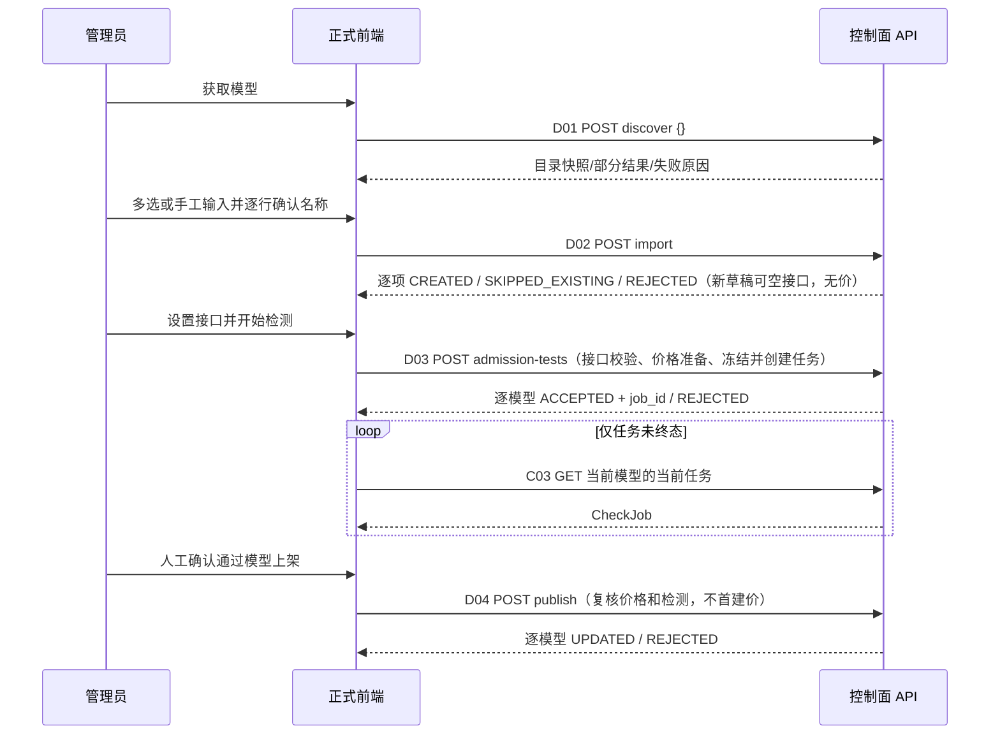
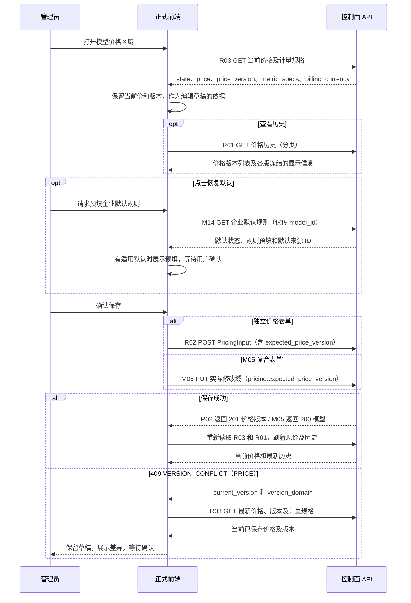
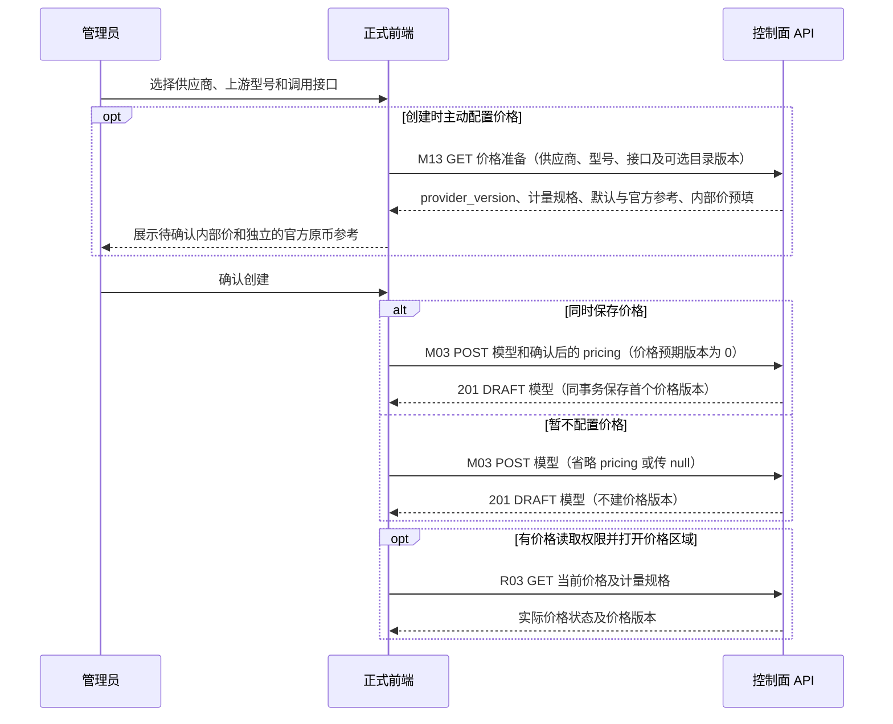
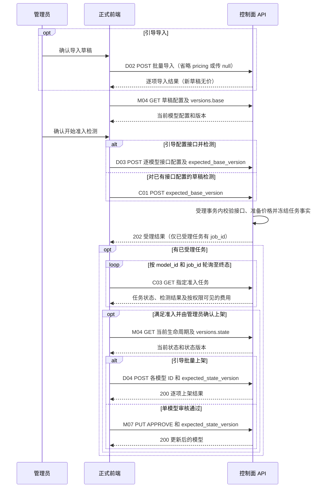

# 模型接入 V1.4：前端协同对接指南

> **当前导航对接入口（2026-11-12）**：[完整菜单分组、路由、权限和多语言清单](../../operations/business-navigation-20261112/前端完整导航对接清单.md)。区分四项仅菜单/权限与已实现业务，并说明保留身份Demo的路由投影不可直接照搬。

> **2026-11-12 接入引导最终修订设计（未实施）**：当前正式后端及原 33 项任务已完成；下方带日期的“尚未实现”等文字仅为历史时点。新设计以[40 接入引导与初始化最终修订设计](40-接入引导与初始化最终修订设计.md)为准：D02 创建空接口草稿且不配置价格；D03/C01 在配置接口、解析计量后准备或保留价格并冻结检测事实；D04/M07 APPROVE 复核有效价格或已确认的无metric未定价例外，以及准入结果后上架，不首建价格。F40-01～04及数据库增量已按[本次直接回执](reviews/FLOW40-评审通过与任务接续授权-20261112.md)确认：复杂官方规则无法表达时内部全0并记录UNSUPPORTED_RULE；完全无已适配metric时不建价格版本，允许检测和满足其他条件后上架，前端显示“未匹配的计价模式”。流程已批准但业务尚未实施。此次只同步文档，已发布 OpenAPI、类型、示例和历史证据均保持，不代表当前服务已支持这些新语义。

当前增补（2026-11-11）：M08/M09/M10可选不分页已按[用户回执](reviews/M08-M10可选不分页-评审确认-20261111.md)批准，默认仍分页；三个候选接口沿用A01的`paginate`参数及nullable分页元数据语义，见本文对应接线与验收补充。仅同步设计和待办规格，不开发业务、不操作数据库、不创建或恢复Goal；P1/P2完成状态及历史证据保留。

当前设计更新（2026-11-11）：ADJ-01～ADJ-04已按建议通过，且用户确认当前没有历史业务数据，见[本次回执](reviews/ADJ-01～ADJ-04-评审确认-20261111.md)。本次统一A01显式全量查询及有序多星期条件行；不建设旧数据回填、旧格式双读或分组推断。未来价格版本历史、目录版本追溯和检测费用/审计固化继续保留。P1/P2已有8项完成，本次增补尚未实施，不改其完成状态或历史证据。

实施顺序（2026-11-10）：按[21详细计划](21-后端重建详细实施计划.md)，P1先完整拆除旧模型模块并独立验收保留底座，再建设本文所述新版能力。旧模型页面和身份内嵌模型面板在P1退出，保留页面须独立验收；本指南用于新版专业前端后续对接，不在中间底座补做新Demo或空模型占位页。该2026-11-10计划说明为设计时点记录；P1/P2当前已完成，本次仅同步获批ADJ设计，未启动后续业务。

授权对接分批：P3首批后交付A01～A13的实际OpenAPI、全部展示字段、权限/版本/幂等/错误说明、脱敏测试样本和调用时序，专业前端可据此先联调授权。前置P2包括真实模型/供应商/固定模板读取，不能由前端猜名称或补查越界详情。A13仅选ACTIVE且不额外要求models READ；A06/A08/A10仅本次新增要求ACTIVE，既有非ACTIVE可保留/撤销；模型侧A02允许DRAFT。样本是隔离测试数据，不代表正式创建/准入上架链已完成。M03初始授权、M05混合保存、状态/删除竞争等在P5～P8补联调条件，D02不增加initial_grants；P9补完整56操作包。页面实际未交付时确认/取消等交互保持not_run，不恢复旧Demo。

评审状态更新（2026-11-10）：本文件相关原评审及V13增量已明确通过，见[19](19-V1.3评审结论归档.md)；事实待核见20，未来执行顺序见21。尚未实施。

版本：V1.4前端反馈四项同步稿；日期：2026-11-10。**本文是正式前端的实施输入，不是前端实现、接口上线或实际联调通过记录。** 本轮不制作或启动新版 Demo，不修改正式业务代码。

## 1. 使用依据、交付状态与范围

业务决议以[01-需求基线与原型追踪](01-需求基线与原型追踪.md)为准；任务、状态与费用语义见[03-后端详细设计](03-后端详细设计.md)；HTTP 路径、JSON 字段、条件校验和错误以[04B-API接口与字段字典](04B-API接口与字段字典.md)及[OpenAPI 设计草案](04-openapi-review.json)共同评审。供应商实际能力和最新缺口见06总表及22A/22B/22C，不能仅凭模板或手册型号存在就把能力显示为已验证。

| 材料/结果                    | 当前状态                                                                        | 前端如何使用                                                          |
| ---------------------------- | ------------------------------------------------------------------------------- | --------------------------------------------------------------------- |
| 本文与独立 API 评审材料      | V1.2原32项已获评审回执；V1.3新增调整已明确通过，均未实现                        | 审阅页面流程、字段、版本冲突和异常；不把示例当可用服务                |
| 数据库专项设计               | 原评审通过；本轮按用户确认同步元信息版本、企业默认价来源和关联约束，尚未执行DDL | 本轮仅设计，不能将此前回执扩展为拆除/开发授权；前端遵守状态与事务约束 |
| 正式接口文档/生成客户端      | 后端开发时按获批契约生成并校验                                                  | 核对实际版本、运行地址、会话上下文和契约摘要                          |
| 开发后实际联调指南与结果     | 尚未交付、全部 `not_run`                                                        | 实施完成后补真实环境、接口差异、请求响应证据、浏览器流程及失败清单    |
| 真实供应商调用/余额/扣费验证 | 未执行                                                                          | 不能用本设计或前端模拟标记为通过                                      |

本系统只提供供应商配置、模型发现、物理模型管理、授权、价格、准入/健康管理探测、检测费用和余额监控。前端不增加普通用户聊天、推理入口、运行时路由、外部配置下发或消息投递功能。保留共享身份页面，替换其中模型授权目标为物理模型 UUID；不保留旧逻辑模型/挂载/出口审批业务入口。

全部模型业务接口统一进入 `/api/v1/model-access`，包括身份页面中的模型授权视图；旧模型路径不保留别名、重定向或兼容层。身份账号/部门/用户组 CRUD 和公共认证仍由外部模块提供。操作标识统一为 `modelAccessV14…`。V1.2原32项正式回执已归档，本轮新增设计独立核对，未开发。

本版接口索引共 **56 个 operation**：P01–P06、D01–D05、M01–M14、C01–C04、H01–H05、A01–A13、R01–R03、B01–B06。M09提供模型表单最小供应商选项，M10提供现有标签候选，M11读取生命周期事件，B06提供余额配置用途的接收人，A13提供身份页面的模型授权候选；B05用于读取确定的余额任务结果，M14读取产品/研发按型号预置的只读企业默认计价规则。精确方法/路径见本文末尾索引及04B。

## 2. 所有页面共用的调用约定

### 2.1 会话、语言与返回封装

复用现有登录、会话和 CSRF 机制。OpenAPI 中 `ais_session` 为会话 cookie 示意名，实际名称和值取现有认证上下文；不新建模型专属登录或密码证明。带凭据请求沿用共享 API 客户端。所有修改操作按契约携带 `Idempotency-Key`、既有 `X-CSRF-Token`；读取接口不携带秘密输入。按用户偏好发送 `Accept-Language`，字段标签和错误提示遵循当前用户语言。

统一响应四字段为 `code/data/params/request_id`，不存在可直接展示的通用 `message` 字段。成功 `code="OK"`；错误 `data=null`。使用安全错误码和参数完成本地化，保留 `request_id` 供问题定位，不展示原始上游报文或秘密。

完整成功示例（A02，一次删除一条授权后的响应）：

```json
{
  "code": "OK",
  "data": {
    "grant_version": 8,
    "added": [],
    "removed_grant_ids": ["40000000-0000-4000-8000-000000000001"],
    "unchanged_count": 0
  },
  "params": {},
  "request_id": "90000000-0000-4000-8000-000000000001"
}
```

完整错误示例（HTTP 409）：

```json
{
  "code": "VERSION_CONFLICT",
  "data": null,
  "params": { "current_version": 9 },
  "request_id": "90000000-0000-4000-8000-000000000002"
}
```

本文 UUID 都是用于说明结构的合成值；不是可直接调用的真实资源。供应商模板键、动态字段键、价格指标键取当前接口返回，不能照抄示意字符串构造产品内置数据。

### 2.2 只读刷新、幂等与网络失败

- 每次明确保存/删除/开始检测等用户动作生成一个幂等键；同一动作的在途按钮禁用。相同键不能附带已经改变的请求体，修改内容后再次保存属于新动作、新键。
- 前端请求库关闭修改请求的自动重试，尤其不能在超时、断网、401刷新会话、429、5xx、重新挂载组件或窗口重获焦点后自动重放检测 POST。
- 提交返回202表示任务已接收，随后只 GET 该任务。轮询失败不重新创建任务；离开页面只停止浏览器轮询，不等于取消后端任务。当前没有对外取消检测接口，不添加一个只改变前端显示的“取消任务”按钮。
- 返回 `OPERATION_RESULT_UNKNOWN`（HTTP409）或提交响应丢失时显示“提交结果待确认”，通过最新结果/历史或资源读取核对。能找到任务 ID 即接续该任务；无法确认时保留原幂等键和安全关联信息，由用户明确决定是否恢复查询/同键核对提交，不自动换键再 POST。检测可能产生费用，不能提示“失败，已自动重新检测”。
- 常规 GET 可进行有界刷新/退避；页面离开、对象切换或失去权限后停止。用请求序号/当前资源 ID 丢弃迟到响应，避免旧筛选数据覆盖新页面。
- 前端不访问供应商推理/余额地址、不读取云秘密。浏览器只调用本控制面；Base URL 可为内网/企业自建地址，不新增出口主机许可、Receiver 或审批字段。

模型写操作的幂等事实写入全新 `ma_command_requests`，禁止调用旧模型命令接口或向旧命令表写入。

### 2.3 版本与原子范围

| 变更                              | 读取版本                                    | 提交字段                                                          | 冲突处理                                                                               |
| --------------------------------- | ------------------------------------------- | ----------------------------------------------------------------- | -------------------------------------------------------------------------------------- |
| 供应商编辑/删除                   | P04 `version`                               | `expected_version`；DELETE 为 query                               | 重新读P04，展示变化，用户重新确认保存                                                  |
| 模型身份/协议配置及准入或健康提交 | M04 `versions.base`                         | `expected_base_version`                                           | 重新读取模型配置及任务；不以生命周期版本代替身份/协议版本                              |
| 模型可编辑元信息                  | M04 `versions.metadata`                     | M05 `expected_metadata_version`                                   | 重新读取模态、上下文、最大输出、标签及描述，比较并重新确认，不能覆盖其他人的元信息修改 |
| 模型生命周期/引导发布             | M04 `versions.state`                        | M07及D04各行的 `expected_state_version`                           | 重新读取当前状态与状态版本；不把状态冲突当成功                                         |
| 模型删除                          | M04 `versions.base`与`versions.state`       | M06 query同时传 `expected_base_version`和`expected_state_version` | 重新核对配置、生命周期和在途任务后由用户再删除                                         |
| 模型授权                          | A01 `grant_version` / M04 `versions.grants` | `expected_grant_version`                                          | 刷新完整受影响授权视图，重算差异并再次确认移除                                         |
| 模型价格                          | R03 `price_version`                         | `expected_price_version`                                          | 保留草稿，刷新现价及指标规则后人工比较                                                 |
| 健康设置                          | M04 `versions.health`                       | `expected_health_config_version`                                  | 刷新开关/周期再保存                                                                    |
| 身份页面的直接授权集合            | A05/A07/A09 `authorization_version`         | `expected_authorization_version`                                  | 重新加载同主体可管理集合，不覆盖其他管理员变更                                         |
| 余额配置                          | B01 `version`                               | `expected_version`                                                | 重新读B01；旧余额查询结果不能代替新配置版本                                            |

`versions.base`仅在身份/协议域（所属供应商、两类模型标识、标准调用接口、自定义路径及受约束的目录来源绑定）真实变化时递增；`versions.metadata`只在六项元信息真实变化时递增。`versions.state`在生命周期转换时递增。检测提交时由服务端在同一事务冻结`CheckJob.base_version`、`CheckJob.metadata_version`及完整配置；任务只证明当时快照，元信息修改不改旧任务计划、结果、费用或准入周期，也不自动下架/重新检测。前端不能把任一种配置版本当生命周期版本用于发布；新发起的健康检查读取新的元信息。

M05 多域保存、A02 混合授权、A03 跨模型批量授权是整体事务；D02/D03/D04 是逐模型/逐项事务，允许部分成功。前端不能统一解释为“批量接口都原子”或“批量接口都可部分成功”。

### 2.4 展示数据的责任与字段边界

本版API按原型实际使用的读视图返回关联展示数据。页面不能仅拿UUID/key，再遍历列表逐行补查模板、供应商、用户或计量目录；按区加载价格、授权、检测历史及分页仍是正常请求，不与逐行补查混淆。

| 数据类别                                                  | 事实来源                               | 前端处理                                                                                   |
| --------------------------------------------------------- | -------------------------------------- | ------------------------------------------------------------------------------------------ |
| 实体名称、用户名、部门路径、供应商模板名、目录模型名      | 当前接口的显式展示字段                 | 直接显示；名称不是提交身份，操作仍使用对应ID/key；禁止用UUID或把key标题化冒充名称          |
| 历史操作者、当时供应商/模型/接口/计量指标                 | 对应历史返回的固化快照                 | 不查当前用户/当前模型/当前模板来解释旧记录；原实体删除不丢当时事实                         |
| 动态模板字段标题、提示、选项及条件                        | P01明确的label/value/control及条件规格 | 按值提交、按label展示；响应已本地化，不把文案反向当枚举值                                  |
| 生命周期、健康状态、检测类型、固定模态、固定价格来源/模式 | 04B明确的稳定枚举与前端国际化资源      | 按当前用户语言翻译；保留未知枚举安全回退，不能按文字判断状态流转                           |
| UTC时间、K Token、小时周期、Decimal展示                   | 明确类型的响应值＋本文格式化规则       | 只做确定格式化；不猜单位、补0、改时区口径或重算权威费用                                    |
| 不可见/失效/未知的关联                                    | 响应明确的可用性或空值说明             | 按响应契约显示未知/未获取/不可用；不可见或不存在关联使用同一安全占位，不反查区分删除与越界 |

读写DTO必须分开。`template_name`、供应商关联名称、操作者快照、目录统计和服务器版本等只读字段不得整对象回传给保存接口。表单只构造04B对应的输入组件；不能因响应增加展示字段而让PUT接受前端覆盖这些事实。

候选列表与已保存选择必须分开维护：已选项随当前对象读响应回显，搜索/翻页只更新可选项集合，不删除暂未载入的选择。同名用户用显示名＋username区分，部门用当前可见路径区分；先保留ID，再渲染名称。候选变化、对象失效和越界由明确状态反馈，不从“当前页没看到”推断已删除。

页面只用自身权限允许的最小读投影。模型详情不通过P04补供应商信息；检查结果不从费用快照补接口名或触发人；余额接收人用B06，不借A12模型授权选择器。服务端返回展示字段不意味着获得该关联实体的完整详情、秘密或写权限。

## 3. 供应商列表、详情与编辑

### 3.1 页面进入和查询顺序

1. 具有 `model.providers:READ` 时读取 P02 列表；列表已提供模板展示与余额摘要，不为每行额外请求模板或余额。创建/编辑需要动态表单时再读取 P01。P02 使用 `page=1&page_size=20`，`q` 覆盖名称/API地址/备注；改变搜索条件回第一页。
2. 打开详情读取 P04。关联模型通过 M01 `provider_id={UUID}` 分页读取；没有 `model.models:READ` 时不请求该区，不把403解释为空模型。
3. 余额面板有权限时读取 B01/B04；它们是只读，不因进入页面而查询上游余额。
4. 编辑前读取最新P04取得固定的 `template_version_id/catalog_release_id`，再用 P01?provider_id 回读该实例旧版 `revision/fields/auth_modes` 渲染；P05普通编辑原样回传模板版本ID。创建从P01当前批次选择并以P03提交准确ID。明确通过既有模板选择改选当前版本（可同key）才变更绑定，不新增升级按钮。成功替换页面实体及版本，再刷新受影响列表。保存配置不自动进行模型检测或余额查询。

`Provider.version`是编辑/删除时回传的乐观版本；新增 `connection_revision`是只读连接身份代次，不能代替 `expected_version`。模板、地址、认证身份/凭据、项目或区域变化使连接代次递增；名称、备注、安全等级变化不递增。前端只展示后端返回值，不自行加一、不作为可编辑字段提交。

模板 `enabled` 只表示数据库当前发布批次是否允许新采用该模板；不可用时展示功能原因并禁用新建/改绑，不限制已有实例使用原历史ID普通编辑，不展示批准延期、研发排期或评审状态。本轮网宿官方资料已恢复调研并补齐设计；未来是否可创建以实际已发布模板及已实现适配能力为准，不能继续按旧项目延期屏蔽。无已证实自动余额接口时使用NONE，或管理员明确配置CUSTOM；余额能力缺口不裁剪供应商接入。其他模板按对应数据库版本的动态字段显示。`balance_template_supported=false` 时不能显示“已支持自动余额”，仍按可用模式提供 NONE/CUSTOM。模板名称、字段显示名、说明按语言返回，不硬编码21家共享同一表单。

### 3.2 供应商请求与秘密语义

P03 使用 `POST /api/v1/model-access/providers` 创建供应商。当 `balance_config.mode` 为 `NONE` 时，`currency_or_unit` 可省略或显式传 `null`，不能传 `"CNY"` 等非空值。前端构造请求时应省略该字段，避免提交表单的默认币种。

以下是使用 OpenAI 模板、不查询余额的完整创建请求体。提交前将示例 UUID 换成 P01 返回的当前可采用的 `openai` 模板版本，将密钥占位符换成表单输入。请求沿用会话 Cookie，并携带 `X-CSRF-Token` 和 `Idempotency-Key`。

```json
{
  "name": "openai",
  "template_key": "openai",
  "template_version_id": "30000000-0000-4000-8000-000000000001",
  "base_url": "https://api.openai.com/v1",
  "security_level": "INTERNET",
  "public_config": {},
  "secrets": {
    "api_key": "<供应商 API Key>"
  },
  "notes": "",
  "clear_secret_fields": [],
  "balance_config": {
    "mode": "NONE",
    "alert_enabled": false
  }
}
```

P03 的请求体为 `ProviderCreate`，P05 为 `ProviderUpdate`；P05 必须带 `expected_version`，创建禁止该字段；两者均必传 `template_version_id/template_key`。以下为编辑请求结构示例；`template_version_id/template_key/public_config` 必须换成 P01/P04 返回的真实已校验值：

```json
{
  "expected_version": 4,
  "name": "研发模型供应商",
  "template_key": "<P01返回的模板key>",
  "base_url": "https://models.example.invalid/v1",
  "security_level": "INTERNET",
  "public_config": {},
  "notes": "研发环境",
  "template_version_id": "30000000-0000-4000-8000-000000000001"
}
```

此例不包含 `secrets`，因此保留既有秘密。示例URL是保留域，不能用于真实连接。不同模板可能有条件必填配置，空 `public_config` 并不代表所有模板都能通过验证。

| 用户意图                   | 请求表示                             | 显示/校验                                                        |
| -------------------------- | ------------------------------------ | ---------------------------------------------------------------- |
| 编辑未改秘密               | 不发送该秘密字段，或该字段传空字符串 | 保留原值；用 `configured_secret_fields` 显示“已配置”，输入框为空 |
| 替换秘密                   | `secrets`中仅放明确修改的字段及新值  | 仅输入、不可回显；保存成功或关闭弹窗清除内存中的秘密             |
| 显式清除秘密               | `clear_secret_fields`放该字段键      | 校验该模板是否允许清除；必需凭据清除后缺失则拒绝                 |
| 同字段既填新秘密又要求清除 | 不发送冲突请求                       | 就地提示；后端仍校验拒绝                                         |
| 切换模板                   | 按新模板重建允许字段/条件必填        | 不把旧模板的同名秘密视为可复用凭据；不提交失效字段               |

不得把“••••••”“已配置”等占位文本当新密钥提交；不在表单默认值、浏览器持久缓存、URL、埋点、错误报告或剪贴板自动保存秘密。服务账号 JSON 同样属于秘密输入，不展示历史完整内容。模型Key、财务/管理Key使用独立表单区，OpenRouter余额不能复用普通推理Key。

成功：P03 HTTP201、P05 HTTP200，均返回最新 `Provider`。名称冲突 `NAME_CONFLICT` 让用户改名称；`TEMPLATE_UNAVAILABLE` 展示模板不可用原因；`VERSION_CONFLICT`保留非秘密草稿并重新读取，不能直接覆盖当前版本。供应商存在ACTIVE模型也可编辑，不要求先下架，不自动使模型变成DRAFT。

### 3.3 供应商删除

删除前读取P04最新版本和关联模型状态，前端说明将删除关联模型、配置及全部价格历史；费用与审计独立留存。P06：`DELETE /api/v1/model-access/providers/{provider_id}?expected_version={version}`，无JSON请求体。后端整体检查全部关联模型的删除条件，任一不满足整体拒绝。`STATE_CONFLICT`指引处理关联模型；`CHECK_IN_PROGRESS`显示任务进行中，等待结果；不让删除按钮暗中批量下架或取消检测。

## 4. 接入引导：发现、导入、检测、确认上架



### 4.1 获取目录与续页

首次 D01 请求 `{}`，服务器固定当前实例配置版本、template_version_id及catalog_release_id，并在Discovery响应回传目录批次；目录发布不更换该发现上下文。返回HTTP200仍要检查 `data.status`：`SUCCESS`为本次已完整取得目录；`PARTIAL`/`truncated=true`为目录未读完；`FAILED`显示 `error_code/error_params`，保留手工入口。HTTP200不等于目录完整或账号可调用所有候选。

D05 按页读取已保存快照：`GET /api/v1/model-access/providers/{provider_id}/model-discoveries/{discovery_id}?page=1&page_size=20`。响应明确返回 page/page_size/total，total 与 total_loaded 是当前已加载数；truncated=true 时不是上游目录完整总量。这只翻固定版本的本地快照，不请求新的上游目录页；续页和D02导入均使用原批次，不能从当前M08重新拼候选。需要继续上游发现时，管理员继续获取，D01 请求：

```json
{ "resume_discovery_id": "50000000-0000-4000-8000-000000000001" }
```

续页沿用同批供应商配置；供应商编辑后旧快照不能跨账号/端点继续，遇 `DISCOVERY_STALE` 提示重新获取。过期 `DISCOVERY_EXPIRED`（HTTP410）同样重新获取或手工添加；已创建模型不重建。前端不能在失败后自动修改供应商URL或尝试不同协议。Azure缺部署发现配置/权限、上游无公开列表时，显示具体原因，不能伪造成空且成功。

### 4.2 名称、能力与官方绑定

逐行独立编辑 `model_id_at_gateway`；`model_id_at_provider`保存精确上游ID/部署名。Azure任意部署名不等于官方型号，不能根据本地名称推断型号、价格或能力；M04返回的 `official_model_binding`（官方型号/版本/来源绑定）只读展示，不由前端伪造。页面只使用当前实例的可信型号绑定/不可用原因；M08内置型号条目仅是规格来源，返回的投影UNKNOWN不能当作实例VERIFIED证明；不能把06手册核对表中的退役、别名差异、批准延期等研究分类直接当响应状态下发，也不能自动替换成看似相同的新型号。

`official_model_binding`采用明确的 `OfficialModelBinding`组件，字段如下；这些字段均只读，不放入M03/M05请求：

| 字段                               | 前端含义                                                                                                                          |
| ---------------------------------- | --------------------------------------------------------------------------------------------------------------------------------- |
| state                              | VERIFIED=可信型号绑定且连接代次匹配；UNKNOWN=未建立可信绑定；STALE=绑定与当前连接代次不匹配；三者均不代表项目评审或模型调用已通过 |
| canonical_model_id / model_version | 官方型号与版本，可null；不能用部署名猜测补齐                                                                                      |
| deployment_name                    | 绑定时实际部署名，可null；不是网关全局名称                                                                                        |
| bound_connection_revision          | 核实时绑定的供应商连接代次，可null；对照Provider.connection_revision理解历史范围                                                  |
| source_uri / observed_at           | 资料来源及核查时刻，可null；展示为来源说明，不能当成实调通过证据                                                                  |
| reason_code                        | 未知或失效原因，可null；按当前用户语言显示安全解释                                                                                |

连接变化后STALE是资料有效性状态，不是模型生命周期状态。前端不得据此自动下架、重准入、替换型号或重新套用价格；新任务不能把旧型号当成新目标已验证型号。历史展示保留原来源与有效性说明，供应商编辑仍按已确认要求允许。

初始信息按后端已验证预置优先、发现其次、未知留空；人工明确编辑高于自动预置。未知上下文/输出上限显示“未知”，不填0；未知模态不自动假设文本。导入请求不携带手册价格或浏览器自行推导的官方元数据。

### 4.3 导入请求与逐项结果

D02修订后HTTP200，以下是40目标设计示例（不是已发布服务可执行样例）：

```json
{
  "discovery_id": "50000000-0000-4000-8000-000000000001",
  "models": [
    {
      "model_id_at_provider": "team-chat-deployment",
      "model_id_at_gateway": "研发对话模型",
      "supported_invocation_apis": [],
      "custom_invocation_apis": []
    },
    {
      "model_id_at_provider": "team-embed-deployment",
      "model_id_at_gateway": "研发向量模型",
      "supported_invocation_apis": [],
      "custom_invocation_apis": []
    }
  ],
  "expected_provider_version": 1
}
```

手工输入可省略 `discovery_id` 或传null；候选ID不得混入其他发现批次。每次1～100项是接口技术分批上限，不是系统总模型数上限。成功创建的是DRAFT，不触发推理、不初始化价格；本例显式传入空接口且不配置价格；后续在下一步完善接口后再提交检测；不得因导入成功就宣称接口已验证。

结果示例：

```json
{
  "code": "OK",
  "data": {
    "items": [
      {
        "input_index": 0,
        "physical_model_id": "10000000-0000-4000-8000-000000000001",
        "status": "CREATED",
        "code": "OK",
        "params": {},
        "model": {
          "physical_model_id": "10000000-0000-4000-8000-000000000001",
          "model_id_at_gateway": "研发对话模型",
          "model_id_at_provider": "team-chat-deployment",
          "provider_id": "20000000-0000-4000-8000-000000000001",
          "provider_name": "研发模型供应商",
          "status": "DRAFT",
          "versions": {
            "base": 1,
            "state": 1,
            "grants": 1,
            "health": 1,
            "price": 0,
            "metadata": 1
          },
          "supported_invocation_apis": [],
          "custom_invocation_apis": [],
          "invocation_apis": [],
          "catalog_model_version_id": null
        }
      },
      {
        "input_index": 1,
        "physical_model_id": null,
        "status": "REJECTED",
        "code": "NAME_CONFLICT",
        "params": {},
        "model": null
      }
    ],
    "succeeded_count": 1,
    "skipped_count": 0,
    "failed_count": 1
  },
  "params": {},
  "request_id": "90000000-0000-4000-8000-000000000003"
}
```

“可添加”统计表示尚未添加，包含名称冲突而需先改名的候选；不表示每一行现在可直接保存。`stats.added + stats.addable = stats.loaded`，`name_conflicts`属于`addable`的子集。用户修改建议名称后仍以后端保存校验为准。

按 `input_index` 对应原输入行，不按返回顺序猜行。`SKIPPED_EXISTING`显示已存在及其物理模型链接，不能计成新创建，也不能覆盖已有基础字段。`REJECTED`逐行显示 `code/params`；修正后只提交待处理行，保留已成功物理模型ID。计数采用后端字段，不能仅凭HTTP200显示“全部导入成功”。

### 4.4 接口设置、开始检测与发布

开始D03检测时标准或已适配自定义接口合计至少一项；D02保存草稿不执行该组合非空要求。自定义路径是独立项目，输入相对路径，不要求填写名称/适配器/请求脚本，也不自动勾选标准接口。支持项由模板/模型能力和后端适配决定；`CUSTOM_API_UNSUPPORTED`保留草稿并显示需适配原因，不能绕过为Chat协议。

D03示例（接续上例D02实际返回的基础版本1；1是该响应的值，不是客户端默认值。已存在模型或后续编辑后必须使用其实际最新版本）：

```json
{
  "models": [
    {
      "physical_model_id": "10000000-0000-4000-8000-000000000001",
      "expected_base_version": 1,
      "supported_invocation_apis": ["CHAT_COMPLETIONS", "RESPONSES"],
      "custom_invocation_apis": []
    }
  ]
}
```

HTTP202仅表示逐项接收完成；检查每行 `ACCEPTED/job_id` 或 `REJECTED/code`。同一模型保存接口与建任务是原子操作，失败不能显示“已保存且开始检测”。前端不得主动传已通过结果、删掉必检项目或传计费主体。

每个 `job_id`走C03读取。通过后刷新M04取得 `PENDING_REVIEW` 和当前 `versions.state`，由有审核权限的管理员明确勾选并确认D04：

```json
{
  "models": [
    {
      "physical_model_id": "10000000-0000-4000-8000-000000000001",
      "expected_state_version": 3
    }
  ]
}
```

D04 HTTP200逐项反馈；复核有效价格或真实无metric未定价例外，以及适用准入PASS，不首次建价；只对明确成功的行显示ACTIVE。通过检测不自动发布；前端PASS缓存不是发布凭据。同一准入周期的已通过完整接口可通过 `reuse_job_id`显式申请复用：服务端检查同物理模型、同 `admission_epoch`、同 `base_version`且来源为终态准入任务，并核对当前计划、完整项目与探针输入；描述变化不机械拒绝，新增流式要求而源缺该项目等不匹配返回STATE_CONFLICT，不自动补发；显示复用来源，不把复用计成新模型请求。`CheckJob.admission_epoch`为只读服务端UUID，客户端不能提交或修改以扩大复用范围。模型创建、身份/协议配置修改、重新启用、审核拒绝时产生新周期；一次准入失败回DRAFT保持当前周期。供应商编辑本身不改变周期、不强制复验；需要验证新配置时，由管理员明确发起不带reuse_job_id的新检测。健康每轮新请求，不支持复用。

## 5. 模型列表、创建、详情与编辑

### 5.1 列表和供应商横向标签

M01查询列表，M02查询各标签数量。两请求携带相同 `q/status/input_modalities/output_modalities`；M01另加当前供应商 `provider_id`，M02不加此条件，才能显示所有供应商在其他筛选条件下的数量。M02 返回管理可见范围内的全部供应商。没有模型或当前筛选条件下没有匹配模型的供应商仍返回，`model_count: 0`，可直接渲染零计数标签。`total` 是各供应商匹配数之和。切换供应商/搜索/筛选时回到第一页，默认20条，最大100条。

搜索q同时匹配模型名称、供应商侧标识、模型说明和供应商实例名称；M01/M02保持同口径。同一个模态字段多选为OR，不同字段之间AND。数组query按OpenAPI默认form/explode编码，例如 `input_modalities=text&input_modalities=image`。无独立逻辑模型`type`筛选。计数和列表都以服务端权限范围为准，不用已加载一页的length代替总数，不把403补成0。

### 5.2 手动创建

打开创建弹窗读取M09的最小供应商选项和M10标签选项，默认分页，也可按§5.2.1显式选择paginate=false。选定供应商后以M08的provider_id读取该实例固定批次的模型预置规格；需要全部该实例候选时显式不分页，仅预填单型号时继续按model_id_at_provider筛选，分页续页附返回的catalog_release_id。选中条目时保留catalog_model_version_id并提交；纯手工无选择可省略，由服务器首次受理固定匹配或null。模型表单不依赖P02/P04的供应商管理权限，也不加载供应商认证字段；不因选择模型而调用检测。M03正文示例：

```json
{
  "provider_id": "20000000-0000-4000-8000-000000000001",
  "model_id_at_gateway": "研发对话模型",
  "model_id_at_provider": "team-chat-deployment",
  "supported_invocation_apis": ["CHAT_COMPLETIONS"],
  "custom_invocation_apis": [],
  "input_modalities": ["text"],
  "output_modalities": ["text"],
  "context_window": 128000,
  "max_output_tokens": null,
  "tags": [],
  "health": {
    "auto_health_check": false,
    "health_check_interval_minutes": 360
  },
  "expected_provider_version": 1,
  "pricing": {
    "expected_price_version": 0,
    "currency": "CNY",
    "pricing_mode": "FIXED",
    "periods": [
      {
        "name": "内部确认价格",
        "is_fallback": true,
        "conditions": [],
        "metric_rates": [
          {
            "metric_key": "input_tokens",
            "unit": "MILLION_TOKENS",
            "unit_price": "0"
          },
          {
            "metric_key": "output_tokens",
            "unit": "MILLION_TOKENS",
            "unit_price": "0"
          }
        ]
      }
    ],
    "catalog_price_version_id": null,
    "catalog_default_price_version_id": null
  }
}
```

本例全部数值为合成示例，不是官方报价；0仅示范服务端确认无企业默认且真实缺价、指标为input_tokens/output_tokens的完整默认免费配置。实际M13返回的完整指标必须全部提交。M03 HTTP201返回DRAFT Model；提交initial_grants另需permissions:WRITE，pricing对象另需pricing:WRITE，基础需models:WRITE，全部域同事务。M03可省略pricing或传null；仅主动配置价格时先M13准备并提交完整pricing和准确参考ID，仍检查价格写权限。未主动配置不建价，后续D03按已批准规则处理。expected_provider_version从M13回传，示例1不是默认值。全局调用ID与供应商内上游ID分别规范化且区分大小写，冲突分别处理NAME_CONFLICT/PROVIDER_MODEL_CONFLICT。

### 5.2.1 模型表单候选的可选不分页（2026-11-11已批准）

M08/M09/M10均支持`paginate`，默认`true`。不传该参数时仍是第1页、每页20条、每页上限100；`paginate=true`同原分页语义。需要一次读取全部匹配候选时使用如下请求，其中`{provider_id}`替换为当前选定的合法可见实例UUID：

```http
GET /api/v1/model-access/model-options/providers?paginate=false
GET /api/v1/model-access/model-options/tags?paginate=false
GET /api/v1/model-access/models/templates?provider_id={provider_id}&paginate=false
```

不分页请求不能携带`page`或`page_size`，包括共享请求工具自动注入的默认值；误传返回`422 VALIDATION_FAILED`。`paginate`只接受单个`true`或`false`，空值、其他值或重复参数返回`400 MALFORMED_REQUEST`。不能使用`page_size=0/-1`或超大页长代替开关。

继续读取原`ModelTemplatePage`、`ProviderOptionPage`、`TagOptionPage`：分页时`page/page_size`为整数，不分页时二者均为`null`，`items`包含当前权限范围与筛选条件下的全部匹配项，`total=items.length`；空结果为`items=[]、total=0`，不静默截断。前端类型必须允许nullable，按请求模式隐藏分页控件，不把null转成0或1。筛选、展示名称、语言和权限语义均保持；同次响应的items与total来自同一一致性快照，不意味着后续请求仍看到相同集合。

| 接口 | 前端加载方式                                                                                                          | 保持的约束                                                                                                                                                                                                                                                                             |
| ---- | --------------------------------------------------------------------------------------------------------------------- | -------------------------------------------------------------------------------------------------------------------------------------------------------------------------------------------------------------------------------------------------------------------------------------- |
| M08  | 先选供应商，再按provider_id读取其固定目录；可一次加载该范围，或按型号筛选后预填。无需在打开表单时加载全部供应商富规格 | provider_id仍是可选参数，无provider请求沿既有当前批次语义；响应保留catalog_release_id/catalog_revision及条目版本关联，显式批次与实例不一致仍拒绝。排序为template_key、model_id_at_provider、catalog_model_version_id升序；不因取消分页获取上游目录或触发检测，价格仍受pricing:READ控制 |
| M09  | 需要完整供应商下拉和本地搜索时使用false；也可继续q搜索/分页                                                           | 返回当前模型管理范围内最小投影，按name、id升序；无需providers:READ，不读取认证配置或余额                                                                                                                                                                                               |
| M10  | 候选较少时全量，标签增长后可继续q搜索/分页，不要求每次打开都全量                                                      | 内置标签与当前可见模型自定义标签按稳定value去重，先内置后自定义、同类按value升序；内置label按用户语言，自定义原文不变                                                                                                                                                                  |

M09/M10的`q`与M08的template_key、model_id_at_provider、provider_id、catalog_release_id筛选在两种模式下均生效。“全部”只指当前合法范围和筛选的结果，不表示全部供应商或全部标签的无权限目录。切换供应商时隔离旧供应商的候选响应；不能把旧批次结果拼入新选择。

编辑时已选供应商和标签继续由M04独立回显；候选请求失败、当前q未命中、分页未加载或语言切换均不得清空既有选择或草稿。不分页只是候选加载方式，不能把返回的全部候选当成全部已选值。保存仍使用原稳定ID/value及服务器版本校验。新增接口/页面验收见[08第12节](08-测试验证与实施计划.md#12-m08m09m10可选不分页2026-11-11全部not_run)，目前全部not_run。

### 5.3 详情按区加载

先M04获取基础、生命周期、健康和版本；读取M11生命周期时间线；根据现有READ权限分别读取R03/R01价格、C04/C02准入、H03/H02健康。授权区仅在现原型编辑弹窗入口加载A01，不新增详情权限Tab。M04可见不等于可读取所有授权主体或价格；独立区403按权限隐藏/显示无权访问，不替换为空数据。

M04模型基础、`invocation_apis`和服务端官方绑定为事实来源。模板建议接口与模型实际启用接口分开呈现。当前模型状态与最新健康状态分开展示，UNHEALTHY不等于SUSPENDED。

### 5.4 分域保存

M05按字段分域控制，不能再把整个“基本信息”区域在非DRAFT锁定。`base`是完整`ModelIdentityInput`：所属供应商、供应商侧模型标识、模型名称、支持的调用接口、自定义接口路径，仅DRAFT可提交，并携`expected_base_version`；可选目录型号来源绑定按同域规则维护，不能借此改写非DRAFT身份。创建M03仍使用完整`ModelBase`，不要把创建DTO整包用作M05更新DTO。

`metadata`是完整`ModelMetadataInput`，包含`input_modalities`、`output_modalities`、`context_window`、`max_output_tokens`、`tags`、`description`六项，必须携`expected_metadata_version`。未知模态/标签用`[]`，未知数值/描述用`null`，不以0替代未知。所有状态均可按权限编辑元信息，包括TESTING和PENDING_REVIEW；这覆盖原PRD关于这两个状态整页不可编辑的旧条款。授权、价格和健康设置仍按各自域及版本保存。

| 当前状态       | 身份/协议五类字段（base）               | 六项元信息（metadata） | 授权/价格/健康设置 |
| -------------- | --------------------------------------- | ---------------------- | ------------------ |
| DRAFT          | 可改                                    | 可改                   | 按对应权限可改     |
| TESTING        | 锁定                                    | 可改                   | 按对应权限可改     |
| PENDING_REVIEW | 锁定                                    | 可改                   | 按对应权限可改     |
| ACTIVE         | 锁定                                    | 可改                   | 按对应权限可改     |
| SUSPENDED      | 锁定                                    | 可改                   | 按对应权限可改     |
| RETIRED        | 锁定；需按既有重新启用流程回DRAFT后修改 | 可改                   | 按对应权限可改     |

只提交用户实际修改的域，不把非DRAFT只读`base`回传；即使值没改，非法域也不能由后端静默忽略。元信息保存本身不改变生命周期、准入周期或自动发模型请求；修改“流式输出”标签不增删已受理任务的项目，旧结果只说明当时快照。下一次明确发起的适用检查按新标签和模态构造计划，不能把旧PASS展示成新配置已验证。

一次表单同时修改授权和健康示例：

```json
{
  "grants": {
    "expected_grant_version": 7,
    "add": [{ "subject_type": "USER", "subject_id": "30000000-0000-4000-8000-000000000001" }],
    "remove_grant_ids": ["40000000-0000-4000-8000-000000000001"]
  },
  "health": { "auto_health_check": true, "health_check_interval_minutes": 360 },
  "expected_health_config_version": 2
}
```

成功HTTP200返回最新Model；任一域无权限、越界、冲突或不合法，全请求回滚。不能先调用A02再调用H04伪装成“同一表单全部成功”；独立区域独立保存时才分别使用专用接口。

## 6. 授权编辑：暂存、确认、一次提交

### 6.1 模型编辑弹窗中的三源授权

完整授权编辑区首次调用`A01?paginate=false`，不带page/page_size、q或subject_type，一次取得合法可见直接授权集合和`grant_version/authorization_version`；按subject_type在本地分区。A12按 `subject_type=DEPARTMENT/USER_GROUP/USER`查询可选主体。部门按树层级呈现且固定包含子树；用户组支持搜索多选；用户支持部门筛选和搜索。返回的 `manageable`用于可操作提示，实际范围仍由后端检查。无PROJECT选项，不允许手填范围根扩大范围。

A01省略paginate仍为原分页；paginate=false响应page/page_size为null且total等于items长度，无100条截断，空集合为[]。需要远端q/subject_type筛选时，其结果只用于显示，不能替换完整编辑基线；失败保留原草稿，不清空已选项。分页模式跨页版本变化仍应刷新，不拼接不同版本。不可见关系及候选搜索未命中项不能自动删除；全量只指直接关系，不展开部门/组成员。

本地维护基准集合与待提交差异：新增放 `add[]`，删除使用原关系 `id`放 `remove_grant_ids[]`。新增后又取消，仅从本地add移除；已有关系删除后又恢复，仅从remove移除。同一主体同时增删应在前端消歧，后端仍以 `GRANT_DELTA_CONFLICT`拒绝，不依赖请求顺序。

### 6.2 保存前确认与取消

1. 用户点击添加/移除只更新弹窗草稿，不发写请求。
2. 点击保存后，计算实际净移除项；有移除时先展示删除主体及影响摘要，前端二次确认。无净移除时不额外制造移除确认。
3. 用户取消确认：不发送任何授权修改请求，原配置不变，可继续编辑；关闭弹窗/取消整个编辑则丢弃草稿。
4. 用户确认：一次A02或M05提交全部增删。请求不增加 `confirmed`、`proof`、密码或审批字段；不把UI确认宣称为服务端证明。
5. 成功后用响应更新版本，再刷新需要展示的当前集合和共享计数；不能仅靠乐观删行宣称已生效。

A02请求示例：

```json
{
  "expected_grant_version": 7,
  "add": [{ "subject_type": "USER_GROUP", "subject_id": "30000000-0000-4000-8000-000000000002" }],
  "remove_grant_ids": ["40000000-0000-4000-8000-000000000001"],
  "reason": "调整研发访问范围"
}
```

`VERSION_CONFLICT`：保留不含秘密的草稿，重新A01取得最新集合，展示他人变更与当前差异；由用户重新选择要保留的修改并再次确认净移除。不能替换版本后静默重发旧remove集合。`OUT_OF_SCOPE`：本次整体未生效，刷新可选主体/授权范围，说明不可操作项；不能拆开重发“剩下可成功的部分”改变原子语义。

### 6.3 跨模型批量添加

现原型缺多模型选择入口，仍按F-PERM-05设计A03。正式前端需补列表选择和“批量添加授权”入口；这是已识别的原型差异，不是取消功能。请求示例：

```json
{
  "models": [
    { "physical_model_id": "10000000-0000-4000-8000-000000000001", "expected_grant_version": 7 },
    { "physical_model_id": "10000000-0000-4000-8000-000000000002", "expected_grant_version": 2 }
  ],
  "add": [{ "subject_type": "DEPARTMENT", "subject_id": "30000000-0000-4000-8000-000000000003" }]
}
```

每请求最多100模型，整个请求一个事务；任何模型冲突/越界全部回滚。重复关系为无变化成功，响应每模型GrantResult给出 `unchanged_count`。不得用D02逐项成功的展示逻辑解释A03失败，也不能为超过100项偷偷自动分批并承诺全选全局原子；超出时明确限制本次选择或由用户明确分批操作。

### 6.4 共享身份页面接线

| 页面           | 读取/保存直接关系 | 有效来源/数量                                            |
| -------------- | ----------------- | -------------------------------------------------------- |
| 用户模型授权   | A05 → A06         | A04只列当前可用模型；A11列原始来源事实，可包含不可用原因 |
| 部门模型授权   | A07 → A08         | 固定子树继承；直接授权数量与用户最终可用数量不同         |
| 用户组模型授权 | A09 → A10         | 组直接授权数量；不能把组全局可见解释为授权对象无限范围   |

用户详情的“选择已上架模型”使用A13，以当前主体类型/ID及搜索条件查询最小模型候选；不通过M01取得完整模型配置。候选只提供ACTIVE且尚未由当前来源直接授予的模型，但部门/组继承不等于已有用户直授。此候选限制只用于主体侧新增授权，不限制模型创建/编辑时为DRAFT配置授权；A05/A07/A09保留既有非ACTIVE直接授权供回显或撤销，不可因候选未返回而默删。用户表格的模型名称、提供商、授权来源和直接/继承方式由A04/A11的最小摘要与sources确定；可直接撤销的按钮只对应本用户直接来源，不能取消继承来源。

原始GroupsView只有删除组时“组授予的模型权限也将移除”的提示，没有模型授权Tab。A09/A10是新版后端的组授权接线能力，不以本文声称该原型已有Tab或擅自新增页面入口；对应正式交互仍按既有评审处理。

主体侧保存使用 `physical_model_ids` 与 `expected_authorization_version`，是当前主体可管理范围内直接集合的替换，不是三源最终可用集合的替换。前端保存前应加载完整可管理分页集合并核对同版本；不能把第一页、当前搜索结果或用户可用模型结果直接当替换集合。只改该来源，不删除部门/组产生的其他来源；不可见关系由后端保护。移除同样先前端确认。`authorization_version` 来自新 `ma_grant_state.revision`；任意直接模型授权关系变更都会推进，可产生模块级的粗粒度冲突。该版本不冻结用户组成员或部门树，保存时仍重新校验当前主体状态、管理范围及身份关联；不要把它当最终有效权限快照。

所有调用中的 `model_id`/`physical_model_id`都表示物理模型UUID，不能继续传旧逻辑模型UUID、显示名称或上游ID。来源按模型去重展示模型行，同时保留多条 `sources[]`；不能只留第一个来源。用户停用或模型非ACTIVE时保留原授权事实并显示不可用，不能自动删除授权。

## 7. 价格配置与历史

1. 打开价格区域读取R03，按 `metric_specs`渲染指标、单位、说明及互斥关系，显示 `billing_currency/billing_time_zone`及来源。读取R01展示版本历史。
2. `state=UNPRICED`且 `price=null`显示“待配置”，不显示0元；`CURRENCY_MISMATCH`提示当前币种与既有价不一致，不能只替换币种标签。
3. `BUILT_IN`表示首次完整采用产品/研发预置的企业默认规则（可非零、可分时）或首次符合真实缺价政策的完整免费0；`ENTERPRISE_CUSTOM`表示修改建议后的内部价及所有后续改价。服务端按完整规则和来源派生，前端不传source/kind，也不能以数值恰好相同推断已采用默认。首次采用默认时，服务端以is_fallback及规范化conditions对应时段，核对指标、单位、费率和模式；同一时段任一已发布语言标签均可作为未改名确认，不能因切换语言误标CUSTOM，自行改名则按自定义。`PricingBasis`为schema_version=3，独立冻结`default_reference`和`official_reference`；首次完全采用默认为`ENTERPRISE_DEFAULT_CONFIRMED`，不把默认规则伪装成官方报价。
4. `PricingInput.catalog_default_price_version_id`表示企业默认目录来源，`catalog_price_version_id`表示官方参考，两者可以并存。40修订后D02不传非空pricing或两个价格来源ID；M03主动配置价格才须回传M13提供的相应准确ID；R02/M05省略某键继承该来源、显式null清除该来源。保留同一个历史参考允许旧批次，新选择必须匹配实例固定批次及可信型号；保存完整默认后改数字仍保留可解释的参考快照，但来源为企业自定义。每种来源分别校验，不能串用两个ID或借来源ID绕过价格权限。
5. 固定价为一个无条件兜底时段；分时价为恰一兜底加至少一个具名条件时段。每时段必须包含同一套服务端允许指标；不得增删指标或省略项补0。每个条件行提交weekdays多选集合（1～7、严格升序、非空且无重复）和start_minute/end_minute；分钟左闭右开。跨午夜由前端显式拆成两天条件行并展示，不能显示跨日但提交反向分钟值。conditions行数、分组和顺序保持原输入，不合并、展开或重排。
6. 保存R02 HTTP201；M05.pricing整体表单HTTP200。成功刷新R03及R01；旧费用仍使用发送时价格快照，不能重新用最新价计算历史费用。

固定价示例（`input_tokens`及单位只用于示意，必须确实存在于该模型R03.metric_specs才可提交）：

```json
{
  "expected_price_version": 2,
  "currency": "CNY",
  "pricing_mode": "FIXED",
  "periods": [
    {
      "name": "默认价格",
      "is_fallback": true,
      "conditions": [],
      "metric_rates": [
        { "metric_key": "input_tokens", "unit": "MILLION_TOKENS", "unit_price": "2.50" }
      ]
    }
  ]
}
```

M08继续提供内置型号规格及官方原币参考，不再承担“企业恢复默认”的来源。无价格读取权限时其`pricing_details_visible=false`、`pricing_state=HIDDEN`、`builtin_pricing=null`，仍可读取不含单价的计量规格；HIDDEN不能解释为缺价免费。企业默认规则由M14读取，创建/导入优先级由M13聚合，已保存当前价由R03读取，三者职责不能混用。

点击已有价格区的“恢复默认”时，使用`M14?model_id={当前模型UUID}`；服务端按模型真实配置解析默认，只需价格READ及该模型价格管理范围，不额外要求models/providers权限。`AVAILABLE`只将默认规则及`catalog_default_price_version_id`预填到本地表单，仍需用户保存R02/M05；不立即写价，不请求供应商，不覆盖用户尚未确认的输入。`NOT_CONFIGURED`显示未配置企业默认规则，不能自动拿官方价冒充默认；`NOT_APPLICABLE`明确无可配置计量项。管理员在独立价格编辑中仍可依据官方参考手工配置，但不由恢复默认按钮隐式换来源。所有后续保存（包括恢复默认）均新增`ENTERPRISE_CUSTOM`版本。已有BUILT_IN和CUSTOM均不随目录发布自动改值。

`currency`必填且回传已展示的预算币种（缺省CNY），作为保存上下文断言，不提供币种选择；变化返回409 BILLING_CURRENCY_CHANGED。企业默认规则是按型号发布的数值模板，`currency_mode=SYSTEM_BILLING_CURRENCY`，采用当前预算币种，不包含伪造的官方币种。没有适用默认时，官方USD参考保留USD标签，内部CNY表单可仅预填相同数字后由管理员明确确认；这不是换汇。复杂官方规则但有适用企业默认时用默认，官方复杂规则本身仍标不支持；没有默认时不自动选档/填0。

错误处理：`PRICE_RULE_INVALID`定位重叠、缺兜底、缺指标或不合法时间；`METRIC_UNSUPPORTED`刷新规格并保留用户草稿；`BILLING_CURRENCY_CHANGED`刷新币种/准备并由管理员重新确认；读取状态`CURRENCY_MISMATCH`展示既有价与当前币种不同；`VERSION_CONFLICT`比较新版本后由用户重新保存。不得自动把缺指标设0以通过校验。

模型删除会物理删除全部价格版本，R01/R03随后返回对象不存在；页面不能承诺价格历史永久保留。审计和检测费用中的价格快照独立保留，历史金额读取当时固化事实，不依赖已删除价格详情链接。

### 7.1 条件行保存与回显（ADJ-02已通过）

前端每个时段维护独立有序conditions数组，每行包含本地UI key、weekdays复选集合与起止分钟。UI key不提交；服务端不要求行ID或ordinal。保存前只将每行weekdays按周一至周日序列化，不能重排conditions或periods。保存成功使用确认后的价格版本/R03完整回读更新表单；错误保留草稿。

下面是图一的条件行投影，省略了实际写请求必须提供的指标、费率、币种、版本和兜底；不能单独作为完整R02请求：

```json
{
  "periods": [
    {
      "name": "时段 1",
      "conditions": [{ "weekdays": [1, 2, 3, 4, 5], "start_minute": 540, "end_minute": 720 }]
    },
    {
      "name": "时段 2",
      "conditions": [
        { "weekdays": [1], "start_minute": 780, "end_minute": 840 },
        { "weekdays": [2], "start_minute": 780, "end_minute": 840 },
        { "weekdays": [3], "start_minute": 780, "end_minute": 840 },
        { "weekdays": [4], "start_minute": 780, "end_minute": 840 },
        { "weekdays": [5], "start_minute": 780, "end_minute": 840 }
      ]
    }
  ]
}
```

保存回读后时段1仍一行、时段2仍五行；即使计费结果相同，也不自动合并。只变分组或行序属于新编辑动作、新幂等键，原键携不同结构返回409。首次默认来源判断可忽略纯行分组/排序来比较计价语义，但真实保存和显示仍按用户结构。整体重叠错误定位原periods[i].conditions[j]，相邻区间允许，跨午夜须显式拆行。

当前价、后续价格历史、M08官方参考、M13准备/M14默认预填、创建/导入与M05复合保存共用ConditionRow。费用显示使用PriceSnapshot格式2及PricingBasis格式3冻结的条件行，费用分项与父快照一致；不查询当前目录补行。当前没有历史业务数据，不编写旧weekday格式读取、分组恢复或迁移适配；未来历史追溯和删除后的审计/费用事实仍保留。验收以[图一原输入](sources/20261111-pricing-condition-input.png)为保真样本，不能将本设计当作已通过前端联调。

### 7.2 模型价格接口调用时序

本节按已合入基线的 V31 后端契约整理。第 19 节的「未实施」是设计归档时点的标记。接口的完整方法、路径及响应码见第 14 节，FLOW40 交付范围见 [V31 交付与前端对接](45-FLOW40本地交付与前端对接.md)。

#### 7.2.1 已有模型：读取、编辑、恢复默认与保存



- **版本由前端自动回传。** 已有模型用同一次 R03 读取的价格和 `price_version` 初始化草稿，无需用户填写版本号。M04 的 `versions.price` 是模型详情中的版本摘要。仅修改价格时，M05 可只提交 `pricing` 域。其他修改域各带自己的预期版本，任一提交域发生冲突时整笔 M05 不保存。
- `price_version=0` 表示尚无价格版本。R03 即使返回 `price=null`，也应使用它返回的实际版本。例如有历史价格但当前计量规则已不适用时，价格对象可能为空而版本仍大于 0。
- M14 只预填，已有模型模式会返回预填时的实际版本。如果它与草稿依据的版本不同，先重读 R03 并让用户核对当前价。遇到价格版本冲突也按此处理，确认后用最新读取的版本和新的 `Idempotency-Key` 发起保存。
- R03、R01 和已有模型模式的 M14 使用价格 READ。R02 及 M05 的价格域使用价格 WRITE。普通读取、恢复默认预填和价格历史查询都不产生价格版本。

#### 7.2.2 手工创建模型：可选价格准备与确认



M03 两条分支均须传当前供应商的 `expected_provider_version`。主动定价时取 M13 的 `provider_version`，提交已确认的完整规则，并分别回传适用的企业默认与官方参考版本 ID。M13 无可用预填时按返回的计量规格和原因处理。无适配指标时省略价格或传 `null`。仅手工创建不会发起检测。M08 可用于读取目录规格和官方原币参考，M14 用于显式查看或恢复企业默认。

#### 7.2.3 导入或已有草稿：准入前准备价格，再确认上架



- D02 不需要调用 M13。D03/C01 由后端保留适用现价。没有价格且有适配指标时，按企业默认、可表达的官方原数、缺价或复杂规则时全指标置零的顺序准备首价。已有价格失配时拒绝本次准备并保留旧价。接口已适配但没有计量指标时，可继续检测且不建价，费用为 `UNPRICED`，金额为 `null`。
- D03 的 202 和 D04 的 200 均须检查逐项结果。D04/M07 APPROVE 复核适用的准入通过结果及当前价格，真实无适配计量指标按 FLOW40 例外处理。遇价格校验失败可由有权限的用户读取 R03 并按 §7.2.1 保存。上架动作本身不建价，检测历史继续展示该次冻结的费用事实。

## 8. 生命周期与删除交互

| 界面动作 | 允许起始状态              | 接口/提交                                                            | 成功后                                        |
| -------- | ------------------------- | -------------------------------------------------------------------- | --------------------------------------------- |
| 开始准入 | DRAFT                     | C01或引导D03                                                         | TESTING，读取任务                             |
| 审核通过 | PENDING_REVIEW            | M07 action=APPROVE / 引导D04                                         | ACTIVE                                        |
| 审核拒绝 | PENDING_REVIEW            | M07 action=REJECT                                                    | DRAFT；前端原因必填                           |
| 暂停     | ACTIVE                    | M07 action=SUSPEND                                                   | SUSPENDED；前端原因必填                       |
| 恢复     | SUSPENDED                 | M07 action=RESUME                                                    | ACTIVE；不自动重准入                          |
| 下架     | ACTIVE/SUSPENDED          | M07 action=RETIRE                                                    | RETIRED；既有检测可结束并记费                 |
| 重新启用 | RETIRED                   | M07 action=REACTIVATE                                                | DRAFT，再由管理员发起准入                     |
| 删除     | DRAFT/RETIRED且无在途检测 | M06 DELETE，query同时传expected_base_version与expected_state_version | 移出列表；全部价格历史删除，费用/审计独立保留 |

M07正文为 `{"action":"SUSPEND","expected_state_version":4,"reason":"维护调整"}`，HTTP200返回Model。后端API的reason可选并保存，不意味着原型要求原因的前端可以省略。前端不能提交任意 `status`代替命令。

TESTING不能删；PENDING_REVIEW需先明确拒绝回DRAFT；ACTIVE/SUSPENDED先明确下架。存在在途健康任务返回 `CHECK_IN_PROGRESS`，等待终态后重新读取版本，由用户再删；不自动把取消/下架/删除串成隐藏动作。M06请求示例：`DELETE /api/v1/model-access/models/{model_id}?expected_base_version=2&expected_state_version=6`，无JSON请求体；两个版本都取最新M04，不能复制成相同值。M06成功 `Deleted`；删除最后一页唯一项后回退可用页并重读M01/M02，不从缓存推测准确数量。

状态按钮按当前状态和操作权限显示；错误响应中的`params.allowed_actions`若存在，仅作安全辅助提示，不假设Model存在同名字段。收到 `STATE_CONFLICT`、`ADMISSION_STALE`、`VERSION_CONFLICT`后刷新M04和最新任务，不继续以旧页面状态执行下一步。

## 9. 准入与健康：提交一次，按任务查询

### 9.1 请求/读取顺序

| 场景         | 提交                                          | 轮询                            | 历史/最新                        | 成功HTTP                                               |
| ------------ | --------------------------------------------- | ------------------------------- | -------------------------------- | ------------------------------------------------------ |
| 单模型准入   | C01，expected_base_version取M04.versions.base | C03，必须使用返回任务ID         | C02最近50项摘要；C04最新完整结果 | 提交202；列表CheckJobSummary分页；最新为null或CheckJob |
| 引导准入     | D03逐模型提交                                 | 对ACCEPTED行的模型/job_id走C03  | 同上                             | 202 BatchResult                                        |
| 手动健康     | H01，expected_base_version取M04.versions.base | H05，必须使用返回任务ID         | H02最近5项摘要；H03最新完整结果  | 提交202；列表CheckJobSummary分页；最新为null或CheckJob |
| 自动健康设置 | H04，开关/周期/版本                           | 页面需要查看当前检查时读H03/H05 | H02                              | 200 Model                                              |

C04/H03无记录返回 `200 data=null`，不是异常也不触发检测。最新任务入口可能是另一个管理员的新任务；已知job_id的进度页面必须固定该ID，不用latest不断替换当前任务。请求的任务类型和模型必须匹配；返回404时不能换另一个模型路径试探。

轮询建议作为前端技术参数：可见页面每2秒GET一次，较长任务放缓至5秒；前一请求未结束不叠加，GET失败有界退避并提供“恢复查询”。只在 `status=QUEUED/RUNNING`继续；`COMPLETED/CANCELLED`停止，并刷新M04、相关历史与费用展示。浏览器等待超时不自行将后端任务改FAIL；后端 `deadline_at`与终态才是结果依据。多模型引导限制浏览器读取并发，不能因此取消后端已接收任务。

健康开关默认关；周期60/360/720/1440分钟，显示1/6/12/24小时，默认6小时。只ACTIVE自动执行，手动允许ACTIVE/SUSPENDED；健康结果只改变健康状态，不改变模型生命周期。健康每轮新请求，不传 `reuse_job_id`。

### 9.2 结果和调用数展示

按物理模型→已启用接口→检测项目展示，项目仅 `MODEL_REQUEST`、`PROTOCOL`、条件 `STREAMING`。无Tool/JSON/可靠性项目。每接口基础请求一次、兼容性一次，带流式标签且接口适用时流式一次；两个适用文本接口共6次，无流式共4次。标准接口与自定义路径即使路径相同仍是独立启用项目，不在前端去重成一个。

| 字段/状态            | 界面含义                           | 不得推断                           |
| -------------------- | ---------------------------------- | ---------------------------------- |
| planned_model_calls  | 本轮计划新发模型请求数             | 不包括复用/不适用项                |
| actual_model_calls   | 有持久证据进入HTTP调用的尝试数     | 不等于供应商实际收到或精确收费次数 |
| unknown_model_calls  | 已占用发送权但无法确认调用的项目数 | 不能当0次、失败重发许可或免费      |
| auxiliary_http_calls | 认证/上传/同任务轮询等辅助动作     | 不能算新的模型生成                 |
| PASS / FAIL / ERROR  | 判定通过/业务不满足/执行或协议错误 | HTTP200或收到首字节不等于PASS      |
| NOT_APPLICABLE       | 该条件项目不适用及原因             | 不能计通过                         |
| REUSED               | 引用同引导已通过完整接口结果       | 不能计本轮新调用或再次扣费         |
| DISPATCHED           | 已占用唯一发送权                   | 不保证已得到响应，也不能自动重发   |

以服务端result/summary为准汇总，不把所有可见PASS行相加后自行把任务设置通过。流式中途错误、缺终止、异步仅接收未完成等分别显示原因；不由前端直接解析供应商SSE。

### 9.3 费用和未知状态

先检查 `CheckJob.pricing_details_visible`：仅具有 `model.pricing:READ`时返回完整cost及价格快照；为false时 `CheckItem.cost=null`且summary不含价格/费用，前端显示“无价格费用查看权限”，不得将脱敏空值解释为零费用、尚未计费或计费失败，也不从其他摘要推导单价金额。用户仍可按准入/健康READ权限查看允许返回的检测结果。

`pricing_details_visible=true`时，`CheckItem.cost`仍可能因事实尚未形成而为空，此时不显示0；终态 `cost_status`独立于检测结果：COMPLETE显示total_amount，PARTIAL显示known_amount与“总金额未知”，UNPRICED显示待配置价格，UNKNOWN显示结果/费用不确定，NOT_SENT才按后端明确的未发送原因显示0。缺usage/缺价不应触发一次额外模型请求。

分项 `CostLine.status=CALCULATION_ERROR`表示用量与价格已知、但金额计算失败，例如金额超出可保存范围。此时保留可存的quantity/unit_price及来源，`amount=null`，`unknown_reason=AMOUNT_OVERFLOW`；主记录 `cost_status=UNKNOWN`。前端显示“金额计算失败/超出精度范围”，不能标为缺usage、缺价或0费用，不能截断金额后自行补账。`KNOWN/UNKNOWN_USAGE/UNPRICED/CALCULATION_ERROR`是分项状态，与主记录枚举分别处理。

用量、单价、金额读取服务端Decimal字符串；不要用浏览器重新汇总缓存、thinking或多模态子项计算权威账单。计费身份固定system/总部，触发人另列管理员；不出现可选billing_user_id、管理员预算不足或自动预算审批流程。旧任务清理/模型删除后费用和审计仍可解释，但本版没有新增通用费用列表API；前端不自创路径，已有审计视图接线按其正式契约实施。

复用结果的 `CheckItem.reuse_source` 是完整来源快照，包含原任务/项目/周期/基础版本、原供应商版本、安全配置及原 PASS 断言；源历史清理后仍可显示。仅 REUSED 非空，普通项为 null；不计为新调用，也不把原费用再次计入本次。`request_started_at` 是发送权占用事务固化的意图/尝试时间；DISPATCHED 后发生 UNKNOWN 仍保留，不能据此称供应商已收到。

## 10. 余额配置、确定任务轮询与阈值状态

### 10.1 配置和手动查询分开

B01读取配置，B04读取上次成功值及最近尝试状态。B02保存配置HTTP200；保存本身不请求供应商。NONE不查询；TEMPLATE按模板能力；CUSTOM表单只提供已支持的HTTP方法、URL、认证、字段路径、可选JSON body，不提供任意脚本执行。秘密留空保留/显式清除与供应商规则相同。

启用预警时阈值必须大于0，接收用户/渠道满足契约；配置保存若选择 EMAIL，所有接收者须有有效邮箱，否则 422；已有接收者之后清空邮箱不阻断身份编辑，标记邮件不可用，重新保存余额配置时仍执行邮箱校验；保留配置但明确 `notification_delivery_supported=false`。前端不能显示“邮件已发送”“已通知”、发送测试邮件或通知队列；可以展示“余额低于阈值”的监控事实。

B02 NONE示例：

```json
{ "expected_version": 2, "mode": "NONE", "alert_enabled": false }
```

启用TEMPLATE/CUSTOM时按B01/P01已支持字段补全 `currency_or_unit/query_config/secrets/threshold/recipient_user_ids/channels`；不能把NONE最小例子当完整启用配置。余额币种独立于内部CNY计费，不能自动换汇；上游明确返回负余额时正常显示负值，不截断为0。

自定义余额响应映射必须明确 `calculation_mode`：`DIRECT` 使用 `value_path`，`SUBTRACT` 使用 `total_path` 与 `used_path`，由服务端 Decimal 计算“总额减已用”；不执行任意表达式。自定义认证仅支持 PRD 的 NONE/BEARER/HEADER，分别无秘密、`secrets.token`、`auth_header_name` + `secrets.header_value`。CUSTOM 新建未指定余额单位时默认 CNY；此默认值不读取内部总部币种。详见 04B 的 `BalanceQueryConfig`。

### 10.2 本次任务与上次余额分开

1. 用户点击“查询余额”，B03 `POST /api/v1/model-access/providers/{provider_id}/balance-query`，请求体严格 `{}`，携带本次幂等键。
2. HTTP202返回 `BalanceQueryReceipt`，保存本次 `run_id`和`status=RUNNING`。该响应不是最新余额值。
3. 用B05 `GET /api/v1/model-access/providers/{provider_id}/balance-queries/{run_id}`读取本次任务；只在 `status=RUNNING`继续轮询，`SUCCESS/FAILED`停止。`run_id`必须属于当前供应商。
4. 本次任务终态后B04刷新汇总。B04 `active_run_id`仅表示在途，终态清空；不能仅凭B04仍保留的上一次SUCCESS就认定本次成功。
5. 失败显示本次错误，同时保留上次成功金额和 `last_success_at`，明确“上次成功值/本次查询失败”。首次失败且无成功值时显示未知，不能填0。

B03完整受理响应（HTTP202）：

```json
{
  "code": "OK",
  "data": { "run_id": "60000000-0000-4000-8000-000000000001", "status": "RUNNING" },
  "params": {},
  "request_id": "90000000-0000-4000-8000-000000000004"
}
```

B05读取本次超时任务的完整业务失败响应示例（HTTP200，安全错误码仅为说明，实际值以适配注册为准）：

```json
{
  "code": "OK",
  "data": {
    "id": "60000000-0000-4000-8000-000000000001",
    "provider_id": "20000000-0000-4000-8000-000000000001",
    "status": "FAILED",
    "trigger_type": "MANUAL",
    "expected_currency_or_unit": "USD",
    "currency_or_unit": null,
    "balance_value": null,
    "error_code": "UPSTREAM_TIMEOUT",
    "safe_detail": {
      "reason_code": "UPSTREAM_TIMEOUT",
      "http_status": null,
      "value_path": null,
      "currency_path": null,
      "configured_currency": "USD",
      "observed_currency": null,
      "calculation_mode": null,
      "total_path": null,
      "used_path": null
    },
    "started_at": "2026-11-06T01:00:00Z",
    "completed_at": "2026-11-06T01:00:30Z"
  },
  "params": {},
  "request_id": "90000000-0000-4000-8000-000000000005"
}
```

B05 `expected_currency_or_unit`是此次配置预期单位；`currency_or_unit`是本次实际响应单位，未取得时null，失败但已观察到单位时仍保留。二者不同必须显示查询不匹配原因，不能把预期单位冒充实际返回值。余额任务截止/占用回收由后端处理，前端GET等待或恢复查询，不在网络超时后自动重新POST。`OPERATION_BUSY`读取既有在途状态；`BALANCE_QUERY_DISABLED`引导先配置。

正常自动查询每30分钟；失败退避由后端调度，不是前端定时POST。阈值以原币种 `balance <= threshold`进入LOW，`> threshold`恢复NORMAL；旧币种余额不与新阈值比较。余额低不会自动停用模型，前端不得联动修改模型状态。

## 11. 数值、时间与显示细节

| 数据                             | 传输/编辑                                                        | 显示与边界                                                                |
| -------------------------------- | ---------------------------------------------------------------- | ------------------------------------------------------------------------- |
| 价格、阈值、余额、费用、用量小数 | Decimal十进制字符串或明确null；禁止JSON number/NaN/Infinity/指数 | 最多2位为展示规则，编辑保留原始精度；负余额可用，负单价/阈值按校验拒绝    |
| 上下文/输出上限                  | 正整数Token或null；请求上限为JS安全整数9007199254740991          | 1K=1000；128K提交128000，1.5K提交1500；小于1或换算后非整数拒绝，未知不填0 |
| 原始Token数量                    | 按接口值类型读取，超安全整数不经Number转换                       | 不把很长整数四舍五入后再提交或汇总                                        |
| 时间戳                           | RFC3339 UTC字符串                                                | 按用户展示时区格式化，保留准确时刻供提示                                  |
| 价格时段                         | 服务端计费时区，星期1～7、分钟整数                               | 不能按浏览器本地时区静默改变计费窗口                                      |
| 版本号、UUID                     | 原样保留并按契约回传                                             | 不从显示名称、日期或行序号生成业务身份                                    |

金额组件应使用字符串/已评审精确十进制能力处理，不做 `Number(value)`、`parseFloat`后再保存。展示0.01的内部值可能是0.0075，重新保存未改字段必须保持0.0075或不提交该域，不能把展示舍入结果写回价格。客户端金额预览仅供交互，权威费用始终来自后端。

表头、模板标签、错误、空状态、按钮、来源说明和时间格式按当前用户语言；中文只是本文写作语言。运行中的未知结果、未定价、协议未适配、绑定未知/失效与失败须按实际原因区分；项目是否调研完毕、是否批准延期及本轮是否实测不进入页面。

## 12. 错误处理清单

| HTTP/错误                                                                | 前端处理                                                  | 避免的错误行为                            |
| ------------------------------------------------------------------------ | --------------------------------------------------------- | ----------------------------------------- |
| 400 MALFORMED_REQUEST                                                    | 提示请求格式错误并记录request_id                          | 自动改字段重发                            |
| 401 UNAUTHENTICATED                                                      | 进入共享登录恢复，保留非秘密工作草稿                      | 登录成功后自动重放检测POST                |
| 403 FORBIDDEN/OUT_OF_SCOPE/CSRF_INVALID                                  | 按共享权限/CSRF机制处理，刷新有效操作范围                 | 把403显示为“无模型/余额0”或申请旧出口审批 |
| PASSWORD_CHANGE_REQUIRED / TERMS_ACCEPTANCE_REQUIRED / RESOURCE_DISABLED | 沿用现身份流程及安全提示                                  | 新建模型专属认证例外                      |
| 404 NOT_FOUND                                                            | 对象不存在或不可见；停止轮询/关闭失效详情                 | 用其他路径/ID试探可见性                   |
| 409 CATALOG_CHANGED                                                      | 保留草稿，重读固定实例/当前可采用模板并由用户明确保存     | 静默换版本、重置输入或自动重发            |
| 422 CATALOG_INCOMPATIBLE                                                 | 展示安全字段/原因，核对模板、型号、价格所属批次及适配条件 | 混用不同批次或凭部署名猜型号              |
| 503 CATALOG_UNAVAILABLE                                                  | 保留草稿和request_id，等待目录/适配版本恢复               | 退回代码目录、自动换模板或重复检测        |
| 409 VERSION_CONFLICT                                                     | 刷新版本、比较差异、由用户重新保存                        | 仅替换expected版本自动覆盖                |
| 409 STATE_CONFLICT / ADMISSION_STALE                                     | 刷新模型及依据任务，按允许状态处理                        | 用前端缓存PASS继续发布                    |
| 409 CHECK_IN_PROGRESS / OPERATION_BUSY                                   | 显示/查询现有任务，禁止重复开始                           | 自动建立第二轮                            |
| 409 IDEMPOTENCY_CONFLICT / IDEMPOTENCY_IN_PROGRESS                       | 保持原动作关联，提示冲突或处理中                          | 换键自动重发                              |
| 410 DISCOVERY_EXPIRED                                                    | 重新获取或手工添加，成功导入项保留                        | 悄悄删除已导入模型                        |
| DISCOVERY_STALE                                                          | 配置已变，原发现不可继续；重新获取                        | 将新账号目录拼入旧发现                    |
| 422 VALIDATION_FAILED / GRANT_DELTA_CONFLICT                             | 绑定字段提示，原配置不变                                  | 拆分提交变成部分生效                      |
| PRICE_RULE_INVALID / METRIC_UNSUPPORTED / CURRENCY_MISMATCH              | 刷新规则/币种并修正草稿                                   | 自动补零、删指标或改币种标签              |
| CUSTOM_API_UNSUPPORTED / TEMPLATE_UNAVAILABLE                            | 显示已登记原因并保留可编辑草稿                            | 猜协议/猜URL进行调用                      |
| BALANCE_CONFIG_INVALID / BALANCE_QUERY_DISABLED                          | 纠正配置，查询动作由用户再明确发起                        | 保存配置时隐式查询                        |
| 500 / 断网 / 超时                                                        | 保留request_id及安全状态，区分读取失败与提交未知          | 通用拦截器自动重试写请求                  |

错误HTTP精确映射以04最终评审契约为准；表中未写HTTP的业务码不由前端根据名称自行指定状态码。D01 HTTP200+FAILED和D02/D03/D04 HTTP2xx+逐行REJECTED是业务结果，不能只进入通用HTTP错误分支。

## 13. 原型差异与正式前端实施清单

| 原型/旧实现差异                         | 正式前端要求                                                                                  |
| --------------------------------------- | --------------------------------------------------------------------------------------------- |
| 模型列表缺完整多模型选择/批量授权入口   | 补F-PERM-05对应A03；不裁掉后端能力                                                            |
| 部分输入/输出模态筛选未完整出现         | 补M01/M02一致筛选和计数；不新增type                                                           |
| PRD旧详情权限Tab                        | 按最新确认使用编辑弹窗授权区，不新增Tab                                                       |
| 旧逻辑模型、挂载、出口审批/Receiver页面 | 拆除旧业务入口及调用；共享导航/身份页保留，详细清单见02                                       |
| 旧按点击立即授权/解除                   | 改为草稿、净差异、移除确认、保存一次生效                                                      |
| 非DRAFT编辑范围                         | 仅身份/协议五类字段锁定；元信息六字段及授权/价格/健康按权限独立可改，含TESTING/PENDING_REVIEW |
| 旧余额“通知成功”展示                    | 配置保留，投递固定不支持；只展示阈值状态                                                      |
| 旧全量价格永久历史预期                  | 删除模型同时删除全部价格历史；审计/费用快照独立解释                                           |
| 原型localStorage、模拟检测和固定余额    | 不能作为正式后端事实或联调通过证据                                                            |

开发完成后的实际联调文档至少记录：实际前后端版本/契约摘要、环境地址及会话机制（不含秘密）、56项API实际状态与差异、关键流程真实请求响应、共享身份接线、全部错误/并发/删除组合、权限角色与语言、浏览器版本及结果、供应商真实未测/模拟/实测边界。不能用本设计的示例请求替代实跑证据，也不因一个接口通就宣称整页面完成。

建议联调批次按完整业务闭环组织：①供应商/发现/创建；②模型分域保存/三源授权/身份页；③价格/Decimal/删除；④准入/健康/费用/故障恢复；⑤余额任务/阈值/多语言。每批定向稳定后执行适用整体回归，测试计划以08为准，不为了本文额外建立并行验收系统。

当前所有上述联调项均 `not_run`；本轮只核对设计文件和请求结构，不启动Demo、数据库或供应商调用。本轮契约已统一 `official_model_binding`只读绑定、`DISCOVERY_STALE`续页拒绝、B03/B05独立余额任务及实际响应币种可空；后台任务回收由03/05定义。前端消费正式只读字段，不自增写入字段绕过约束。

## 14. 全接口页面归属索引

下表由本轮OpenAPI设计稿的operation提取，作为页面与接口对照；精确组件和条件以04B/04为准。示例不替代完整JSON Schema。

<!-- API_INDEX_BEGIN -->

| 编号 | 方法/路径                                                                           | 成功HTTP | 操作/页面                                                    |
| ---- | ----------------------------------------------------------------------------------- | -------- | ------------------------------------------------------------ |
| P01  | `GET /api/v1/model-access/provider-templates`                                       | 200      | 只读供应商动态模板；供应商列表/详情/编辑/删除                |
| P02  | `GET /api/v1/model-access/providers`                                                | 200      | 供应商列表；供应商列表/详情/编辑/删除                        |
| P03  | `POST /api/v1/model-access/providers`                                               | 201      | 创建供应商；供应商列表/详情/编辑/删除                        |
| P04  | `GET /api/v1/model-access/providers/{provider_id}`                                  | 200      | 供应商详情；供应商列表/详情/编辑/删除                        |
| P05  | `PUT /api/v1/model-access/providers/{provider_id}`                                  | 200      | 编辑供应商；供应商列表/详情/编辑/删除                        |
| P06  | `DELETE /api/v1/model-access/providers/{provider_id}`                               | 200      | 删除供应商及关联运行对象；供应商列表/详情/编辑/删除          |
| D01  | `POST /api/v1/model-access/providers/{provider_id}/models/discover`                 | 200      | 获取或继续模型发现；接入引导                                 |
| D02  | `POST /api/v1/model-access/providers/{provider_id}/models/import`                   | 200      | 批量导入物理模型草稿；接入引导                               |
| D03  | `POST /api/v1/model-access/providers/{provider_id}/models/admission-tests`          | 202      | 引导保存接口并逐模型提交检测；接入引导                       |
| D04  | `POST /api/v1/model-access/providers/{provider_id}/models/publish`                  | 200      | 引导批量确认上架；接入引导                                   |
| D05  | `GET /api/v1/model-access/providers/{provider_id}/model-discoveries/{discovery_id}` | 200      | 读取发现快照；接入引导                                       |
| M01  | `GET /api/v1/model-access/models`                                                   | 200      | 物理模型列表；模型列表/详情/基础编辑/生命周期                |
| M02  | `GET /api/v1/model-access/models/summary`                                           | 200      | 模型列表供应商标签计数；模型列表/详情/基础编辑/生命周期      |
| M03  | `POST /api/v1/model-access/models`                                                  | 201      | 手动创建物理模型；模型列表/详情/基础编辑/生命周期            |
| M04  | `GET /api/v1/model-access/models/{model_id}`                                        | 200      | 物理模型详情；模型列表/详情/基础编辑/生命周期                |
| M05  | `PUT /api/v1/model-access/models/{model_id}`                                        | 200      | 复合表单保存修改域；模型列表/详情/基础编辑/生命周期          |
| M06  | `DELETE /api/v1/model-access/models/{model_id}`                                     | 200      | 物理删除模型及所有价格历史；模型列表/详情/基础编辑/生命周期  |
| M07  | `PUT /api/v1/model-access/models/{model_id}/status`                                 | 200      | 模型生命周期命令；模型列表/详情/基础编辑/生命周期            |
| M08  | `GET /api/v1/model-access/models/templates`                                         | 200      | 模型内置规格；模型列表/详情/基础编辑/生命周期                |
| M09  | `GET /api/v1/model-access/model-options/providers`                                  | 200      | 模型表单可选供应商；模型基础表单供应商选择器                 |
| M10  | `GET /api/v1/model-access/model-options/tags`                                       | 200      | 模型表单已有标签目录；模型标签选择器                         |
| M11  | `GET /api/v1/model-access/models/{model_id}/lifecycle-events`                       | 200      | 模型生命周期时间线；模型详情生命周期时间线                   |
| M12  | `GET /api/v1/model-access/model-options/model-id-availability`                      | 200      | 保存前调用ID检查；创建及DRAFT编辑，最终保存仍校验唯一        |
| M13  | `GET /api/v1/model-access/model-options/pricing-preparation`                        | 200      | 创建/导入前准备：企业默认优先，官方原币参考独立展示          |
| M14  | `GET /api/v1/model-access/model-options/default-pricing`                            | 200      | 按型号读取固定批次企业内置默认规则；只读，无管理后台         |
| C01  | `POST /api/v1/model-access/models/{model_id}/admission-tests`                       | 202      | 提交准入检测；准入检测/历史                                  |
| C02  | `GET /api/v1/model-access/models/{model_id}/admission-tests`                        | 200      | 准入历史最近50次；准入检测/历史                              |
| C03  | `GET /api/v1/model-access/models/{model_id}/admission-tests/{test_id}`              | 200      | 准入进度和完整结果；准入检测/历史                            |
| C04  | `GET /api/v1/model-access/models/{model_id}/admission-tests/latest`                 | 200      | 最新准入结果；准入检测/历史                                  |
| H01  | `POST /api/v1/model-access/models/{model_id}/health-checks`                         | 202      | 手动健康检查；健康设置/检查/历史                             |
| H02  | `GET /api/v1/model-access/models/{model_id}/health-checks`                          | 200      | 健康历史最近5次；健康设置/检查/历史                          |
| H03  | `GET /api/v1/model-access/models/{model_id}/health-checks/latest`                   | 200      | 最近健康结果；健康设置/检查/历史                             |
| H04  | `PUT /api/v1/model-access/models/{model_id}/health-config`                          | 200      | 保存健康开关周期；健康设置/检查/历史                         |
| H05  | `GET /api/v1/model-access/models/{model_id}/health-checks/{test_id}`                | 200      | 健康进度及完整结果；健康设置/检查/历史                       |
| A01  | `GET /api/v1/model-access/models/{model_id}/permissions`                            | 200      | 物理模型授权集合；授权编辑/批量授权/共享身份页面             |
| A02  | `PUT /api/v1/model-access/models/{model_id}/permissions`                            | 200      | 一次保存授权增删；授权编辑/批量授权/共享身份页面             |
| A03  | `POST /api/v1/model-access/models/permissions/batch`                                | 200      | 跨模型批量添加授权；授权编辑/批量授权/共享身份页面           |
| A04  | `GET /api/v1/model-access/users/{user_id}/accessible-models`                        | 200      | 用户可使用物理模型与来源；授权编辑/批量授权/共享身份页面     |
| A05  | `GET /api/v1/model-access/users/{user_id}/model-grants`                             | 200      | 用户直接物理模型授权；授权编辑/批量授权/共享身份页面         |
| A06  | `PUT /api/v1/model-access/users/{user_id}/model-grants`                             | 200      | 保存用户直接授权；授权编辑/批量授权/共享身份页面             |
| A07  | `GET /api/v1/model-access/departments/{department_id}/model-grants`                 | 200      | 部门直接物理模型授权；授权编辑/批量授权/共享身份页面         |
| A08  | `PUT /api/v1/model-access/departments/{department_id}/model-grants`                 | 200      | 保存部门直接授权；授权编辑/批量授权/共享身份页面             |
| A09  | `GET /api/v1/model-access/groups/{group_id}/model-grants`                           | 200      | 用户组直接物理模型授权；授权编辑/批量授权/共享身份页面       |
| A10  | `PUT /api/v1/model-access/groups/{group_id}/model-grants`                           | 200      | 保存用户组直接授权；授权编辑/批量授权/共享身份页面           |
| A11  | `GET /api/v1/model-access/users/{user_id}/model-grant-sources`                      | 200      | 用户授权来源事实；授权编辑/批量授权/共享身份页面             |
| A12  | `GET /api/v1/model-access/model-permission-subjects`                                | 200      | 模型授权可选主体；授权编辑/批量授权/共享身份页面             |
| A13  | `GET /api/v1/model-access/model-permission-models`                                  | 200      | 主体模型授权可选模型；身份页面模型授权候选                   |
| R01  | `GET /api/v1/model-access/models/{model_id}/pricing`                                | 200      | 价格历史；价格配置/版本历史                                  |
| R02  | `POST /api/v1/model-access/models/{model_id}/pricing`                               | 201      | 保存新价格版本；价格配置/版本历史                            |
| R03  | `GET /api/v1/model-access/models/{model_id}/pricing/current`                        | 200      | 当前价格及适配计量规格；价格配置/版本历史                    |
| B01  | `GET /api/v1/model-access/providers/{provider_id}/balance-config`                   | 200      | 读取余额查询配置；供应商余额配置/任务/监控                   |
| B02  | `PUT /api/v1/model-access/providers/{provider_id}/balance-config`                   | 200      | 保存余额配置；供应商余额配置/任务/监控                       |
| B03  | `POST /api/v1/model-access/providers/{provider_id}/balance-query`                   | 202      | 手动查询供应商余额；供应商余额配置/任务/监控                 |
| B04  | `GET /api/v1/model-access/providers/{provider_id}/balance`                          | 200      | 最近余额和监控状态；供应商余额配置/任务/监控                 |
| B05  | `GET /api/v1/model-access/providers/{provider_id}/balance-queries/{run_id}`         | 200      | 读取本次余额查询结果；供应商余额配置/任务/监控               |
| B06  | `GET /api/v1/model-access/balance-recipient-options`                                | 200      | 余额接收用户候选；搜索人员或部门及其子部门人员，最终只选用户 |

<!-- API_INDEX_END -->

索引更新为56个operation。此前55操作/16个JSON示例的校验属于原时点；本轮新增M14、元信息版本和默认来源后，需按当前OpenAPI重新核对示例，实际静态结果见design-validation.json。文档检查不代表接口实现或运行验收通过。

## 15. 页面显示数据来源表（V1.2）

以下逐项对应原型可见内容与PRD补充要求。路径均从对应接口成功响应的`data`开始；`items[]`表示页面当前行。标为“固定枚举/本地格式化”的项目无需新增响应文本，其他名称和历史事实必须有明确返回字段。所有操作提交身份仍使用ID/key，不能提交展示名称代替身份。同行以 `/` 分隔的是同一对象下的并列字段，例如 `items[].a/b` 表示 `items[].a` 与 `items[].b`。P01的认证、动态字段和余额规格均位于已选模板 `items[]` 中；M08的元信息/价格规格均位于匹配当前供应商模板及上游ID的 `items[]` 中，不能把分页封装当作模板本身。

### 15.1 供应商列表、详情与动态表单

| 原型列/控件                 | 接口与响应路径                                                                                    | 渲染、回显与边界                                                                                                                            |
| --------------------------- | ------------------------------------------------------------------------------------------------- | ------------------------------------------------------------------------------------------------------------------------------------------- |
| 供应商实例名称              | P02 `items[].name`；P04 `name`                                                                    | 实例名称不是模板名称，按原文显示；操作仍用id                                                                                                |
| 供应商模板名称/图标         | P02 `items[].template_name/template_icon_key`；P04 `template_name/template_icon_key`              | 直接展示名称；图标键映射受控资源，未知用通用图标；不能只显示template_key                                                                    |
| API接口/安全等级/备注       | P02 `items[].base_url/security_level/notes`                                                       | URL为无秘密公开地址；安全等级用固定枚举翻译；空备注显示“—”                                                                                  |
| 模型数量                    | P02 `items[].model_count`                                                                         | 按接口可见范围计数，不能用当前关联模型分页数量代替                                                                                          |
| 余额值及单位                | P02 `items[].balance_summary.last_balance_value/last_balance_unit`                                | Decimal显示；null显示未查询/未知，合法负值不截断，单位不换成内部计费币种                                                                    |
| 预警/查询状态               | P02 `items[].balance_summary.alert_state/query_status/mode/alert_enabled`                         | 固定枚举分别解释；UNKNOWN不是正常，NONE不是0元                                                                                              |
| 更新时间/最近失败           | P02 `items[].balance_summary.last_success_at/last_attempt_at/error_code`                          | 失败保留旧成功值及其时间，不能把最近尝试时间标为余额更新时间                                                                                |
| 在途余额操作                | P02 `items[].balance_summary.active_run_id`                                                       | 已有在途时显示进度，必要时用B05读该任务；不自动新建B03                                                                                      |
| 创建/更新时间及编辑版本     | P02 `items[].created_at/updated_at/version`；P04 `created_at/updated_at/version`                  | 时间确定格式化；写版本直接回传，不客户端加一                                                                                                |
| 搜索/分页/空态              | P02 q及`page/page_size/total/items`                                                               | 名称/API地址/备注搜索；空列表不等于无权限                                                                                                   |
| 模板选择卡片/下拉           | P01 `items[].key/name/icon_key/enabled/unavailable_reason/template_version_id/catalog_release_id` | 按name展示，选择值为准确template_version_id并提交key；编辑用provider_id回读原版本，只有明确改选才换绑定；不可用禁新采用，不禁旧实例普通编辑 |
| 默认API地址                 | P01 `items[].default_base_url`与P04 `base_url`                                                    | 新建应用明确默认；编辑以已保存值回显，不能因模板读取覆写已编辑值                                                                            |
| 认证模式选项                | P01 `auth_modes[].value/label`                                                                    | value提交，label显示；不从稳定值推导人类标签                                                                                                |
| 字段标题/说明/默认值        | P01 `fields[].label/description/default`；P04 `public_config`                                     | 字段key定位值；新建用默认，编辑用存值；非秘密空值依字段类型处理                                                                             |
| 输入控件/动态选项           | P01 `fields[].control/value_type/options[].value/label`                                           | 按TEXT/PASSWORD/TEXTAREA/SELECT/RADIO/NUMBER/SWITCH/JSON_EDITOR选择控件，拒绝脚本执行                                                       |
| 显示/必填/校验              | P01 `fields[].visible_when/required/required_when/validation_schema`                              | 只执行声明的字段比较条件；null表示无条件约束/始终显示；不把隐藏字段的旧秘密带到新认证模式                                                   |
| 凭据已配置状态              | P04 `configured_secret_fields`                                                                    | 只展示“已配置”，秘密输入留空；没有凭据值、前后缀或密文回显                                                                                  |
| 表单名称/地址/安全等级/备注 | P04 `name/base_url/security_level/notes/template_key/template_version_id`                         | 构造ProviderUpdate输入，只传业务输入字段；只读展示属性不回传                                                                                |
| 详情关联模型                | M01 `provider_id`筛选后最小模型列表                                                               | 按models权限加载，缺权限显示不可访问，不把403解释成0模型                                                                                    |

### 15.2 接入引导四步骤

| 步骤/列/控件                          | 接口与响应路径                                                                                                                                                    | 渲染、回显与边界                                                                                                                      |
| ------------------------------------- | ----------------------------------------------------------------------------------------------------------------------------------------------------------------- | ------------------------------------------------------------------------------------------------------------------------------------- |
| 获取加载、失败/空列表                 | D01/D05 `status/error_code/error_params/manual_entry_allowed`                                                                                                     | 目录失败与无候选区分；失败仍允许手工录入，不伪造模型可调用                                                                            |
| 总数/已添加/可添加/名称冲突           | D01/D05 `stats.loaded/added/addable/name_conflicts/scope`                                                                                                         | 统计范围LOADED，added+addable=loaded；addable含名称冲突待改名项，name_conflicts是其子集，不将三数相加；truncated=true不得当上游全目录 |
| 分页/继续获取                         | D05 `page/page_size/total`；D01/D05 `truncated/total_loaded/expires_at`                                                                                           | D05仅翻本地快照，继续上游用D01的resume_discovery_id；过期重取                                                                         |
| 供应商模型名                          | `items[].provider_model_name`                                                                                                                                     | null可回退显示上游ID，并说明未提供名称，不能称猜测为官方名称                                                                          |
| 供应商侧ID                            | `items[].model_id_at_provider`                                                                                                                                    | 精确保存，不能按名称替换ID                                                                                                            |
| 拟保存模型名称                        | `items[].suggested_gateway_name`                                                                                                                                  | 管理员可独立编辑；提交为model_id_at_gateway                                                                                           |
| 名称冲突反馈                          | `items[].suggested_gateway_name_conflict/name_conflict_reason`                                                                                                    | 只显示冲突事实/安全说明，不查询冲突模型的私有身份；保存仍做唯一校验                                                                   |
| 已添加状态与真实名称                  | `items[].already_added/existing_physical_model_id/existing_model_id_at_gateway`                                                                                   | 不能用当前建议名称冒充已保存名称；不可见对象不补查                                                                                    |
| 标签、输入/输出模态、上下文、最大输出 | `items[].metadata.tags/input_modalities/output_modalities/context_window/max_output_tokens`                                                                       | 按已解析元数据展示；无值显示未获取数据；数值按K Token确定格式化                                                                       |
| 元数据来源                            | `items[].metadata.field_sources/official_model_binding`及`items[].catalog_model_version_id`；Discovery的`template_version_id/catalog_release_id/catalog_revision` | 区分固定批次的预置/发现/未知；导入沿快照来源，不根据模型前缀猜能力或价格                                                              |
| 勾选与已选择数                        | 当前用户本地选择集合＋各行可添加状态                                                                                                                              | 可确定统计本地选中集合，不拿已加载页长当服务端总数；手工项独立可编辑                                                                  |
| 导入逐行结果                          | D02 `items[].input_index/status/code/params`                                                                                                                      | 按input_index对应输入；CREATED/SKIPPED_EXISTING/REJECTED分别处理                                                                      |
| 下一步模型名称/供应商/接口回显        | D02 `items[].model.model_id_at_gateway/model_id_at_provider/provider_name/supported_invocation_apis/custom_invocation_apis/invocation_apis`                       | 使用实际保存后的名称和接口；不可直接复制原输入当事实，也不逐行M04补齐                                                                 |
| 下一步版本                            | D02 `items[].model.versions.base/state/grants/health/price`                                                                                                       | 检测/发布回传相应实际版本，不默认1；失败model=null无后续检测                                                                          |
| 导入计数                              | D02 `succeeded_count/skipped_count/failed_count`                                                                                                                  | 已存在不算新创建成功                                                                                                                  |
| 测试结果/开始检测                     | D03受理行的job_id＋C03 CheckJob                                                                                                                                   | 显示所选模型真实名称，检测结果按§15.7；D03操作使用导入/保存版本                                                                       |
| 确认上架/完成                         | D04逐行结果＋M04最新状态与版本                                                                                                                                    | 仅人工明确上架；全接口PASS不自动ACTIVE；完成页成功/失败数来自实际逐行结果                                                             |

### 15.3 模型列表、供应商标签与基础表单

| 原型列/控件                | 接口与响应路径                                                                                          | 渲染、回显与边界                                                                                                      |
| -------------------------- | ------------------------------------------------------------------------------------------------------- | --------------------------------------------------------------------------------------------------------------------- |
| 全部模型数量               | M02 `total`                                                                                             | 不能以当前M01页长计算                                                                                                 |
| 供应商横向标签名称/数量    | M02 `providers[].provider_name/model_count`                                                             | 切换标签使用对应provider_id；0也合法                                                                                  |
| 供应商图标                 | M02 `providers[].template_icon_key`；M01 `items[].provider_template_icon_key`                           | 只从受控前端资源映射；未知键使用通用图标，不对任意远程地址发请求                                                      |
| 模型名称                   | M01 `items[].model_id_at_gateway`                                                                       | 原样展示与复制；点击用id打开M04，不另建可编辑显示别名                                                                 |
| 供应商侧标识               | M01 `items[].model_id_at_provider`                                                                      | 原样展示，不改写部署名或推断官方型号                                                                                  |
| 供应商实例名称             | M01 `items[].provider_name`                                                                             | 同一行已提供，不逐行P04补查                                                                                           |
| 安全等级                   | M01 `items[].security_level`                                                                            | 固定枚举标签按当前语言显示，不构成出口许可                                                                            |
| 输入/输出模态              | M01 `items[].input_modalities/output_modalities`                                                        | 固定枚举按当前语言展示；空集合显示未获取，不自动填text                                                                |
| 生命周期/健康状态          | M01 `items[].status/health_status`                                                                      | 两套固定枚举分别翻译；UNHEALTHY不自动变SUSPENDED                                                                      |
| 健康悬停时间               | M01 `items[].health_checked_at`                                                                         | null为尚无完成记录；UTC按显示时区格式化                                                                               |
| 创建时间                   | M01 `items[].created_at`                                                                                | 格式化显示，不能替代模型版本                                                                                          |
| 搜索/状态/模态筛选         | M01/M02同q/status/input_modalities/output_modalities                                                    | 搜索包含模型名称、供应商侧标识、供应商名称；M01另传当前provider_id，M02保持横向标签视角                               |
| 分页与空列表               | M01 `page/page_size/total/items`                                                                        | 新筛选回首页；total=0显示空态，403显示无权限，不互相转换                                                              |
| 行操作                     | M01 `id/status/versions`＋共享会话操作能力                                                              | 固定状态机决定按钮；提交前按操作需要取最新版本，不从状态文字反推操作码                                                |
| 创建/编辑供应商选项        | M09 `items[].id/name/base_url/template_key/template_name/template_icon_key/security_level`              | 显示实例名称及地址，选中值为id；默认分页或显式paginate=false，模型权限即可读取最小投影，不依赖P02/P04                 |
| 已选供应商回显             | M04 `provider_id/provider_name/provider_base_url/provider_template_name`                                | 候选页未载入/被搜索排除仍保留已有选中项；不能把UUID当标签                                                             |
| 模型名称/上游标识输入      | M04 `model_id_at_gateway/model_id_at_provider`；新建由用户输入与M08预置                                 | 名称默认来自上游ID，但冲突需要修改；实际写入M03或M05.base                                                             |
| 标准接口多选               | M04 `supported_invocation_apis`与`invocation_apis[]`；M08建议接口                                       | 选中以标准稳定键；界面用固定接口名称字典；建议与已启用分开，不能声称预置已通过检测                                    |
| 自定义接口路径行           | M04 `custom_invocation_apis[].path`                                                                     | 只编辑路径，不要求填名称/适配器；服务端ID仅用于关联；不联动标准多选                                                   |
| 模态、上下文、最大输出预置 | M08 `items[].metadata/catalog_model_version_id/template_version_id/catalog_release_id`与M04同名基础字段 | 按provider_id固定目录批次并保留选中来源ID；人工保存值优先；context/max为空显示未获取数据，1K=1000，保留整数Token      |
| 标签候选                   | M10 `items[].value/label/kind`                                                                          | 已有自定义标签完整去重来源，不翻遍M01；默认分页或显式paginate=false，按label显示、value提交；自定义原文不因换语言改写 |
| 已选标签回显               | M04 `tags[]`                                                                                            | 未出现在当前M10分页结果中也保留，直到用户明确移除                                                                     |
| 描述                       | M04 `description`                                                                                       | 用户原文，空值显示“—”；所有状态通过M05.metadata按版本修改                                                             |
| 自动健康开关/周期          | M04 `health.auto_health_check/health_check_interval_minutes`                                            | 开关关为false，60/360/720/1440确定显示1/6/12/24小时；非DRAFT仍可改                                                    |
| 分域只读与保存             | M04 `status/versions.base/versions.metadata`                                                            | 身份/协议五类字段仅DRAFT可改；六项元信息所有状态可改；各域携准确版本，不把响应展示字段回传                            |

### 15.4 模型详情与生命周期时间线

| 原型信息项                            | 接口与响应路径                                                                | 渲染、回显与边界                                                 |
| ------------------------------------- | ----------------------------------------------------------------------------- | ---------------------------------------------------------------- |
| 供应商、API接口、安全等级             | M04 `provider_name/provider_base_url/security_level`                          | 模型详情直接具备所需最小投影；不查询P04或返回凭据                |
| 模板关联展示                          | M04 `provider_template_key/provider_template_name/provider_template_icon_key` | key只做关联，名称/图标按响应显示                                 |
| 模型名称/供应商侧标识                 | M04 `model_id_at_gateway/model_id_at_provider`                                | 区分调用名和上游标识                                             |
| 支持接口/自定义路径                   | M04 `invocation_apis[]`和`custom_invocation_apis[]`                           | 标准固定名称翻译、自定义显示path；不显示内部适配器为配置项       |
| 输入/输出模态、标签、上下文、最大输出 | M04对应字段                                                                   | 缺数据按未知处理，不改成本地推断值                               |
| 状态、健康与最近时间                  | M04 `status/health_status/health_checked_at/health`                           | 区分生命周期、健康、调度设置                                     |
| 描述/创建时间                         | M04 `description/created_at`                                                  | 用户原文及确定时间格式化                                         |
| 价格/准入/健康分区                    | R03/R01、C02/C04、H02/H03                                                     | 按区权限读取；无权限不显示为空记录，检查名称和操作者不依赖价格区 |
| 生命周期转换                          | M11 `items[].from_status/to_status/action`                                    | 固定枚举翻译；from_status=null表示创建，不能编造前置状态         |
| 事件时间及顺序                        | M11 `items[].occurred_at/id`                                                  | 按接口稳定顺序分页；本地格式化时间，不按显示字符串重新排序       |
| 事件操作者                            | M11 `items[].actor.username/display_name/kind`                                | 使用事件时快照；AUTO/SYSTEM按类型显示，不查询当前用户名称        |
| 转换原因                              | M11 `items[].reason`                                                          | null表示未提供原因；只显示安全原文，不生成解释补齐               |
| 时间线空态                            | M11 `items/page/page_size/total`                                              | 空列表显示暂无状态记录；不将健康检查完成补成生命周期事件         |

### 15.5 授权编辑与共享身份模型视图

| 原型列/控件              | 接口与响应路径                                                                                                  | 渲染、回显与边界                                                                                                         |
| ------------------------ | --------------------------------------------------------------------------------------------------------------- | ------------------------------------------------------------------------------------------------------------------------ |
| 三类已授权名单           | A01?paginate=false完整加载后按subject_type分区；`items[].subject_name/subject_username/subject_department_path` | USER展示姓名＋username及可见部门路径；关系ID用于移除；只含当前合法可见直接关系，不展开成员                               |
| 已授权计数与分页         | A01 `total/page/page_size/grant_version/authorization_version`                                                  | 全量模式page/page_size为null且total=items长度；按完整返回集合本地统计分区。默认分页仍保留，筛选/分页结果不得覆盖编辑基线 |
| 候选姓名/用户名/部门路径 | A12 `items[].name/username/department_path`                                                                     | 同名用户能区分，操作只使用subject_type/subject_id                                                                        |
| 部门树层级/懒加载        | A12 `items[].parent_id/has_children`及`view_mode`；请求parent_id                                                | 未传parent_id返回可见根，逐层分页；可见根parent_id=null，不泄露真实越界父级                                              |
| 部门树搜索定位           | A12 q与`items[].ancestors[].department_id/name`                                                                 | 有q时跨当前可见子树搜索，不能同时传parent_id；按结构定位，不解析department_path造树                                      |
| 用户部门筛选/用户组搜索  | A12 subject_type=USER的department_id/q；USER_GROUP仅q                                                           | 用户管理范围来自服务端；无关参数不能借机扩大范围                                                                         |
| 可操作提示               | A01 `items[].manageable`，A12 `items[].manageable`                                                              | 提示不替代后端写校验；PROJECT不出现                                                                                      |
| 未载入候选的选中项       | A01已有授权行的显示字段                                                                                         | 已有项不依赖当前候选页，不逐ID查用户详情；候选搜索不到不自动删除                                                         |
| 用户可访问模型数         | A04 `total`                                                                                                     | 计数按用户/模型有效性和范围，不取当前页length                                                                            |
| 身份页模型名称/提供商    | A04/A11 `items[].model.model_id_at_gateway/provider_name`；A05/A07/A09直接集合的`items[]`同名字段               | 均为ModelAuthorizationSummary最小投影，不加载Model完整配置/价格                                                          |
| 授权来源                 | A04/A11 `items[].sources[].subject_type/subject_name/subject_username/subject_department_path/inherited`        | 保留全部来源；部门/组/用户用固定枚举翻译，不只显示第一个来源                                                             |
| 授权方式                 | A04/A11 `sources`本地确定计算                                                                                   | 存在USER直接来源和继承来源则显示“直接授权、继承”；只继承不能显示取消直接授权按钮                                         |
| 可用/不可用原因          | A04/A11 `available/unavailable_reason`                                                                          | 按契约区分可用列表与事实列表；不可用不自动删除授权                                                                       |
| 选择已上架模型           | A13 `items[].model_id_at_gateway/provider_name/status`                                                          | 按当前subject_type/id查询，排除该来源已直授；不以M01补候选，不要求额外models:READ                                        |
| 新增/移除与一次保存      | A01 grant_version或主体集合authorization_version                                                                | 本地计算差异/完整可管理集合；有净移除先确认，取消不发请求；混合增删一事务                                                |
| 取消直接授权             | 当前来源集合＋A06主体保存                                                                                       | 仅取消当前用户的直接来源；部门/组继承保留。组页当前原型无新增Tab，后端组授权能力不冒充原型已有入口                       |

### 15.6 价格配置、恢复默认与历史

| 原型信息项/控件             | 接口与响应路径                                                                                               | 渲染、回显与边界                                                                                                               |
| --------------------------- | ------------------------------------------------------------------------------------------------------------ | ------------------------------------------------------------------------------------------------------------------------------ |
| 当前计费币种/时区           | R03 `billing_currency/billing_time_zone/currency_source/time_zone_source`                                    | 说明来自总部或默认值；不采用供应商余额单位或浏览器本地时区                                                                     |
| 是否有价格                  | R03 `state/price/unpriced_reason`                                                                            | 一般无价显示待配置；METRIC_SPEC_UNAVAILABLE显示“未匹配的计价模式”；不把null显示免费；币种冲突不能直接改旧价标签                |
| 计量指标标题/单位/说明      | R03 `metric_specs[].display_name/unit_label/description`                                                     | 服务端已解析适配目录展示；metric_key是提交键，不拿它拼中文标题                                                                 |
| 固定价格输入                | R03 `price.periods[].metric_rates[].unit_price`                                                              | 固定恰一个兜底；未编辑保留原始Decimal，不把两位显示值回写                                                                      |
| 分时段名/条件/各项单价      | R03 `price.periods[].name/is_fallback/conditions[].weekdays/start_minute/end_minute`及metric_rates           | 按原时段/条件行序回显，一行多选仍一行、五行单选仍五行；不按时间合并或拆行；用户时段名保持原文                                  |
| 来源标记                    | R03 `price.source`                                                                                           | 固定BUILT_IN/ENTERPRISE_CUSTOM翻译；不能在输入DTO伪造内置来源                                                                  |
| 恢复默认按钮                | M14 `state/default_reference/internal_pricing_prefill`及`default_reference.catalog_default_price_version_id` | 只预填固定批次企业默认规则，0也是有效配置；用户保存仍CUSTOM；403不当无默认，NOT_CONFIGURED不以官方价冒充默认；不自动覆写已有价 |
| 价格说明                    | PRD固定文案的前端国际化资源                                                                                  | 显示内部核算用途及不作供应商结算依据；不从单价或币种推断规则                                                                   |
| 历史版本/当前高亮           | R01 `items[].version`与R03 `price_version`                                                                   | 按版本标当前，不以当前分页第一行硬判当前                                                                                       |
| 历史来源/模式/币种/记录时间 | R01 `items[].source/pricing_mode/currency/created_at`                                                        | 稳定枚举及确定时间格式化；没有名字补查                                                                                         |
| 历史创建人                  | R01 `items[].created_by_display.username/display_name/kind`                                                  | 已固化事件身份；改名/删除后不以当前用户详情重写                                                                                |
| 历史指标及单位              | R01 `items[].periods[].metric_rates[].display_name/unit_label`                                               | 由该版本冻结标签解释，不能请求当前R03目录来解释旧版本                                                                          |
| 历史规则摘要                | R01 `items[].pricing_mode/periods`及返回的指标展示字段                                                       | 固定模式＋单价/单位，分时显示兜底价与时段数；使用确定格式化，不重新计算历史费用                                                |
| 历史分页/空态               | R01 `page/page_size/total/items`                                                                             | 空历史可与UNPRICED对应；模型删除后不是空价格，而是模型不可用/不存在                                                            |

### 15.7 准入、健康进度与历史

| 原型列/信息项                   | 接口与响应路径                                                                             | 渲染、回显与边界                                                                       |
| ------------------------------- | ------------------------------------------------------------------------------------------ | -------------------------------------------------------------------------------------- |
| 历史检测时间                    | C02/H02 `items[].created_at/started_at/completed_at`                                       | 列表检测时间按已开始时间，未开始用创建时间并显式等待；完成时间不得拿创建时间冒充       |
| 历史模型/供应商名称             | C02/H02 `items[].model_display.model_id_at_gateway/provider_name/template_name`            | 事件时快照，与当前模型改名无关；不补查Model或Provider                                  |
| 触发人/手动自动                 | C02/H02 `items[].trigger_type/triggered_by_display.username/display_name/kind`             | AUTO按类型显示自动检查；人工姓名来自事件快照，不能只显示UUID                           |
| 检测类别/接口摘要               | C02/H02 `items[].check_types/invocation_apis[]`                                            | 固定检测类别翻译；接口用display_name/path，历史列表不逐行C03/H05补查                   |
| 历史通过/失败/执行状态          | C02/H02 `items[].status/result/counts`                                                     | result=null是尚未完成；summary互斥数量可确定总项目数，不等于模型HTTP次数               |
| 历史分页/空态                   | C02/H02 `page/page_size/total/items`                                                       | 分别最近50/5；历史列表使用CheckJobSummary，点击一行才读详情                            |
| 当前任务抬头                    | C03/H05/C04/H03 `model_display`、`triggered_by_display`                                    | 不依赖pricing:READ；按固定job_id接续轮询，不被新latest任务替换                         |
| 逐项检测名称                    | CheckJob `items[].check_type`＋`items[].invocation_api.display_name/path`                  | 固定类别名称与历史接口组合；CUSTOM_UUID仅是身份，不作为标题                            |
| 状态/耗时                       | `items[].status`、`items[].result_detail.latency_ms`                                       | 按稳定状态翻译；未有耗时显示“—”，不是0；时间为控制面经过时长，不伪称供应商内部处理时长 |
| 结果详情/排查建议               | `items[].result_detail.detail_text/suggestion_text`                                        | 已脱敏本地化文本；WAITING/RUNNING无终态时显示固定进度文案；不展示上游原始报文          |
| 接口配置历史                    | `items[].invocation_api.id/api_key/kind/path/display_name`                                 | 直接使用事件时配置，当前接口被改/删不影响解释                                          |
| 复用来源                        | `items[].reuse_source`                                                                     | 只对REUSED显示原任务/项目/版本、原模型供应商安全快照与原PASS依据；不查已清理来源记录   |
| 汇总通过/总项数                 | CheckJob `summary`各互斥计数                                                               | REUSED/NOT_APPLICABLE与实际新调用分开，不能自行设置PASS                                |
| 计划/实际/未知/辅助调用数       | CheckJob `planned_model_calls/actual_model_calls/unknown_model_calls/auxiliary_http_calls` | 分别展示，不将unknown当0、不将辅助HTTP计成新生成                                       |
| 费用可见性                      | CheckJob `pricing_details_visible`                                                         | false不返回费用和价格，仍可完整渲染检查名称/接口/操作者/结果                           |
| 费用主体/总部、用量、价格、金额 | 有权时`items[].cost`各固化快照与`cost_status/known_amount/total_amount/lines`              | system归属和实际管理员分列；未知不填0，不重算历史单价；触发人不是扣费人                |

### 15.8 余额配置与查询结果

| 原型控件/列            | 接口与响应路径                                                                                                           | 渲染、回显与边界                                                                                                                                      |
| ---------------------- | ------------------------------------------------------------------------------------------------------------------------ | ----------------------------------------------------------------------------------------------------------------------------------------------------- |
| 查询模式               | B01 `mode`                                                                                                               | NONE/TEMPLATE/CUSTOM固定选项；保存不立刻查询                                                                                                          |
| 模板方法/地址/说明     | P01对应模板的`balance_template_spec.http_method/path/description`                                                        | 固定只读规格不是已验证可用；无需从供应商名字猜接口                                                                                                    |
| 模板币种/单位          | `balance_template_spec.currency_mode/fixed_currency_or_unit/currency_options[].value/label`                              | FIXED不可任意改；CHOICE只能选规格允许单位                                                                                                             |
| 模板认证字段           | P01 `balance_fields[]`与`balance_template_spec.auth_field_keys`                                                          | 动态标签/控件/条件同供应商表单，余额秘密独立                                                                                                          |
| CUSTOM方法/URL/认证    | B01 `query_config.method/url/auth_type/auth_header_name`                                                                 | GET/POST、NONE/BEARER/HEADER按固定枚举；不增加其他认证选项                                                                                            |
| 余额映射方式           | B01 `query_config.calculation_mode/value_path/total_path/used_path/currency_path`                                        | DIRECT单字段、SUBTRACT同响应总额减已用；条件字段严格按模式回显                                                                                        |
| POST请求体             | B01 `query_config.body`                                                                                                  | 可选JSON对象；GET为空；不执行脚本/模板表达式，不夹带秘密                                                                                              |
| 供应商余额单位         | B01 `currency_or_unit`                                                                                                   | CUSTOM新建默认CNY但不读取总部币种；编辑用存值，不自动换汇                                                                                             |
| 秘密已配置状态         | B01 `configured_secret_fields`                                                                                           | 仅显示配置状态；秘密留空保留，明文永不回显                                                                                                            |
| 预警开关/阈值          | B01 `alert_enabled/threshold`                                                                                            | 启用须正数，Decimal原精度保存；关闭不触发消息                                                                                                         |
| 已选接收人             | B01 `recipient_user_ids/recipient_users[]`                                                                               | 姓名＋username、部门路径随响应直接回显；未载入候选页不丢选择                                                                                          |
| 接收人搜索/候选        | B06 `q/department_id`及`items[].user_id/username/display_name/department_name/department_path`                           | 人员关键字或可见部门名及其子部门人员；department_id固定含子部门且与q取交集。始终只返回当前用途可见启用非system用户，去重分页；不调用A12或保存部门订阅 |
| 已选但不可用           | B01 `recipient_users[].selectable/unavailable_reason`；B06 `selected_items[]`                                            | 不可见/不存在只有原配置已知ID和通用占位，不区分删除还是越界，不补查姓名                                                                               |
| 邮箱展示与资格         | B01/B06接收人`email/email_valid`                                                                                         | 选择EMAIL保存必须人人有效邮箱；事后邮箱变更不阻断身份编辑；不可见为空，不据此探测身份                                                                 |
| 默认接收人/渠道        | 共享可信会话当前管理员＋固定IN_APP                                                                                       | 新建默认值，不通过任意selected_ids查询用户；已有配置按B01回显                                                                                         |
| 通知渠道/是否投递      | B01 `channels/notification_delivery_supported`                                                                           | 渠道值固定翻译，当前固定false；不能显示已通知、发送测试邮件或补发动作                                                                                 |
| 最近余额/单位/成功时间 | B04 `last_balance_value/last_balance_unit/last_success_at`                                                               | 失败不覆盖旧成功值，首次未知显示未查询/未知                                                                                                           |
| 查询/预警状态          | B04 `query_status/alert_state/last_attempt_at/error_code/active_run_id`                                                  | 区分上次终态、低余额及在途查询，不误判本次成功                                                                                                        |
| 本次任务结果           | B03返回run_id；B05 `status/balance_value/expected_currency_or_unit/currency_or_unit/safe_detail/started_at/completed_at` | 只能用本次run判断完成，单位未知不能用预期值补齐；失败按`error_code/safe_detail.reason_code`和本地固定错误资源显示安全说明；不展示上游原文             |

### 15.9 页面装配及刷新边界

| 页面状态       | 首批/后续读取                                            | 禁止的替代方式                                                        |
| -------------- | -------------------------------------------------------- | --------------------------------------------------------------------- |
| 供应商列表     | P02一次分页读取；打开编辑才P01/P04/B01                   | 按每行再查模板/详情/余额补名称                                        |
| 模型列表       | M01＋M02同筛选并行；切换筛选重读                         | 先全量P02/P04构造供应商名称字典再渲染模型                             |
| 模型创建/编辑  | M09/M10选项；编辑M04；按实际打开域加载A01、R03/M08       | 必须额外取得providers:READ才能选供应商；把当前候选分页当已选全集      |
| 模型详情       | M04＋M11；按权限读取价格及准入/健康摘要                  | 无pricing:READ权限就不展示检测接口/触发人；以当前身份替换历史操作者   |
| 身份页模型授权 | A04/A11可用/来源视图＋A05/A07/A09直接集合；A13未直授候选 | 以M01完整Model代替最小模型摘要，或新增原型没有的组授权Tab             |
| 准入/健康历史  | C02/H02分页摘要；用户点击一行才C03/H05详情               | 每行额外取详情才能显示触发人/接口/检测类型                            |
| 余额配置       | B01已选接收人回显＋B06当前候选，B04监控状态              | 用模型授权候选A12选余额接收人或从用户详情逐人补姓名/邮箱              |
| 写后刷新       | 用返回真实ID/名称/版本更新目标，再刷新受影响列表/分区    | 默认版本1、客户端自增版本、旧表单名替代已保存名，或无差别刷新所有模块 |

每个接口都只保证其返回时的快照。列表与详情被其他管理员并发修改时，展示允许短暂前后版本不同；提交必须按实际返回版本执行冲突处理，不能为了“保证页面一致”静默覆盖新状态。来源、未知和无权限提示是产品事实，不能用猜测字段值让界面看似完整。

## 16. 数据库一致性复核后的对接说明（已评审通过）

此前数据库语义复核未新增前端表单或API字段，完整修订见[14](14-数据库语义与API一致性复核及修改清单.md)。供应商实例可在P03/P05选择/切换模板；目录只读不限制实例编辑。connection_revision是服务端连接代次，不作为编辑提交版本，P05仍传expected_version。价格版本号非0不保证当前可计费，使用取价状态展示。

历史价格currency/rounding/amount_scale取创建时固化值；失败余额查询若已取得实际币种仍展示该值，不能用预期配置覆盖。P02/B04.error_params与当前错误码来自同次终态，前端无需再查其他run补参数。无价历史费用的指标名称/单位使用发送时冻结回退文案，语言切换不借当前目录重建；图标缺专属资源时使用冻结受控通用键。

创建即复用或不适用的检测项目计入summary相应状态，七计数之和是项目总数，不能等同planned_model_calls。BatchGrantResult.models[].result是授权保存结果。此前复核未改变接口字段类型/必填/枚举；本轮目录版本关联新增字段见§17，实际联调和UI验证仍未执行。

## 17. 数据库目录版本对接补充（已评审通过）

本轮没有新增模板/目录管理页面、版本管理控件或目录写接口。模板与目录来自数据库不可变发布批次；目录版本ID为现有表单提交上下文，不是新增项目实施状态，也不在业务列表强制增加版本列。原型页面数量保持；前次补M12/M13为55项，本次M14补齐后为56项操作。

| 已有交互           | 版本处理与页面责任                                                                                                                                                                                                         |
| ------------------ | -------------------------------------------------------------------------------------------------------------------------------------------------------------------------------------------------------------------------- |
| 创建供应商         | P01默认当前批次；选择保存template_version_id与template_key，提交P03。发布并发导致CATALOG_CHANGED时保留草稿、重新读取并明确选择，不自动套新版默认。                                                                         |
| 编辑供应商         | 先P04，再P01?provider_id取得旧版表单；普通保存传原ID。既有模板选择入口可读P01当前批次并明确改选同key新版或其他模板，保存前按新规格处理字段/秘密，不以打开弹窗触发改绑。                                                    |
| 模型内置建议       | M08?provider_id固定实例批次；默认分页、下一页加catalog_release_id，也可paginate=false一次取同批次匹配项。实例仍旧版时继续旧建议；只有显式P05换版后才能读新版建议。已有模型规格、价格不随之覆盖。                           |
| 发现/导入          | Discovery固定template_version_id和catalog_release_id，D05/续页/D02使用原快照。明确选择目录项提交catalog_model_version_id；没有目录来源为null或输入省略，不伪造映射。                                                       |
| DRAFT身份/协议编辑 | ModelIdentityInput.catalog_model_version_id省略且目标未变时保留原来源；显式null清除；目标变化由后端重核或清除不成立来源。已保存型号来源可属于历史批次，不等于当前执行承诺。                                                |
| 价格预填/保存      | M08.builtin_pricing.catalog_price_version_id仅记录参考。R02/M05普通保存始终CUSTOM；省略继承当前参考、null清除、新选择验证固定批次。旧参考可继续保留，不要求升级目录才能改价。                                              |
| 历史记录           | 使用响应的template_catalog_binding、model_catalog_binding及价格catalog_binding区分运行模板、原型号来源、价格来源；三者可来自不同批次，不能合成一个“当前版本”。标题/单位/金额仍按完整事件快照显示，不额外请求目录改写历史。 |
| 余额显示           | 目录发布不清理P02/B04最近成功余额/时间或重写最近失败事实；仍使用balance_summary当前缓存和B05本次任务结果，不能因目录升级显示余额0。                                                                                        |

CatalogBinding包含catalog_release_id、catalog_revision、template_version_id以及可空的catalog_model_version_id、catalog_price_version_id，五字段均返回；同一对象内同批一致。价格隐藏权限和检测历史展示权限保持独立，不能从另一快照绕过pricing:READ推测单价。所有JSON示例只是结构示意UUID，不代表当前目录可用数据；模板ID须来自实际读取结果。

## 18. V1.3：模型调用ID检查接线

用户输入model_id_at_gateway后，前端可去抖发M12，保存前用最终候选值刷新检查；创建不带exclude_model_id，DRAFT编辑带当前物理模型UUID。服务端规范化规则以04B §9为准，前端不要仅凭JavaScript trim或当前可见列表宣称全局唯一。使用返回的normalized_model_id_at_gateway提示并提交；该字段就是调用ID/模型名称，不增加第二套业务名称。

查询示意：`GET /api/v1/model-access/model-options/model-id-availability?model_id_at_gateway=%20Example-Model%20`。编辑另带`exclude_model_id=当前模型UUID`；不发Idempotency-Key，不持久保存检查结果。

成功data示例：`{"normalized_model_id_at_gateway":"Example-Model","available":true}`。被占用时available=false仍HTTP200，统一提示“该模型调用ID不可用，请修改”；不能尝试读取占用对象或展示所属供应商/人员。`Example-Model`与`example-model`按不同ID判断。

- 输入/当前编辑对象变化后旧结果立即失效；用请求序号或取消前请求防止迟到结果覆盖新输入，不自动把请求失败当可用。
- 401走登录、403显示无写权限、404不区分对象不存在/越界、409 STATE_CONFLICT刷新当前模型状态、422定位调用ID格式。所有响应no-store。
- 编辑未改调用ID仍可排除自身返回true；非DRAFT身份/协议域不可编辑；元信息、授权、价格、健康保存不调用M12。
- 引导多模型草稿先本批查重，再逐项提示；“可用”不预留。最终M03/M05或D02可能返回NAME_CONFLICT，保留用户输入并提示重新检查，禁止自动加后缀改名或自动换键重发。
- R03允许标准为空且自定义接口非空；未知自定义协议仍不能通过。R09计费时区固定缺省Asia/Shanghai，不加系统时区控件；用户显示时区照旧。

本轮只设计，不调用真实模型；后续开发采用本地Mock，性能及大数据量批量测试按用户要求不执行。小样本批量功能、唯一冲突/并发正确性、权限、费用和故障场景保持。

## 19. 40修订：检测前价格准备与独立价格配置（未实施）

D02不再要求M13，也不让管理员在候选选择页确认内部价格。pricing键省略或null均不配置，非空对象拒绝；返回草稿真实接口及price版本0。M03手工创建不强制价格，主动配置仍走原价格权限和完整校验。

接口配置完成后，管理员明确点击开始测试，D03/C01服务端在同一逐模型事务中保存接口、保留有效价格或准备初价、冻结检测事实及任务/审计；提交后执行供应商请求。前端不替服务端选来源、不提交任意费率，不自动发起第二次检测。

| 检测前事实                                     | 40修订处理                                                                                                               |
| ---------------------------------------------- | ------------------------------------------------------------------------------------------------------------------------ |
| 已有有效内部价，包括明确零价                   | 保留原价和版本，不重新初始化。                                                                                           |
| 无内部价且存在适用企业默认                     | 完整采用固定版本默认规则，按当前内部币种固化。                                                                           |
| 无默认且官方参考可表达                         | 按已批准F40-01自动采用官方原数、内部预算币种，保留官方原币参考，不换汇。                                                 |
| 无默认、真实无价/无公开价且计量项已适配        | 完整FIXED兜底时段，所有已识别指标Decimal 0；未知用量仍未知。                                                             |
| 无适用默认且官方复杂规则无法表达，metric非空   | 按F40-02建立完整FIXED零价，原因UNSUPPORTED_RULE，不伪称无官方价格。                                                      |
| 有metric而已有内部价失配                       | 按F40-03拒绝准备并保留原价，不自动覆盖或归零。                                                                           |
| 完全无已适配metric，但至少一个接口已适配       | 按F40-04继续检测，不建空费率或零价版本；保存可取得原始用量、调用事实与system/总部归属，金额UNPRICED/null，不标完整计费。 |
| 目录未初始化、读取失败、无权限、版本或币种冲突 | 不当作缺价，不生成免费规则；显示安全错误并保留已保存草稿。                                                               |

无接口草稿调用R03返回UNPRICED及unpriced_reason=INTERFACES_NOT_CONFIGURED，价格展示为待配置，不显示免费。D04及M07 APPROVE仅复核当前价格和准入结果，不能绕过D03准备在上架时补首价；metric非空时无有效价格不改成ACTIVE；真实无metric时按F40-04满足其他上架条件即可ACTIVE，不补空价。

M13/M14继续服务独立价格配置和建议查询；R02/M05仍按原权限显式保存新版本。无price READ不显示金额；自动初价属于受控准入动作，不新增任意价格WRITE权。历史未定价检测及旧价格快照不回算、不改写。已发布OpenAPI/客户端/示例保持历史，须等待后端同版实现后再联调本节新流程。

## 20. 最新原型价格矩阵对接

本轮新ModelsView把详情及历史价格改为按计量指标逐行显示，并在TIME_BASED时列出每个时段名/价格；FIXED显示固定价。使用R03.price/R01.items中的PricingVersion.periods及metric_rates完整数据，标签来自服务端冻结display_name/unit_label，按返回的时段与指标数组顺序呈现，不硬编码输入/缓存/输出三项或默认全为1M Token。不同单位使用真实unit_label；单价保持Decimal字符串，不用Number进行计费。

详情原型已移除价格来源行，API source保留历史追溯用途，不强迫详情添加；价格历史仍按source显示。无可用规则使用原型空态；合法0规则显示0，不能用truthy判断误成空态。历史展示取本版本冻结的规则/标签和PricingBasis，不重新套用当前目录。此结论基于本轮真实下载渲染资源和逐页面字面差分；未登录进入业务页面，不能视为可视交互或端到端联调已通过，来源证据见11/17。

## 开发前准备同步（2026-11-10）

开发前准备轮次已刷新21模板公开规格与参考价，见[22](22-开发前准备完成情况与官方复核汇总.md)；该准备轮次沿用当时55操作。本次前端反馈同步后为56操作，并增加明确的元信息版本及默认价来源，不新增生命周期评审状态、实施优先级、依赖版本等产品字段。DEC-01已确认两Vertex原ID作废停用且无替代，属于本版目录范围决定；不新增实施状态字段，前端不能据此自动改名或删除既有模型。

M13/现有价格界面继续区分官方原币参考与内部确认币种。上下文/TTL/限时折扣、缺报价与缺计量规格按已有状态和原因展示，不以Number重算、不补0、不前端自行选择最低档。OpenRouter自动usage、网宿H3状态及SSML都是后端适配细节，不增加管理员协议脚本或新按钮。检测结果和费用状态分别展示，非成功终态带usage也不能显示检测成功。

本轮没有正式API、页面或联调成果；开发完成后的实际对接文档仍按原计划交付。

## 21. 前端反馈四项确认后的对接补充（2026-11-10）

本节与正文已同步，依据用户本次明确确认；属于设计交付，不创建管理后台，不实施业务或修改任务完成状态。M05字段白名单和六状态矩阵见§5.4，价格取值顺序见§19。

### 21.1 元信息与其他域一次保存

以下为ACTIVE模型的完整元信息域修改示例；只包含已修改的域，`metadata`本身为六字段完整对象。`expected_metadata_version`来自M04，不是固定默认值。

```json
{
  "expected_metadata_version": 3,
  "metadata": {
    "input_modalities": ["text", "image"],
    "output_modalities": ["text"],
    "context_window": 128000,
    "max_output_tokens": 8192,
    "tags": ["流式输出"],
    "description": "内部知识问答模型"
  }
}
```

标签示例文字须替换为M10已返回的实际稳定value，不能拿本地译文当值。前端保留没有改动的原值，避免把未加载字段覆盖成null/[]；若读取权限或返回不完整，应先补齐合法读取而非猜值。元信息与授权/价格/健康可同次M05提交，任一版本冲突或权限失败均整体回滚。任务历史显示`metadata_version`与其当时模型快照，不把模型当前标签覆盖到检测结果中。

### 21.2 企业默认规则读取与恢复默认

M14为`GET /api/v1/model-access/model-options/default-pricing`。已有模型模式只传`model_id`，由服务端解析该模型的真实供应商/型号/接口和固定目录，权限为价格READ及当前模型价格范围，不额外要求models/providers权限；不得混传创建前参数。创建前模式与M13一致：provider_id、model_id_at_provider、supported_invocation_apis、custom_api_paths及可选catalog_model_version_id；先验models:WRITE与实例用途范围，有实际metric才验pricing:READ。两种模式不能混用，也不接受任意默认目录ID越界查价。

| 响应字段                             | 前端用途                                                                                                                                                                                                   |
| ------------------------------------ | ---------------------------------------------------------------------------------------------------------------------------------------------------------------------------------------------------------- |
| state                                | AVAILABLE显示企业默认；NOT_CONFIGURED表示没有匹配默认；NOT_APPLICABLE表示没有可配置计量项，不能把403/503当这些状态                                                                                         |
| model_id                             | 已有模型模式返回对应UUID；创建前模式为null，不能从供应商模式猜已有模型身份                                                                                                                                 |
| provider_id / provider_version       | 实际供应商上下文；创建/导入仍按M13版本传expected_provider_version                                                                                                                                          |
| catalog_binding                      | 实例固定批次及可信型号，展示可读revision；不自动切当前最新批次                                                                                                                                             |
| metric_specs                         | 真实完整可配置指标，使用display_name/unit_label/description，不自行增删                                                                                                                                    |
| billing_currency / currency_source   | 当前预算币种及来源；缺省CNY，非管理员自选币种                                                                                                                                                              |
| billing_time_zone / time_zone_source | 计价时区与来源，保持本版固定Asia/Shanghai                                                                                                                                                                  |
| default_reference                    | 完整不可变企业默认规则、准确条目/型号/批次/适配版本；不是官方参考对象                                                                                                                                      |
| internal_pricing_prefill             | 待用户确认的完整内部价，含默认来源ID；已有模型模式expected_price_version为当前实际价版本，官方参考键省略以便保存继承；创建前版本为0且官方参考null，正式创建仍用M13取得双来源完整准备。null时不得造免费配置 |

M13已返回有效默认和预填时，创建/导入无需再强制查询M14；M14服务于明确查看默认或恢复默认的动作。默认来源与官方参考同时存在时分别保留两个ID；普通写入既有价可分别省略继承或显式null清除，不由浏览器重新解释目录关系。模板发布不会改变当前模型价，恢复默认只用实例固定批次，不能隐式采用更新批次。

### 21.3 B06按部门查找人员

- `q`同时匹配用户显示名、username、邮箱，以及操作者当前可见部门名称；命中部门时包含该部门及全部后代中的可选人员。人员条件与部门命中条件是OR，按user_id去重后再分页。
- 可选`department_id`用于已明确选择的可见部门筛选，固定包含其子部门；与`q`取AND。不能把任意部门ID、全局标记或客户端自定义范围根当授权，越界/不存在使用相同404。
- 用户展示返回department_name/department_path用于同名部门及同名用户区分；不显示不可见祖先路径。列表始终只包含当前用途范围内、启用、非system的具体用户，权限交集由服务端执行。
- 勾选和保存的仍是`user_id`，B02仍提交`recipient_user_ids`；没有部门勾选后的持续订阅或自动新增人员。人员以后调入某部门不会自动成为接收人；已选择用户按现有启用/范围/邮箱规则重新核验。
- 搜索/分页不取消已选项，编辑回显继续使用B01和B06.selected_items；保存EMAIL渠道仍要求所有所选用户具备有效邮箱。消息中心和邮件投递本轮不实现。

### 21.4 认证模板与价格模板的多语言

前端按当前偏好传`Accept-Language`，省略时使用既有会话语言协商。P01认证字段label/description、auth_modes与options的label，以及MetricSpec的display_name/unit_label/description由后端按目录发布语言返回。产品默认价格的各时段名（含兜底）也由M14/M13按该目录发布语言投影到periods[].name；官方原始时段名称保留原文。未覆盖的语言按既有协商规则回退到该固定版本的fallback_locale；不能切换到当前目录补译旧模板。前端如缓存，缓存键必须包含语言、实例/目录版本及权限上下文，避免不同语言或权限间串用结果。

下表是同一发布版本在两种请求语言下的**局部显示示例**，不是可直接调用的供应商数据。技术值不变，翻译只改变展示文案：

| 字段                                 | 稳定值               | Accept-Language: zh-CN | Accept-Language: en                     |
| ------------------------------------ | -------------------- | ---------------------- | --------------------------------------- |
| DynamicField.key / label             | api_key              | API密钥                | API key                                 |
| DynamicField.description             | 字段说明             | 用于访问该供应商的凭证 | Credential used to access this provider |
| 认证选项value / label                | BEARER               | Bearer令牌             | Bearer token                            |
| MetricSpec.metric_key / display_name | input_tokens         | 输入Token              | Input tokens                            |
| MetricSpec.unit / unit_label         | MILLION_TOKENS       | 每百万Token            | Per million tokens                      |
| MetricSpec.description               | 指标说明             | 计费的普通输入Token    | Billable regular input tokens           |
| 企业默认periods[].name               | 同一目录默认兜底时段 | 默认时段               | Default period                          |

API键名、ID、enum/value、单位键、数值和校验条件不随语言改变；固定产品枚举由前端既有国际化资源显示。企业默认时段的多语言标签由目录source_detail.period_name_labels保存，以稳定目录时段name为键，覆盖全部时段；后端投影当前语言，前端不必取得整套标签自行翻译。默认来源内部快照保留完整语言事实；同一种语言下标签必须唯一，避免时段混淆。管理员确认保存后的periods[].name属于业务原文，后续切语言不动态翻译；供应商实例名、用户输入描述和自定义时段名同样保留原文。历史价格从其冻结的多语言标签中协商，不重新查当前目录；显示翻译变化不能改币种、单位分母、单价或历史费用。P01按provider_id读取旧模板时，即使当前发布版本增加了字段或翻译，也只显示该实例固定版本的语言内容与认证规格。

历史语言边界：当前模板的指标说明按语言返回；历史费用内metric_specs.description仅有当时冻结字符串，保留该原文，不回查当前目录补译。历史指标名称/单位及默认时段名称仅从各自完整冻结的语言标签中选择。

40关联补充（未实施）：M05的DRAFT基础域允许两接口集合为空，空草稿改名不被接口非空卡住；非DRAFT基础锁定及接口变更失效检测保持。自动初价形成依据为ENTERPRISE_DEFAULT_APPLIED、OFFICIAL_REFERENCE_APPLIED、ZERO_FALLBACK_APPLIED，三者source=BUILT_IN；schema_version沿用3和五键，历史CONFIRMED保持，不能将自动处理显示为管理员确认。新ZERO_FALLBACK_APPLIED零价理由为PRICE_UNAVAILABLE/NO_PUBLIC_PRICE/UNSUPPORTED_RULE；旧ENTERPRISE_DEFAULT_ZERO保留原两理由，复杂规则真实原因不得改写为没有官方价格。

### F40-04 已确认的无计量项展示与费用边界（未实施）

至少一个接口真实可适配，但完整解析结果metric_specs=[]时，D03/C01允许继续检测；D04/M07 APPROVE在其他准入、权限、版本及状态条件满足后允许上架。不创建rates=[]价格或虚构零价版本；R03为state=UNPRICED、unpriced_reason=METRIC_SPEC_UNAVAILABLE、metric_specs=[]，从未建价时price=null/price_version=0，有历史价格时保留历史而不作为本次适用价。前端计价模式显示“未匹配的计价模式”（按当前用户语言翻译）；不新增PricingMode枚举，实际价格模式仍只有FIXED/TIME_BASED。空接口草稿的INTERFACES_NOT_CONFIGURED与本例不同，不能藉此绕过D03接口非空校验。

检测保存可取得的原始usage、调用事实和system/总部费用归属；无法计算的金额为null/UNPRICED，不记0、不标COMPLETE，未知用量不得补0。控制面负责本系统管理检测事实；实际用户请求的数据面系统须遵守同一事实语义，但外部获取/投递协议仍属后续规划，本轮不新增数据面实现或宣称已验。后续补齐计量适配后，经获授权的检测准备或独立价格配置采用实际指标；目录发布、读取和健康检查不自动改价，不回算历史或覆盖已有企业价。

### FLOW40归零原因回显（已确认）

ZERO_FALLBACK_APPLIED按default_zero_reason展示：PRICE_UNAVAILABLE/NO_PUBLIC_PRICE为缺价默认免费；UNSUPPORTED_RULE为复杂规则暂不支持、内部价格置0。按当前语言翻译且保留真实原因，不把两类都称为无报价；完全无metric仍显示未匹配的计价模式，金额未定价而非0。

## 2026-11-12：新版模型接入导航正式对接

本节补齐服务端 `/api/v1/me/permissions` 的新版导航，与既有 capabilities 使用同一次权限快照；不恢复旧模型Demo。最新原型首页及引用资源已于本日只读核验，证据见[导航交付](../../operations/model-navigation-20261112/README.md)。

| 对象 | 机器标识                             | 中文 / English / Français                         | 排序 | 专业前端路径 / 可见条件                             |
| ---- | ------------------------------------ | ------------------------------------------------- | ---- | --------------------------------------------------- |
| 分组 | `group_code=model`                   | 模型接入 / Model access / Accès aux modèles       | 20   | 不对应页面、不授予权限；至少一个可见模型叶子时返回  |
| 菜单 | `menu_code=route_id=model_providers` | 供应商 / Providers / Fournisseurs                 | 50   | `/model/providers`；`model.providers.can_read=true` |
| 菜单 | `menu_code=route_id=model_models`    | 模型管理 / Model management / Gestion des modèles | 60   | `/model/models`；`model.models.can_read=true`       |

两个叶子均为 `parent_group_code=model`、`sidebar_hidden=false`，无根部门或超级管理员专属限制。机器标识沿用服务端下划线命名规范，原型的 `model.providers/model.models` 页面名通过本表映射，不应直接拼成URL。`route_id` 是前端路由注册键，响应不增加 `path/url` 字段；专业前端需显式注册以上两条路径并加载新版页面。详情、编辑、发现/导入、价格、授权和检测属于页面内流程，不新增对应侧栏菜单。

`navigation.schema_version` 仍为3；目录内容变化自动改变 `catalog_version` SHA256。当前完整目录15叶子/4分组，接口既有上限20/4不变；实际响应按权限裁剪，不能要求每人固定数量。不要硬编码旧13/3上限、旧目录摘要或只支持 identity/system/personal。`groups` 是菜单分组，不是身份用户组，也不是 `permission_resources` 的分组列。客户端按 `parent_group_code` 组装、`sort_order` 排序，以返回的 `title/title_locale` 展示。

语言选择继续遵守：显式 `?locale=` → 用户偏好 → `Accept-Language` → 系统默认，且受数据库启用语言限制。中文、英文、法文目录均已提供；未启用语言按既有协商回退，不能把返回的中文标题标记成法文。切换语言或刷新权限时重新请求，保持当前用户未保存表单。

READ决定列表入口；WRITE控制创建/编辑/删除等动作，不单凭菜单显示推断写权限。模型页面内分别使用 `model.permissions`、`model.pricing`、`model.admission`、`model.review` 控制相应区域和动作；没有这些权限不隐藏整个已获READ的模型列表。资源禁用、撤权、会话变更后以新的 capabilities/navigation 为准，直达路径也要守卫，后端API仍最终鉴权。

保留身份前端仅做协议兼容：严格校验新增两条已知导航及父组后，投影到自身已实现的13条路由；不显示模型分组、不注册旧模型路径、不发起旧模型接口。该兼容策略不适用于专业前端；专业前端必须保留并渲染新版两菜单。未知机器标识或非法结构仍拒绝，不静默接受任意新页面。

## 2026-11-12追加：项目管理、成本与预算菜单

用户按新截图确认增加以下菜单，默认只给超级管理员新增权限，其他角色不变。当前完整目录为 **19叶子/5分组**；上节15/4为上一交付时点。schema_version仍为3，接口groups上限由4增至5、items上限仍20，catalog_version随目录内容更新。

| 分组     | menu_code / route_id | 标题 zh-CN / en / fr                                    | 专业前端路径       | 资源 READ         |
| -------- | -------------------- | ------------------------------------------------------- | ------------------ | ----------------- |
| identity | identity_projects    | 项目管理 / Project management / Gestion des projets     | /identity/projects | identity.projects |
| cost     | cost_bills           | 消费账单 / Consumption bills / Factures de consommation | /cost/bills        | cost.bills        |
| cost     | cost_expenses        | 费用明细 / Expense details / Détail des dépenses        | /cost/expenses     | cost.expenses     |
| cost     | cost_budgets         | 预算管理 / Budget management / Gestion des budgets      | /cost/budgets      | cost.budgets      |

cost组标题为“成本与预算 / Cost and budget / Coûts et budgets”，分组顺序 identity(10)→model(20)→cost(30)→system(40)→personal(50)。项目管理位于用户组管理之后、角色管理之前。叶子排序已整体重排为10的递增序列，前端必须用返回sort_order排序，不能硬编码旧排序值。三个成本子菜单按账单→费用→预算排列；无可见子菜单时不返回cost组。

这四项本轮只交付导航与权限资源，不包含业务接口、业务数据表或正式页面实现。专业前端按映射接入对应模块；不能将菜单可见当成业务后端已交付，也不能在缺接口时造成功响应或演示数据。READ控制菜单，WRITE为独立管理能力；目前没有新增的业务端点可据此执行。旧身份Demo仅兼容响应并投影已实现路由，四条新增业务路径不注册、不展示占位菜单。已拆的旧模型页面继续不可达。

新增四项资源的默认显式READ/WRITE仅授予SUPER_ADMIN；SYSTEM_ADMIN和其他角色没有自动新增授权。后续通过既有角色管理明确配置，服务器按当前有效READ投影导航。中英法和禁用语言回退遵循上节规则。初始化/升级接线、DML版本与验收见[本次交付](../../operations/business-navigation-20261112/README.md)。
