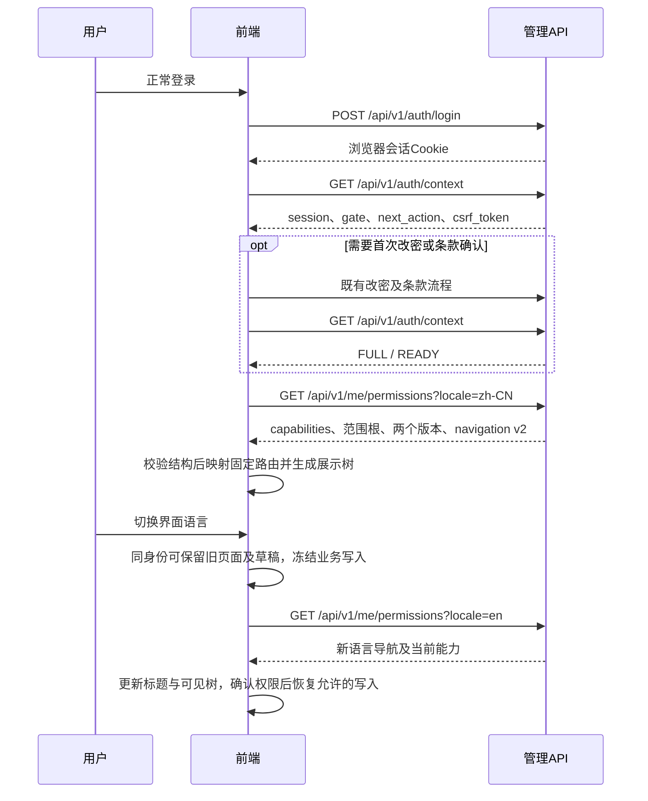

# GET me permissions 前端接入说明

适用日期：2026-11-05。源码基线：`codex/integrate-interim-ma6@b5f499c3a3a5b8a3b79aab1a262e912e03e5e843`。管理契约 **M1 1.1.0**，导航结构 **schema_version=2**；同接口也包含在 **M2 2.5.0** 中。本文说明浏览器管理端如何读取当前权限、呈现菜单和在权限变化时保护页面及写操作。

完整字段以 [M1 实际 OpenAPI](../../contracts/actual/openapi.json) 为机器契约；模型接入流程见 [模型接入模块前端接口与功能时序](模型接入模块-前端接口与功能时序-V2.5.0.md)。不要使用旧导航 v1 的客户端或历史发布快照接入当前导航。

## 1. 接口用途与调用前提

| 项目                         | 当前约定                                                           |
| ---------------------------- | ------------------------------------------------------------------ |
| 方法和路径                   | `GET /api/v1/me/permissions`                                       |
| operationId                  | `getMyPermissions`                                                 |
| 会话                         | 正常管理登录后的 Cookie，会话 `scope=FULL` 且 `gate=READY`         |
| 业务资源权限                 | 不要求事先拥有某个菜单资源；服务端计算该用户当前实际能力           |
| 请求体                       | 无                                                                 |
| CSRF / 幂等键 / 密码二次验证 | 此 GET 均不需要                                                    |
| 成功                         | HTTP 200，`code=OK`，结果位于 `data`                               |
| 缓存                         | 客户端使用 `cache: 'no-store'`；按身份、权限失效代次和语言隔离缓存 |

它回答的是“当前管理用户能读写哪些管理能力、可以进入哪些页面”。它不回答“此用户的 API Key 能否调用某个模型”。模型使用授权、当前可用性和内部路由是另一条业务链。

正常顺序为：登录 → `GET /api/v1/auth/context` → 按 `next_action` 完成首次改密、当前登录条款确认 → FULL/READY → 本接口。不能用反复请求本接口绕过登录门禁。

联调源以环境配置为准。本轮部署记录的浏览器入口为 `http://10.22.116.82:18088`（2026-11-05，b5f499c3）；本文路径均相对浏览器同源。另起前端域名/端口时须安排匹配PublicOrigin的联调环境，不直接跨源带Cookie或关闭来源检查。

## 2. 详细输入

### 2.1 Query

| 字段     | 类型   | 必填 | 约束                                                             | 作用                                           |
| -------- | ------ | ---- | ---------------------------------------------------------------- | ---------------------------------------------- |
| `locale` | string | 否   | 最多35字符；提供时不能为空，须为可规范化的语言标签；只能出现一次 | 显式指定菜单展示语言，例如 `zh-CN`、`en`、`fr` |

不接受其他 query，不接受重复参数。`?locale=`、`?locale=en&locale=fr`、`?user_id=...` 均不能作为合法调用方式。省略 `locale` 表示自动协商，不是传空字符串。

语言选择顺序：有效且已启用的显式 `locale` → 用户偏好 → `Accept-Language` → 系统默认语言。`en-US`/`en-GB` 可按已实现映射回退 `en`，`fr-FR` 可回退 `fr`；不随意截断任何语言标签。标签格式合法但该语言未启用时继续协商；标签本身非法时返回400。

### 2.2 Header 与 Cookie

| 输入              | 是否需要                | 前端处理                                                |
| ----------------- | ----------------------- | ------------------------------------------------------- |
| Cookie            | 是，浏览器自动携带      | 使用同源会话；不读取、拼接、复制 HttpOnly Cookie        |
| `Accept`          | 建议 `application/json` | 公共 transport 自动设置                                 |
| `Accept-Language` | 建议                    | 跟随当前界面语言；显式 `locale` 优先                    |
| `Origin`          | 此 GET 不要求手工提供   | 若浏览器提供，须匹配配置的 PublicOrigin；跨站请求仍拒绝 |
| `Authorization`   | 不使用                  | 用户 API Key 不能替代管理会话                           |

HTTPS 会话 Cookie 名为 `__Host-ais_session`；明确配置的 HTTP Demo 使用 `ais_session_dev`。这些名称只供理解环境，不要求前端管理 Cookie 值。

```http
GET /api/v1/me/permissions?locale=zh-CN
Accept: application/json
Accept-Language: zh-CN
```

## 3. 详细输出

### 3.1 统一包络

| 字段         | 类型          | 是否必有 | 含义                                             |
| ------------ | ------------- | -------- | ------------------------------------------------ |
| `code`       | string        | 是       | 成功固定为 `OK`；错误时为稳定业务码              |
| `data`       | object / null | 是       | 成功为权限对象；失败为 null                      |
| `params`     | object        | 是       | 结构化补充信息；成功常为空对象，不依赖它存放授权 |
| `request_id` | string，UUID  | 是       | 故障反馈追踪标识，不是授权凭据                   |

### 3.2 data

| 字段                       | 类型         | 是否必有 | 含义与使用方式                                                                            |
| -------------------------- | ------------ | -------- | ----------------------------------------------------------------------------------------- |
| `capabilities`             | Capability[] | 是       | 当前已知资源的实际能力，可能同时返回 `false/false` 的条目；不要把“存在于数组”当成获权     |
| `department_scope_root_id` | string       | 是       | 当前用户所属部门、当前部门子树的范围根；只用于展示/缓存隔离，不是可由客户端修改的授权参数 |
| `permissions_version`      | string       | 是       | 当前角色的权限版本，十进制字符串                                                          |
| `configuration_version`    | string       | 是       | 当前系统配置版本，十进制字符串                                                            |
| `navigation`               | Navigation   | 是       | 服务端已经筛选、排序、本地化的导航                                                        |

版本始终按字符串保存、比较，不使用 `Number()`、`parseInt()` 或浮点数。相同版本不能单独证明身份相同：用户、会话门禁、部门/角色变化及客户端权限失效代次也必须纳入缓存隔离。

### 3.3 Capability

| 字段            | 类型                            | 是否必有 | 含义                                              |
| --------------- | ------------------------------- | -------- | ------------------------------------------------- |
| `resource_code` | string                          | 是       | 稳定资源代码，如 `model.models`                   |
| `can_read`      | boolean                         | 是       | 当前是否可执行此资源的 READ                       |
| `can_write`     | boolean                         | 是       | 当前是否可执行此资源的 WRITE                      |
| `data_scope`    | `GLOBAL` / `DEPARTMENT_SUBTREE` | 否       | 当前仅 `identity.groups` 返回；不能推广到其他资源 |

资源查不到或能力为 false 时按无权处理。前端分别使用服务端返回的两个布尔值；不要自行把所有资源的 WRITE 推导成 READ。四个模型命令资源允许纯 WRITE 入口，见第5节。

`identity.groups.data_scope=GLOBAL` 表示当前受信内置部门管理员的用户组范围为全局；`DEPARTMENT_SUBTREE` 表示当前部门子树。根部门用户的子树可覆盖整个组织，但不因此把响应改写为 GLOBAL。其他资源没有该字段，不表示它们也获得全局范围。

当前契约已知资源代码如下；资源已知不代表已经启用/获权，始终读本次can_read/can_write。

| resource_code                   | 能力领域               |
| ------------------------------- | ---------------------- |
| `audit.annotations`             | 管理审计独立注释       |
| `audit.management`              | 管理审计读取           |
| `audit.terms_acceptances`       | 条款确认历史读取       |
| `demo.control_plane`            | 受控样例（默认不开放） |
| `identity.groups`               | 用户组                 |
| `identity.keys`                 | 管理范围API Key        |
| `identity.permission_resources` | 权限资源管理           |
| `identity.roles`                | 管理角色               |
| `identity.users`                | 部门与用户             |
| `personal.keys`                 | 本人API Key            |
| `personal.profile`              | 个人资料               |
| `system.settings`               | 通用配置               |

### 3.4 Navigation

| 字段              | 类型              | 是否必有 | 含义                                                                 |
| ----------------- | ----------------- | -------- | -------------------------------------------------------------------- |
| `schema_version`  | integer           | 是       | 当前为2；前端只接纳当前支持的版本                                    |
| `catalog_version` | string            | 是       | `sha256:` 加64位小写十六进制，标识编译期导航目录及策略；不是权限版本 |
| `locale`          | string            | 是       | 本次实际协商的语言                                                   |
| `groups`          | NavigationGroup[] | 是       | 当前可见容器，最多2个；无可见后代时裁剪，空数组合法                  |
| `items`           | NavigationItem[]  | 是       | 当前可见可路由叶子，最多20个；仅渲染返回的入口                       |

NavigationGroup：

| 字段                | 类型    | 是否必有 | 含义                                              |
| ------------------- | ------- | -------- | ------------------------------------------------- |
| `group_code`        | string  | 是       | 展示容器代码：`model_access` 或 `model_more`      |
| `parent_group_code` | string  | 否       | 根容器省略；`model_more` 的父级为 `model_access`  |
| `title`             | string  | 是       | 当前展示标题，纯文本；不能按HTML插入              |
| `title_locale`      | string  | 是       | 该标题真正来自的语言，可与 navigation.locale 不同 |
| `sort_order`        | integer | 是       | 同层合并容器和叶子后使用的排序值                  |

NavigationItem：

| 字段                | 类型    | 是否必有 | 含义                                           |
| ------------------- | ------- | -------- | ---------------------------------------------- |
| `menu_code`         | string  | 是       | 当前与 route_id 相同的稳定菜单代码             |
| `route_id`          | string  | 是       | 映射本地固定页面组件的标识；不是服务端任意URL  |
| `parent_group_code` | string  | 否       | 模型叶子的父容器；非模型入口省略               |
| `title`             | string  | 是       | 页面/菜单标题，使用服务端原样纯文本            |
| `title_locale`      | string  | 是       | 标题来源语言                                   |
| `sort_order`        | integer | 是       | 叶子目录顺序值，不能据数组下标推断固定业务位置 |

标题当前支持 `zh-CN/en/fr`；长度1～128个Unicode字符，不含控制字符、前后空白或行分隔符。前端不重建标题表、不按本地i18n key覆盖服务端标题。

## 4. 响应形状示例

以下为简化示例，仅展示个人资料能力及对应导航，省略其他能力和入口；版本与目录摘要为演示值，不是服务器实测响应。真实响应按全部返回项处理。

```json
{
  "code": "OK",
  "data": {
    "capabilities": [
      { "resource_code": "personal.profile", "can_read": true, "can_write": true },
      { "resource_code": "model.models", "can_read": false, "can_write": false },
      {
        "resource_code": "identity.groups",
        "data_scope": "DEPARTMENT_SUBTREE",
        "can_read": false,
        "can_write": false
      }
    ],
    "department_scope_root_id": "10000000-0000-4000-8000-000000000001",
    "permissions_version": "42",
    "configuration_version": "83",
    "navigation": {
      "schema_version": 2,
      "catalog_version": "sha256:0000000000000000000000000000000000000000000000000000000000000000",
      "locale": "zh-CN",
      "groups": [],
      "items": [
        {
          "menu_code": "overview",
          "route_id": "overview",
          "title": "工作台",
          "title_locale": "zh-CN",
          "sort_order": 10
        },
        {
          "menu_code": "profile",
          "route_id": "profile",
          "title": "个人资料",
          "title_locale": "zh-CN",
          "sort_order": 180
        },
        {
          "menu_code": "change_password",
          "route_id": "change_password",
          "title": "修改密码",
          "title_locale": "zh-CN",
          "sort_order": 190
        },
        {
          "menu_code": "terms",
          "route_id": "terms",
          "title": "用户须知",
          "title_locale": "zh-CN",
          "sort_order": 200
        }
      ]
    }
  },
  "params": {},
  "request_id": "20000000-0000-4000-8000-000000000001"
}
```

模型分组示例（仅展示navigation的模型分支，省略其他根层叶子；目录摘要仍为占位值）：

```json
{
  "schema_version": 2,
  "catalog_version": "sha256:0000000000000000000000000000000000000000000000000000000000000000",
  "locale": "zh-CN",
  "groups": [
    {
      "group_code": "model_access",
      "sort_order": 20,
      "title": "模型接入",
      "title_locale": "zh-CN"
    },
    {
      "group_code": "model_more",
      "parent_group_code": "model_access",
      "sort_order": 50,
      "title": "更多模型操作",
      "title_locale": "zh-CN"
    }
  ],
  "items": [
    {
      "menu_code": "providers",
      "route_id": "providers",
      "parent_group_code": "model_access",
      "sort_order": 20,
      "title": "供应商管理",
      "title_locale": "zh-CN"
    },
    {
      "menu_code": "physical_models",
      "route_id": "physical_models",
      "parent_group_code": "model_access",
      "sort_order": 30,
      "title": "物理模型",
      "title_locale": "zh-CN"
    },
    {
      "menu_code": "logical_models",
      "route_id": "logical_models",
      "parent_group_code": "model_access",
      "sort_order": 40,
      "title": "逻辑模型",
      "title_locale": "zh-CN"
    },
    {
      "menu_code": "model_admission",
      "route_id": "model_admission",
      "parent_group_code": "model_more",
      "sort_order": 50,
      "title": "检测与审核",
      "title_locale": "zh-CN"
    },
    {
      "menu_code": "model_permissions",
      "route_id": "model_permissions",
      "parent_group_code": "model_more",
      "sort_order": 60,
      "title": "逻辑模型授权",
      "title_locale": "zh-CN"
    },
    {
      "menu_code": "model_pricing",
      "route_id": "model_pricing",
      "parent_group_code": "model_more",
      "sort_order": 70,
      "title": "模型参考价格",
      "title_locale": "zh-CN"
    },
    {
      "menu_code": "model_review",
      "route_id": "model_review",
      "parent_group_code": "model_more",
      "sort_order": 80,
      "title": "提交审核决议",
      "title_locale": "zh-CN"
    }
  ]
}
```

## 5. 导航目录及权限规则

两容器固定定义：`model_access`，根层排序20；`model_more`，父级model_access、层内排序50。它们没有 route_id，没有READ/WRITE，不能被当作权限资源提交。

模型分组呈现为：模型接入 → 供应商管理、物理模型、逻辑模型、更多操作；更多操作 → 检测与审核、逻辑模型授权、模型参考价格、提交审核决议。缺失的叶子不补齐，空容器不显示。

下表是当前目录参考，供建立固定 `route_id → component/path` 映射；实际可见集合、名称、父级和顺序仍以响应为准。

| route_id / menu_code | 默认中文标题 | 前端路径                       | 父组         | 排序 | 资源/额外限制                                |
| -------------------- | ------------ | ------------------------------ | ------------ | ---- | -------------------------------------------- |
| overview             | 工作台       | /                              | 根层         | 10   | 正常会话入口                                 |
| providers            | 供应商管理   | /model/providers               | model_access | 20   | model.providers；根部门范围                  |
| physical_models      | 物理模型     | /model/models                  | model_access | 30   | model.models；根部门范围                     |
| logical_models       | 逻辑模型     | /model/logical-models          | model_access | 40   | model.logical；根部门范围                    |
| model_admission      | 检测与审核   | /model/admission               | model_more   | 50   | model.admission；READ或WRITE入口；根部门范围 |
| model_permissions    | 逻辑模型授权 | /model/permissions             | model_more   | 60   | model.permissions；READ或WRITE入口           |
| model_pricing        | 模型参考价格 | /model/pricing                 | model_more   | 70   | model.pricing；READ或WRITE入口；根部门范围   |
| model_review         | 提交审核决议 | /model/review                  | model_more   | 80   | model.review；READ或WRITE入口；根部门范围    |
| groups               | 用户组       | /identity/groups               | 根层         | 90   | identity.groups                              |
| roles                | 管理角色     | /identity/roles                | 根层         | 100  | identity.roles；受信超管                     |
| permission_resources | 权限资源     | /identity/permission-resources | 根层         | 110  | identity.permission_resources；受信超管      |
| users                | 部门与用户   | /identity/users                | 根层         | 120  | identity.users                               |
| settings             | 通用配置     | /system/settings               | 根层         | 130  | system.settings                              |
| management_audit     | 管理审计     | /system/logs                   | 根层         | 140  | audit.management                             |
| terms_acceptances    | 条款确认记录 | /system/terms-acceptances      | 根层         | 150  | audit.terms_acceptances                      |
| managed_keys         | API Key 管理 | /identity/keys                 | 根层         | 160  | identity.keys                                |
| personal_keys        | 我的 API Key | /account/keys                  | 根层         | 170  | personal.keys                                |
| profile              | 个人资料     | /account                       | 根层         | 180  | personal.profile                             |
| change_password      | 修改密码     | /account/password              | 根层         | 190  | 正常会话入口                                 |
| terms                | 用户须知     | /terms                         | 根层         | 200  | 正常会话入口                                 |

七个模型资源中，除 `model.permissions` 外，其余六个要求当前用户位于根部门范围，再叠加实际资源能力。`model.permissions` 保留部门子树授权，不要求根部门。不要按“用户名为demo_admin”或前端角色名称赋予特权。

普通入口要求 READ；`model.admission/model.permissions/model.pricing/model.review` 的入口可由 READ 或 WRITE 显示。纯 WRITE 能进入命令页面，不代表可读取列表、对象详情、价格或审核证据。页面每个读取/写入控件仍分别检查能力，依赖读取缺失时提示权限不足，不能直接改用其他接口绕过。

`roles` 和 `permission_resources` 还有后端受信超级管理员身份约束。`overview/change_password/terms` 是正常会话下的公共应用入口，不对应独立业务资源。服务端业务接口始终重新鉴权；菜单可见不等于任意对象操作已被批准。

## 6. 首次装载、语言切换与权限刷新



| 事件                                              | 展示处理                                  | 写入处理                           |
| ------------------------------------------------- | ----------------------------------------- | ---------------------------------- |
| 首次读取尚未成功                                  | 显示加载态，不从旧账号缓存补菜单          | 禁止业务写入                       |
| 同用户、同权限失效代次的语言刷新                  | 可保留旧页面实例及未提交草稿              | 请求中冻结；成功且未失效后重新判断 |
| 同身份网络失败或5xx                               | 可冻结显示上次成功快照并提示重试          | 持续禁止，不把旧缓存当成当前许可   |
| 401或账号/会话替换                                | 清理旧身份权限与业务缓存，进入登录        | 禁止，不能从旧缓存恢复             |
| 403、撤权、范围或资源停用                         | 刷新当前权限；清除不能继续使用的界面/弹窗 | 禁止旧动作，不自动提交草稿         |
| 密码/条款门禁变化                                 | 回到既有门禁流程                          | 禁止业务写入                       |
| 无navigation、schema非2、未知route_id或结构不合法 | 明确显示契约不兼容                        | 禁止业务写入，不降级为本地静态菜单 |

不要只把 `permissions_version` 放进缓存key。现有Demo还使用用户ID、客户端 `permissionEpoch`、显式/自动语言、用户语言偏好及当前界面语言。失效后清理/重取权限，业务GET和POST仍由服务端当前状态裁决。没有SSE推送或授权永久租约承诺。

实际入口参考：`AuthProvider.tsx` 的 PermissionsProvider、`navigation.ts` 的 validateNavigation/navigationTree、`transport/client.ts` 的权限写守卫。弹窗和Portal里的保存也必须经过公共写守卫，避免页面冻结但弹窗仍能发包。

## 7. 前端调用示例

仓库内沿用已有 transport 和导航边界，不另写一套权限判断源：

```typescript
import { transport, unwrap } from '../../api/transport/client'
import { validateNavigation } from './navigation'

const abortController = new AbortController()
const result = await transport.client.GET('/api/v1/me/permissions', {
  params: { query: { locale: 'zh-CN' } },
  signal: abortController.signal,
})
const permissions = validateNavigation(unwrap(result))
const canWritePhysical = permissions.capabilities.some(
  (x) => x.resource_code === 'model.models' && x.can_write,
)
// 仍需当前权限请求成功且不在刷新/失效状态，才可启用保存。
```

跨项目实现时也使用同源 `credentials: 'same-origin'` 和 `cache: 'no-store'`；不要手工设置Cookie、伪造Origin或关闭CSRF机制。接口不返回CSRF，写请求所需CSRF来自auth/context。

## 8. 失败响应与处理

当前operation在OpenAPI中逐项声明的错误：

| HTTP | code                        | 前端行为                                                   |
| ---- | --------------------------- | ---------------------------------------------------------- |
| 400  | `MALFORMED_REQUEST`         | 检查未知/重复/空locale、非法语言标签等请求输入；不盲目重试 |
| 401  | `UNAUTHENTICATED`           | 清除旧身份缓存，正常重新登录                               |
| 403  | `PASSWORD_CHANGE_REQUIRED`  | 进入改密流程并重新读取context                              |
| 403  | `TERMS_ACCEPTANCE_REQUIRED` | 按当前登录快照展示并确认条款，再读取context                |
| 403  | `ORIGIN_REJECTED`           | 核对同源代理/PublicOrigin；不能关闭来源校验解决            |
| 403  | `FORBIDDEN`                 | 禁止继续使用旧权限，提示或重新取得当前身份状态             |
| 500  | `INTERNAL_ERROR`            | 展示错误和request_id；可人工重试读取，不能恢复写许可       |

公共会话错误映射还可能输出 **503 `AUTHENTICATION_BUSY` + `Retry-After: 1`**。当前getMyPermissions的operation响应清单未单列此项；这是契约声明与公共运行时错误映射的差异，本次文档不修改业务或生成契约。前端应将其作为暂时读取失败，有界等待后重试GET，期间冻结写入，不误判为权限撤销或读取成功。

```json
{
  "code": "UNAUTHENTICATED",
  "data": null,
  "params": {},
  "request_id": "20000000-0000-4000-8000-000000000002"
}
```

本地导航校验产生的 `NAVIGATION_CONTRACT_INCOMPATIBLE`、公共写守卫产生的 `PERMISSIONS_REFRESH_REQUIRED` 是客户端错误，不是本接口HTTP成功业务码。

## 9. 联调核对清单与来源

1. 登录/改密/条款完成后才请求，能区分400、401、403、5xx与网络失败。
2. 至少核对根范围完整菜单、普通部门的裁剪、纯WRITE模型授权入口及空容器裁剪。
3. 切换中英文时标题更新；刷新失败可保留草稿但不能保存；撤权、账号切换和不兼容不复活旧权限。
4. 按三个版本各自含义处理：权限版本、配置版本、目录摘要；版本字符串无精度转换。
5. 不把组资源GLOBAL范围套给用户、Key、模型或其他资源，不把管理权限当作AI调用授权。

来源：`backend/api/currentuser/v1/permissions.go`、`backend/internal/controller/currentuser/currentuser_v1_permissions.go`、`backend/internal/logic/authorization/views.go`、`backend/internal/library/navigation/catalog.go`与`catalog.json`、`backend/internal/library/localization/selection.go`、`backend/internal/middleware/session.go`、`web-demo/src/features/auth/{AuthProvider.tsx,navigation.ts}`及`web-demo/src/app/routeRegistry.ts`。上述路径均相对仓库根。

本文是当前代码与契约的前端说明；本次只做文档字段/引用/一致性及秘密检查，不把既有业务验收写成本次重新实跑。

源文件摘要：M1实际OpenAPI SHA256 `ac7bd923631ba55581d488bb57c1d6716f78b7e6fdfaae0de146ad2a418074bd`。
