# 模型接入模块前端接口说明与功能调用时序

适用日期：2026-11-05。源码基线：`codex/integrate-interim-ma6@d199e51b3ccd3e933af9177f5fe86d0dd04a5527` 加 `codex/logical-authorization-summary` 本次已审阅实现；最终身份以Git提交及生成规范为准。当前模型接入实际契约为 **M2 2.6.0**，其中包括M1公共接口；180个操作并非180个模型专属操作。本文覆盖 **58个ModelAccess操作、9个关联共享操作、2个内部路由操作，共69个**；浏览器接入其中67个管理/关联操作，内部路由的2个单独标注。

机器契约：[当前模型接入OpenAPI](../../contracts/actual/model-access-openapi.json)；当前权限与导航：[GET me permissions详细说明](GET-me-permissions-前端接入说明-V1.1.0.md)。本文第4节按业务流程阅读，第5节按operationId查询详细输入输出，第6节查询嵌套结构。

## 1. 前端接入前提与能力边界

- 管理端采用正常Cookie登录，完成既有首次改密/登录条款流程，达到FULL/READY；再取得当前 `GET /api/v1/me/permissions`。菜单、按钮和页面读写分别使用当前能力，实际业务请求仍独立鉴权。
- 主DDL需V23，并显式启用 `model.logical-name-edit`、`model.mount-incremental-v1` 附加状态。迁移是运维职责，浏览器不能执行安装或通过改请求绕过缺失状态。
- 七个独立资源：`model.providers`、`model.models`、`model.logical`、`model.admission`、`model.review`、`model.permissions`、`model.pricing`。除model.permissions可按部门子树授权外，其余六个要求根部门范围。
- 同一表单可能组合多资源：导入要求provider和physical的WRITE；随物理模型保存挂载还要求logical的WRITE；随物理模型保存价格还要求pricing的WRITE。不能只按主页面的WRITE启用整表单。
- 当前测试服务器部署保留原执行配置，未启用真实供应商调用。管理、发现/检测执行就绪、真实网关转发是不同层次；接口已实现不代表当前Demo可向真实供应商发包。联调检测前须由环境负责人确认受控测试配置，本说明不授予调用权限。
- G35实际账单消费、G37实际智能路由/网关调用方仍未接通；视频21及原七长等待、VF600、MA6-04仍按既有失败/暂缓状态保留。不把创建任务、模拟成功或读取候选池写成完整真实模型执行验收通过。

本轮部署记录确认的浏览器联调入口为 `http://10.22.116.82:18088`（2026-11-05，b5f499c3），该环境仍是已部署b5f499c3/M2 2.5.0，本次2.6.0未部署，不能据此预期测试服务器已有新字段。API路径相对该源。新前端另起域名/端口时，由环境负责人提供与浏览器实际源匹配的PublicOrigin/同源代理方案；不通过伪造Origin、关闭校验或改变共享测试服务配置解决403。

## 2. 通用请求、返回与前端数据规则

### 2.1 请求与错误处理

管理GET使用同源Cookie、Accept-Language；管理写请求还需浏览器合法Origin、当前 `X-CSRF-Token` 和 `Idempotency-Key`。CSRF由auth/context获得；幂等键在用户一次明确提交时生成并与冻结的完整请求绑定。DELETE也可能有JSON正文，不能丢掉relations或reason。

模型接口当前**不要求密码二次验证**，不调用auth/reauth；少数旧操作在契约中保留可选 `X-Reauth-Proof` 兼容声明，不应据此弹密码框。API的reason可省略或为空；提供非空值时最多512字符并拒绝纯空白、控制字符。当前产品UI仍要求暂停原因、人工审核拒绝原因，UI要求与API兼容字段分别处理。

JSON写入使用 `Content-Type: application/json`，不要提交未知字段、类型错误、重复字段或将数字字符串转成JSON number。详细必填字段以第5、6节为准；“字段必有但允许空/nullable”不同于“字段可省略”。

有requestBody的管理命令即使只有可选reason，也发送合法JSON对象 `{}`，不使用空正文或null代替对象；DELETE授权移除则必须完整发送relations。

统一包络：

```json
{ "code": "OK", "data": {}, "params": {}, "request_id": "20000000-0000-4000-8000-000000000001" }
```

同版生成类型见 [model-access.d.ts](../../web-demo/src/api/generated/model-access.d.ts)，通用传输见 [client.ts](../../web-demo/src/api/transport/client.ts)，物理模型实际封装见 [models-api.ts](../../web-demo/src/features/model-access/models-api.ts)。不要复制第6节结构另造一套失去契约同步的类型。

```typescript
// 放在同级model-access功能模块中；key由一次用户最终确认产生并随冻结正文保存。
import type { operations } from '../../api/generated/model-access'
import { modelsApi } from './models-api'
type PhysicalCreate = operations['m2CreateModel']['requestBody']['content']['application/json']

async function submitPhysicalModel(body: PhysicalCreate, frozenKey: string) {
  return modelsApi.create(body, frozenKey)
}
```

网络结果未知时不重新生成frozenKey、修改正文后盲重试；新用户意图才生成新键。

成功检查HTTP状态和code，读取data。创建常为201，异步受理常为202；契约同时列出200的命令须兼容正常重放等成功形态。`applied`、`replayed`、`accepted`按当前接口含义解释：accepted不是业务完成，replayed也不代表重新执行或再次返回秘密。

| 情况                                         | 前端处理                                                                        |
| -------------------------------------------- | ------------------------------------------------------------------------------- |
| 401 / 密码或条款门禁                         | 回到既有认证流程，不继续旧写入                                                  |
| FORBIDDEN / RESOURCE_DISABLED / OUT_OF_SCOPE | 刷新权限并禁用原动作；不从旧缓存恢复许可                                        |
| VALIDATION_FAILED                            | 按实际params/字段错误反馈；保留用户草稿，不猜测字段名                           |
| CURSOR_INVALID / CURSOR_STALE                | 回到当前筛选首屏；不拼接或跨筛选复用游标                                        |
| MODEL_STATE_CONFLICT / ADMISSION_STALE       | 刷新对象、准入和最终接口选择，重新确认，不自动改状态                            |
| IDEMPOTENCY_CONFLICT                         | 同键不同正文；检查客户端冻结请求，不换键偷偷重做                                |
| IDEMPOTENCY_IN_PROGRESS / OPERATION_BUSY     | 保留原请求与键，按提示有界恢复；不并发重复提交                                  |
| COMMAND_RECEIPT_EXPIRED                      | 回执无法按原方式恢复；提示人工核对当前对象/任务，不能假定未执行                 |
| REMOTE_OBLIGATION_PENDING / 删除影响阻断     | 显示未结责任，不用强制删除或清零绕过                                            |
| 网络失败、5xx、超时                          | 结果可能未知；冻结提交，先核对对象/已知任务或用受控同键恢复；不自动生成新键重发 |

各操作精确HTTP/code清单见第5节，不把上表全部错误套给所有接口。日志和反馈只带operationId、request_id、安全路径/状态，不记录供应商密钥、管理Cookie、CSRF或完整检测材料。

部分历史兼容错误清单仍包含BUDGET_REVOKED，不能据此为新来源检测重新增加预算表单。新检测按已确认口径取消预算门禁，历史财务来源和未结责任仍受原保护。

### 2.2 分页

主列表统一采用 `page=1&page_size=20`。页码从1开始，page_size默认20、最大100；page_size不能脱离page使用，page模式不能混入limit/cursor。成功data为 `items/page/page_size/total/total_pages`，计数为JSON整数；超出末页可返回空items，不能当404。

旧游标模式仍兼容：不传page时使用 `limit/cursor`，返回 `items/has_more/next_cursor`，与指定页响应是两种结构。前端必须按自己提交的模式读取，不要求游标响应一定有total，也不要求页码响应一定有next_cursor。

| 场景                                  | 专项规则                                                                                           |
| ------------------------------------- | -------------------------------------------------------------------------------------------------- |
| 供应商、物理、逻辑、价格/授权等主列表 | 使用各自筛选和页码；更换搜索、目录节点、语言或范围回第1页                                          |
| 供应商详情关联物理模型                | GET provider详情的 `models_page/models_page_size`，读取 `related_models`，不是另造一个models子路由 |
| 物理/逻辑详情的挂载关系               | `mounts_page/mounts_page_size`，读取 `related_mounts`；旧mounts兼容投影不是全量关系承诺            |
| 准入历史                              | 只在最近50轮窗口中分页；指定页使用返回的 `page_snapshot` 保持同一次历史窗口，失效后回首屏          |
| 发现候选                              | 只对已保存的discovery分页，保留过期/截断/手工录入提示；不把一次发现当供应商完整目录保证            |
| 选择器                                | 可以用游标逐页搜索，仍受各自资源和当前范围限制；不能只拉首20条就断言没有匹配项                     |
| 批次/单检测任务                       | 按已知ID查询安全状态，不是页码主列表；不能假定存在未交付的任务列表/结果下载接口                    |

### 2.3 名称、ID与值类型

| 数据               | 前端约定                                                                                                           |
| ------------------ | ------------------------------------------------------------------------------------------------------------------ |
| UUID               | 用于path、提交和稳定key；优先展示响应已返回的实际名称，不用UUID代替名称                                            |
| 供应商             | `provider_id`提交；`provider_name`/供应商`name`展示                                                                |
| 物理模型           | `id/physical_model_id`为稳定身份；`model_id_at_provider`为实际上游模型标识，保留原大小写、空格、Unicode            |
| 逻辑模型           | 稳定UUID不随改名变化；`logical_name`是实际调用名称，`display_name/localized_name`是展示字段                        |
| 授权主体/历史人物  | 使用主体响应的名称、用户/部门/组实际字段、`triggered_by_name`等；不猜测当前姓名替换历史快照                        |
| 权限/代次/价格修订 | 十进制字符串保存，不转浮点number；页码/数量字段则按契约为integer                                                   |
| Token声明          | 采用契约的十进制字符串或null；新输入0/空规范化为null，正数上下文≤2,000,000、最大输出≤1,000,000；旧超限未改值可保持 |
| 布尔能力           | null=未知、false=明确不支持、true=声明/验证支持，三者不能合并                                                      |
| 价格               | 精确十进制字符串，最多4位小数；cached_input_price的null是回退普通输入价，0表示明确零缓存读单价                     |

供应商新建/改名最多80个Unicode字符，历史81～128字符仅可未改值保留；逻辑调用名新输入按当前80字符规则与后端规范化处理，旧值按兼容规则保留。部分OpenAPI通用上界保留历史范围，第5节通用schema上界不是放宽新业务输入的许可。

### 2.4 六种治理状态的编辑与动作

| status         | 中文   | 供应商/上游标识/模型类型 | 调用接口/操作规格/调用配置 | 说明/声明能力                | 挂载/价格                                             |
| -------------- | ------ | ------------------------ | -------------------------- | ---------------------------- | ----------------------------------------------------- |
| DRAFT          | 草稿   | 可编辑                   | 可编辑                     | 可编辑                       | 按各自权限、工作负载与确认要求                        |
| TESTING        | 检测中 | 不可编辑                 | 不可编辑                   | 不通过物理编辑接口修改       | 独立关系/价格命令仍由各自当前业务校验，不能凭本表绕过 |
| PENDING_REVIEW | 待审核 | 不可编辑                 | 不可编辑                   | 不通过物理编辑接口修改       | 同上                                                  |
| ACTIVE         | 已上架 | 不可修改                 | 不可修改                   | 可维护；声明不扩大已验证能力 | 按独立权限与事务约束维护                              |
| SUSPENDED      | 已暂停 | 可修改                   | 不可修改                   | 可维护；关键变更使准入失效   | 按独立权限与事务约束维护                              |
| RETIRED        | 已下架 | 可编辑                   | 可编辑                     | 可编辑                       | 按各自权限、工作负载与确认要求                        |

不存在第七种REJECTED治理状态，拒绝是审核决议。更新保留治理状态，不自动检测、审核、上架；关键变更会递增准入代次、清除当前准入/审核引用及已验证能力。按钮优先使用详情/列表的 `allowed_commands`，仍需当前权限；不能只按本表在客户端制造状态迁移。

## 3. 关联读取和缓存刷新

页面入口先使用permissions结果。供应商/物理/逻辑选择器和详情分别要求各自READ，价格要求pricing READ，检测历史要求admission READ；纯WRITE用户可进入对应命令入口，但不能借该入口获得所有关联读取。

关联身份候选可按场景使用M1公共接口：`GET /api/v1/users`、`/departments`、`/groups`及其当前范围查询。它们各自要求identity资源权限，不因已经拥有model.permissions而自动开放。已有用户列表按部门加载，组成员选择保留既有部门/成员候选规则；不要为做选择器申请全局用户数据。

保存后刷新当前对象及受影响列表/目录节点/影响预览：供应商调用配置改变还需刷新关联物理模型和准入；物理身份或能力变更刷新详情/历史/逻辑就绪；挂载/逻辑状态或改名刷新逻辑及物理反向关联、授权可访问目录；授权变化刷新主体授权/来源；价格保存刷新current与history。不能为更新一个局部面板清空所有身份缓存，权限变化则使用公共权限失效流程。

## 4. 各功能接口调用时序

图中“Worker”为后端执行组件，浏览器不直接调用；“事务/校验”为后端职责，不需要前端增加SQL或私有维护API。图里的API路径是实际接口，花括号参数在HTTP发出前替换。

### 4.1 页面初始化与模板驱动表单

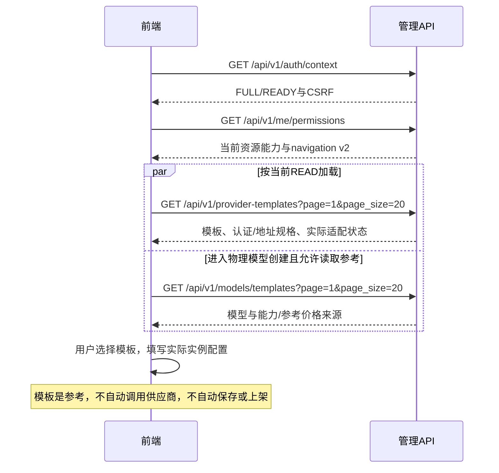

### 4.2 供应商列表、详情、新建与修改

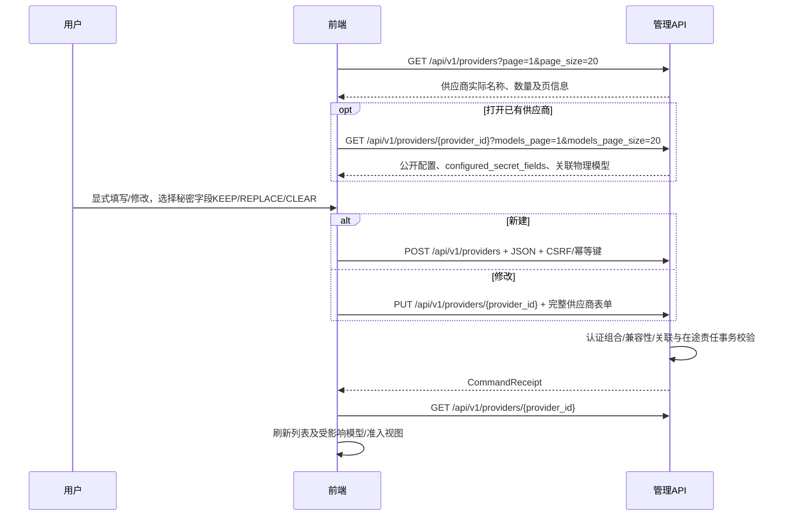

编辑详情没有秘密明文，只返回哪些字段已经配置。KEEP不传原秘密；REPLACE仅发送用户本次新输入；CLEAR只用于当前认证组合允许的清空。public_config与secret_actions分别构造，不能把已掩码的星号当真实密钥提交。供应商PUT按契约完整字段提交，不把缺省误当PATCH。

### 4.3 模型发现、手工补录与批量导入

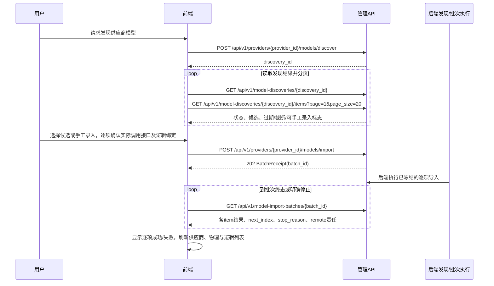

每次1～100项，DISCOVERY项使用discovery_id/candidate_id；MANUAL项提供真实上游标识。单项的source、实际invocation_api、operation_profile、invocation_config和logical_binding按第5节提交。发现失败不能伪装为已发现，按manual_entry_allowed提供独立手工录入。导入不等于检测/审核上架，后续走正式流程；批次可部分成功，不承诺整批全成全败。

### 4.4 物理模型目录筛选、详情与编辑

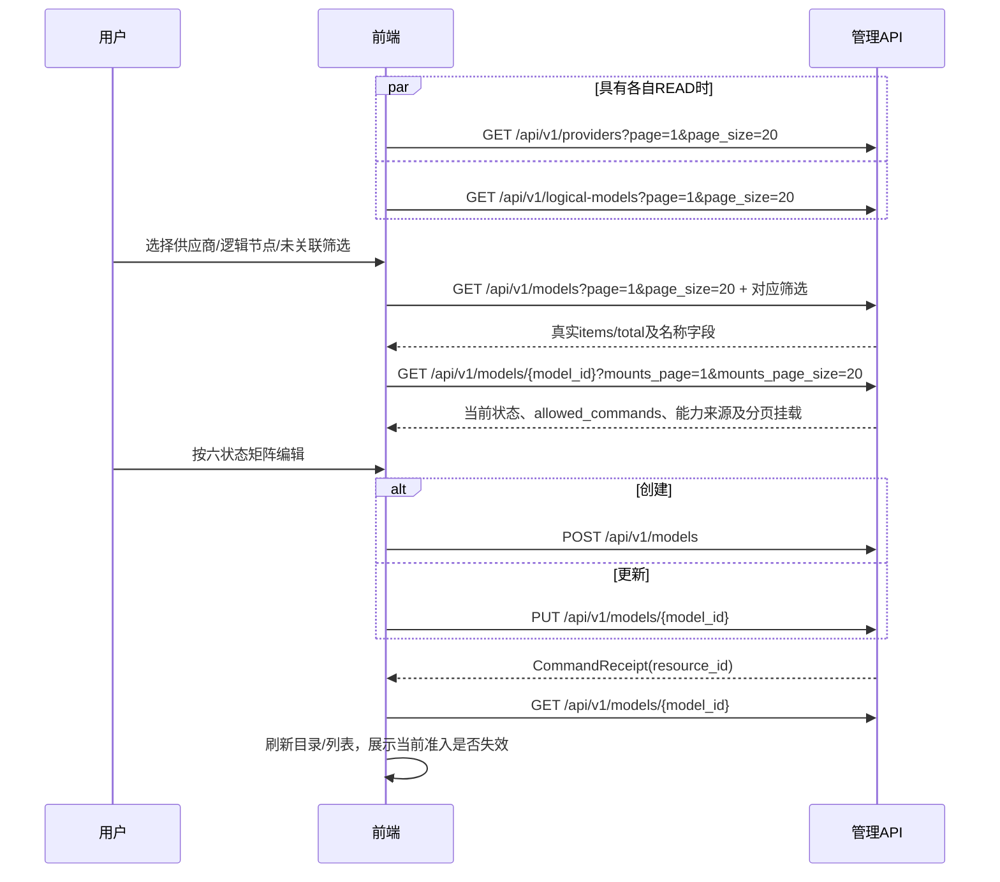

物理更新采用明确字段存在性处理；未修改的挂载/价格不随表单夹带。`logical_bindings`存在时是有界完整替换；空数组有明确清空含义。不能把related_mounts当前一页当全量提交，关系超过单次替换限额时保留元数据编辑，关系改走第4.10节的增量接口。物理创建或编辑带逻辑绑定/价格时叠加相应WRITE；模板参考价格仅在用户确认保存时写入。

### 4.5 单模型检测、进度、结果和取消

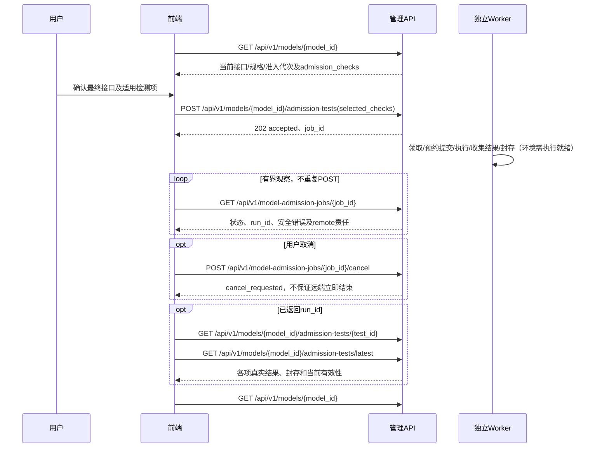

`selected_checks`业务项为BASE_REQUEST、STREAMING、TOOL_CALLING、JSON_MODE、VISION、RELIABILITY、LONG_CONTEXT，按服务端适用性提供；基础请求必须保留。不适用项不能提交为成功，UNAVAILABLE与NOT_APPLICABLE不同。新流程**没有必填已批准额度引用或budget授权**；响应中的历史budget_batch_id仅兼容旧财务来源，不要求用户补预算、不在前端自动生成批准引用。

### 4.6 供应商内逐模型检测选择与最终接口确认

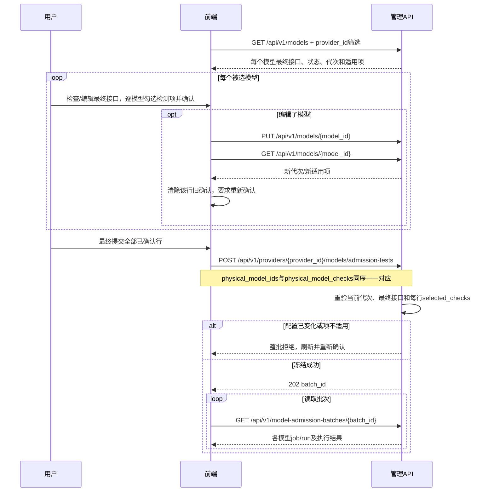

提供physical_model_checks时必须覆盖全部physical_model_ids且同序；每行必须含physical_model_id、expected_admission_generation、selected_checks。顶层selected_checks仍按契约必填；新前端使用逐行选择作为各模型实际集合，不把公共集合机械覆盖所有行。未提供逐行集合时保持旧公共集合口径。

```json
{
  "physical_model_ids": ["30000000-0000-4000-8000-000000000001"],
  "selected_checks": ["BASE_REQUEST"],
  "physical_model_checks": [
    {
      "physical_model_id": "30000000-0000-4000-8000-000000000001",
      "expected_admission_generation": "7",
      "selected_checks": ["BASE_REQUEST"]
    }
  ]
}
```

配置身份、状态、准入代次或适用项变化后，旧“最终接口已确认”不能沿用。RELIABILITY的文本及适用短同步规格由后端固定：20个主样本、最多4路并发、至少19成功且无异常未结义务；不由前端填成功数或改阈值。视频21专项仍暂缓，本说明不恢复测试或宣称其可靠性已通过。

当前检测选择界面要求模型处于DRAFT且BASE_REQUEST为AVAILABLE。RETIRED可以编辑不等于可以直接检测；先根据allowed_commands完成需要的状态动作，再重取详情并确认。

### 4.7 历史结果、可靠性指标与人工审核

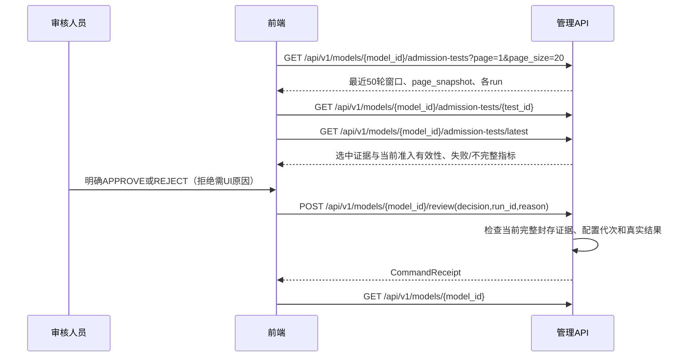

run_id来自选中且当前有效的正式检测证据，不用“最新”文字替代具体ID；旧成功历史不自动等于当前准入有效。展示可靠性时区分主样本、子场景和观测不完整，不能把取消/未知/未执行算通过。审核动作由后端决定状态；不直接PUT status=ACTIVE。

### 4.8 批量审核发布与三类批次取消/继续

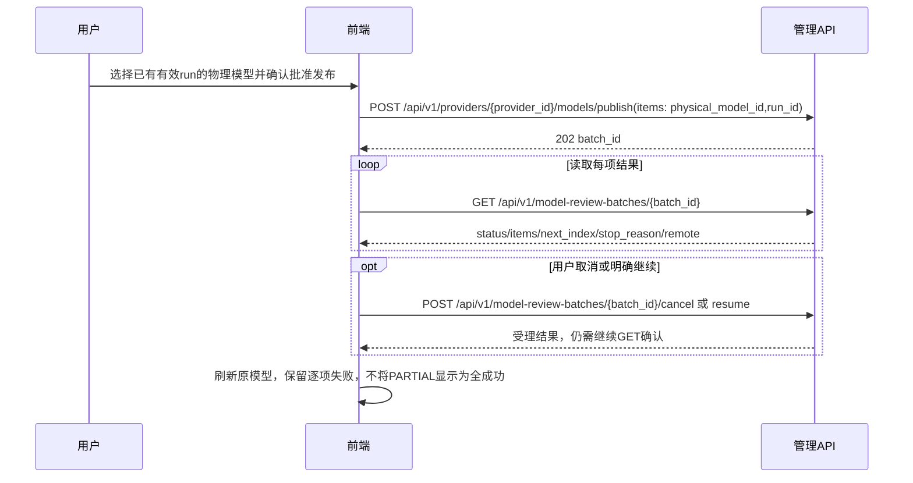

导入、检测、审核分别使用model-import-batches、model-admission-batches、model-review-batches，不能混用batch_id。状态为PENDING/RUNNING/SUCCEEDED/PARTIAL/FAILED/CANCELLED；是否可继续按当前停止原因/后端判断，不是所有FAILED或CANCELLED都可无条件resume。取消不抹去已经成功的项，不撤销远端已发生调用。

### 4.9 暂停、恢复、下架、重新激活及删除

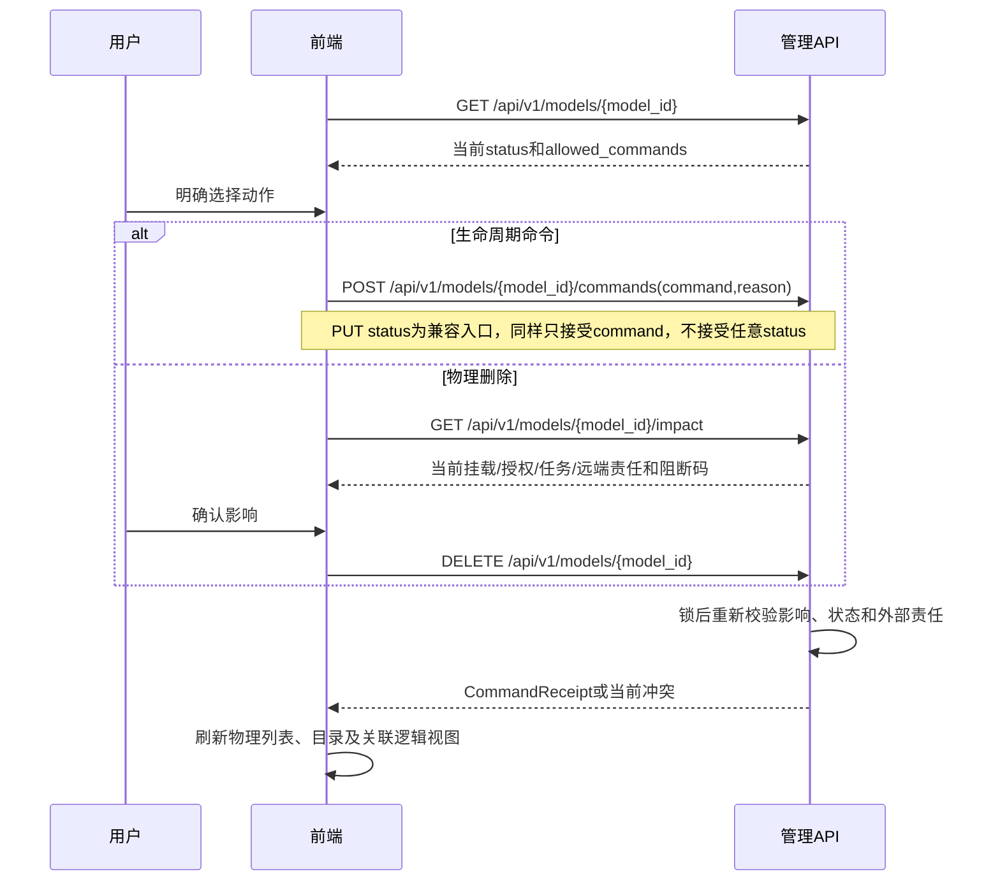

command限PAUSE/RESUME/RETIRE/REACTIVATE；按allowed_commands执行。单物理模型ACTIVE不允许直接删除；供应商级联删除是独立已确认业务，可覆盖六状态关联模型，但仍受在途、未知远端责任、外部引用等安全约束。供应商删除先GET `/api/v1/providers/{provider_id}/impact` 再DELETE供应商；逻辑模型删除同样先读自身impact再DELETE。预览不是执行许可，不向DELETE提交旧预览当作强制授权。

### 4.10 逻辑模型新建、修改、改名及状态

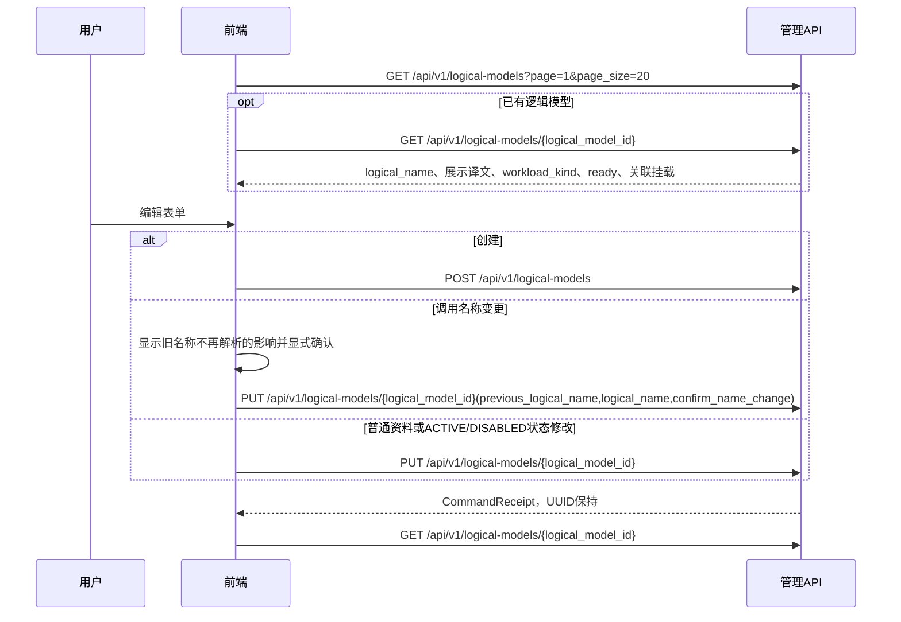

改logical_name是更改真正的调用名称，不是改展示名；稳定UUID、挂载和授权关系不应因改名重新创建。缺少名称变更确认或旧名称不符时刷新并重新确认，不自动跟随旧值提交。旧调用名不作为自动别名保留。workload确认、已有挂载兼容性由后端校验，不按模型类型标签猜测可混挂。

### 4.11 增量挂载、优先级、移动与解除

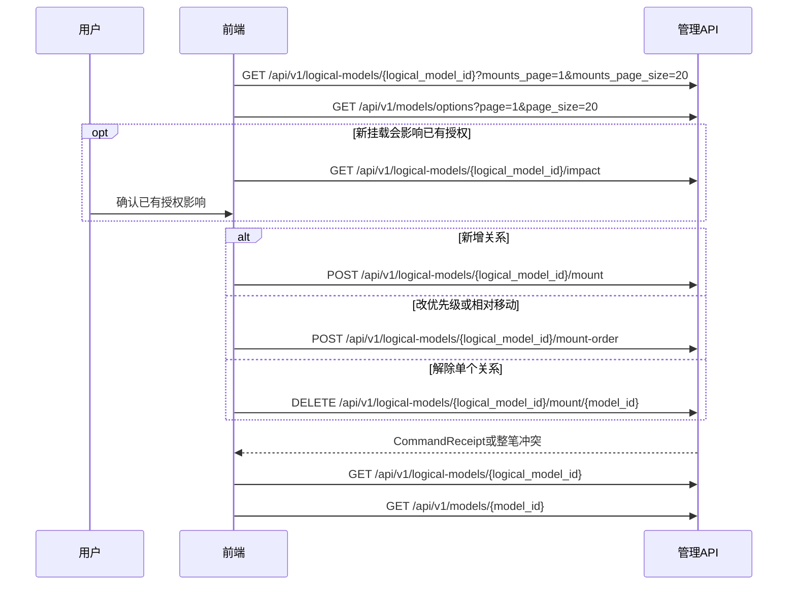

新priority为1～999，可同值，同值按稳定挂载ID排序；旧超限值允许读取/未改值兼容。自动追加应排已有末尾，无法用合法值表达时整笔拒绝，提示管理员显式调整，不偷偷全量重排或突破999。placement为BEFORE/AFTER/FIRST/LAST/PRIORITY；BEFORE/AFTER使用锚点，PRIORITY必须给priority，其余条件详见第5节业务提示。

关系总量不受单次旧完整替换20条上限约束，按分页增量操作；不能用一页覆盖所有关系。物理模型PUT的logical_bindings仍是有界完整替换，不适合大关系集。

### 4.12 以逻辑模型为中心的授权与批量授权

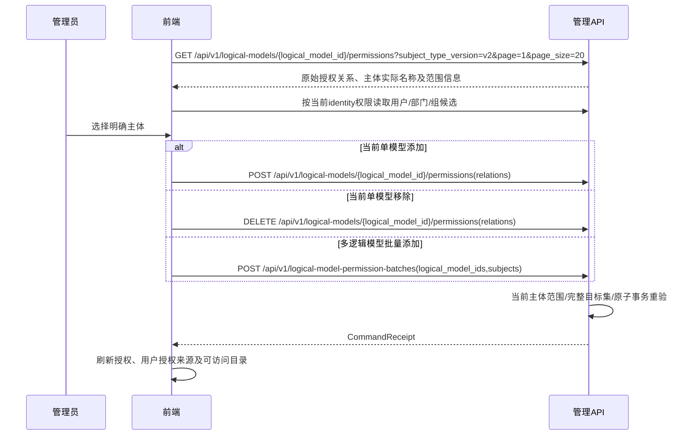

主体三类：USER、DEPARTMENT、USER_GROUP；旧GROUP与USER_GROUP表示同一组，不是第四类。输入兼容两种组拼写；查询显式 `subject_type_version=v2` 输出USER_GROUP，省略或v1保留GROUP；同一游标不能跨版本复用。部门授权按后代范围生效，用户直授/用户组/祖先部门来源为并集；移除一个来源不保证彻底撤权。

### 4.13 以主体为中心的共享授权及用户可访问目录

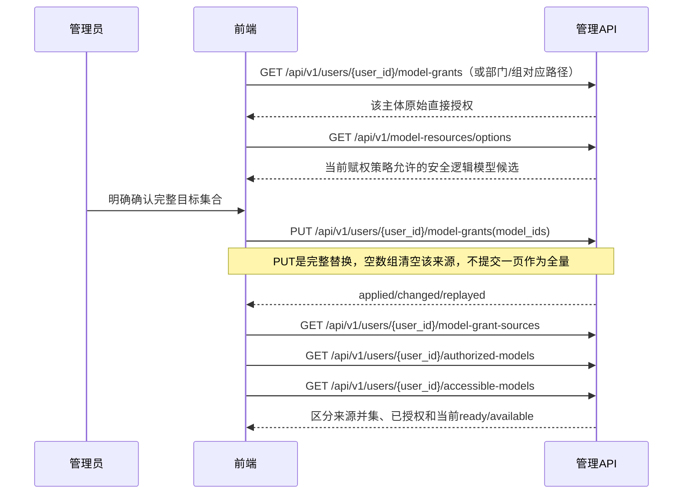

这组共享接口使用identity.users/identity.groups当前权限与范围；不是model.permissions入口的同名替代授权。model-resources/options是赋权安全候选，不等于physical models/options。authorized-models和accessible-models分别解释授权与当前可用，不能将“没有当前可用候选”展示为“没有任何授权”。

### 4.14 当前价格、历史版本与新增报价

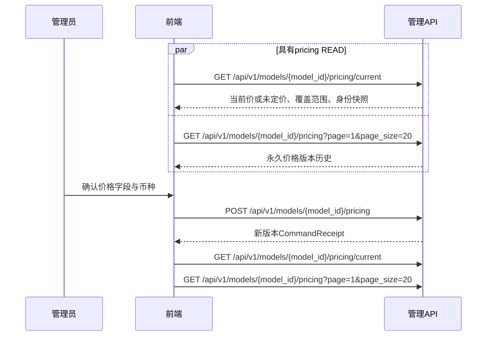

价格为追加版本，没有“PUT旧价格”或“DELETE历史价格”。unit为PER_MILLION_TOKENS，币种按当前契约CNY/USD；input_price/output_price为十进制字符串，cached_input_price必有但可null。UNPRICED/不完整覆盖不等于免费；参考模板价格不代表已经确认保存。此模块不提供前端真实账单计费完成保证。

### 4.15 内部模型使用授权与候选解析（浏览器禁止直调）

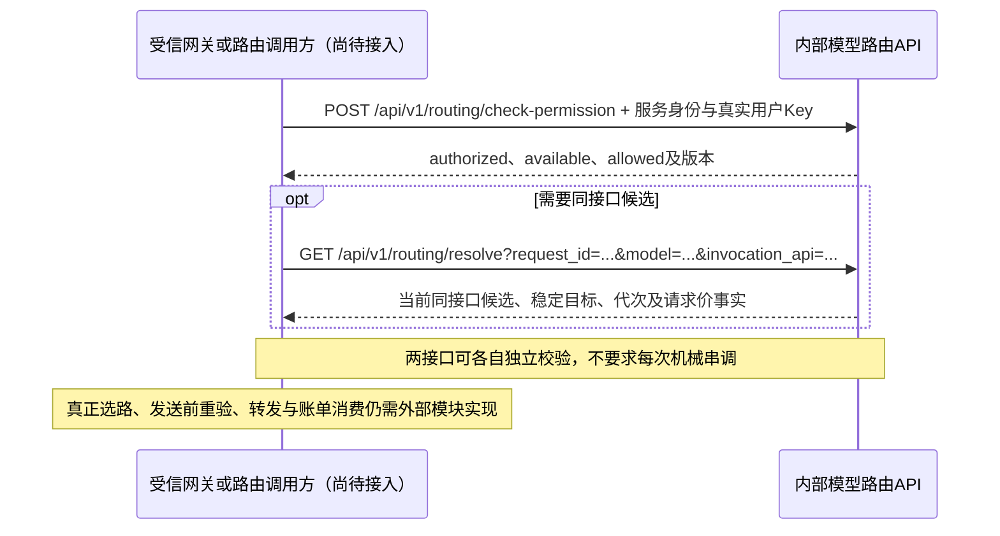

认证同时需要 `X-AIS-Routing-Token` 与 `Authorization: Bearer <真实用户API Key>`；管理Cookie或请求传user_id不成立。禁止把服务凭据或此内部返回的供应商地址/价格内部快照放进浏览器。AI请求沿用已确认口径，不新增管理登录条款门禁。

**契约注意**：routingResolve的request_id/model/invocation_api在当前OpenAPI query中标成非必填，但正式Req验证明确要求必填。本文按正式运行时写明这三项必填，不把生成器的required=false作为允许省略的依据；operation_profile可选，但AUDIO须明确对应操作。该差异为后端后续契约维护项，本次只交文档，不改代码或契约。

## 5. 逐接口输入输出索引

以下按当前M2 2.6.0实际契约整理，旧2.5.0版本保留。字段必有依据schema.required，条件性约束仍按第2、4节。

| operationId                                                   | 方法与路径                                                          | 说明                           | 权限                                       |
| ------------------------------------------------------------- | ------------------------------------------------------------------- | ------------------------------ | ------------------------------------------ |
| [listDepartmentModelGrants](#listdepartmentmodelgrants)       | `GET /api/v1/departments/{department_id}/model-grants`              | 部门直接模型授权列表           | identity.users:READ                        |
| [replaceDepartmentModelGrants](#replacedepartmentmodelgrants) | `PUT /api/v1/departments/{department_id}/model-grants`              | 完整替换部门直接模型授权       | identity.users:WRITE                       |
| [listGroupModelGrants](#listgroupmodelgrants)                 | `GET /api/v1/groups/{group_id}/model-grants`                        | 组直接模型授权列表             | identity.groups:READ                       |
| [replaceGroupModelGrants](#replacegroupmodelgrants)           | `PUT /api/v1/groups/{group_id}/model-grants`                        | 完整替换组直接模型授权         | identity.groups:WRITE                      |
| [m2BatchLogicalPermissions](#m2batchlogicalpermissions)       | `POST /api/v1/logical-model-permission-batches`                     | 多逻辑模型批量授权             | model.permissions:WRITE                    |
| [m2ListLogicalModels](#m2listlogicalmodels)                   | `GET /api/v1/logical-models`                                        | 逻辑模型列表                   | model.logical:READ                         |
| [m2CreateLogicalModel](#m2createlogicalmodel)                 | `POST /api/v1/logical-models`                                       | 新建逻辑模型                   | model.logical:WRITE                        |
| [m2ListLogicalModelOptions](#m2listlogicalmodeloptions)       | `GET /api/v1/logical-models/options`                                | 逻辑模型候选                   | model.logical:READ                         |
| [m2DeleteLogicalModel](#m2deletelogicalmodel)                 | `DELETE /api/v1/logical-models/{logical_model_id}`                  | 删除逻辑模型                   | model.logical:WRITE                        |
| [m2GetLogicalModel](#m2getlogicalmodel)                       | `GET /api/v1/logical-models/{logical_model_id}`                     | 逻辑模型详情与挂载分页         | model.logical:READ                         |
| [m2UpdateLogicalModel](#m2updatelogicalmodel)                 | `PUT /api/v1/logical-models/{logical_model_id}`                     | 更新逻辑模型资料、调用名或状态 | model.logical:WRITE                        |
| [m2GetLogicalModelImpact](#m2getlogicalmodelimpact)           | `GET /api/v1/logical-models/{logical_model_id}/impact`              | 逻辑模型影响预览               | model.logical:READ                         |
| [m2MountLogicalModel](#m2mountlogicalmodel)                   | `POST /api/v1/logical-models/{logical_model_id}/mount`              | 新增逻辑挂载                   | model.logical:WRITE                        |
| [m2OrderLogicalMounts](#m2orderlogicalmounts)                 | `POST /api/v1/logical-models/{logical_model_id}/mount-order`        | 挂载排序或优先级调整           | model.logical:WRITE                        |
| [m2UnmountLogicalModel](#m2unmountlogicalmodel)               | `DELETE /api/v1/logical-models/{logical_model_id}/mount/{model_id}` | 解除单个挂载                   | model.logical:WRITE                        |
| [m2RemoveLogicalPermissions](#m2removelogicalpermissions)     | `DELETE /api/v1/logical-models/{logical_model_id}/permissions`      | 移除逻辑模型明确授权关系       | model.permissions:WRITE                    |
| [m2ListLogicalPermissions](#m2listlogicalpermissions)         | `GET /api/v1/logical-models/{logical_model_id}/permissions`         | 逻辑模型原始授权列表           | model.permissions:READ                     |
| [m2AddLogicalPermissions](#m2addlogicalpermissions)           | `POST /api/v1/logical-models/{logical_model_id}/permissions`        | 增加逻辑模型明确授权关系       | model.permissions:WRITE                    |
| [m2GetAdmissionBatch](#m2getadmissionbatch)                   | `GET /api/v1/model-admission-batches/{batch_id}`                    | 读取检测批次                   | model.admission:READ                       |
| [m2CancelAdmissionBatch](#m2canceladmissionbatch)             | `POST /api/v1/model-admission-batches/{batch_id}/cancel`            | 请求取消检测批次               | model.admission:WRITE                      |
| [m2ResumeAdmissionBatch](#m2resumeadmissionbatch)             | `POST /api/v1/model-admission-batches/{batch_id}/resume`            | 请求继续检测批次               | model.admission:WRITE                      |
| [m2GetAdmissionJob](#m2getadmissionjob)                       | `GET /api/v1/model-admission-jobs/{job_id}`                         | 读取单检测任务                 | model.admission:READ                       |
| [m2CancelAdmissionJob](#m2canceladmissionjob)                 | `POST /api/v1/model-admission-jobs/{job_id}/cancel`                 | 请求取消单检测任务             | model.admission:WRITE                      |
| [m2GetDiscovery](#m2getdiscovery)                             | `GET /api/v1/model-discoveries/{discovery_id}`                      | 读取已保存模型发现任务         | model.providers:READ                       |
| [m2ListDiscoveryItems](#m2listdiscoveryitems)                 | `GET /api/v1/model-discoveries/{discovery_id}/items`                | 分页读取发现候选               | model.providers:READ                       |
| [m2GetImportBatch](#m2getimportbatch)                         | `GET /api/v1/model-import-batches/{batch_id}`                       | 读取导入批次                   | model.providers:READ                       |
| [m2CancelImportBatch](#m2cancelimportbatch)                   | `POST /api/v1/model-import-batches/{batch_id}/cancel`               | 请求取消导入批次               | model.providers:WRITE                      |
| [m2ResumeImportBatch](#m2resumeimportbatch)                   | `POST /api/v1/model-import-batches/{batch_id}/resume`               | 请求继续导入批次               | model.providers:WRITE                      |
| [listModelOptions](#listmodeloptions)                         | `GET /api/v1/model-resources/options`                               | 共享赋权模型候选               | 共享赋权策略:READ                          |
| [listModelTranslations](#listmodeltranslations)               | `GET /api/v1/model-resources/{model_id}/translations`               | 共享模型译文                   | 共享赋权策略:READ                          |
| [m2GetReviewBatch](#m2getreviewbatch)                         | `GET /api/v1/model-review-batches/{batch_id}`                       | 读取审核发布批次               | model.review:READ                          |
| [m2CancelReviewBatch](#m2cancelreviewbatch)                   | `POST /api/v1/model-review-batches/{batch_id}/cancel`               | 请求取消审核批次               | model.review:WRITE                         |
| [m2ResumeReviewBatch](#m2resumereviewbatch)                   | `POST /api/v1/model-review-batches/{batch_id}/resume`               | 请求继续审核批次               | model.review:WRITE                         |
| [m2ListModels](#m2listmodels)                                 | `GET /api/v1/models`                                                | 物理模型列表                   | model.models:READ                          |
| [m2CreateModel](#m2createmodel)                               | `POST /api/v1/models`                                               | 新建物理模型                   | model.models:WRITE                         |
| [m2ListModelOptions](#m2listmodeloptions)                     | `GET /api/v1/models/options`                                        | 物理模型候选                   | model.models:READ                          |
| [m2ListModelTemplates](#m2listmodeltemplates)                 | `GET /api/v1/models/templates`                                      | 物理模型参考模板               | model.models:READ                          |
| [m2DeleteModel](#m2deletemodel)                               | `DELETE /api/v1/models/{model_id}`                                  | 删除物理模型                   | model.models:WRITE                         |
| [m2GetModel](#m2getmodel)                                     | `GET /api/v1/models/{model_id}`                                     | 物理模型详情与反向挂载分页     | model.models:READ                          |
| [m2UpdateModel](#m2updatemodel)                               | `PUT /api/v1/models/{model_id}`                                     | 更新物理模型                   | model.models:WRITE                         |
| [m2ListAdmissionRuns](#m2listadmissionruns)                   | `GET /api/v1/models/{model_id}/admission-tests`                     | 最近50轮检测历史分页           | model.admission:READ                       |
| [m2TestModel](#m2testmodel)                                   | `POST /api/v1/models/{model_id}/admission-tests`                    | 发起单物理模型检测             | model.admission:WRITE                      |
| [m2GetLatestAdmissionRun](#m2getlatestadmissionrun)           | `GET /api/v1/models/{model_id}/admission-tests/latest`              | 最新检测与当前有效性           | model.admission:READ                       |
| [m2GetAdmissionRun](#m2getadmissionrun)                       | `GET /api/v1/models/{model_id}/admission-tests/{test_id}`           | 检测轮次完整安全结果           | model.admission:READ                       |
| [m2CommandModel](#m2commandmodel)                             | `POST /api/v1/models/{model_id}/commands`                           | 物理模型生命周期命令           | model.models:WRITE                         |
| [m2GetModelImpact](#m2getmodelimpact)                         | `GET /api/v1/models/{model_id}/impact`                              | 物理模型影响预览               | model.models:READ                          |
| [m2ListModelPrices](#m2listmodelprices)                       | `GET /api/v1/models/{model_id}/pricing`                             | 价格历史列表                   | model.pricing:READ                         |
| [m2CreateModelPrice](#m2createmodelprice)                     | `POST /api/v1/models/{model_id}/pricing`                            | 追加永久价格版本               | model.pricing:WRITE                        |
| [m2GetCurrentModelPrice](#m2getcurrentmodelprice)             | `GET /api/v1/models/{model_id}/pricing/current`                     | 当前价格及覆盖状态             | model.pricing:READ                         |
| [m2ReviewModel](#m2reviewmodel)                               | `POST /api/v1/models/{model_id}/review`                             | 单模型人工审核决议             | model.review:WRITE                         |
| [m2UpdateModelStatus](#m2updatemodelstatus)                   | `PUT /api/v1/models/{model_id}/status`                              | 生命周期命令兼容入口           | model.models:WRITE                         |
| [m2ListProviderTemplates](#m2listprovidertemplates)           | `GET /api/v1/provider-templates`                                    | 供应商模板与能力规格           | model.providers:READ                       |
| [m2ListProviders](#m2listproviders)                           | `GET /api/v1/providers`                                             | 供应商列表                     | model.providers:READ                       |
| [m2CreateProvider](#m2createprovider)                         | `POST /api/v1/providers`                                            | 新建供应商实例                 | model.providers:WRITE                      |
| [m2DeleteProvider](#m2deleteprovider)                         | `DELETE /api/v1/providers/{provider_id}`                            | 级联删除供应商                 | model.providers:WRITE                      |
| [m2GetProvider](#m2getprovider)                               | `GET /api/v1/providers/{provider_id}`                               | 供应商详情与关联模型分页       | model.providers:READ                       |
| [m2UpdateProvider](#m2updateprovider)                         | `PUT /api/v1/providers/{provider_id}`                               | 更新供应商实例                 | model.providers:WRITE                      |
| [m2GetProviderImpact](#m2getproviderimpact)                   | `GET /api/v1/providers/{provider_id}/impact`                        | 供应商级联影响预览             | model.providers:READ                       |
| [m2TestProviderModels](#m2testprovidermodels)                 | `POST /api/v1/providers/{provider_id}/models/admission-tests`       | 供应商内批量逐模型检测         | model.admission:WRITE                      |
| [m2DiscoverProviderModels](#m2discoverprovidermodels)         | `POST /api/v1/providers/{provider_id}/models/discover`              | 发起供应商模型发现             | model.providers:WRITE                      |
| [m2ImportProviderModels](#m2importprovidermodels)             | `POST /api/v1/providers/{provider_id}/models/import`                | 冻结并受理模型导入批次         | model.providers:WRITE + model.models:WRITE |
| [m2PublishProviderModels](#m2publishprovidermodels)           | `POST /api/v1/providers/{provider_id}/models/publish`               | 受理批量审核发布               | model.review:WRITE                         |
| [routingCheckPermission](#routingcheckpermission)             | `POST /api/v1/routing/check-permission`                             | 内部模型使用授权及可用性检查   | 内部服务 + 真实用户Key；非浏览器           |
| [routingResolve](#routingresolve)                             | `GET /api/v1/routing/resolve`                                       | 内部同接口候选与请求价解析     | 内部服务 + 真实用户Key；非浏览器           |
| [m2ListUserAccessibleModels](#m2listuseraccessiblemodels)     | `GET /api/v1/users/{user_id}/accessible-models`                     | 用户可访问模型目录             | identity.users:READ                        |
| [m2ListUserAuthorizedModels](#m2listuserauthorizedmodels)     | `GET /api/v1/users/{user_id}/authorized-models`                     | 用户已授权逻辑模型             | identity.users:READ                        |
| [listUserModelGrantSources](#listusermodelgrantsources)       | `GET /api/v1/users/{user_id}/model-grant-sources`                   | 用户授权来源并集               | identity.users:READ                        |
| [listUserModelGrants](#listusermodelgrants)                   | `GET /api/v1/users/{user_id}/model-grants`                          | 用户直接模型授权列表           | identity.users:READ                        |
| [replaceUserModelGrants](#replaceusermodelgrants)             | `PUT /api/v1/users/{user_id}/model-grants`                          | 完整替换用户直接模型授权       | identity.users:WRITE                       |

### 逐项接口

### listDepartmentModelGrants

**部门直接模型授权列表**：`GET /api/v1/departments/{department_id}/model-grants`。

- 权限：`identity.users:READ`；范围：`current-subtree`；会话：`full`。
- 契约说明：查询部门原始模型授权；支持原limit/cursor游标模式与显式page/page_size指定页模式。总数仅统计当前授权范围和筛选条件允许返回的结果，业务附加统计与特殊窗口规则保持。

| 来源  | 参数          | 类型    | 必填 | 约束与说明                                                        |
| ----- | ------------- | ------- | ---- | ----------------------------------------------------------------- |
| query | page          | integer | 否   | 目标页码，从1开始；不可与limit或cursor同时提供；最小值 1          |
| query | page_size     | integer | 否   | 每页条数，仅与page一起使用，默认20，最大100；最小值 1；最大值 100 |
| path  | department_id | string  | 是   | 目标部门唯一标识；最短 36；最长 36                                |
| query | locale        | string  | 否   | 展示语言；省略时按当前用户偏好及系统默认解析                      |
| query | limit         | integer | 否   | 游标模式每页条数，默认20，最大100；默认 20                        |
| query | cursor        | string  | 否   | 服务端签名游标；必须保持相同身份、范围、筛选及页大小              |

请求正文：无。

| 成功HTTP | data类型      | 响应头     |
| -------- | ------------- | ---------- |
| 200      | [S001](#s001) | 无额外声明 |

错误：HTTP 400：CURSOR_INVALID, MALFORMED_REQUEST；HTTP 401：UNAUTHENTICATED；HTTP 403：FORBIDDEN, ORIGIN_REJECTED, OUT_OF_SCOPE, PASSWORD_CHANGE_REQUIRED, RESOURCE_DISABLED, TERMS_ACCEPTANCE_REQUIRED；HTTP 404：NOT_FOUND；HTTP 409：CURSOR_STALE；HTTP 422：VALIDATION_FAILED；HTTP 500：INTERNAL_ERROR。

### replaceDepartmentModelGrants

**完整替换部门直接模型授权**：`PUT /api/v1/departments/{department_id}/model-grants`。

- 权限：`identity.users:WRITE`；范围：`current-subtree`；会话：`full`。
- 契约说明：本操作无需操作原因或密码二次认证。reason仅为旧客户端兼容字段；缺省或空串允许，非空原文保留并校验。X-Reauth-Proof如存在仅兼容接收，不消费。登录、权限、管理范围、Origin/CSRF、对象保护、业务约束、事务审计及幂等仍生效；结果未知必须使用原载荷与原幂等键重试。
- 业务接线：完整替换该主体原始直接授权；model_ids=[]清除此来源。先取得完整集合并明确确认，不提交当前一页；使用该identity资源当前WRITE及范围，不按model.permissions绕过。

| 来源   | 参数            | 类型   | 必填 | 约束与说明                         |
| ------ | --------------- | ------ | ---- | ---------------------------------- |
| path   | department_id   | string | 是   | 目标部门唯一标识；最短 36；最长 36 |
| header | Origin          | string | 是   | —                                  |
| header | X-CSRF-Token    | string | 是   | —                                  |
| header | Idempotency-Key | string | 是   | —                                  |

请求正文：`application/json`，必须提供，[S006](#s006)。

| 成功HTTP | data类型      | 响应头     |
| -------- | ------------- | ---------- |
| 200      | [S007](#s007) | 无额外声明 |

错误：HTTP 400：CURSOR_INVALID, MALFORMED_REQUEST；HTTP 401：UNAUTHENTICATED；HTTP 403：CSRF_INVALID, FORBIDDEN, ORIGIN_REJECTED, OUT_OF_SCOPE, PASSWORD_CHANGE_REQUIRED, RESOURCE_DISABLED, TERMS_ACCEPTANCE_REQUIRED；HTTP 404：NOT_FOUND；HTTP 409：CURSOR_STALE, DELETE_TOO_LARGE, IDEMPOTENCY_CONFLICT, IDEMPOTENCY_IN_PROGRESS；HTTP 415：UNSUPPORTED_MEDIA_TYPE；HTTP 422：BATCH_TOO_LARGE, MODEL_UNAVAILABLE, VALIDATION_FAILED；HTTP 500：INTERNAL_ERROR。

### listGroupModelGrants

**组直接模型授权列表**：`GET /api/v1/groups/{group_id}/model-grants`。

- 权限：`identity.groups:READ`；范围：`cross-department-group`；会话：`full`。
- 契约说明：查询用户组原始模型授权；支持原limit/cursor游标模式与显式page/page_size指定页模式。总数仅统计当前授权范围和筛选条件允许返回的结果，业务附加统计与特殊窗口规则保持。

| 来源  | 参数      | 类型    | 必填 | 约束与说明                                                        |
| ----- | --------- | ------- | ---- | ----------------------------------------------------------------- |
| query | page      | integer | 否   | 目标页码，从1开始；不可与limit或cursor同时提供；最小值 1          |
| query | page_size | integer | 否   | 每页条数，仅与page一起使用，默认20，最大100；最小值 1；最大值 100 |
| path  | group_id  | string  | 是   | 目标组唯一标识；最短 36；最长 36                                  |
| query | locale    | string  | 否   | 展示语言；省略时按当前用户偏好及系统默认解析                      |
| query | limit     | integer | 否   | 游标模式每页条数，默认20，最大100；默认 20                        |
| query | cursor    | string  | 否   | 服务端签名游标；必须保持相同身份、范围、筛选及页大小              |

请求正文：无。

| 成功HTTP | data类型      | 响应头     |
| -------- | ------------- | ---------- |
| 200      | [S001](#s001) | 无额外声明 |

错误：HTTP 400：CURSOR_INVALID, MALFORMED_REQUEST；HTTP 401：UNAUTHENTICATED；HTTP 403：FORBIDDEN, ORIGIN_REJECTED, OUT_OF_SCOPE, PASSWORD_CHANGE_REQUIRED, RESOURCE_DISABLED, TERMS_ACCEPTANCE_REQUIRED；HTTP 404：NOT_FOUND；HTTP 409：CURSOR_STALE；HTTP 422：VALIDATION_FAILED；HTTP 500：INTERNAL_ERROR。

### replaceGroupModelGrants

**完整替换组直接模型授权**：`PUT /api/v1/groups/{group_id}/model-grants`。

- 权限：`identity.groups:WRITE`；范围：`cross-department-group`；会话：`full`。
- 契约说明：本操作无需操作原因或密码二次认证。reason仅为旧客户端兼容字段；缺省或空串允许，非空原文保留并校验。X-Reauth-Proof如存在仅兼容接收，不消费。登录、权限、管理范围、Origin/CSRF、对象保护、业务约束、事务审计及幂等仍生效；结果未知必须使用原载荷与原幂等键重试。
- 业务接线：完整替换该主体原始直接授权；model_ids=[]清除此来源。先取得完整集合并明确确认，不提交当前一页；使用该identity资源当前WRITE及范围，不按model.permissions绕过。

| 来源   | 参数            | 类型   | 必填 | 约束与说明                       |
| ------ | --------------- | ------ | ---- | -------------------------------- |
| path   | group_id        | string | 是   | 目标组唯一标识；最短 36；最长 36 |
| header | Origin          | string | 是   | —                                |
| header | X-CSRF-Token    | string | 是   | —                                |
| header | Idempotency-Key | string | 是   | —                                |

请求正文：`application/json`，必须提供，[S006](#s006)。

| 成功HTTP | data类型      | 响应头     |
| -------- | ------------- | ---------- |
| 200      | [S007](#s007) | 无额外声明 |

错误：HTTP 400：CURSOR_INVALID, MALFORMED_REQUEST；HTTP 401：UNAUTHENTICATED；HTTP 403：CSRF_INVALID, FORBIDDEN, ORIGIN_REJECTED, OUT_OF_SCOPE, PASSWORD_CHANGE_REQUIRED, RESOURCE_DISABLED, TERMS_ACCEPTANCE_REQUIRED；HTTP 404：NOT_FOUND；HTTP 409：CURSOR_STALE, DELETE_TOO_LARGE, IDEMPOTENCY_CONFLICT, IDEMPOTENCY_IN_PROGRESS；HTTP 415：UNSUPPORTED_MEDIA_TYPE；HTTP 422：BATCH_TOO_LARGE, MODEL_UNAVAILABLE, VALIDATION_FAILED；HTTP 500：INTERNAL_ERROR。

### m2BatchLogicalPermissions

**多逻辑模型批量授权**：`POST /api/v1/logical-model-permission-batches`。

- 权限：`model.permissions:WRITE`；范围：`current-subtree`；会话：`full`。
- 契约说明：本操作无需操作原因或密码二次认证。reason仅为旧客户端兼容字段；缺省或空串允许，非空原文保留并校验。X-Reauth-Proof如存在仅兼容接收，不消费。登录、权限、管理范围、Origin/CSRF、对象保护、业务约束、事务审计及幂等仍生效；结果未知必须使用原载荷与原幂等键重试。

| 来源   | 参数            | 类型   | 必填 | 约束与说明 |
| ------ | --------------- | ------ | ---- | ---------- |
| header | Origin          | string | 是   | —          |
| header | X-CSRF-Token    | string | 是   | —          |
| header | Idempotency-Key | string | 是   | —          |

请求正文：`application/json`，必须提供，[S008](#s008)。

| 成功HTTP | data类型      | 响应头     |
| -------- | ------------- | ---------- |
| 200      | [S010](#s010) | 无额外声明 |

错误：HTTP 400：MALFORMED_REQUEST；HTTP 401：UNAUTHENTICATED；HTTP 403：CSRF_INVALID, FORBIDDEN, ORIGIN_REJECTED, OUT_OF_SCOPE, PASSWORD_CHANGE_REQUIRED, RESOURCE_DISABLED, TERMS_ACCEPTANCE_REQUIRED；HTTP 404：NOT_FOUND；HTTP 409：COMMAND_RECEIPT_EXPIRED, DELETE_TOO_LARGE, IDEMPOTENCY_CONFLICT, IDEMPOTENCY_IN_PROGRESS, OPERATION_BUSY；HTTP 415：UNSUPPORTED_MEDIA_TYPE；HTTP 422：BATCH_TOO_LARGE, MODEL_UNAVAILABLE, VALIDATION_FAILED；HTTP 500：INTERNAL_ERROR；HTTP 503：COMMAND_HMAC_KEY_UNAVAILABLE。

### m2ListLogicalModels

**逻辑模型列表**：`GET /api/v1/logical-models`。

- 权限：`model.logical:READ`；范围：`global-settings`；会话：`full`。
- 契约说明：查询逻辑模型；支持原limit/cursor游标模式与显式page/page_size指定页模式。总数仅统计当前授权范围和筛选条件允许返回的结果，业务附加统计与特殊窗口规则保持。

| 来源  | 参数      | 类型    | 必填 | 约束与说明                                                        |
| ----- | --------- | ------- | ---- | ----------------------------------------------------------------- |
| query | page      | integer | 否   | 目标页码，从1开始；不可与limit或cursor同时提供；最小值 1          |
| query | page_size | integer | 否   | 每页条数，仅与page一起使用，默认20，最大100；最小值 1；最大值 100 |
| query | search    | string  | 否   | 按本接口既有匹配规则筛选的搜索文本；最长 256                      |
| query | locale    | string  | 否   | 请求展示语言，省略时按当前用户偏好及系统默认语言解析；最长 35     |
| query | limit     | integer | 否   | 游标模式每页条数，默认20，最大100；默认 20；最小值 1；最大值 100  |
| query | cursor    | string  | 否   | 绑定身份、范围、筛选及相关代次的签名游标；最长 4096               |
| query | status    | string  | 否   | 状态；枚举 ["ACTIVE", "DISABLED"]                                 |

请求正文：无。

| 成功HTTP | data类型      | 响应头     |
| -------- | ------------- | ---------- |
| 200      | [S011](#s011) | 无额外声明 |

错误：HTTP 400：CURSOR_INVALID, MALFORMED_REQUEST；HTTP 401：UNAUTHENTICATED；HTTP 403：FORBIDDEN, ORIGIN_REJECTED, OUT_OF_SCOPE, PASSWORD_CHANGE_REQUIRED, RESOURCE_DISABLED, TERMS_ACCEPTANCE_REQUIRED；HTTP 404：NOT_FOUND；HTTP 409：CURSOR_STALE；HTTP 422：VALIDATION_FAILED；HTTP 500：INTERNAL_ERROR。

### m2CreateLogicalModel

**新建逻辑模型**：`POST /api/v1/logical-models`。

- 权限：`model.logical:WRITE`；范围：`global-settings`；会话：`full`。
- 业务接线：initial_physical_model_ids仅为有界初始集合，后续大关系集走增量挂载。调用名/显示名/翻译分别处理。

| 来源   | 参数            | 类型   | 必填 | 约束与说明 |
| ------ | --------------- | ------ | ---- | ---------- |
| header | Origin          | string | 是   | —          |
| header | X-CSRF-Token    | string | 是   | —          |
| header | Idempotency-Key | string | 是   | —          |

请求正文：`application/json`，必须提供，[S019](#s019)。

| 成功HTTP | data类型      | 响应头     |
| -------- | ------------- | ---------- |
| 200      | [S010](#s010) | 无额外声明 |
| 201      | [S010](#s010) | 无额外声明 |

错误：HTTP 400：MALFORMED_REQUEST；HTTP 401：UNAUTHENTICATED；HTTP 403：CSRF_INVALID, FORBIDDEN, ORIGIN_REJECTED, OUT_OF_SCOPE, PASSWORD_CHANGE_REQUIRED, RESOURCE_DISABLED, TERMS_ACCEPTANCE_REQUIRED；HTTP 404：NOT_FOUND；HTTP 409：COMMAND_RECEIPT_EXPIRED, DELETE_TOO_LARGE, IDEMPOTENCY_CONFLICT, IDEMPOTENCY_IN_PROGRESS, NAME_CONFLICT, OPERATION_BUSY；HTTP 415：UNSUPPORTED_MEDIA_TYPE；HTTP 422：VALIDATION_FAILED；HTTP 500：INTERNAL_ERROR。

### m2ListLogicalModelOptions

**逻辑模型候选**：`GET /api/v1/logical-models/options`。

- 权限：`model.logical:READ`；范围：`global-settings`；会话：`full`。
- 契约说明：查询逻辑模型候选；支持原limit/cursor游标模式与显式page/page_size指定页模式。总数仅统计当前授权范围和筛选条件允许返回的结果，业务附加统计与特殊窗口规则保持。

| 来源  | 参数      | 类型    | 必填 | 约束与说明                                                        |
| ----- | --------- | ------- | ---- | ----------------------------------------------------------------- |
| query | page      | integer | 否   | 目标页码，从1开始；不可与limit或cursor同时提供；最小值 1          |
| query | page_size | integer | 否   | 每页条数，仅与page一起使用，默认20，最大100；最小值 1；最大值 100 |
| query | search    | string  | 否   | 按本接口既有匹配规则筛选的搜索文本；最长 256                      |
| query | locale    | string  | 否   | 请求展示语言，省略时按当前用户偏好及系统默认语言解析；最长 35     |
| query | limit     | integer | 否   | 游标模式每页条数，默认20，最大100；默认 20；最小值 1；最大值 100  |
| query | cursor    | string  | 否   | 绑定身份、范围、筛选及相关代次的签名游标；最长 4096               |

请求正文：无。

| 成功HTTP | data类型      | 响应头     |
| -------- | ------------- | ---------- |
| 200      | [S020](#s020) | 无额外声明 |

错误：HTTP 400：CURSOR_INVALID, MALFORMED_REQUEST；HTTP 401：UNAUTHENTICATED；HTTP 403：FORBIDDEN, ORIGIN_REJECTED, OUT_OF_SCOPE, PASSWORD_CHANGE_REQUIRED, RESOURCE_DISABLED, TERMS_ACCEPTANCE_REQUIRED；HTTP 404：NOT_FOUND；HTTP 409：CURSOR_STALE；HTTP 422：VALIDATION_FAILED；HTTP 500：INTERNAL_ERROR。

### m2DeleteLogicalModel

**删除逻辑模型**：`DELETE /api/v1/logical-models/{logical_model_id}`。

- 权限：`model.logical:WRITE`；范围：`global-settings`；会话：`full`。
- 契约说明：本操作无需操作原因或密码二次认证。reason仅为旧客户端兼容字段；缺省或空串允许，非空原文保留并校验。X-Reauth-Proof如存在仅兼容接收，不消费。登录、权限、管理范围、Origin/CSRF、对象保护、业务约束、事务审计及幂等仍生效；结果未知必须使用原载荷与原幂等键重试。
- 业务接线：先impact；有活动/外部责任时仍可能拒绝，不能因预览成功绕过事务终验。

| 来源   | 参数             | 类型          | 必填 | 约束与说明                          |
| ------ | ---------------- | ------------- | ---- | ----------------------------------- |
| path   | logical_model_id | string (uuid) | 是   | 最短 36；最长 36                    |
| header | Origin           | string        | 是   | —                                   |
| header | X-CSRF-Token     | string        | 是   | —                                   |
| header | Idempotency-Key  | string        | 是   | —                                   |
| header | X-Reauth-Proof   | string        | 否   | —；仅旧兼容声明，当前不要求二次验证 |

请求正文：`application/json`，必须提供，[S024](#s024)。

| 成功HTTP | data类型      | 响应头     |
| -------- | ------------- | ---------- |
| 200      | [S010](#s010) | 无额外声明 |

错误：HTTP 400：MALFORMED_REQUEST；HTTP 401：UNAUTHENTICATED；HTTP 403：CSRF_INVALID, FORBIDDEN, ORIGIN_REJECTED, OUT_OF_SCOPE, PASSWORD_CHANGE_REQUIRED, RESOURCE_DISABLED, TERMS_ACCEPTANCE_REQUIRED；HTTP 404：NOT_FOUND；HTTP 409：ACTION_CHANGED, COMMAND_RECEIPT_EXPIRED, DELETE_TOO_LARGE, EXTERNAL_REFERENCE_BLOCKED, IDEMPOTENCY_CONFLICT, IDEMPOTENCY_IN_PROGRESS, OPERATION_BUSY, REMOTE_OBLIGATION_PENDING, RESOURCE_DELETE_BLOCKED, TARGET_SET_CHANGED；HTTP 415：UNSUPPORTED_MEDIA_TYPE；HTTP 422：VALIDATION_FAILED；HTTP 500：INTERNAL_ERROR。

### m2GetLogicalModel

**逻辑模型详情与挂载分页**：`GET /api/v1/logical-models/{logical_model_id}`。

- 权限：`model.logical:READ`；范围：`global-settings`；会话：`full`。
- 业务接线：related_mounts使用独立挂载分页；ready与active_model_count/candidate_count含义不同于仅逻辑status。

| 来源  | 参数             | 类型          | 必填 | 约束与说明                                                                       |
| ----- | ---------------- | ------------- | ---- | -------------------------------------------------------------------------------- |
| query | mounts_page      | integer       | 否   | 挂载关系页码，从1开始；省略时使用兼容窗口；最小值 1                              |
| query | mounts_page_size | integer       | 否   | 挂载关系每页条数，须与mounts_page一起使用；默认20，最大100；最小值 1；最大值 100 |
| path  | logical_model_id | string (uuid) | 是   | 最短 36；最长 36                                                                 |

请求正文：无。

| 成功HTTP | data类型      | 响应头     |
| -------- | ------------- | ---------- |
| 200      | [S025](#s025) | 无额外声明 |

错误：HTTP 400：MALFORMED_REQUEST；HTTP 401：UNAUTHENTICATED；HTTP 403：FORBIDDEN, ORIGIN_REJECTED, OUT_OF_SCOPE, PASSWORD_CHANGE_REQUIRED, RESOURCE_DISABLED, TERMS_ACCEPTANCE_REQUIRED；HTTP 404：NOT_FOUND；HTTP 422：VALIDATION_FAILED；HTTP 500：INTERNAL_ERROR。

### m2UpdateLogicalModel

**更新逻辑模型资料、调用名或状态**：`PUT /api/v1/logical-models/{logical_model_id}`。

- 权限：`model.logical:WRITE`；范围：`global-settings`；会话：`full`。
- 业务接线：调用名变化需previous_logical_name与confirm_name_change显式确认；新名称按当前规则，旧名称不作为别名。涉及工作负载变化须按当前workload_confirmation确认，不猜测可混挂。

| 来源   | 参数             | 类型          | 必填 | 约束与说明       |
| ------ | ---------------- | ------------- | ---- | ---------------- |
| path   | logical_model_id | string (uuid) | 是   | 最短 36；最长 36 |
| header | Origin           | string        | 是   | —                |
| header | X-CSRF-Token     | string        | 是   | —                |
| header | Idempotency-Key  | string        | 是   | —                |

请求正文：`application/json`，必须提供，[S026](#s026)。

| 成功HTTP | data类型      | 响应头     |
| -------- | ------------- | ---------- |
| 200      | [S010](#s010) | 无额外声明 |

错误：HTTP 400：MALFORMED_REQUEST；HTTP 401：UNAUTHENTICATED；HTTP 403：CSRF_INVALID, FORBIDDEN, ORIGIN_REJECTED, OUT_OF_SCOPE, PASSWORD_CHANGE_REQUIRED, RESOURCE_DISABLED, TERMS_ACCEPTANCE_REQUIRED；HTTP 404：NOT_FOUND；HTTP 409：COMMAND_RECEIPT_EXPIRED, DELETE_TOO_LARGE, IDEMPOTENCY_CONFLICT, IDEMPOTENCY_IN_PROGRESS, MODEL_STATE_CONFLICT, OPERATION_BUSY, WORKLOAD_CONFLICT；HTTP 415：UNSUPPORTED_MEDIA_TYPE；HTTP 422：VALIDATION_FAILED；HTTP 500：INTERNAL_ERROR。

### m2GetLogicalModelImpact

**逻辑模型影响预览**：`GET /api/v1/logical-models/{logical_model_id}/impact`。

- 权限：`model.logical:READ`；范围：`global-settings`；会话：`full`。

| 来源 | 参数             | 类型          | 必填 | 约束与说明       |
| ---- | ---------------- | ------------- | ---- | ---------------- |
| path | logical_model_id | string (uuid) | 是   | 最短 36；最长 36 |

请求正文：无。

| 成功HTTP | data类型      | 响应头     |
| -------- | ------------- | ---------- |
| 200      | [S028](#s028) | 无额外声明 |

错误：HTTP 400：MALFORMED_REQUEST；HTTP 401：UNAUTHENTICATED；HTTP 403：FORBIDDEN, ORIGIN_REJECTED, OUT_OF_SCOPE, PASSWORD_CHANGE_REQUIRED, RESOURCE_DISABLED, TERMS_ACCEPTANCE_REQUIRED；HTTP 404：NOT_FOUND；HTTP 409：DELETE_TOO_LARGE；HTTP 422：VALIDATION_FAILED；HTTP 500：INTERNAL_ERROR。

### m2MountLogicalModel

**新增逻辑挂载**：`POST /api/v1/logical-models/{logical_model_id}/mount`。

- 权限：`model.logical:WRITE`；范围：`global-settings`；会话：`full`。
- 业务接线：新增priority 1～999；confirm_existing_grant_impact按影响明确确认。省略priority采用后端合法追加，无法追加时安全拒绝。

| 来源   | 参数             | 类型          | 必填 | 约束与说明       |
| ------ | ---------------- | ------------- | ---- | ---------------- |
| path   | logical_model_id | string (uuid) | 是   | 最短 36；最长 36 |
| header | Origin           | string        | 是   | —                |
| header | X-CSRF-Token     | string        | 是   | —                |
| header | Idempotency-Key  | string        | 是   | —                |

请求正文：`application/json`，必须提供，[S029](#s029)。

| 成功HTTP | data类型      | 响应头     |
| -------- | ------------- | ---------- |
| 200      | [S010](#s010) | 无额外声明 |

错误：HTTP 400：MALFORMED_REQUEST；HTTP 401：UNAUTHENTICATED；HTTP 403：CSRF_INVALID, FORBIDDEN, ORIGIN_REJECTED, OUT_OF_SCOPE, PASSWORD_CHANGE_REQUIRED, RESOURCE_DISABLED, TERMS_ACCEPTANCE_REQUIRED；HTTP 404：NOT_FOUND；HTTP 409：COMMAND_RECEIPT_EXPIRED, DELETE_TOO_LARGE, IDEMPOTENCY_CONFLICT, IDEMPOTENCY_IN_PROGRESS, MODEL_STATE_CONFLICT, OPERATION_BUSY, WORKLOAD_CONFLICT；HTTP 415：UNSUPPORTED_MEDIA_TYPE；HTTP 422：VALIDATION_FAILED；HTTP 500：INTERNAL_ERROR。

### m2OrderLogicalMounts

**挂载排序或优先级调整**：`POST /api/v1/logical-models/{logical_model_id}/mount-order`。

- 权限：`model.logical:WRITE`；范围：`global-settings`；会话：`full`。
- 业务接线：新priority 1～999、允许同值；旧超限值仅读取/未改兼容。BEFORE/AFTER须anchor_id，PRIORITY须priority；不能合法表达时整笔冲突，不自动全量重排。

| 来源   | 参数             | 类型          | 必填 | 约束与说明       |
| ------ | ---------------- | ------------- | ---- | ---------------- |
| path   | logical_model_id | string (uuid) | 是   | 最短 36；最长 36 |
| header | Origin           | string        | 是   | —                |
| header | X-CSRF-Token     | string        | 是   | —                |
| header | Idempotency-Key  | string        | 是   | —                |

请求正文：`application/json`，必须提供，[S030](#s030)。

| 成功HTTP | data类型      | 响应头     |
| -------- | ------------- | ---------- |
| 200      | [S010](#s010) | 无额外声明 |

错误：HTTP 400：MALFORMED_REQUEST；HTTP 401：UNAUTHENTICATED；HTTP 403：CSRF_INVALID, FORBIDDEN, ORIGIN_REJECTED, OUT_OF_SCOPE, PASSWORD_CHANGE_REQUIRED, RESOURCE_DISABLED, TERMS_ACCEPTANCE_REQUIRED；HTTP 404：NOT_FOUND；HTTP 409：COMMAND_RECEIPT_EXPIRED, DELETE_TOO_LARGE, IDEMPOTENCY_CONFLICT, IDEMPOTENCY_IN_PROGRESS, MODEL_STATE_CONFLICT, OPERATION_BUSY, TARGET_SET_CHANGED, WORKLOAD_CONFLICT；HTTP 415：UNSUPPORTED_MEDIA_TYPE；HTTP 422：VALIDATION_FAILED；HTTP 500：INTERNAL_ERROR。

### m2UnmountLogicalModel

**解除单个挂载**：`DELETE /api/v1/logical-models/{logical_model_id}/mount/{model_id}`。

- 权限：`model.logical:WRITE`；范围：`global-settings`；会话：`full`。

| 来源   | 参数             | 类型          | 必填 | 约束与说明       |
| ------ | ---------------- | ------------- | ---- | ---------------- |
| path   | logical_model_id | string (uuid) | 是   | 最短 36；最长 36 |
| path   | model_id         | string (uuid) | 是   | 最短 36；最长 36 |
| header | Origin           | string        | 是   | —                |
| header | X-CSRF-Token     | string        | 是   | —                |
| header | Idempotency-Key  | string        | 是   | —                |

请求正文：`application/json`，必须提供，[S024](#s024)。

| 成功HTTP | data类型      | 响应头     |
| -------- | ------------- | ---------- |
| 200      | [S010](#s010) | 无额外声明 |

错误：HTTP 400：MALFORMED_REQUEST；HTTP 401：UNAUTHENTICATED；HTTP 403：CSRF_INVALID, FORBIDDEN, ORIGIN_REJECTED, OUT_OF_SCOPE, PASSWORD_CHANGE_REQUIRED, RESOURCE_DISABLED, TERMS_ACCEPTANCE_REQUIRED；HTTP 404：NOT_FOUND；HTTP 409：COMMAND_RECEIPT_EXPIRED, DELETE_TOO_LARGE, IDEMPOTENCY_CONFLICT, IDEMPOTENCY_IN_PROGRESS, OPERATION_BUSY；HTTP 415：UNSUPPORTED_MEDIA_TYPE；HTTP 422：VALIDATION_FAILED；HTTP 500：INTERNAL_ERROR。

### m2RemoveLogicalPermissions

**移除逻辑模型明确授权关系**：`DELETE /api/v1/logical-models/{logical_model_id}/permissions`。

- 权限：`model.permissions:WRITE`；范围：`current-subtree`；会话：`full`。
- 契约说明：本操作无需操作原因或密码二次认证。reason仅为旧客户端兼容字段；缺省或空串允许，非空原文保留并校验。X-Reauth-Proof如存在仅兼容接收，不消费。登录、权限、管理范围、Origin/CSRF、对象保护、业务约束、事务审计及幂等仍生效；结果未知必须使用原载荷与原幂等键重试。

| 来源   | 参数             | 类型          | 必填 | 约束与说明       |
| ------ | ---------------- | ------------- | ---- | ---------------- |
| path   | logical_model_id | string (uuid) | 是   | 最短 36；最长 36 |
| header | Origin           | string        | 是   | —                |
| header | X-CSRF-Token     | string        | 是   | —                |
| header | Idempotency-Key  | string        | 是   | —                |

请求正文：`application/json`，必须提供，[S031](#s031)。

| 成功HTTP | data类型      | 响应头     |
| -------- | ------------- | ---------- |
| 200      | [S010](#s010) | 无额外声明 |

错误：HTTP 400：MALFORMED_REQUEST；HTTP 401：UNAUTHENTICATED；HTTP 403：CSRF_INVALID, FORBIDDEN, ORIGIN_REJECTED, OUT_OF_SCOPE, PASSWORD_CHANGE_REQUIRED, RESOURCE_DISABLED, TERMS_ACCEPTANCE_REQUIRED；HTTP 404：NOT_FOUND；HTTP 409：COMMAND_RECEIPT_EXPIRED, DELETE_TOO_LARGE, IDEMPOTENCY_CONFLICT, IDEMPOTENCY_IN_PROGRESS, OPERATION_BUSY, TARGET_SET_CHANGED；HTTP 415：UNSUPPORTED_MEDIA_TYPE；HTTP 422：BATCH_TOO_LARGE, VALIDATION_FAILED；HTTP 500：INTERNAL_ERROR；HTTP 503：COMMAND_HMAC_KEY_UNAVAILABLE。

### m2ListLogicalPermissions

**逻辑模型原始授权列表**：`GET /api/v1/logical-models/{logical_model_id}/permissions`。

- 权限：`model.permissions:READ`；范围：`current-subtree`；会话：`full`。
- 契约说明：查询逻辑模型原始授权关系；支持原limit/cursor游标模式与显式page/page_size指定页模式。总数仅统计当前授权范围和筛选条件允许返回的结果，业务附加统计与特殊窗口规则保持。
- 业务接线：subject_type_version=v2将组输出为USER_GROUP；省略/v1输出GROUP。主体类型、语言与代次绑定游标，切换后回首屏。

| 来源  | 参数                 | 类型          | 必填 | 约束与说明                                                                                                                      |
| ----- | -------------------- | ------------- | ---- | ------------------------------------------------------------------------------------------------------------------------------- |
| path  | logical_model_id     | string (uuid) | 是   | 逻辑模型标识；最短 36；最长 36                                                                                                  |
| query | page                 | integer       | 否   | 目标页码，从1开始；不可与limit或cursor同时提供；最小值 1                                                                        |
| query | page_size            | integer       | 否   | 每页条数，仅与page一起使用，默认20，最大100；最小值 1；最大值 100                                                               |
| query | search               | string        | 否   | 按本接口既有匹配规则筛选的搜索文本；最长 256                                                                                    |
| query | locale               | string        | 否   | 请求展示语言，省略时按当前用户偏好及系统默认语言解析；最长 35                                                                   |
| query | limit                | integer       | 否   | 游标模式每页条数，默认20，最大100；默认 20；最小值 1；最大值 100                                                                |
| query | cursor               | string        | 否   | 绑定身份、范围、筛选及相关代次的签名游标；最长 4096                                                                             |
| query | subject_type         | string        | 否   | 可选授权主体类型；USER_GROUP与旧GROUP等价；总数和分页仅含当前范围内该类关系；枚举 ["USER", "GROUP", "DEPARTMENT", "USER_GROUP"] |
| query | subject_type_version | string        | 否   | 授权主体枚举版本：省略或v1保留GROUP；v2输出USER_GROUP；版本绑定游标，不改变权限或数据范围；枚举 ["v1", "v2"]                    |

请求正文：无。

| 成功HTTP | data类型      | 响应头     |
| -------- | ------------- | ---------- |
| 200      | [S033](#s033) | 无额外声明 |

错误：HTTP 400：CURSOR_INVALID, MALFORMED_REQUEST；HTTP 401：UNAUTHENTICATED；HTTP 403：FORBIDDEN, ORIGIN_REJECTED, OUT_OF_SCOPE, PASSWORD_CHANGE_REQUIRED, RESOURCE_DISABLED, TERMS_ACCEPTANCE_REQUIRED；HTTP 404：NOT_FOUND；HTTP 409：CURSOR_STALE；HTTP 422：VALIDATION_FAILED；HTTP 500：INTERNAL_ERROR。

### m2AddLogicalPermissions

**增加逻辑模型明确授权关系**：`POST /api/v1/logical-models/{logical_model_id}/permissions`。

- 权限：`model.permissions:WRITE`；范围：`current-subtree`；会话：`full`。
- 契约说明：本操作无需操作原因或密码二次认证。reason仅为旧客户端兼容字段；缺省或空串允许，非空原文保留并校验。X-Reauth-Proof如存在仅兼容接收，不消费。登录、权限、管理范围、Origin/CSRF、对象保护、业务约束、事务审计及幂等仍生效；结果未知必须使用原载荷与原幂等键重试。

| 来源   | 参数             | 类型          | 必填 | 约束与说明       |
| ------ | ---------------- | ------------- | ---- | ---------------- |
| path   | logical_model_id | string (uuid) | 是   | 最短 36；最长 36 |
| header | Origin           | string        | 是   | —                |
| header | X-CSRF-Token     | string        | 是   | —                |
| header | Idempotency-Key  | string        | 是   | —                |

请求正文：`application/json`，必须提供，[S037](#s037)。

| 成功HTTP | data类型      | 响应头     |
| -------- | ------------- | ---------- |
| 200      | [S010](#s010) | 无额外声明 |

错误：HTTP 400：MALFORMED_REQUEST；HTTP 401：UNAUTHENTICATED；HTTP 403：CSRF_INVALID, FORBIDDEN, ORIGIN_REJECTED, OUT_OF_SCOPE, PASSWORD_CHANGE_REQUIRED, RESOURCE_DISABLED, TERMS_ACCEPTANCE_REQUIRED；HTTP 404：NOT_FOUND；HTTP 409：COMMAND_RECEIPT_EXPIRED, DELETE_TOO_LARGE, IDEMPOTENCY_CONFLICT, IDEMPOTENCY_IN_PROGRESS, OPERATION_BUSY；HTTP 415：UNSUPPORTED_MEDIA_TYPE；HTTP 422：BATCH_TOO_LARGE, MODEL_UNAVAILABLE, VALIDATION_FAILED；HTTP 500：INTERNAL_ERROR；HTTP 503：COMMAND_HMAC_KEY_UNAVAILABLE。

### m2GetAdmissionBatch

**读取检测批次**：`GET /api/v1/model-admission-batches/{batch_id}`。

- 权限：`model.admission:READ`；范围：`applicant-and-targets`；会话：`full`。
- 业务接线：只处理本类型且当前申请人与全部目标仍可访问的批次。取消/继续仅受理意图；依据status、stop_reason、items及remote继续读取，不能清除原成功项或未知远端责任。

| 来源 | 参数     | 类型          | 必填 | 约束与说明       |
| ---- | -------- | ------------- | ---- | ---------------- |
| path | batch_id | string (uuid) | 是   | 最短 36；最长 36 |

请求正文：无。

| 成功HTTP | data类型      | 响应头     |
| -------- | ------------- | ---------- |
| 200      | [S038](#s038) | 无额外声明 |

错误：HTTP 400：MALFORMED_REQUEST；HTTP 401：UNAUTHENTICATED；HTTP 403：FORBIDDEN, ORIGIN_REJECTED, OUT_OF_SCOPE, PASSWORD_CHANGE_REQUIRED, RESOURCE_DISABLED, TERMS_ACCEPTANCE_REQUIRED；HTTP 404：NOT_FOUND；HTTP 409：COMMAND_RECEIPT_EXPIRED；HTTP 422：VALIDATION_FAILED；HTTP 500：INTERNAL_ERROR。

### m2CancelAdmissionBatch

**请求取消检测批次**：`POST /api/v1/model-admission-batches/{batch_id}/cancel`。

- 权限：`model.admission:WRITE`；范围：`applicant-and-targets`；会话：`full`。
- 业务接线：只处理本类型且当前申请人与全部目标仍可访问的批次。取消/继续仅受理意图；依据status、stop_reason、items及remote继续读取，不能清除原成功项或未知远端责任。

| 来源   | 参数            | 类型          | 必填 | 约束与说明       |
| ------ | --------------- | ------------- | ---- | ---------------- |
| path   | batch_id        | string (uuid) | 是   | 最短 36；最长 36 |
| header | Origin          | string        | 是   | —                |
| header | X-CSRF-Token    | string        | 是   | —                |
| header | Idempotency-Key | string        | 是   | —                |

请求正文：`application/json`，必须提供，[S024](#s024)。

| 成功HTTP | data类型      | 响应头     |
| -------- | ------------- | ---------- |
| 200      | [S041](#s041) | 无额外声明 |
| 202      | [S041](#s041) | 无额外声明 |

错误：HTTP 400：MALFORMED_REQUEST；HTTP 401：UNAUTHENTICATED；HTTP 403：CSRF_INVALID, FORBIDDEN, ORIGIN_REJECTED, OUT_OF_SCOPE, PASSWORD_CHANGE_REQUIRED, RESOURCE_DISABLED, TERMS_ACCEPTANCE_REQUIRED；HTTP 404：NOT_FOUND；HTTP 409：COMMAND_RECEIPT_EXPIRED, IDEMPOTENCY_CONFLICT, IDEMPOTENCY_IN_PROGRESS, MODEL_STATE_CONFLICT, OPERATION_BUSY；HTTP 415：UNSUPPORTED_MEDIA_TYPE；HTTP 422：VALIDATION_FAILED；HTTP 500：INTERNAL_ERROR。

### m2ResumeAdmissionBatch

**请求继续检测批次**：`POST /api/v1/model-admission-batches/{batch_id}/resume`。

- 权限：`model.admission:WRITE`；范围：`applicant-and-targets`；会话：`full`。
- 业务接线：只处理本类型且当前申请人与全部目标仍可访问的批次。取消/继续仅受理意图；依据status、stop_reason、items及remote继续读取，不能清除原成功项或未知远端责任。

| 来源   | 参数            | 类型          | 必填 | 约束与说明       |
| ------ | --------------- | ------------- | ---- | ---------------- |
| path   | batch_id        | string (uuid) | 是   | 最短 36；最长 36 |
| header | Origin          | string        | 是   | —                |
| header | X-CSRF-Token    | string        | 是   | —                |
| header | Idempotency-Key | string        | 是   | —                |

请求正文：`application/json`，必须提供，[S024](#s024)。

| 成功HTTP | data类型      | 响应头     |
| -------- | ------------- | ---------- |
| 200      | [S041](#s041) | 无额外声明 |
| 202      | [S041](#s041) | 无额外声明 |

错误：HTTP 400：MALFORMED_REQUEST；HTTP 401：UNAUTHENTICATED；HTTP 403：BUDGET_REVOKED, CSRF_INVALID, FORBIDDEN, ORIGIN_REJECTED, OUT_OF_SCOPE, PASSWORD_CHANGE_REQUIRED, RESOURCE_DISABLED, TERMS_ACCEPTANCE_REQUIRED；HTTP 404：NOT_FOUND；HTTP 409：ADAPTER_UNAVAILABLE, COMMAND_RECEIPT_EXPIRED, IDEMPOTENCY_CONFLICT, IDEMPOTENCY_IN_PROGRESS, MODEL_STATE_CONFLICT, OPERATION_BUSY；HTTP 415：UNSUPPORTED_MEDIA_TYPE；HTTP 422：VALIDATION_FAILED；HTTP 500：INTERNAL_ERROR。

### m2GetAdmissionJob

**读取单检测任务**：`GET /api/v1/model-admission-jobs/{job_id}`。

- 权限：`model.admission:READ`；范围：`applicant-and-targets`；会话：`full`。

| 来源 | 参数   | 类型          | 必填 | 约束与说明       |
| ---- | ------ | ------------- | ---- | ---------------- |
| path | job_id | string (uuid) | 是   | 最短 36；最长 36 |

请求正文：无。

| 成功HTTP | data类型      | 响应头     |
| -------- | ------------- | ---------- |
| 200      | [S042](#s042) | 无额外声明 |

错误：HTTP 400：MALFORMED_REQUEST；HTTP 401：UNAUTHENTICATED；HTTP 403：FORBIDDEN, ORIGIN_REJECTED, OUT_OF_SCOPE, PASSWORD_CHANGE_REQUIRED, RESOURCE_DISABLED, TERMS_ACCEPTANCE_REQUIRED；HTTP 404：NOT_FOUND；HTTP 422：VALIDATION_FAILED；HTTP 500：INTERNAL_ERROR。

### m2CancelAdmissionJob

**请求取消单检测任务**：`POST /api/v1/model-admission-jobs/{job_id}/cancel`。

- 权限：`model.admission:WRITE`；范围：`applicant-and-targets`；会话：`full`。
- 业务接线：取消是请求，不保证远端停止或费用清零；保留remote未知/待清理状态并继续观察。

| 来源   | 参数            | 类型          | 必填 | 约束与说明       |
| ------ | --------------- | ------------- | ---- | ---------------- |
| path   | job_id          | string (uuid) | 是   | 最短 36；最长 36 |
| header | Origin          | string        | 是   | —                |
| header | X-CSRF-Token    | string        | 是   | —                |
| header | Idempotency-Key | string        | 是   | —                |

请求正文：`application/json`，必须提供，[S024](#s024)。

| 成功HTTP | data类型      | 响应头     |
| -------- | ------------- | ---------- |
| 200      | [S043](#s043) | 无额外声明 |
| 202      | [S043](#s043) | 无额外声明 |

错误：HTTP 400：MALFORMED_REQUEST；HTTP 401：UNAUTHENTICATED；HTTP 403：CSRF_INVALID, FORBIDDEN, ORIGIN_REJECTED, OUT_OF_SCOPE, PASSWORD_CHANGE_REQUIRED, RESOURCE_DISABLED, TERMS_ACCEPTANCE_REQUIRED；HTTP 404：NOT_FOUND；HTTP 409：COMMAND_RECEIPT_EXPIRED, IDEMPOTENCY_CONFLICT, IDEMPOTENCY_IN_PROGRESS, OPERATION_BUSY；HTTP 415：UNSUPPORTED_MEDIA_TYPE；HTTP 422：VALIDATION_FAILED；HTTP 500：INTERNAL_ERROR。

### m2GetDiscovery

**读取已保存模型发现任务**：`GET /api/v1/model-discoveries/{discovery_id}`。

- 权限：`model.providers:READ`；范围：`applicant-and-targets`；会话：`full`。

| 来源 | 参数         | 类型          | 必填 | 约束与说明       |
| ---- | ------------ | ------------- | ---- | ---------------- |
| path | discovery_id | string (uuid) | 是   | 最短 36；最长 36 |

请求正文：无。

| 成功HTTP | data类型      | 响应头     |
| -------- | ------------- | ---------- |
| 200      | [S044](#s044) | 无额外声明 |

错误：HTTP 400：MALFORMED_REQUEST；HTTP 401：UNAUTHENTICATED；HTTP 403：FORBIDDEN, ORIGIN_REJECTED, OUT_OF_SCOPE, PASSWORD_CHANGE_REQUIRED, RESOURCE_DISABLED, TERMS_ACCEPTANCE_REQUIRED；HTTP 404：NOT_FOUND；HTTP 422：VALIDATION_FAILED；HTTP 500：INTERNAL_ERROR。

### m2ListDiscoveryItems

**分页读取发现候选**：`GET /api/v1/model-discoveries/{discovery_id}/items`。

- 权限：`model.providers:READ`；范围：`applicant-and-targets`；会话：`full`。
- 契约说明：查询已保存的模型发现结果；支持原limit/cursor游标模式与显式page/page_size指定页模式。总数仅统计当前授权范围和筛选条件允许返回的结果，业务附加统计与特殊窗口规则保持。

| 来源  | 参数         | 类型          | 必填 | 约束与说明                                                        |
| ----- | ------------ | ------------- | ---- | ----------------------------------------------------------------- |
| path  | discovery_id | string (uuid) | 是   | 发现标识；最短 36；最长 36                                        |
| query | page         | integer       | 否   | 目标页码，从1开始；不可与limit或cursor同时提供；最小值 1          |
| query | page_size    | integer       | 否   | 每页条数，仅与page一起使用，默认20，最大100；最小值 1；最大值 100 |
| query | search       | string        | 否   | 按本接口既有匹配规则筛选的搜索文本；最长 256                      |
| query | locale       | string        | 否   | 请求展示语言，省略时按当前用户偏好及系统默认语言解析；最长 35     |
| query | limit        | integer       | 否   | 游标模式每页条数，默认20，最大100；默认 20；最小值 1；最大值 100  |
| query | cursor       | string        | 否   | 绑定身份、范围、筛选及相关代次的签名游标；最长 4096               |

请求正文：无。

| 成功HTTP | data类型      | 响应头     |
| -------- | ------------- | ---------- |
| 200      | [S045](#s045) | 无额外声明 |

错误：HTTP 400：CURSOR_INVALID, MALFORMED_REQUEST；HTTP 401：UNAUTHENTICATED；HTTP 403：FORBIDDEN, ORIGIN_REJECTED, OUT_OF_SCOPE, PASSWORD_CHANGE_REQUIRED, RESOURCE_DISABLED, TERMS_ACCEPTANCE_REQUIRED；HTTP 404：NOT_FOUND；HTTP 409：CURSOR_STALE, DISCOVERY_EXPIRED；HTTP 422：VALIDATION_FAILED；HTTP 500：INTERNAL_ERROR。

### m2GetImportBatch

**读取导入批次**：`GET /api/v1/model-import-batches/{batch_id}`。

- 权限：`model.providers:READ`；范围：`applicant-and-targets`；会话：`full`。
- 业务接线：只处理本类型且当前申请人与全部目标仍可访问的批次。取消/继续仅受理意图；依据status、stop_reason、items及remote继续读取，不能清除原成功项或未知远端责任。

| 来源 | 参数     | 类型          | 必填 | 约束与说明       |
| ---- | -------- | ------------- | ---- | ---------------- |
| path | batch_id | string (uuid) | 是   | 最短 36；最长 36 |

请求正文：无。

| 成功HTTP | data类型      | 响应头     |
| -------- | ------------- | ---------- |
| 200      | [S038](#s038) | 无额外声明 |

错误：HTTP 400：MALFORMED_REQUEST；HTTP 401：UNAUTHENTICATED；HTTP 403：FORBIDDEN, ORIGIN_REJECTED, OUT_OF_SCOPE, PASSWORD_CHANGE_REQUIRED, RESOURCE_DISABLED, TERMS_ACCEPTANCE_REQUIRED；HTTP 404：NOT_FOUND；HTTP 409：COMMAND_RECEIPT_EXPIRED；HTTP 422：VALIDATION_FAILED；HTTP 500：INTERNAL_ERROR。

### m2CancelImportBatch

**请求取消导入批次**：`POST /api/v1/model-import-batches/{batch_id}/cancel`。

- 权限：`model.providers:WRITE`；范围：`applicant-and-targets`；会话：`full`。
- 业务接线：只处理本类型且当前申请人与全部目标仍可访问的批次。取消/继续仅受理意图；依据status、stop_reason、items及remote继续读取，不能清除原成功项或未知远端责任。

| 来源   | 参数            | 类型          | 必填 | 约束与说明       |
| ------ | --------------- | ------------- | ---- | ---------------- |
| path   | batch_id        | string (uuid) | 是   | 最短 36；最长 36 |
| header | Origin          | string        | 是   | —                |
| header | X-CSRF-Token    | string        | 是   | —                |
| header | Idempotency-Key | string        | 是   | —                |

请求正文：`application/json`，必须提供，[S024](#s024)。

| 成功HTTP | data类型      | 响应头     |
| -------- | ------------- | ---------- |
| 200      | [S041](#s041) | 无额外声明 |
| 202      | [S041](#s041) | 无额外声明 |

错误：HTTP 400：MALFORMED_REQUEST；HTTP 401：UNAUTHENTICATED；HTTP 403：CSRF_INVALID, FORBIDDEN, ORIGIN_REJECTED, OUT_OF_SCOPE, PASSWORD_CHANGE_REQUIRED, RESOURCE_DISABLED, TERMS_ACCEPTANCE_REQUIRED；HTTP 404：NOT_FOUND；HTTP 409：COMMAND_RECEIPT_EXPIRED, IDEMPOTENCY_CONFLICT, IDEMPOTENCY_IN_PROGRESS, MODEL_STATE_CONFLICT, OPERATION_BUSY；HTTP 415：UNSUPPORTED_MEDIA_TYPE；HTTP 422：VALIDATION_FAILED；HTTP 500：INTERNAL_ERROR。

### m2ResumeImportBatch

**请求继续导入批次**：`POST /api/v1/model-import-batches/{batch_id}/resume`。

- 权限：`model.providers:WRITE`；范围：`applicant-and-targets`；会话：`full`。
- 业务接线：只处理本类型且当前申请人与全部目标仍可访问的批次。取消/继续仅受理意图；依据status、stop_reason、items及remote继续读取，不能清除原成功项或未知远端责任。

| 来源   | 参数            | 类型          | 必填 | 约束与说明       |
| ------ | --------------- | ------------- | ---- | ---------------- |
| path   | batch_id        | string (uuid) | 是   | 最短 36；最长 36 |
| header | Origin          | string        | 是   | —                |
| header | X-CSRF-Token    | string        | 是   | —                |
| header | Idempotency-Key | string        | 是   | —                |

请求正文：`application/json`，必须提供，[S024](#s024)。

| 成功HTTP | data类型      | 响应头     |
| -------- | ------------- | ---------- |
| 200      | [S041](#s041) | 无额外声明 |
| 202      | [S041](#s041) | 无额外声明 |

错误：HTTP 400：MALFORMED_REQUEST；HTTP 401：UNAUTHENTICATED；HTTP 403：CSRF_INVALID, FORBIDDEN, ORIGIN_REJECTED, OUT_OF_SCOPE, PASSWORD_CHANGE_REQUIRED, RESOURCE_DISABLED, TERMS_ACCEPTANCE_REQUIRED；HTTP 404：NOT_FOUND；HTTP 409：COMMAND_RECEIPT_EXPIRED, IDEMPOTENCY_CONFLICT, IDEMPOTENCY_IN_PROGRESS, MODEL_STATE_CONFLICT, OPERATION_BUSY；HTTP 415：UNSUPPORTED_MEDIA_TYPE；HTTP 422：VALIDATION_FAILED；HTTP 500：INTERNAL_ERROR。

### listModelOptions

**共享赋权模型候选**：`GET /api/v1/model-resources/options`。

- 权限：`共享赋权策略:READ`；范围：`assignment-policy`；会话：`full`。
- 契约说明：查询模型资源候选；支持原limit/cursor游标模式与显式page/page_size指定页模式。总数仅统计当前授权范围和筛选条件允许返回的结果，业务附加统计与特殊窗口规则保持。
- 业务接线：共享赋权安全候选，按assignment-policy校验相关identity赋权能力，不是物理模型选项，也不是全局模型任意读取。

| 来源  | 参数             | 类型    | 必填 | 约束与说明                                                        |
| ----- | ---------------- | ------- | ---- | ----------------------------------------------------------------- |
| query | page             | integer | 否   | 目标页码，从1开始；不可与limit或cursor同时提供；最小值 1          |
| query | page_size        | integer | 否   | 每页条数，仅与page一起使用，默认20，最大100；最小值 1；最大值 100 |
| query | search           | string  | 否   | 按名称或展示名称字面包含筛选                                      |
| query | locale           | string  | 否   | 展示语言；省略时按当前用户偏好及系统默认解析                      |
| query | include_disabled | boolean | 否   | 是否包含停用模型；停用项仅供回填                                  |
| query | limit            | integer | 否   | 游标模式每页条数，默认20，最大100；默认 20                        |
| query | cursor           | string  | 否   | 服务端签名游标；必须保持相同身份、范围、筛选及页大小              |

请求正文：无。

| 成功HTTP | data类型      | 响应头     |
| -------- | ------------- | ---------- |
| 200      | [S050](#s050) | 无额外声明 |

错误：HTTP 400：CURSOR_INVALID, MALFORMED_REQUEST；HTTP 401：UNAUTHENTICATED；HTTP 403：FORBIDDEN, ORIGIN_REJECTED, PASSWORD_CHANGE_REQUIRED, RESOURCE_DISABLED, TERMS_ACCEPTANCE_REQUIRED；HTTP 404：NOT_FOUND；HTTP 409：CURSOR_STALE；HTTP 422：VALIDATION_FAILED；HTTP 500：INTERNAL_ERROR。

### listModelTranslations

**共享模型译文**：`GET /api/v1/model-resources/{model_id}/translations`。

- 权限：`共享赋权策略:READ`；范围：`assignment-policy`；会话：`full`。
- 业务接线：同共享赋权策略下读取逻辑资源译文，不是供应商或物理模型命名接口。

| 来源 | 参数     | 类型   | 必填 | 约束与说明       |
| ---- | -------- | ------ | ---- | ---------------- |
| path | model_id | string | 是   | 最短 36；最长 36 |

请求正文：无。

| 成功HTTP | data类型      | 响应头     |
| -------- | ------------- | ---------- |
| 200      | [S054](#s054) | 无额外声明 |

错误：HTTP 400：MALFORMED_REQUEST；HTTP 401：UNAUTHENTICATED；HTTP 403：FORBIDDEN, ORIGIN_REJECTED, PASSWORD_CHANGE_REQUIRED, RESOURCE_DISABLED, TERMS_ACCEPTANCE_REQUIRED；HTTP 404：NOT_FOUND；HTTP 422：VALIDATION_FAILED；HTTP 500：INTERNAL_ERROR。

### m2GetReviewBatch

**读取审核发布批次**：`GET /api/v1/model-review-batches/{batch_id}`。

- 权限：`model.review:READ`；范围：`applicant-and-targets`；会话：`full`。
- 业务接线：只处理本类型且当前申请人与全部目标仍可访问的批次。取消/继续仅受理意图；依据status、stop_reason、items及remote继续读取，不能清除原成功项或未知远端责任。

| 来源 | 参数     | 类型          | 必填 | 约束与说明       |
| ---- | -------- | ------------- | ---- | ---------------- |
| path | batch_id | string (uuid) | 是   | 最短 36；最长 36 |

请求正文：无。

| 成功HTTP | data类型      | 响应头     |
| -------- | ------------- | ---------- |
| 200      | [S038](#s038) | 无额外声明 |

错误：HTTP 400：MALFORMED_REQUEST；HTTP 401：UNAUTHENTICATED；HTTP 403：FORBIDDEN, ORIGIN_REJECTED, OUT_OF_SCOPE, PASSWORD_CHANGE_REQUIRED, RESOURCE_DISABLED, TERMS_ACCEPTANCE_REQUIRED；HTTP 404：NOT_FOUND；HTTP 409：COMMAND_RECEIPT_EXPIRED；HTTP 422：VALIDATION_FAILED；HTTP 500：INTERNAL_ERROR。

### m2CancelReviewBatch

**请求取消审核批次**：`POST /api/v1/model-review-batches/{batch_id}/cancel`。

- 权限：`model.review:WRITE`；范围：`applicant-and-targets`；会话：`full`。
- 业务接线：只处理本类型且当前申请人与全部目标仍可访问的批次。取消/继续仅受理意图；依据status、stop_reason、items及remote继续读取，不能清除原成功项或未知远端责任。

| 来源   | 参数            | 类型          | 必填 | 约束与说明       |
| ------ | --------------- | ------------- | ---- | ---------------- |
| path   | batch_id        | string (uuid) | 是   | 最短 36；最长 36 |
| header | Origin          | string        | 是   | —                |
| header | X-CSRF-Token    | string        | 是   | —                |
| header | Idempotency-Key | string        | 是   | —                |

请求正文：`application/json`，必须提供，[S024](#s024)。

| 成功HTTP | data类型      | 响应头     |
| -------- | ------------- | ---------- |
| 200      | [S041](#s041) | 无额外声明 |
| 202      | [S041](#s041) | 无额外声明 |

错误：HTTP 400：MALFORMED_REQUEST；HTTP 401：UNAUTHENTICATED；HTTP 403：CSRF_INVALID, FORBIDDEN, ORIGIN_REJECTED, OUT_OF_SCOPE, PASSWORD_CHANGE_REQUIRED, RESOURCE_DISABLED, TERMS_ACCEPTANCE_REQUIRED；HTTP 404：NOT_FOUND；HTTP 409：COMMAND_RECEIPT_EXPIRED, IDEMPOTENCY_CONFLICT, IDEMPOTENCY_IN_PROGRESS, MODEL_STATE_CONFLICT, OPERATION_BUSY；HTTP 415：UNSUPPORTED_MEDIA_TYPE；HTTP 422：VALIDATION_FAILED；HTTP 500：INTERNAL_ERROR。

### m2ResumeReviewBatch

**请求继续审核批次**：`POST /api/v1/model-review-batches/{batch_id}/resume`。

- 权限：`model.review:WRITE`；范围：`applicant-and-targets`；会话：`full`。
- 业务接线：只处理本类型且当前申请人与全部目标仍可访问的批次。取消/继续仅受理意图；依据status、stop_reason、items及remote继续读取，不能清除原成功项或未知远端责任。

| 来源   | 参数            | 类型          | 必填 | 约束与说明       |
| ------ | --------------- | ------------- | ---- | ---------------- |
| path   | batch_id        | string (uuid) | 是   | 最短 36；最长 36 |
| header | Origin          | string        | 是   | —                |
| header | X-CSRF-Token    | string        | 是   | —                |
| header | Idempotency-Key | string        | 是   | —                |

请求正文：`application/json`，必须提供，[S024](#s024)。

| 成功HTTP | data类型      | 响应头     |
| -------- | ------------- | ---------- |
| 200      | [S041](#s041) | 无额外声明 |
| 202      | [S041](#s041) | 无额外声明 |

错误：HTTP 400：MALFORMED_REQUEST；HTTP 401：UNAUTHENTICATED；HTTP 403：CSRF_INVALID, FORBIDDEN, ORIGIN_REJECTED, OUT_OF_SCOPE, PASSWORD_CHANGE_REQUIRED, RESOURCE_DISABLED, TERMS_ACCEPTANCE_REQUIRED；HTTP 404：NOT_FOUND；HTTP 409：COMMAND_RECEIPT_EXPIRED, IDEMPOTENCY_CONFLICT, IDEMPOTENCY_IN_PROGRESS, MODEL_STATE_CONFLICT, OPERATION_BUSY；HTTP 415：UNSUPPORTED_MEDIA_TYPE；HTTP 422：VALIDATION_FAILED；HTTP 500：INTERNAL_ERROR。

### m2ListModels

**物理模型列表**：`GET /api/v1/models`。

- 权限：`model.models:READ`；范围：`global-settings`；会话：`full`。
- 契约说明：查询物理模型；支持原limit/cursor游标模式与显式page/page_size指定页模式。总数仅统计当前授权范围和筛选条件允许返回的结果，业务附加统计与特殊窗口规则保持。

| 来源  | 参数             | 类型          | 必填 | 约束与说明                                                                          |
| ----- | ---------------- | ------------- | ---- | ----------------------------------------------------------------------------------- |
| query | page             | integer       | 否   | 目标页码，从1开始；不可与limit或cursor同时提供；最小值 1                            |
| query | page_size        | integer       | 否   | 每页条数，仅与page一起使用，默认20，最大100；最小值 1；最大值 100                   |
| query | search           | string        | 否   | 按本接口既有匹配规则筛选的搜索文本；最长 256                                        |
| query | locale           | string        | 否   | 请求展示语言，省略时按当前用户偏好及系统默认语言解析；最长 35                       |
| query | limit            | integer       | 否   | 游标模式每页条数，默认20，最大100；默认 20；最小值 1；最大值 100                    |
| query | cursor           | string        | 否   | 绑定身份、范围、筛选及相关代次的签名游标；最长 4096                                 |
| query | provider_id      | string (uuid) | 否   | 供应商标识                                                                          |
| query | logical_model_id | string (uuid) | 否   | 逻辑模型标识                                                                        |
| query | status           | string        | 否   | 状态；枚举 ["DRAFT", "TESTING", "PENDING_REVIEW", "ACTIVE", "SUSPENDED", "RETIRED"] |
| query | unmounted        | boolean       | 否   | 未挂载的                                                                            |

请求正文：无。

| 成功HTTP | data类型      | 响应头     |
| -------- | ------------- | ---------- |
| 200      | [S055](#s055) | 无额外声明 |

错误：HTTP 400：CURSOR_INVALID, MALFORMED_REQUEST；HTTP 401：UNAUTHENTICATED；HTTP 403：FORBIDDEN, ORIGIN_REJECTED, OUT_OF_SCOPE, PASSWORD_CHANGE_REQUIRED, RESOURCE_DISABLED, TERMS_ACCEPTANCE_REQUIRED；HTTP 404：NOT_FOUND；HTTP 409：CURSOR_STALE；HTTP 422：VALIDATION_FAILED；HTTP 500：INTERNAL_ERROR。

### m2CreateModel

**新建物理模型**：`POST /api/v1/models`。

- 权限：`model.models:WRITE`；范围：`global-settings`；会话：`full`。
- 附加权限：涉及逻辑绑定时 `model.logical:WRITE`。
- 业务接线：随创建写逻辑绑定需logical WRITE，随创建写价格需pricing WRITE；仅保存草稿，不自动检测/上架。

| 来源   | 参数            | 类型   | 必填 | 约束与说明 |
| ------ | --------------- | ------ | ---- | ---------- |
| header | Origin          | string | 是   | —          |
| header | X-CSRF-Token    | string | 是   | —          |
| header | Idempotency-Key | string | 是   | —          |

请求正文：`application/json`，必须提供，[S065](#s065)。

| 成功HTTP | data类型      | 响应头     |
| -------- | ------------- | ---------- |
| 200      | [S010](#s010) | 无额外声明 |
| 201      | [S010](#s010) | 无额外声明 |

错误：HTTP 400：MALFORMED_REQUEST；HTTP 401：UNAUTHENTICATED；HTTP 403：CSRF_INVALID, FORBIDDEN, ORIGIN_REJECTED, OUT_OF_SCOPE, PASSWORD_CHANGE_REQUIRED, RESOURCE_DISABLED, TERMS_ACCEPTANCE_REQUIRED；HTTP 404：NOT_FOUND；HTTP 409：COMMAND_RECEIPT_EXPIRED, IDEMPOTENCY_CONFLICT, IDEMPOTENCY_IN_PROGRESS, MODEL_STATE_CONFLICT, NAME_CONFLICT, OPERATION_BUSY, WORKLOAD_CONFLICT；HTTP 415：UNSUPPORTED_MEDIA_TYPE；HTTP 422：VALIDATION_FAILED；HTTP 500：INTERNAL_ERROR。

### m2ListModelOptions

**物理模型候选**：`GET /api/v1/models/options`。

- 权限：`model.models:READ`；范围：`global-settings`；会话：`full`。
- 契约说明：查询物理模型候选；支持原limit/cursor游标模式与显式page/page_size指定页模式。总数仅统计当前授权范围和筛选条件允许返回的结果，业务附加统计与特殊窗口规则保持。

| 来源  | 参数             | 类型          | 必填 | 约束与说明                                                                          |
| ----- | ---------------- | ------------- | ---- | ----------------------------------------------------------------------------------- |
| query | page             | integer       | 否   | 目标页码，从1开始；不可与limit或cursor同时提供；最小值 1                            |
| query | page_size        | integer       | 否   | 每页条数，仅与page一起使用，默认20，最大100；最小值 1；最大值 100                   |
| query | search           | string        | 否   | 按本接口既有匹配规则筛选的搜索文本；最长 256                                        |
| query | locale           | string        | 否   | 请求展示语言，省略时按当前用户偏好及系统默认语言解析；最长 35                       |
| query | limit            | integer       | 否   | 游标模式每页条数，默认20，最大100；默认 20；最小值 1；最大值 100                    |
| query | cursor           | string        | 否   | 绑定身份、范围、筛选及相关代次的签名游标；最长 4096                                 |
| query | provider_id      | string (uuid) | 否   | 供应商标识                                                                          |
| query | logical_model_id | string (uuid) | 否   | 逻辑模型标识                                                                        |
| query | status           | string        | 否   | 状态；枚举 ["DRAFT", "TESTING", "PENDING_REVIEW", "ACTIVE", "SUSPENDED", "RETIRED"] |
| query | unmounted        | boolean       | 否   | 未挂载的                                                                            |

请求正文：无。

| 成功HTTP | data类型      | 响应头     |
| -------- | ------------- | ---------- |
| 200      | [S070](#s070) | 无额外声明 |

错误：HTTP 400：CURSOR_INVALID, MALFORMED_REQUEST；HTTP 401：UNAUTHENTICATED；HTTP 403：FORBIDDEN, ORIGIN_REJECTED, OUT_OF_SCOPE, PASSWORD_CHANGE_REQUIRED, RESOURCE_DISABLED, TERMS_ACCEPTANCE_REQUIRED；HTTP 404：NOT_FOUND；HTTP 409：CURSOR_STALE；HTTP 422：VALIDATION_FAILED；HTTP 500：INTERNAL_ERROR。

### m2ListModelTemplates

**物理模型参考模板**：`GET /api/v1/models/templates`。

- 权限：`model.models:READ`；范围：`global-settings`；会话：`full`。
- 契约说明：查询物理模型模板；支持原limit/cursor游标模式与显式page/page_size指定页模式。总数仅统计当前授权范围和筛选条件允许返回的结果，业务附加统计与特殊窗口规则保持。

| 来源  | 参数      | 类型    | 必填 | 约束与说明                                                        |
| ----- | --------- | ------- | ---- | ----------------------------------------------------------------- |
| query | page      | integer | 否   | 目标页码，从1开始；不可与limit或cursor同时提供；最小值 1          |
| query | page_size | integer | 否   | 每页条数，仅与page一起使用，默认20，最大100；最小值 1；最大值 100 |
| query | search    | string  | 否   | 按本接口既有匹配规则筛选的搜索文本；最长 256                      |
| query | locale    | string  | 否   | 请求展示语言，省略时按当前用户偏好及系统默认语言解析；最长 35     |
| query | limit     | integer | 否   | 游标模式每页条数，默认20，最大100；默认 20；最小值 1；最大值 100  |
| query | cursor    | string  | 否   | 绑定身份、范围、筛选及相关代次的签名游标；最长 4096               |

请求正文：无。

| 成功HTTP | data类型      | 响应头     |
| -------- | ------------- | ---------- |
| 200      | [S074](#s074) | 无额外声明 |

错误：HTTP 400：CURSOR_INVALID, MALFORMED_REQUEST；HTTP 401：UNAUTHENTICATED；HTTP 403：FORBIDDEN, ORIGIN_REJECTED, OUT_OF_SCOPE, PASSWORD_CHANGE_REQUIRED, RESOURCE_DISABLED, TERMS_ACCEPTANCE_REQUIRED；HTTP 404：NOT_FOUND；HTTP 409：CURSOR_STALE；HTTP 422：VALIDATION_FAILED；HTTP 500：INTERNAL_ERROR。

### m2DeleteModel

**删除物理模型**：`DELETE /api/v1/models/{model_id}`。

- 权限：`model.models:WRITE`；范围：`global-settings`；会话：`full`。
- 契约说明：本操作无需操作原因或密码二次认证。reason仅为旧客户端兼容字段；缺省或空串允许，非空原文保留并校验。X-Reauth-Proof如存在仅兼容接收，不消费。登录、权限、管理范围、Origin/CSRF、对象保护、业务约束、事务审计及幂等仍生效；结果未知必须使用原载荷与原幂等键重试。
- 业务接线：ACTIVE单模型删除拒绝；其他状态也必须通过影响/活动任务/远端责任校验，先impact，不传强制跳过标记。

| 来源   | 参数            | 类型          | 必填 | 约束与说明                          |
| ------ | --------------- | ------------- | ---- | ----------------------------------- |
| path   | model_id        | string (uuid) | 是   | 最短 36；最长 36                    |
| header | Origin          | string        | 是   | —                                   |
| header | X-CSRF-Token    | string        | 是   | —                                   |
| header | Idempotency-Key | string        | 是   | —                                   |
| header | X-Reauth-Proof  | string        | 否   | —；仅旧兼容声明，当前不要求二次验证 |

请求正文：`application/json`，必须提供，[S024](#s024)。

| 成功HTTP | data类型      | 响应头     |
| -------- | ------------- | ---------- |
| 200      | [S010](#s010) | 无额外声明 |

错误：HTTP 400：MALFORMED_REQUEST；HTTP 401：UNAUTHENTICATED；HTTP 403：CSRF_INVALID, FORBIDDEN, ORIGIN_REJECTED, OUT_OF_SCOPE, PASSWORD_CHANGE_REQUIRED, RESOURCE_DISABLED, TERMS_ACCEPTANCE_REQUIRED；HTTP 404：NOT_FOUND；HTTP 409：ACTION_CHANGED, COMMAND_RECEIPT_EXPIRED, DELETE_TOO_LARGE, EXTERNAL_REFERENCE_BLOCKED, IDEMPOTENCY_CONFLICT, IDEMPOTENCY_IN_PROGRESS, MODEL_STATE_CONFLICT, OPERATION_BUSY, REMOTE_OBLIGATION_PENDING, RESOURCE_DELETE_BLOCKED, TARGET_SET_CHANGED；HTTP 415：UNSUPPORTED_MEDIA_TYPE；HTTP 422：VALIDATION_FAILED；HTTP 500：INTERNAL_ERROR。

### m2GetModel

**物理模型详情与反向挂载分页**：`GET /api/v1/models/{model_id}`。

- 权限：`model.models:READ`；范围：`global-settings`；会话：`full`。
- 业务接线：related_mounts是指定页反向关系；mounts兼容集合不是全量承诺。不要将当前一页写成完整替换。

| 来源  | 参数             | 类型          | 必填 | 约束与说明                                                                       |
| ----- | ---------------- | ------------- | ---- | -------------------------------------------------------------------------------- |
| query | mounts_page      | integer       | 否   | 挂载关系页码，从1开始；省略时使用兼容窗口；最小值 1                              |
| query | mounts_page_size | integer       | 否   | 挂载关系每页条数，须与mounts_page一起使用；默认20，最大100；最小值 1；最大值 100 |
| path  | model_id         | string (uuid) | 是   | 最短 36；最长 36                                                                 |

请求正文：无。

| 成功HTTP | data类型      | 响应头     |
| -------- | ------------- | ---------- |
| 200      | [S079](#s079) | 无额外声明 |

错误：HTTP 400：MALFORMED_REQUEST；HTTP 401：UNAUTHENTICATED；HTTP 403：FORBIDDEN, ORIGIN_REJECTED, OUT_OF_SCOPE, PASSWORD_CHANGE_REQUIRED, RESOURCE_DISABLED, TERMS_ACCEPTANCE_REQUIRED；HTTP 404：NOT_FOUND；HTTP 422：VALIDATION_FAILED；HTTP 500：INTERNAL_ERROR。

### m2UpdateModel

**更新物理模型**：`PUT /api/v1/models/{model_id}`。

- 权限：`model.models:WRITE`；范围：`global-settings`；会话：`full`。
- 业务接线：按六状态矩阵。logical_bindings提供时为有界完整替换且需logical WRITE，price提供时需pricing WRITE；不提交一页关系作为全量；关键变更使当前准入失效。

| 来源   | 参数            | 类型          | 必填 | 约束与说明       |
| ------ | --------------- | ------------- | ---- | ---------------- |
| path   | model_id        | string (uuid) | 是   | 最短 36；最长 36 |
| header | Origin          | string        | 是   | —                |
| header | X-CSRF-Token    | string        | 是   | —                |
| header | Idempotency-Key | string        | 是   | —                |

请求正文：`application/json`，必须提供，[S080](#s080)。

| 成功HTTP | data类型      | 响应头     |
| -------- | ------------- | ---------- |
| 200      | [S010](#s010) | 无额外声明 |

错误：HTTP 400：MALFORMED_REQUEST；HTTP 401：UNAUTHENTICATED；HTTP 403：CSRF_INVALID, FORBIDDEN, ORIGIN_REJECTED, OUT_OF_SCOPE, PASSWORD_CHANGE_REQUIRED, RESOURCE_DISABLED, TERMS_ACCEPTANCE_REQUIRED；HTTP 404：NOT_FOUND；HTTP 409：COMMAND_RECEIPT_EXPIRED, IDEMPOTENCY_CONFLICT, IDEMPOTENCY_IN_PROGRESS, MODEL_STATE_CONFLICT, OPERATION_BUSY, WORKLOAD_CONFLICT；HTTP 415：UNSUPPORTED_MEDIA_TYPE；HTTP 422：VALIDATION_FAILED；HTTP 500：INTERNAL_ERROR。

### m2ListAdmissionRuns

**最近50轮检测历史分页**：`GET /api/v1/models/{model_id}/admission-tests`。

- 权限：`model.admission:READ`；范围：`global-settings`；会话：`full`。
- 契约说明：查询模型最近五十轮准入测试历史；支持原limit/cursor游标模式与显式page/page_size指定页模式。总数仅统计当前授权范围和筛选条件允许返回的结果，业务附加统计与特殊窗口规则保持。
- 业务接线：仅最近50轮窗口。指定页响应含page_snapshot，后续页带回该快照；变化失效后回首屏，不按全历史统计。

| 来源  | 参数          | 类型          | 必填 | 约束与说明                                                          |
| ----- | ------------- | ------------- | ---- | ------------------------------------------------------------------- |
| path  | model_id      | string (uuid) | 是   | 模型标识；最短 36；最长 36                                          |
| query | page          | integer       | 否   | 目标页码，从1开始；不可与limit或cursor同时提供；最小值 1            |
| query | page_size     | integer       | 否   | 每页条数，仅与page一起使用，默认20，最大100；最小值 1；最大值 100   |
| query | search        | string        | 否   | 按本接口既有匹配规则筛选的搜索文本；最长 256                        |
| query | locale        | string        | 否   | 请求展示语言，省略时按当前用户偏好及系统默认语言解析；最长 35       |
| query | limit         | integer       | 否   | 游标模式每页条数，默认20，最大100；默认 20；最小值 1；最大值 100    |
| query | cursor        | string        | 否   | 绑定身份、范围、筛选及相关代次的签名游标；最长 4096                 |
| query | page_snapshot | string        | 否   | 最近50轮历史的签名分页快照；首次可省略，后续跳页原样携带；最长 4096 |

请求正文：无。

| 成功HTTP | data类型      | 响应头     |
| -------- | ------------- | ---------- |
| 200      | [S082](#s082) | 无额外声明 |

错误：HTTP 400：CURSOR_INVALID, MALFORMED_REQUEST；HTTP 401：UNAUTHENTICATED；HTTP 403：FORBIDDEN, ORIGIN_REJECTED, OUT_OF_SCOPE, PASSWORD_CHANGE_REQUIRED, RESOURCE_DISABLED, TERMS_ACCEPTANCE_REQUIRED；HTTP 404：NOT_FOUND；HTTP 409：CURSOR_STALE；HTTP 422：VALIDATION_FAILED；HTTP 500：INTERNAL_ERROR。

### m2TestModel

**发起单物理模型检测**：`POST /api/v1/models/{model_id}/admission-tests`。

- 权限：`model.admission:WRITE`；范围：`global-settings`；会话：`full`。
- 业务接线：必须选择BASE_REQUEST及当前AVAILABLE检测项；先读取当前最终接口。accepted/job_id不代表执行通过，budget_batch_id为历史兼容返回，不是新预算输入。

| 来源   | 参数            | 类型          | 必填 | 约束与说明       |
| ------ | --------------- | ------------- | ---- | ---------------- |
| path   | model_id        | string (uuid) | 是   | 最短 36；最长 36 |
| header | Origin          | string        | 是   | —                |
| header | X-CSRF-Token    | string        | 是   | —                |
| header | Idempotency-Key | string        | 是   | —                |

请求正文：`application/json`，必须提供，[S092](#s092)。

| 成功HTTP | data类型      | 响应头     |
| -------- | ------------- | ---------- |
| 200      | [S093](#s093) | 无额外声明 |
| 202      | [S093](#s093) | 无额外声明 |

错误：HTTP 400：MALFORMED_REQUEST；HTTP 401：UNAUTHENTICATED；HTTP 403：CSRF_INVALID, FORBIDDEN, ORIGIN_REJECTED, OUT_OF_SCOPE, PASSWORD_CHANGE_REQUIRED, RESOURCE_DISABLED, TERMS_ACCEPTANCE_REQUIRED；HTTP 404：NOT_FOUND；HTTP 409：ADAPTER_UNAVAILABLE, COMMAND_RECEIPT_EXPIRED, IDEMPOTENCY_CONFLICT, IDEMPOTENCY_IN_PROGRESS, MODEL_STATE_CONFLICT, OPERATION_BUSY；HTTP 415：UNSUPPORTED_MEDIA_TYPE；HTTP 422：VALIDATION_FAILED；HTTP 500：INTERNAL_ERROR。

### m2GetLatestAdmissionRun

**最新检测与当前有效性**：`GET /api/v1/models/{model_id}/admission-tests/latest`。

- 权限：`model.admission:READ`；范围：`global-settings`；会话：`full`。

| 来源 | 参数     | 类型          | 必填 | 约束与说明       |
| ---- | -------- | ------------- | ---- | ---------------- |
| path | model_id | string (uuid) | 是   | 最短 36；最长 36 |

请求正文：无。

| 成功HTTP | data类型      | 响应头     |
| -------- | ------------- | ---------- |
| 200      | [S094](#s094) | 无额外声明 |

错误：HTTP 400：MALFORMED_REQUEST；HTTP 401：UNAUTHENTICATED；HTTP 403：FORBIDDEN, ORIGIN_REJECTED, OUT_OF_SCOPE, PASSWORD_CHANGE_REQUIRED, RESOURCE_DISABLED, TERMS_ACCEPTANCE_REQUIRED；HTTP 404：NOT_FOUND；HTTP 422：VALIDATION_FAILED；HTTP 500：INTERNAL_ERROR。

### m2GetAdmissionRun

**检测轮次完整安全结果**：`GET /api/v1/models/{model_id}/admission-tests/{test_id}`。

- 权限：`model.admission:READ`；范围：`global-settings`；会话：`full`。

| 来源 | 参数     | 类型          | 必填 | 约束与说明       |
| ---- | -------- | ------------- | ---- | ---------------- |
| path | model_id | string (uuid) | 是   | 最短 36；最长 36 |
| path | test_id  | string (uuid) | 是   | 最短 36；最长 36 |

请求正文：无。

| 成功HTTP | data类型      | 响应头     |
| -------- | ------------- | ---------- |
| 200      | [S096](#s096) | 无额外声明 |

错误：HTTP 400：MALFORMED_REQUEST；HTTP 401：UNAUTHENTICATED；HTTP 403：FORBIDDEN, ORIGIN_REJECTED, OUT_OF_SCOPE, PASSWORD_CHANGE_REQUIRED, RESOURCE_DISABLED, TERMS_ACCEPTANCE_REQUIRED；HTTP 404：NOT_FOUND；HTTP 422：VALIDATION_FAILED；HTTP 500：INTERNAL_ERROR。

### m2CommandModel

**物理模型生命周期命令**：`POST /api/v1/models/{model_id}/commands`。

- 权限：`model.models:WRITE`；范围：`global-settings`；会话：`full`。
- 契约说明：本操作无需操作原因或密码二次认证。reason仅为旧客户端兼容字段；缺省或空串允许，非空原文保留并校验。X-Reauth-Proof如存在仅兼容接收，不消费。登录、权限、管理范围、Origin/CSRF、对象保护、业务约束、事务审计及幂等仍生效；结果未知必须使用原载荷与原幂等键重试。
- 业务接线：仅PAUSE/RESUME/RETIRE/REACTIVATE，UI暂停需原因。与兼容status入口共用幂等命名空间，不能把两个入口当作两个独立动作重发。

| 来源   | 参数            | 类型          | 必填 | 约束与说明                          |
| ------ | --------------- | ------------- | ---- | ----------------------------------- |
| path   | model_id        | string (uuid) | 是   | 最短 36；最长 36                    |
| header | Origin          | string        | 是   | —                                   |
| header | X-CSRF-Token    | string        | 是   | —                                   |
| header | Idempotency-Key | string        | 是   | —                                   |
| header | X-Reauth-Proof  | string        | 否   | —；仅旧兼容声明，当前不要求二次验证 |

请求正文：`application/json`，必须提供，[S097](#s097)。

| 成功HTTP | data类型      | 响应头     |
| -------- | ------------- | ---------- |
| 200      | [S010](#s010) | 无额外声明 |

错误：HTTP 400：MALFORMED_REQUEST；HTTP 401：UNAUTHENTICATED；HTTP 403：CSRF_INVALID, FORBIDDEN, ORIGIN_REJECTED, OUT_OF_SCOPE, PASSWORD_CHANGE_REQUIRED, RESOURCE_DISABLED, TERMS_ACCEPTANCE_REQUIRED；HTTP 404：NOT_FOUND；HTTP 409：ACTION_CHANGED, ADMISSION_STALE, COMMAND_RECEIPT_EXPIRED, EXTERNAL_REFERENCE_BLOCKED, IDEMPOTENCY_CONFLICT, IDEMPOTENCY_IN_PROGRESS, MODEL_STATE_CONFLICT, OPERATION_BUSY, TARGET_SET_CHANGED；HTTP 415：UNSUPPORTED_MEDIA_TYPE；HTTP 422：VALIDATION_FAILED；HTTP 500：INTERNAL_ERROR。

### m2GetModelImpact

**物理模型影响预览**：`GET /api/v1/models/{model_id}/impact`。

- 权限：`model.models:READ`；范围：`global-settings`；会话：`full`。

| 来源 | 参数     | 类型          | 必填 | 约束与说明       |
| ---- | -------- | ------------- | ---- | ---------------- |
| path | model_id | string (uuid) | 是   | 最短 36；最长 36 |

请求正文：无。

| 成功HTTP | data类型      | 响应头     |
| -------- | ------------- | ---------- |
| 200      | [S028](#s028) | 无额外声明 |

错误：HTTP 400：MALFORMED_REQUEST；HTTP 401：UNAUTHENTICATED；HTTP 403：FORBIDDEN, ORIGIN_REJECTED, OUT_OF_SCOPE, PASSWORD_CHANGE_REQUIRED, RESOURCE_DISABLED, TERMS_ACCEPTANCE_REQUIRED；HTTP 404：NOT_FOUND；HTTP 409：DELETE_TOO_LARGE；HTTP 422：VALIDATION_FAILED；HTTP 500：INTERNAL_ERROR。

### m2ListModelPrices

**价格历史列表**：`GET /api/v1/models/{model_id}/pricing`。

- 权限：`model.pricing:READ`；范围：`global-settings`；会话：`full`。
- 契约说明：查询模型价格版本历史；支持原limit/cursor游标模式与显式page/page_size指定页模式。总数仅统计当前授权范围和筛选条件允许返回的结果，业务附加统计与特殊窗口规则保持。

| 来源  | 参数      | 类型          | 必填 | 约束与说明                                                        |
| ----- | --------- | ------------- | ---- | ----------------------------------------------------------------- |
| path  | model_id  | string (uuid) | 是   | 模型标识；最短 36；最长 36                                        |
| query | page      | integer       | 否   | 目标页码，从1开始；不可与limit或cursor同时提供；最小值 1          |
| query | page_size | integer       | 否   | 每页条数，仅与page一起使用，默认20，最大100；最小值 1；最大值 100 |
| query | search    | string        | 否   | 按本接口既有匹配规则筛选的搜索文本；最长 256                      |
| query | locale    | string        | 否   | 请求展示语言，省略时按当前用户偏好及系统默认语言解析；最长 35     |
| query | limit     | integer       | 否   | 游标模式每页条数，默认20，最大100；默认 20；最小值 1；最大值 100  |
| query | cursor    | string        | 否   | 绑定身份、范围、筛选及相关代次的签名游标；最长 4096               |

请求正文：无。

| 成功HTTP | data类型      | 响应头     |
| -------- | ------------- | ---------- |
| 200      | [S098](#s098) | 无额外声明 |

错误：HTTP 400：CURSOR_INVALID, MALFORMED_REQUEST；HTTP 401：UNAUTHENTICATED；HTTP 403：FORBIDDEN, ORIGIN_REJECTED, OUT_OF_SCOPE, PASSWORD_CHANGE_REQUIRED, RESOURCE_DISABLED, TERMS_ACCEPTANCE_REQUIRED；HTTP 404：NOT_FOUND；HTTP 409：CURSOR_STALE；HTTP 422：VALIDATION_FAILED；HTTP 500：INTERNAL_ERROR。

### m2CreateModelPrice

**追加永久价格版本**：`POST /api/v1/models/{model_id}/pricing`。

- 权限：`model.pricing:WRITE`；范围：`global-settings`；会话：`full`。
- 业务接线：追加而非覆盖。cached_input_price必须提供但可null；unit固定PER_MILLION_TOKENS，currency为CNY/USD，新金额为精确字符串最多4位小数。

| 来源   | 参数            | 类型          | 必填 | 约束与说明       |
| ------ | --------------- | ------------- | ---- | ---------------- |
| path   | model_id        | string (uuid) | 是   | 最短 36；最长 36 |
| header | Origin          | string        | 是   | —                |
| header | X-CSRF-Token    | string        | 是   | —                |
| header | Idempotency-Key | string        | 是   | —                |

请求正文：`application/json`，必须提供，[S103](#s103)。

| 成功HTTP | data类型      | 响应头     |
| -------- | ------------- | ---------- |
| 200      | [S010](#s010) | 无额外声明 |
| 201      | [S010](#s010) | 无额外声明 |

错误：HTTP 400：MALFORMED_REQUEST；HTTP 401：UNAUTHENTICATED；HTTP 403：CSRF_INVALID, FORBIDDEN, ORIGIN_REJECTED, OUT_OF_SCOPE, PASSWORD_CHANGE_REQUIRED, RESOURCE_DISABLED, TERMS_ACCEPTANCE_REQUIRED；HTTP 404：NOT_FOUND；HTTP 409：COMMAND_RECEIPT_EXPIRED, DELETE_TOO_LARGE, IDEMPOTENCY_CONFLICT, IDEMPOTENCY_IN_PROGRESS, MODEL_STATE_CONFLICT, OPERATION_BUSY；HTTP 415：UNSUPPORTED_MEDIA_TYPE；HTTP 422：VALIDATION_FAILED；HTTP 500：INTERNAL_ERROR；HTTP 503：COMMAND_HMAC_KEY_UNAVAILABLE。

### m2GetCurrentModelPrice

**当前价格及覆盖状态**：`GET /api/v1/models/{model_id}/pricing/current`。

- 权限：`model.pricing:READ`；范围：`global-settings`；会话：`full`。

| 来源 | 参数     | 类型          | 必填 | 约束与说明       |
| ---- | -------- | ------------- | ---- | ---------------- |
| path | model_id | string (uuid) | 是   | 最短 36；最长 36 |

请求正文：无。

| 成功HTTP | data类型      | 响应头     |
| -------- | ------------- | ---------- |
| 200      | [S104](#s104) | 无额外声明 |

错误：HTTP 400：MALFORMED_REQUEST；HTTP 401：UNAUTHENTICATED；HTTP 403：FORBIDDEN, ORIGIN_REJECTED, OUT_OF_SCOPE, PASSWORD_CHANGE_REQUIRED, RESOURCE_DISABLED, TERMS_ACCEPTANCE_REQUIRED；HTTP 404：NOT_FOUND；HTTP 422：VALIDATION_FAILED；HTTP 500：INTERNAL_ERROR。

### m2ReviewModel

**单模型人工审核决议**：`POST /api/v1/models/{model_id}/review`。

- 权限：`model.review:WRITE`；范围：`global-settings`；会话：`full`。
- 业务接线：decision按APPROVE/REJECT提交并绑定明确run_id；UI拒绝原因必填，API reason保留兼容可选。后端重验当前封存证据，不能从历史成功直接伪造上架。

| 来源   | 参数            | 类型          | 必填 | 约束与说明       |
| ------ | --------------- | ------------- | ---- | ---------------- |
| path   | model_id        | string (uuid) | 是   | 最短 36；最长 36 |
| header | Origin          | string        | 是   | —                |
| header | X-CSRF-Token    | string        | 是   | —                |
| header | Idempotency-Key | string        | 是   | —                |

请求正文：`application/json`，必须提供，[S107](#s107)。

| 成功HTTP | data类型      | 响应头     |
| -------- | ------------- | ---------- |
| 200      | [S010](#s010) | 无额外声明 |

错误：HTTP 400：MALFORMED_REQUEST；HTTP 401：UNAUTHENTICATED；HTTP 403：CSRF_INVALID, FORBIDDEN, ORIGIN_REJECTED, OUT_OF_SCOPE, PASSWORD_CHANGE_REQUIRED, RESOURCE_DISABLED, TERMS_ACCEPTANCE_REQUIRED；HTTP 404：NOT_FOUND；HTTP 409：ADMISSION_STALE, COMMAND_RECEIPT_EXPIRED, EVIDENCE_INCOMPLETE, IDEMPOTENCY_CONFLICT, IDEMPOTENCY_IN_PROGRESS, MODEL_STATE_CONFLICT, OPERATION_BUSY；HTTP 415：UNSUPPORTED_MEDIA_TYPE；HTTP 422：VALIDATION_FAILED；HTTP 500：INTERNAL_ERROR。

### m2UpdateModelStatus

**生命周期命令兼容入口**：`PUT /api/v1/models/{model_id}/status`。

- 权限：`model.models:WRITE`；范围：`global-settings`；会话：`full`。
- 契约说明：本操作无需操作原因或密码二次认证。reason仅为旧客户端兼容字段；缺省或空串允许，非空原文保留并校验。X-Reauth-Proof如存在仅兼容接收，不消费。登录、权限、管理范围、Origin/CSRF、对象保护、业务约束、事务审计及幂等仍生效；结果未知必须使用原载荷与原幂等键重试。 与POST commands共享PAUSE、RESUME、RETIRE、REACTIVATE受控命令及幂等命名空间；不接受直接写status。检测和审核分别使用准入检测和review正式接口，不能经此入口伪造检测或审核结果
- 业务接线：正文为command，不是status；与POST commands共享正式命令链/幂等命名空间，不能写ACTIVE绕过检测审核。

| 来源   | 参数            | 类型          | 必填 | 约束与说明       |
| ------ | --------------- | ------------- | ---- | ---------------- |
| path   | model_id        | string (uuid) | 是   | 最短 36；最长 36 |
| header | Origin          | string        | 是   | —                |
| header | X-CSRF-Token    | string        | 是   | —                |
| header | Idempotency-Key | string        | 是   | —                |

请求正文：`application/json`，必须提供，[S108](#s108)。

| 成功HTTP | data类型      | 响应头     |
| -------- | ------------- | ---------- |
| 200      | [S010](#s010) | 无额外声明 |

错误：HTTP 400：MALFORMED_REQUEST；HTTP 401：UNAUTHENTICATED；HTTP 403：CSRF_INVALID, FORBIDDEN, ORIGIN_REJECTED, OUT_OF_SCOPE, PASSWORD_CHANGE_REQUIRED, RESOURCE_DISABLED, TERMS_ACCEPTANCE_REQUIRED；HTTP 404：NOT_FOUND；HTTP 409：ACTION_CHANGED, ADMISSION_STALE, COMMAND_RECEIPT_EXPIRED, EXTERNAL_REFERENCE_BLOCKED, IDEMPOTENCY_CONFLICT, IDEMPOTENCY_IN_PROGRESS, MODEL_STATE_CONFLICT, OPERATION_BUSY, TARGET_SET_CHANGED；HTTP 415：UNSUPPORTED_MEDIA_TYPE；HTTP 422：VALIDATION_FAILED；HTTP 500：INTERNAL_ERROR。

### m2ListProviderTemplates

**供应商模板与能力规格**：`GET /api/v1/provider-templates`。

- 权限：`model.providers:READ`；范围：`global-settings`；会话：`full`。
- 契约说明：查询供应商模板；支持原limit/cursor游标模式与显式page/page_size指定页模式。总数仅统计当前授权范围和筛选条件允许返回的结果，业务附加统计与特殊窗口规则保持。

| 来源  | 参数      | 类型    | 必填 | 约束与说明                                                        |
| ----- | --------- | ------- | ---- | ----------------------------------------------------------------- |
| query | page      | integer | 否   | 目标页码，从1开始；不可与limit或cursor同时提供；最小值 1          |
| query | page_size | integer | 否   | 每页条数，仅与page一起使用，默认20，最大100；最小值 1；最大值 100 |
| query | search    | string  | 否   | 按本接口既有匹配规则筛选的搜索文本；最长 256                      |
| query | locale    | string  | 否   | 请求展示语言，省略时按当前用户偏好及系统默认语言解析；最长 35     |
| query | limit     | integer | 否   | 游标模式每页条数，默认20，最大100；默认 20；最小值 1；最大值 100  |
| query | cursor    | string  | 否   | 绑定身份、范围、筛选及相关代次的签名游标；最长 4096               |

请求正文：无。

| 成功HTTP | data类型      | 响应头     |
| -------- | ------------- | ---------- |
| 200      | [S109](#s109) | 无额外声明 |

错误：HTTP 400：CURSOR_INVALID, MALFORMED_REQUEST；HTTP 401：UNAUTHENTICATED；HTTP 403：FORBIDDEN, ORIGIN_REJECTED, OUT_OF_SCOPE, PASSWORD_CHANGE_REQUIRED, RESOURCE_DISABLED, TERMS_ACCEPTANCE_REQUIRED；HTTP 404：NOT_FOUND；HTTP 409：CURSOR_STALE；HTTP 422：VALIDATION_FAILED；HTTP 500：INTERNAL_ERROR。

### m2ListProviders

**供应商列表**：`GET /api/v1/providers`。

- 权限：`model.providers:READ`；范围：`global-settings`；会话：`full`。
- 契约说明：查询供应商实例；支持原limit/cursor游标模式与显式page/page_size指定页模式。总数仅统计当前授权范围和筛选条件允许返回的结果，业务附加统计与特殊窗口规则保持。

| 来源  | 参数      | 类型    | 必填 | 约束与说明                                                        |
| ----- | --------- | ------- | ---- | ----------------------------------------------------------------- |
| query | page      | integer | 否   | 目标页码，从1开始；不可与limit或cursor同时提供；最小值 1          |
| query | page_size | integer | 否   | 每页条数，仅与page一起使用，默认20，最大100；最小值 1；最大值 100 |
| query | search    | string  | 否   | 按本接口既有匹配规则筛选的搜索文本；最长 256                      |
| query | locale    | string  | 否   | 请求展示语言，省略时按当前用户偏好及系统默认语言解析；最长 35     |
| query | limit     | integer | 否   | 游标模式每页条数，默认20，最大100；默认 20；最小值 1；最大值 100  |
| query | cursor    | string  | 否   | 绑定身份、范围、筛选及相关代次的签名游标；最长 4096               |

请求正文：无。

| 成功HTTP | data类型      | 响应头     |
| -------- | ------------- | ---------- |
| 200      | [S116](#s116) | 无额外声明 |

错误：HTTP 400：CURSOR_INVALID, MALFORMED_REQUEST；HTTP 401：UNAUTHENTICATED；HTTP 403：FORBIDDEN, ORIGIN_REJECTED, OUT_OF_SCOPE, PASSWORD_CHANGE_REQUIRED, RESOURCE_DISABLED, TERMS_ACCEPTANCE_REQUIRED；HTTP 404：NOT_FOUND；HTTP 409：CURSOR_STALE；HTTP 422：VALIDATION_FAILED；HTTP 500：INTERNAL_ERROR。

### m2CreateProvider

**新建供应商实例**：`POST /api/v1/providers`。

- 权限：`model.providers:WRITE`；范围：`global-settings`；会话：`full`。
- 业务接线：新name最多80个Unicode字符；按供应商模板认证/地址分支构造public_config与secret_actions，不提交掩码字符串。

| 来源   | 参数            | 类型   | 必填 | 约束与说明 |
| ------ | --------------- | ------ | ---- | ---------- |
| header | Origin          | string | 是   | —          |
| header | X-CSRF-Token    | string | 是   | —          |
| header | Idempotency-Key | string | 是   | —          |

请求正文：`application/json`，必须提供，[S121](#s121)。

| 成功HTTP | data类型      | 响应头     |
| -------- | ------------- | ---------- |
| 200      | [S010](#s010) | 无额外声明 |
| 201      | [S010](#s010) | 无额外声明 |

错误：HTTP 400：MALFORMED_REQUEST；HTTP 401：UNAUTHENTICATED；HTTP 403：CSRF_INVALID, FORBIDDEN, ORIGIN_REJECTED, OUT_OF_SCOPE, PASSWORD_CHANGE_REQUIRED, RESOURCE_DISABLED, TERMS_ACCEPTANCE_REQUIRED；HTTP 404：NOT_FOUND；HTTP 409：COMMAND_RECEIPT_EXPIRED, IDEMPOTENCY_CONFLICT, IDEMPOTENCY_IN_PROGRESS, NAME_CONFLICT, OPERATION_BUSY；HTTP 415：UNSUPPORTED_MEDIA_TYPE；HTTP 422：VALIDATION_FAILED；HTTP 500：INTERNAL_ERROR；HTTP 503：COMMAND_HMAC_KEY_UNAVAILABLE。

### m2DeleteProvider

**级联删除供应商**：`DELETE /api/v1/providers/{provider_id}`。

- 权限：`model.providers:WRITE`；范围：`global-settings`；会话：`full`。
- 契约说明：本操作无需操作原因或密码二次认证。reason仅为旧客户端兼容字段；缺省或空串允许，非空原文保留并校验。X-Reauth-Proof如存在仅兼容接收，不消费。登录、权限、管理范围、Origin/CSRF、对象保护、业务约束、事务审计及幂等仍生效；结果未知必须使用原载荷与原幂等键重试。
- 业务接线：当前六状态关联模型可以按已确认供应商级联规则处理；先impact并明确确认，执行仍重验活动任务、远端责任与外部引用。

| 来源   | 参数            | 类型          | 必填 | 约束与说明                          |
| ------ | --------------- | ------------- | ---- | ----------------------------------- |
| path   | provider_id     | string (uuid) | 是   | 最短 36；最长 36                    |
| header | Origin          | string        | 是   | —                                   |
| header | X-CSRF-Token    | string        | 是   | —                                   |
| header | Idempotency-Key | string        | 是   | —                                   |
| header | X-Reauth-Proof  | string        | 否   | —；仅旧兼容声明，当前不要求二次验证 |

请求正文：`application/json`，必须提供，[S024](#s024)。

| 成功HTTP | data类型      | 响应头     |
| -------- | ------------- | ---------- |
| 200      | [S010](#s010) | 无额外声明 |

错误：HTTP 400：MALFORMED_REQUEST；HTTP 401：UNAUTHENTICATED；HTTP 403：CSRF_INVALID, FORBIDDEN, ORIGIN_REJECTED, OUT_OF_SCOPE, PASSWORD_CHANGE_REQUIRED, RESOURCE_DISABLED, TERMS_ACCEPTANCE_REQUIRED；HTTP 404：NOT_FOUND；HTTP 409：ACTION_CHANGED, COMMAND_RECEIPT_EXPIRED, DELETE_TOO_LARGE, EXTERNAL_REFERENCE_BLOCKED, IDEMPOTENCY_CONFLICT, IDEMPOTENCY_IN_PROGRESS, OPERATION_BUSY, REMOTE_OBLIGATION_PENDING, RESOURCE_DELETE_BLOCKED, TARGET_SET_CHANGED；HTTP 415：UNSUPPORTED_MEDIA_TYPE；HTTP 422：VALIDATION_FAILED；HTTP 500：INTERNAL_ERROR。

### m2GetProvider

**供应商详情与关联模型分页**：`GET /api/v1/providers/{provider_id}`。

- 权限：`model.providers:READ`；范围：`global-settings`；会话：`full`。
- 业务接线：related_models使用详情自身models_page/models_page_size分页。只有公开配置及configured_secret_fields，不回显秘密。

| 来源  | 参数             | 类型          | 必填 | 约束与说明                                                                           |
| ----- | ---------------- | ------------- | ---- | ------------------------------------------------------------------------------------ |
| path  | provider_id      | string (uuid) | 是   | 最短 36；最长 36                                                                     |
| query | models_page      | integer       | 否   | 关联物理模型目标页码，从1开始；省略时保持原供应商详情响应，不加载关联列表；最小值 1  |
| query | models_page_size | integer       | 否   | 关联物理模型每页条数，仅与models_page一起使用，默认20，最大100；最小值 1；最大值 100 |

请求正文：无。

| 成功HTTP | data类型      | 响应头     |
| -------- | ------------- | ---------- |
| 200      | [S125](#s125) | 无额外声明 |

错误：HTTP 400：MALFORMED_REQUEST；HTTP 401：UNAUTHENTICATED；HTTP 403：FORBIDDEN, ORIGIN_REJECTED, OUT_OF_SCOPE, PASSWORD_CHANGE_REQUIRED, RESOURCE_DISABLED, TERMS_ACCEPTANCE_REQUIRED；HTTP 404：NOT_FOUND；HTTP 422：VALIDATION_FAILED；HTTP 500：INTERNAL_ERROR。

### m2UpdateProvider

**更新供应商实例**：`PUT /api/v1/providers/{provider_id}`。

- 权限：`model.providers:WRITE`；范围：`global-settings`；会话：`full`。
- 业务接线：完整PUT表单；新/改名最多80，历史长名未改可保持。秘密KEEP/REPLACE/CLEAR，配置改变可能使关联准入失效。

| 来源   | 参数            | 类型          | 必填 | 约束与说明       |
| ------ | --------------- | ------------- | ---- | ---------------- |
| path   | provider_id     | string (uuid) | 是   | 最短 36；最长 36 |
| header | Origin          | string        | 是   | —                |
| header | X-CSRF-Token    | string        | 是   | —                |
| header | Idempotency-Key | string        | 是   | —                |

请求正文：`application/json`，必须提供，[S121](#s121)。

| 成功HTTP | data类型      | 响应头     |
| -------- | ------------- | ---------- |
| 200      | [S010](#s010) | 无额外声明 |

错误：HTTP 400：MALFORMED_REQUEST；HTTP 401：UNAUTHENTICATED；HTTP 403：CSRF_INVALID, FORBIDDEN, ORIGIN_REJECTED, OUT_OF_SCOPE, PASSWORD_CHANGE_REQUIRED, RESOURCE_DISABLED, TERMS_ACCEPTANCE_REQUIRED；HTTP 404：NOT_FOUND；HTTP 409：COMMAND_RECEIPT_EXPIRED, DELETE_TOO_LARGE, IDEMPOTENCY_CONFLICT, IDEMPOTENCY_IN_PROGRESS, NAME_CONFLICT, OPERATION_BUSY, PROVIDER_CONFIG_IN_USE, REMOTE_OBLIGATION_PENDING；HTTP 415：UNSUPPORTED_MEDIA_TYPE；HTTP 422：VALIDATION_FAILED；HTTP 500：INTERNAL_ERROR；HTTP 503：COMMAND_HMAC_KEY_UNAVAILABLE。

### m2GetProviderImpact

**供应商级联影响预览**：`GET /api/v1/providers/{provider_id}/impact`。

- 权限：`model.providers:READ`；范围：`global-settings`；会话：`full`。

| 来源 | 参数        | 类型          | 必填 | 约束与说明       |
| ---- | ----------- | ------------- | ---- | ---------------- |
| path | provider_id | string (uuid) | 是   | 最短 36；最长 36 |

请求正文：无。

| 成功HTTP | data类型      | 响应头     |
| -------- | ------------- | ---------- |
| 200      | [S028](#s028) | 无额外声明 |

错误：HTTP 400：MALFORMED_REQUEST；HTTP 401：UNAUTHENTICATED；HTTP 403：FORBIDDEN, ORIGIN_REJECTED, OUT_OF_SCOPE, PASSWORD_CHANGE_REQUIRED, RESOURCE_DISABLED, TERMS_ACCEPTANCE_REQUIRED；HTTP 404：NOT_FOUND；HTTP 409：DELETE_TOO_LARGE；HTTP 422：VALIDATION_FAILED；HTTP 500：INTERNAL_ERROR。

### m2TestProviderModels

**供应商内批量逐模型检测**：`POST /api/v1/providers/{provider_id}/models/admission-tests`。

- 权限：`model.admission:WRITE`；范围：`global-settings`；会话：`full`。
- 业务接线：新前端提供physical_model_checks，每项ID与顶层同序一一对应，附expected_admission_generation并逐项确认；顶层selected_checks仍必填。配置变化整批拒绝并重新确认。

| 来源   | 参数            | 类型          | 必填 | 约束与说明       |
| ------ | --------------- | ------------- | ---- | ---------------- |
| path   | provider_id     | string (uuid) | 是   | 最短 36；最长 36 |
| header | Origin          | string        | 是   | —                |
| header | X-CSRF-Token    | string        | 是   | —                |
| header | Idempotency-Key | string        | 是   | —                |

请求正文：`application/json`，必须提供，[S128](#s128)。

| 成功HTTP | data类型      | 响应头     |
| -------- | ------------- | ---------- |
| 200      | [S041](#s041) | 无额外声明 |
| 202      | [S041](#s041) | 无额外声明 |

错误：HTTP 400：MALFORMED_REQUEST；HTTP 401：UNAUTHENTICATED；HTTP 403：CSRF_INVALID, FORBIDDEN, ORIGIN_REJECTED, OUT_OF_SCOPE, PASSWORD_CHANGE_REQUIRED, RESOURCE_DISABLED, TERMS_ACCEPTANCE_REQUIRED；HTTP 404：NOT_FOUND；HTTP 409：ADAPTER_UNAVAILABLE, ADMISSION_STALE, COMMAND_RECEIPT_EXPIRED, IDEMPOTENCY_CONFLICT, IDEMPOTENCY_IN_PROGRESS, OPERATION_BUSY；HTTP 415：UNSUPPORTED_MEDIA_TYPE；HTTP 422：VALIDATION_FAILED；HTTP 500：INTERNAL_ERROR。

### m2DiscoverProviderModels

**发起供应商模型发现**：`POST /api/v1/providers/{provider_id}/models/discover`。

- 权限：`model.providers:WRITE`；范围：`global-settings`；会话：`full`。
- 业务接线：可能涉及上游网络，需执行环境明确授权与就绪；读取discovery状态与manual_entry_allowed，不把发现失败伪装为成功。

| 来源   | 参数            | 类型          | 必填 | 约束与说明       |
| ------ | --------------- | ------------- | ---- | ---------------- |
| path   | provider_id     | string (uuid) | 是   | 最短 36；最长 36 |
| header | Origin          | string        | 是   | —                |
| header | X-CSRF-Token    | string        | 是   | —                |
| header | Idempotency-Key | string        | 是   | —                |

请求正文：`application/json`，必须提供，[S024](#s024)。

| 成功HTTP | data类型      | 响应头     |
| -------- | ------------- | ---------- |
| 200      | [S130](#s130) | 无额外声明 |

错误：HTTP 400：MALFORMED_REQUEST；HTTP 401：UNAUTHENTICATED；HTTP 403：CSRF_INVALID, FORBIDDEN, ORIGIN_REJECTED, OUT_OF_SCOPE, PASSWORD_CHANGE_REQUIRED, RESOURCE_DISABLED, TERMS_ACCEPTANCE_REQUIRED；HTTP 404：NOT_FOUND；HTTP 409：ADAPTER_UNAVAILABLE, COMMAND_RECEIPT_EXPIRED, IDEMPOTENCY_CONFLICT, IDEMPOTENCY_IN_PROGRESS, OPERATION_BUSY；HTTP 415：UNSUPPORTED_MEDIA_TYPE；HTTP 422：VALIDATION_FAILED；HTTP 500：INTERNAL_ERROR。

### m2ImportProviderModels

**冻结并受理模型导入批次**：`POST /api/v1/providers/{provider_id}/models/import`。

- 权限：`model.providers:WRITE + model.models:WRITE`；范围：`global-settings`；会话：`full`。
- 附加权限：涉及逻辑绑定时 `model.logical:WRITE`。
- 业务接线：同时要求model.providers WRITE与model.models WRITE；涉及EXISTING/CREATE逻辑绑定再要求model.logical WRITE。items为1～100项，受理后按batch_id逐项观察，不能推断整批原子成功。

| 来源   | 参数            | 类型          | 必填 | 约束与说明       |
| ------ | --------------- | ------------- | ---- | ---------------- |
| path   | provider_id     | string (uuid) | 是   | 最短 36；最长 36 |
| header | Origin          | string        | 是   | —                |
| header | X-CSRF-Token    | string        | 是   | —                |
| header | Idempotency-Key | string        | 是   | —                |

请求正文：`application/json`，必须提供，[S131](#s131)。

| 成功HTTP | data类型      | 响应头     |
| -------- | ------------- | ---------- |
| 200      | [S041](#s041) | 无额外声明 |
| 202      | [S041](#s041) | 无额外声明 |

错误：HTTP 400：MALFORMED_REQUEST；HTTP 401：UNAUTHENTICATED；HTTP 403：CSRF_INVALID, FORBIDDEN, ORIGIN_REJECTED, OUT_OF_SCOPE, PASSWORD_CHANGE_REQUIRED, RESOURCE_DISABLED, TERMS_ACCEPTANCE_REQUIRED；HTTP 404：NOT_FOUND；HTTP 409：ADAPTER_UNAVAILABLE, COMMAND_RECEIPT_EXPIRED, DISCOVERY_EXPIRED, IDEMPOTENCY_CONFLICT, IDEMPOTENCY_IN_PROGRESS, OPERATION_BUSY；HTTP 415：UNSUPPORTED_MEDIA_TYPE；HTTP 422：VALIDATION_FAILED；HTTP 500：INTERNAL_ERROR。

### m2PublishProviderModels

**受理批量审核发布**：`POST /api/v1/providers/{provider_id}/models/publish`。

- 权限：`model.review:WRITE`；范围：`global-settings`；会话：`full`。
- 业务接线：items逐项绑定physical_model_id/run_id，1～100项；是批量审核发布入口，不能当作无检测证据的强制上架。

| 来源   | 参数            | 类型          | 必填 | 约束与说明       |
| ------ | --------------- | ------------- | ---- | ---------------- |
| path   | provider_id     | string (uuid) | 是   | 最短 36；最长 36 |
| header | Origin          | string        | 是   | —                |
| header | X-CSRF-Token    | string        | 是   | —                |
| header | Idempotency-Key | string        | 是   | —                |

请求正文：`application/json`，必须提供，[S133](#s133)。

| 成功HTTP | data类型      | 响应头     |
| -------- | ------------- | ---------- |
| 200      | [S041](#s041) | 无额外声明 |
| 202      | [S041](#s041) | 无额外声明 |

错误：HTTP 400：MALFORMED_REQUEST；HTTP 401：UNAUTHENTICATED；HTTP 403：CSRF_INVALID, FORBIDDEN, ORIGIN_REJECTED, OUT_OF_SCOPE, PASSWORD_CHANGE_REQUIRED, RESOURCE_DISABLED, TERMS_ACCEPTANCE_REQUIRED；HTTP 404：NOT_FOUND；HTTP 409：ADMISSION_STALE, COMMAND_RECEIPT_EXPIRED, EVIDENCE_INCOMPLETE, IDEMPOTENCY_CONFLICT, IDEMPOTENCY_IN_PROGRESS, OPERATION_BUSY；HTTP 415：UNSUPPORTED_MEDIA_TYPE；HTTP 422：VALIDATION_FAILED；HTTP 500：INTERNAL_ERROR。

### routingCheckPermission

**内部模型使用授权及可用性检查**：`POST /api/v1/routing/check-permission`。

- 权限：`内部服务 + 真实用户Key；非浏览器`；范围：`key-owner`；会话：`service-and-user-key`。
- 契约说明：仅受信服务身份及真实用户API Key；主体固定为当前Key所有者，禁止任意user_id声明或管理角色绕过。授权为用户直授/用户组/祖先部门SUBTREE并集；authorized与available分别返回，只有两者均真才allowed。不返回来源主体或凭据，AI请求不新增条款门禁。
- 业务接线：仅内部双凭据；授权来源并集与当前available分别判断，allowed为两者都真。浏览器不能用管理Cookie调用，也不新增AI条款门禁。

参数：无query/path/管理header参数声明；内部认证按第4.15节单独处理。

请求正文：`application/json`，必须提供，[S135](#s135)。

| 成功HTTP | data类型      | 响应头     |
| -------- | ------------- | ---------- |
| 200      | [S136](#s136) | 无额外声明 |

错误：HTTP 400：MALFORMED_REQUEST；HTTP 401：UNAUTHENTICATED；HTTP 403：FORBIDDEN；HTTP 404：NOT_FOUND；HTTP 415：UNSUPPORTED_MEDIA_TYPE；HTTP 422：VALIDATION_FAILED；HTTP 500：INTERNAL_ERROR；HTTP 503：NOT_READY。

### routingResolve

**内部同接口候选与请求价解析**：`GET /api/v1/routing/resolve`。

- 权限：`内部服务 + 真实用户Key；非浏览器`；范围：`key-owner`；会话：`service-and-user-key`。
- 契约说明：仅受信服务身份和真实用户API Key双重验证后可读取；管理Cookie、角色READ和任意user_id不作为使用授权。每次按同一只读快照重读用户/Key、三来源授权、ACTIVE及当前准入、唯一调用接口和请求价；不启用跨接口隐式转换，不返回认证凭据，不新增AI条款门禁。结果是当前候选事实，发送前调用方仍须按版本和目标重验，不是永久发送许可。
- 业务接线：仅内部受信服务与真实用户Key；运行时request_id、model、invocation_api必填，当前OpenAPI参数required=false是声明差异。operation_profile可选但AUDIO须明确实际操作。不向浏览器暴露候选内部地址/请求价。

| 来源  | 参数              | 类型          | 必填                   | 约束与说明                                                                         |
| ----- | ----------------- | ------------- | ---------------------- | ---------------------------------------------------------------------------------- |
| query | request_id        | string (uuid) | 运行时必填；契约误标否 | 业务请求的稳定UUID；各候选请求价绑定同一请求，不作为认证材料；最短 36；最长 36     |
| query | model             | string        | 运行时必填；契约误标否 | 用户调用的逻辑模型名称；精确匹配当前名称，不按展示名或旧名称解析；最短 1；最长 128 |
| query | invocation_api    | string        | 运行时必填；契约误标否 | 下游请求的调用接口种类；仅返回该接口兼容的候选；最短 1；最长 64                    |
| query | operation_profile | string        | 否                     | 可选操作限定；AUDIO必须明确语音合成或转写，不混用音频操作；最长 64                 |

请求正文：无。

| 成功HTTP | data类型      | 响应头     |
| -------- | ------------- | ---------- |
| 200      | [S139](#s139) | 无额外声明 |

错误：HTTP 400：MALFORMED_REQUEST；HTTP 401：UNAUTHENTICATED；HTTP 403：FORBIDDEN；HTTP 404：NOT_FOUND；HTTP 415：UNSUPPORTED_MEDIA_TYPE；HTTP 422：MODEL_UNAVAILABLE, VALIDATION_FAILED；HTTP 500：INTERNAL_ERROR；HTTP 503：NOT_READY。

### m2ListUserAccessibleModels

**用户可访问模型目录**：`GET /api/v1/users/{user_id}/accessible-models`。

- 权限：`identity.users:READ`；范围：`current-subtree`；会话：`full`。
- 契约说明：PRD用户模型目录兼容投影；按原授权事实返回并以ready标注当前资源就绪，未就绪不代表可调用。支持游标及页码，与authorized-models共享来源隐藏、范围和游标语义；此管理目录不构成数据面放行。
- 业务接线：返回授权目录并标记当前可用，不等于已调用成功或网关已经接通。

| 来源  | 参数                 | 类型          | 必填 | 约束与说明                                                                                                   |
| ----- | -------------------- | ------------- | ---- | ------------------------------------------------------------------------------------------------------------ |
| path  | user_id              | string (uuid) | 是   | 用户标识；最短 36；最长 36                                                                                   |
| query | page                 | integer       | 否   | 目标页码，从1开始；不可与limit或cursor同时提供；最小值 1                                                     |
| query | page_size            | integer       | 否   | 每页条数，仅与page一起使用，默认20，最大100；最小值 1；最大值 100                                            |
| query | search               | string        | 否   | 按本接口既有匹配规则筛选的搜索文本；最长 256                                                                 |
| query | locale               | string        | 否   | 请求展示语言，省略时按当前用户偏好及系统默认语言解析；最长 35                                                |
| query | limit                | integer       | 否   | 游标模式每页条数，默认20，最大100；默认 20；最小值 1；最大值 100                                             |
| query | cursor               | string        | 否   | 绑定身份、范围、筛选及相关代次的签名游标；最长 4096                                                          |
| query | subject_type_version | string        | 否   | 授权主体枚举版本：省略或v1保留GROUP；v2输出USER_GROUP；版本绑定游标，不改变权限或数据范围；枚举 ["v1", "v2"] |

请求正文：无。

| 成功HTTP | data类型      | 响应头     |
| -------- | ------------- | ---------- |
| 200      | [S146](#s146) | 无额外声明 |

错误：HTTP 400：CURSOR_INVALID, MALFORMED_REQUEST；HTTP 401：UNAUTHENTICATED；HTTP 403：FORBIDDEN, ORIGIN_REJECTED, OUT_OF_SCOPE, PASSWORD_CHANGE_REQUIRED, RESOURCE_DISABLED, TERMS_ACCEPTANCE_REQUIRED；HTTP 404：NOT_FOUND；HTTP 409：CURSOR_STALE, DELETE_TOO_LARGE；HTTP 422：VALIDATION_FAILED；HTTP 500：INTERNAL_ERROR。

### m2ListUserAuthorizedModels

**用户已授权逻辑模型**：`GET /api/v1/users/{user_id}/authorized-models`。

- 权限：`identity.users:READ`；范围：`current-subtree`；会话：`full`。
- 契约说明：查询用户已授权逻辑模型；支持原limit/cursor游标模式与显式page/page_size指定页模式。总数仅统计当前授权范围和筛选条件允许返回的结果，业务附加统计与特殊窗口规则保持。
- 业务接线：按用户当前直接/组/祖先部门来源理解已授权逻辑模型；授权与当前ready可用性分开展示。

| 来源  | 参数                 | 类型          | 必填 | 约束与说明                                                                                                   |
| ----- | -------------------- | ------------- | ---- | ------------------------------------------------------------------------------------------------------------ |
| path  | user_id              | string (uuid) | 是   | 用户标识；最短 36；最长 36                                                                                   |
| query | page                 | integer       | 否   | 目标页码，从1开始；不可与limit或cursor同时提供；最小值 1                                                     |
| query | page_size            | integer       | 否   | 每页条数，仅与page一起使用，默认20，最大100；最小值 1；最大值 100                                            |
| query | search               | string        | 否   | 按本接口既有匹配规则筛选的搜索文本；最长 256                                                                 |
| query | locale               | string        | 否   | 请求展示语言，省略时按当前用户偏好及系统默认语言解析；最长 35                                                |
| query | limit                | integer       | 否   | 游标模式每页条数，默认20，最大100；默认 20；最小值 1；最大值 100                                             |
| query | cursor               | string        | 否   | 绑定身份、范围、筛选及相关代次的签名游标；最长 4096                                                          |
| query | subject_type_version | string        | 否   | 授权主体枚举版本：省略或v1保留GROUP；v2输出USER_GROUP；版本绑定游标，不改变权限或数据范围；枚举 ["v1", "v2"] |

请求正文：无。

| 成功HTTP | data类型      | 响应头     |
| -------- | ------------- | ---------- |
| 200      | [S146](#s146) | 无额外声明 |

错误：HTTP 400：CURSOR_INVALID, MALFORMED_REQUEST；HTTP 401：UNAUTHENTICATED；HTTP 403：FORBIDDEN, ORIGIN_REJECTED, OUT_OF_SCOPE, PASSWORD_CHANGE_REQUIRED, RESOURCE_DISABLED, TERMS_ACCEPTANCE_REQUIRED；HTTP 404：NOT_FOUND；HTTP 409：CURSOR_STALE, DELETE_TOO_LARGE；HTTP 422：VALIDATION_FAILED；HTTP 500：INTERNAL_ERROR。

### listUserModelGrantSources

**用户授权来源并集**：`GET /api/v1/users/{user_id}/model-grant-sources`。

- 权限：`identity.users:READ`；范围：`current-subtree`；会话：`full`。
- 契约说明：查询用户模型授权来源；支持原limit/cursor游标模式与显式page/page_size指定页模式。总数仅统计当前授权范围和筛选条件允许返回的结果，业务附加统计与特殊窗口规则保持。
- 业务接线：原始来源事实可能同时存在；移除一个来源不代表用户完全失去该模型权限。

| 来源  | 参数      | 类型    | 必填 | 约束与说明                                                        |
| ----- | --------- | ------- | ---- | ----------------------------------------------------------------- |
| query | page      | integer | 否   | 目标页码，从1开始；不可与limit或cursor同时提供；最小值 1          |
| query | page_size | integer | 否   | 每页条数，仅与page一起使用，默认20，最大100；最小值 1；最大值 100 |
| path  | user_id   | string  | 是   | 目标用户唯一标识；最短 36；最长 36                                |
| query | locale    | string  | 否   | 展示语言；省略时按当前用户偏好及系统默认解析                      |
| query | limit     | integer | 否   | 游标模式每页条数，默认20，最大100；默认 20                        |
| query | cursor    | string  | 否   | 服务端签名游标；必须保持相同身份、范围、筛选及页大小              |

请求正文：无。

| 成功HTTP | data类型      | 响应头     |
| -------- | ------------- | ---------- |
| 200      | [S151](#s151) | 无额外声明 |

错误：HTTP 400：CURSOR_INVALID, MALFORMED_REQUEST；HTTP 401：UNAUTHENTICATED；HTTP 403：FORBIDDEN, ORIGIN_REJECTED, OUT_OF_SCOPE, PASSWORD_CHANGE_REQUIRED, RESOURCE_DISABLED, TERMS_ACCEPTANCE_REQUIRED；HTTP 404：NOT_FOUND；HTTP 409：CURSOR_STALE；HTTP 422：VALIDATION_FAILED；HTTP 500：INTERNAL_ERROR。

### listUserModelGrants

**用户直接模型授权列表**：`GET /api/v1/users/{user_id}/model-grants`。

- 权限：`identity.users:READ`；范围：`current-subtree`；会话：`full`。
- 契约说明：查询用户原始模型授权；支持原limit/cursor游标模式与显式page/page_size指定页模式。总数仅统计当前授权范围和筛选条件允许返回的结果，业务附加统计与特殊窗口规则保持。

| 来源  | 参数      | 类型    | 必填 | 约束与说明                                                        |
| ----- | --------- | ------- | ---- | ----------------------------------------------------------------- |
| query | page      | integer | 否   | 目标页码，从1开始；不可与limit或cursor同时提供；最小值 1          |
| query | page_size | integer | 否   | 每页条数，仅与page一起使用，默认20，最大100；最小值 1；最大值 100 |
| path  | user_id   | string  | 是   | 目标用户唯一标识；最短 36；最长 36                                |
| query | locale    | string  | 否   | 展示语言；省略时按当前用户偏好及系统默认解析                      |
| query | limit     | integer | 否   | 游标模式每页条数，默认20，最大100；默认 20                        |
| query | cursor    | string  | 否   | 服务端签名游标；必须保持相同身份、范围、筛选及页大小              |

请求正文：无。

| 成功HTTP | data类型      | 响应头     |
| -------- | ------------- | ---------- |
| 200      | [S001](#s001) | 无额外声明 |

错误：HTTP 400：CURSOR_INVALID, MALFORMED_REQUEST；HTTP 401：UNAUTHENTICATED；HTTP 403：FORBIDDEN, ORIGIN_REJECTED, OUT_OF_SCOPE, PASSWORD_CHANGE_REQUIRED, RESOURCE_DISABLED, TERMS_ACCEPTANCE_REQUIRED；HTTP 404：NOT_FOUND；HTTP 409：CURSOR_STALE；HTTP 422：VALIDATION_FAILED；HTTP 500：INTERNAL_ERROR。

### replaceUserModelGrants

**完整替换用户直接模型授权**：`PUT /api/v1/users/{user_id}/model-grants`。

- 权限：`identity.users:WRITE`；范围：`current-subtree`；会话：`full`。
- 契约说明：本操作无需操作原因或密码二次认证。reason仅为旧客户端兼容字段；缺省或空串允许，非空原文保留并校验。X-Reauth-Proof如存在仅兼容接收，不消费。登录、权限、管理范围、Origin/CSRF、对象保护、业务约束、事务审计及幂等仍生效；结果未知必须使用原载荷与原幂等键重试。
- 业务接线：完整替换该主体原始直接授权；model_ids=[]清除此来源。先取得完整集合并明确确认，不提交当前一页；使用该identity资源当前WRITE及范围，不按model.permissions绕过。

| 来源   | 参数            | 类型   | 必填 | 约束与说明                         |
| ------ | --------------- | ------ | ---- | ---------------------------------- |
| path   | user_id         | string | 是   | 目标用户唯一标识；最短 36；最长 36 |
| header | Origin          | string | 是   | —                                  |
| header | X-CSRF-Token    | string | 是   | —                                  |
| header | Idempotency-Key | string | 是   | —                                  |

请求正文：`application/json`，必须提供，[S006](#s006)。

| 成功HTTP | data类型      | 响应头     |
| -------- | ------------- | ---------- |
| 200      | [S007](#s007) | 无额外声明 |

错误：HTTP 400：CURSOR_INVALID, MALFORMED_REQUEST；HTTP 401：UNAUTHENTICATED；HTTP 403：CSRF_INVALID, FORBIDDEN, ORIGIN_REJECTED, OUT_OF_SCOPE, PASSWORD_CHANGE_REQUIRED, RESOURCE_DISABLED, TERMS_ACCEPTANCE_REQUIRED；HTTP 404：NOT_FOUND；HTTP 409：CURSOR_STALE, DELETE_TOO_LARGE, IDEMPOTENCY_CONFLICT, IDEMPOTENCY_IN_PROGRESS；HTTP 415：UNSUPPORTED_MEDIA_TYPE；HTTP 422：BATCH_TOO_LARGE, MODEL_UNAVAILABLE, VALIDATION_FAILED；HTTP 500：INTERNAL_ERROR。

## 6. 请求与响应数据结构

新增authorization_summary仅当前model.permissions READ可见；三个字段为当前可见范围直接主体数量，不展开成员/继承，不受挂载或模型分页截断。无READ省略，不是三个零。结构索引仅供本文引用。

### S001

用途示例：`listDepartmentModelGrants.data`；另有2处同结构引用。

本接口结果数据，错误时按统一契约返回

组合：`anyOf`。满足一个或多个分支；分页按请求模式选择。

| 分支 | 类型          | 选择条件           |
| ---- | ------------- | ------------------ |
| 1    | [S002](#s002) | 未传page的游标请求 |
| 2    | [S005](#s005) | 显式page页码请求   |

### S002

用途示例：`listDepartmentModelGrants.data.anyOf1`。

额外字段：不允许。

| 字段        | 类型            | 父对象存在时必有 | 约束与说明                       |
| ----------- | --------------- | ---------------- | -------------------------------- |
| has_more    | boolean         | 是               | 游标模式是否还有下一页           |
| items       | [S003](#s003)[] | 是               | 当前页安全结果集合               |
| next_cursor | string 或 null  | 是               | 游标模式下一页签名游标；末页为空 |

### S003

用途示例：`listDepartmentModelGrants.data.anyOf1.items[]`；另有1处同结构引用。

额外字段：不允许。

| 字段        | 类型           | 父对象存在时必有 | 约束与说明                           |
| ----------- | -------------- | ---------------- | ------------------------------------ |
| granted_at  | string         | 是               | 原始授权授予时间                     |
| id          | string         | 是               | 唯一标识                             |
| model       | [S004](#s004)  | 是               | 受控模型安全信息                     |
| scope_mode  | string 或 null | 是               | 部门原始授权的范围方式；其他来源为空 |
| source_id   | string         | 是               | 原始来源主体标识；范围外来源为空     |
| source_type | string         | 是               | 原始授权来源类型：用户、部门或组     |

### S004

用途示例：`listDepartmentModelGrants.data.anyOf1.items[].model`；另有1处同结构引用。

受控模型安全信息

额外字段：不允许。

| 字段                  | 类型           | 父对象存在时必有 | 约束与说明                       |
| --------------------- | -------------- | ---------------- | -------------------------------- |
| description           | string         | 是               | 默认说明                         |
| display_name          | string         | 是               | 默认展示名称                     |
| id                    | string         | 是               | 唯一标识                         |
| localized_description | string         | 是               | 当前语言说明                     |
| localized_name        | string         | 是               | 当前语言展示名称                 |
| logical_name          | string         | 是               | 逻辑模型名称                     |
| requested_locale      | string         | 是               | 请求使用的语言                   |
| resolved_locale       | string 或 null | 是               | 实际命中的翻译语言；未命中时为空 |
| selectable            | boolean        | 是               | 是否允许新增授权选择             |
| status                | string         | 是               | 当前状态                         |

### S005

用途示例：`listDepartmentModelGrants.data.anyOf2`。

额外字段：不允许。

| 字段        | 类型            | 父对象存在时必有 | 约束与说明                             |
| ----------- | --------------- | ---------------- | -------------------------------------- |
| items       | [S003](#s003)[] | 是               | 当前页安全结果集合                     |
| page        | integer         | 是               | 本次请求的目标页码，从1开始            |
| page_size   | integer         | 是               | 本次使用的每页条数                     |
| total       | integer (int64) | 是               | 当前授权范围和全部筛选条件下的结果总数 |
| total_pages | integer (int64) | 是               | 按当前每页条数计算的总页数；空集合为0  |

### S006

用途示例：`replaceDepartmentModelGrants.requestBody`；另有2处同结构引用。

额外字段：不允许。

| 字段      | 类型     | 父对象存在时必有 | 约束与说明                                                           |
| --------- | -------- | ---------------- | -------------------------------------------------------------------- |
| model_ids | string[] | 是               | 0至1000个不同规范UUID；空集合清当前主体直授，保留其他来源；数组项：— |
| reason    | string   | 否               | 兼容字段，可省略；非空时保留原文并校验最多512字符；最长 512          |

### S007

用途示例：`replaceDepartmentModelGrants.data`；另有2处同结构引用。

本接口结果数据，错误时按统一契约返回

额外字段：不允许。

| 字段         | 类型    | 父对象存在时必有 | 约束与说明               |
| ------------ | ------- | ---------------- | ------------------------ |
| applied      | boolean | 是               | 本次是否实际修改业务事实 |
| changed      | boolean | 是               | 业务事实是否发生变化     |
| replayed     | boolean | 是               | 是否返回已有成功幂等结果 |
| subject_id   | string  | 是               | 授权主体唯一标识         |
| subject_type | string  | 是               | 授权主体类型             |

### S008

用途示例：`m2BatchLogicalPermissions.requestBody`。

额外字段：不允许。

| 字段              | 类型            | 父对象存在时必有 | 约束与说明                                                  |
| ----------------- | --------------- | ---------------- | ----------------------------------------------------------- |
| logical_model_ids | string[]        | 是               | 最少项 1；最多项 100；数组项：—                             |
| reason            | string          | 否               | 兼容字段，可省略；非空时保留原文并校验最多512字符；最长 512 |
| subjects          | [S009](#s009)[] | 是               | 最少项 1；最多项 100                                        |

### S009

用途示例：`m2BatchLogicalPermissions.requestBody.subjects[]`；另有1处同结构引用。

额外字段：不允许。

| 字段         | 类型          | 父对象存在时必有 | 约束与说明                                                                                          |
| ------------ | ------------- | ---------------- | --------------------------------------------------------------------------------------------------- |
| subject_id   | string (uuid) | 是               | 最短 36；最长 36                                                                                    |
| subject_type | string        | 是               | 授权主体类型；USER_GROUP与旧GROUP表示同一用户组；枚举 ["DEPARTMENT", "GROUP", "USER", "USER_GROUP"] |

### S010

用途示例：`m2BatchLogicalPermissions.data`；另有18处同结构引用。

本接口结果数据，错误时按统一契约返回

额外字段：不允许。

| 字段        | 类型          | 父对象存在时必有 | 约束与说明 |
| ----------- | ------------- | ---------------- | ---------- |
| applied     | boolean       | 是               | —          |
| replayed    | boolean       | 是               | —          |
| resource_id | string (uuid) | 是               | —          |

### S011

用途示例：`m2ListLogicalModels.data`。

本接口结果数据，错误时按统一契约返回

组合：`anyOf`。满足一个或多个分支；分页按请求模式选择。

| 分支 | 类型          | 选择条件           |
| ---- | ------------- | ------------------ |
| 1    | [S012](#s012) | 未传page的游标请求 |
| 2    | [S018](#s018) | 显式page页码请求   |

### S012

用途示例：`m2ListLogicalModels.data.anyOf1`。

额外字段：不允许。

| 字段        | 类型            | 父对象存在时必有 | 约束与说明               |
| ----------- | --------------- | ---------------- | ------------------------ |
| has_more    | boolean         | 是               | 是否还有下一页           |
| items       | [S013](#s013)[] | 是               | 结果列表；最多项 100     |
| next_cursor | string 或 null  | 是               | 下一页签名游标；末页为空 |

### S013

用途示例：`m2ListLogicalModels.data.anyOf1.items[]`；另有1处同结构引用。

额外字段：不允许。

| 字段                  | 类型               | 父对象存在时必有 | 约束与说明                                                                                           |
| --------------------- | ------------------ | ---------------- | ---------------------------------------------------------------------------------------------------- |
| active_model_count    | integer            | 否               | 已上架物理模型数量                                                                                   |
| authorization_summary | [S014](#s014)      | 否               | 仅当前model.permissions READ可见；无读取权限省略，不以零替代。与授权明细同快照同范围，独立于关系分页 |
| candidate_count       | integer            | 是               | 候选数量；最小值 0                                                                                   |
| created_at            | string (date-time) | 否               | 创建时间                                                                                             |
| description           | string             | 是               | 说明                                                                                                 |
| display_name          | string             | 是               | 展示名称                                                                                             |
| id                    | string (uuid)      | 是               | 标识                                                                                                 |
| localized_description | string             | 是               | 本地化说明                                                                                           |
| localized_name        | string             | 是               | 本地化名称                                                                                           |
| logical_name          | string             | 是               | 逻辑名称                                                                                             |
| mounts                | [S015](#s015)[]    | 是               | 挂载；最多项 20                                                                                      |
| ready                 | boolean            | 是               | 当前控制面证据是否满足就绪条件，不代表数据面调用承诺                                                 |
| related_mounts        | [S016](#s016)      | 否               | 挂载关系分页；指定mounts_page或关系超过旧20项窗口时返回，旧mounts仅保留第一页，不是完整替换输入      |
| status                | string             | 是               | 状态；枚举 ["ACTIVE", "DISABLED"]                                                                    |
| translations          | [S017](#s017)[]    | 是               | 翻译集合；最多项 20                                                                                  |
| workload_kind         | string 或 null     | 是               | 工作负载种类；枚举 ["TEXT_GENERATION", "EMBEDDING", "IMAGE_GENERATION", "AUDIO", "VIDEO"]            |

### S014

用途示例：`m2ListLogicalModels.data.anyOf1.items[].authorization_summary`；另有1处同结构引用。

仅当前model.permissions READ可见；无读取权限省略，不以零替代。与授权明细同快照同范围，独立于关系分页

额外字段：不允许。

| 字段             | 类型            | 父对象存在时必有 | 约束与说明                                                           |
| ---------------- | --------------- | ---------------- | -------------------------------------------------------------------- |
| department_count | integer (int64) | 是               | 当前可见范围内直接授权的部门主体数量，不展开成员或继承用户；最小值 0 |
| user_count       | integer (int64) | 是               | 当前可见范围内直接授权的用户主体数量，不含组或部门继承；最小值 0     |
| user_group_count | integer (int64) | 是               | 当前可见范围内直接授权的用户组主体数量；全部成员须可见；最小值 0     |

### S015

用途示例：`m2ListLogicalModels.data.anyOf1.items[].mounts[]`；另有2处同结构引用。

额外字段：不允许。

| 字段                    | 类型                  | 父对象存在时必有 | 约束与说明                               |
| ----------------------- | --------------------- | ---------------- | ---------------------------------------- |
| model_id_at_provider    | string 或 null        | 否               | 当前挂载物理模型在供应商处的原始模型名称 |
| physical_model_id       | string (uuid)         | 是               | 物理模型标识                             |
| priority                | integer               | 是               | 优先级；最小值 1                         |
| provider_base_url       | string 或 null        | 否               | 关联供应商API地址，不含认证配置          |
| provider_id             | string (uuid) 或 null | 否               | 当前关联供应商标识                       |
| provider_name           | string 或 null        | 否               | 当前关联供应商名称，不含配置             |
| provider_security_level | string 或 null        | 否               | 关联供应商安全等级                       |
| status                  | string 或 null        | 否               | 物理模型治理状态                         |

### S016

用途示例：`m2ListLogicalModels.data.anyOf1.items[].related_mounts`；另有1处同结构引用。

挂载关系分页；指定mounts_page或关系超过旧20项窗口时返回，旧mounts仅保留第一页，不是完整替换输入

额外字段：不允许。

| 字段        | 类型            | 父对象存在时必有 | 约束与说明                             |
| ----------- | --------------- | ---------------- | -------------------------------------- |
| items       | [S015](#s015)[] | 是               | 当前页结果；没有结果时为空数组         |
| page        | integer         | 是               | 本次请求的目标页码，从1开始            |
| page_size   | integer         | 是               | 本次使用的每页条数                     |
| total       | integer (int64) | 是               | 当前授权范围和全部筛选条件下的结果总数 |
| total_pages | integer (int64) | 是               | 按当前每页条数计算的总页数；空集合为0  |

### S017

用途示例：`m2ListLogicalModels.data.anyOf1.items[].translations[]`；另有5处同结构引用。

额外字段：不允许。

| 字段        | 类型   | 父对象存在时必有 | 约束与说明                               |
| ----------- | ------ | ---------------- | ---------------------------------------- |
| description | string | 是               | 该语言的说明译文；空字符串表示未提供说明 |
| locale_code | string | 是               | 该条译文对应的语言编码                   |
| name        | string | 是               | 该语言的名称译文                         |

### S018

用途示例：`m2ListLogicalModels.data.anyOf2`。

额外字段：不允许。

| 字段        | 类型            | 父对象存在时必有 | 约束与说明                             |
| ----------- | --------------- | ---------------- | -------------------------------------- |
| items       | [S013](#s013)[] | 是               | 结果列表；最多项 100                   |
| page        | integer         | 是               | 本次请求的目标页码，从1开始            |
| page_size   | integer         | 是               | 本次使用的每页条数                     |
| total       | integer (int64) | 是               | 当前授权范围和全部筛选条件下的结果总数 |
| total_pages | integer (int64) | 是               | 按当前每页条数计算的总页数；空集合为0  |

### S019

用途示例：`m2CreateLogicalModel.requestBody`。

额外字段：不允许。

| 字段                       | 类型            | 父对象存在时必有 | 约束与说明                                                                                                 |
| -------------------------- | --------------- | ---------------- | ---------------------------------------------------------------------------------------------------------- |
| description                | string          | 是               | 逻辑模型基础说明：新建最多240个Unicode字符；最长 4000                                                      |
| display_name               | string          | 否               | 可选展示名，省略时使用逻辑名称；最长 128                                                                   |
| initial_physical_model_ids | string[]        | 否               | 创建时初始挂载的物理模型，按选择顺序初始化优先级；同一保存事务完成，可选任意治理状态；最多项 20；数组项：— |
| logical_name               | string          | 是               | 逻辑调用名，新增最多80个Unicode字符，去首尾空白后保存；最长 80                                             |
| reason                     | string          | 否               | 操作原因，可省略或为空；非空时最多512字符，拒绝纯空白及控制字符；最长 512                                  |
| translations               | [S017](#s017)[] | 是               | 最多项 20                                                                                                  |
| workload_kind              | string          | 否               | 枚举 ["TEXT_GENERATION", "EMBEDDING", "IMAGE_GENERATION", "AUDIO", "VIDEO"]                                |

### S020

用途示例：`m2ListLogicalModelOptions.data`。

本接口结果数据，错误时按统一契约返回

组合：`anyOf`。满足一个或多个分支；分页按请求模式选择。

| 分支 | 类型          | 选择条件           |
| ---- | ------------- | ------------------ |
| 1    | [S021](#s021) | 未传page的游标请求 |
| 2    | [S023](#s023) | 显式page页码请求   |

### S021

用途示例：`m2ListLogicalModelOptions.data.anyOf1`。

额外字段：不允许。

| 字段        | 类型            | 父对象存在时必有 | 约束与说明               |
| ----------- | --------------- | ---------------- | ------------------------ |
| has_more    | boolean         | 是               | 是否还有下一页           |
| items       | [S022](#s022)[] | 是               | 结果列表；最多项 100     |
| next_cursor | string 或 null  | 是               | 下一页签名游标；末页为空 |

### S022

用途示例：`m2ListLogicalModelOptions.data.anyOf1.items[]`；另有2处同结构引用。

额外字段：不允许。

| 字段           | 类型           | 父对象存在时必有 | 约束与说明                                                                                |
| -------------- | -------------- | ---------------- | ----------------------------------------------------------------------------------------- |
| display_name   | string         | 是               | 展示名称                                                                                  |
| id             | string (uuid)  | 是               | 标识                                                                                      |
| localized_name | string         | 是               | 本地化名称                                                                                |
| logical_name   | string         | 是               | 逻辑名称                                                                                  |
| status         | string         | 是               | 状态；枚举 ["ACTIVE", "DISABLED"]                                                         |
| workload_kind  | string 或 null | 是               | 工作负载种类；枚举 ["TEXT_GENERATION", "EMBEDDING", "IMAGE_GENERATION", "AUDIO", "VIDEO"] |

### S023

用途示例：`m2ListLogicalModelOptions.data.anyOf2`。

额外字段：不允许。

| 字段        | 类型            | 父对象存在时必有 | 约束与说明                             |
| ----------- | --------------- | ---------------- | -------------------------------------- |
| items       | [S022](#s022)[] | 是               | 结果列表；最多项 100                   |
| page        | integer         | 是               | 本次请求的目标页码，从1开始            |
| page_size   | integer         | 是               | 本次使用的每页条数                     |
| total       | integer (int64) | 是               | 当前授权范围和全部筛选条件下的结果总数 |
| total_pages | integer (int64) | 是               | 按当前每页条数计算的总页数；空集合为0  |

### S024

用途示例：`m2DeleteLogicalModel.requestBody`；另有11处同结构引用。

额外字段：不允许。

| 字段   | 类型   | 父对象存在时必有 | 约束与说明                                                                |
| ------ | ------ | ---------------- | ------------------------------------------------------------------------- |
| reason | string | 否               | 操作原因，可省略或为空；非空时最多512字符，拒绝纯空白及控制字符；最长 512 |

### S025

用途示例：`m2GetLogicalModel.data`。

本接口结果数据，错误时按统一契约返回

额外字段：不允许。

| 字段                  | 类型               | 父对象存在时必有 | 约束与说明                                                                                           |
| --------------------- | ------------------ | ---------------- | ---------------------------------------------------------------------------------------------------- |
| active_model_count    | integer            | 否               | 已上架物理模型数量                                                                                   |
| authorization_summary | [S014](#s014)      | 否               | 仅当前model.permissions READ可见；无读取权限省略，不以零替代。与授权明细同快照同范围，独立于关系分页 |
| candidate_count       | integer            | 是               | 候选数量；最小值 0                                                                                   |
| created_at            | string (date-time) | 否               | 创建时间                                                                                             |
| description           | string             | 是               | 说明                                                                                                 |
| display_name          | string             | 是               | 展示名称                                                                                             |
| id                    | string (uuid)      | 是               | 标识                                                                                                 |
| localized_description | string             | 是               | 本地化说明                                                                                           |
| localized_name        | string             | 是               | 本地化名称                                                                                           |
| logical_name          | string             | 是               | 逻辑名称                                                                                             |
| mounts                | [S015](#s015)[]    | 是               | 挂载；最多项 20                                                                                      |
| ready                 | boolean            | 是               | 当前控制面证据是否满足就绪条件，不代表数据面调用承诺                                                 |
| related_mounts        | [S016](#s016)      | 否               | 挂载关系分页；指定mounts_page或关系超过旧20项窗口时返回，旧mounts仅保留第一页，不是完整替换输入      |
| status                | string             | 是               | 状态；枚举 ["ACTIVE", "DISABLED"]                                                                    |
| translations          | [S017](#s017)[]    | 是               | 翻译集合；最多项 20                                                                                  |
| workload_kind         | string 或 null     | 是               | 工作负载种类；枚举 ["TEXT_GENERATION", "EMBEDDING", "IMAGE_GENERATION", "AUDIO", "VIDEO"]            |

### S026

用途示例：`m2UpdateLogicalModel.requestBody`。

额外字段：不允许。

| 字段                  | 类型            | 父对象存在时必有 | 约束与说明                                                                                    |
| --------------------- | --------------- | ---------------- | --------------------------------------------------------------------------------------------- |
| confirm_name_change   | boolean         | 否               | 确认更名影响用户API调用                                                                       |
| description           | string          | 否               | 逻辑模型基础说明：修改最多240个Unicode字符；旧长说明可省略或原值保留；最长 4000               |
| display_name          | string          | 否               | 最长 128                                                                                      |
| logical_name          | string          | 否               | 新名称去首尾空白且最多80字符；历史81～128字符原值允许同名保存，主动更名须符合新限制；最长 128 |
| previous_logical_name | string          | 否               | 本次更名确认所对应的原调用名称；最长 128                                                      |
| reason                | string          | 否               | 操作原因，可省略或为空；非空时最多512字符，拒绝纯空白及控制字符；最长 512                     |
| status                | string          | 否               | 枚举 ["ACTIVE", "DISABLED"]                                                                   |
| translations          | [S017](#s017)[] | 否               | 最多项 20                                                                                     |
| workload_confirmation | [S027](#s027)   | 否               | —                                                                                             |

### S027

用途示例：`m2UpdateLogicalModel.requestBody.workload_confirmation`。

额外字段：不允许。

| 字段                          | 类型    | 父对象存在时必有 | 约束与说明                                                                  |
| ----------------------------- | ------- | ---------------- | --------------------------------------------------------------------------- |
| confirm_existing_grant_impact | boolean | 是               | —                                                                           |
| workload_kind                 | string  | 是               | 枚举 ["TEXT_GENERATION", "EMBEDDING", "IMAGE_GENERATION", "AUDIO", "VIDEO"] |

### S028

用途示例：`m2GetLogicalModelImpact.data`；另有2处同结构引用。

本接口结果数据，错误时按统一契约返回

额外字段：不允许。

| 字段                    | 类型          | 父对象存在时必有 | 约束与说明 |
| ----------------------- | ------------- | ---------------- | ---------- |
| active_job_count        | string        | 是               | —          |
| blocking_codes          | string[]      | 是               | 数组项：—  |
| configuration_version   | string        | 是               | —          |
| grant_count             | string        | 是               | —          |
| mount_count             | string        | 是               | —          |
| remote_obligation_count | string        | 是               | —          |
| target_id               | string (uuid) | 是               | —          |

### S029

用途示例：`m2MountLogicalModel.requestBody`。

额外字段：不允许。

| 字段                          | 类型          | 父对象存在时必有 | 约束与说明                                                                |
| ----------------------------- | ------------- | ---------------- | ------------------------------------------------------------------------- |
| confirm_existing_grant_impact | boolean       | 是               | —                                                                         |
| physical_model_id             | string (uuid) | 是               | 最短 36；最长 36                                                          |
| priority                      | integer       | 否               | 最小值 1；最大值 2147483647                                               |
| reason                        | string        | 否               | 操作原因，可省略或为空；非空时最多512字符，拒绝纯空白及控制字符；最长 512 |

### S030

用途示例：`m2OrderLogicalMounts.requestBody`。

额外字段：不允许。

| 字段              | 类型          | 父对象存在时必有 | 约束与说明                                                                          |
| ----------------- | ------------- | ---------------- | ----------------------------------------------------------------------------------- |
| anchor_id         | string (uuid) | 否               | —                                                                                   |
| physical_model_id | string (uuid) | 是               | 最短 36；最长 36                                                                    |
| placement         | string        | 是               | 枚举 ["BEFORE", "AFTER", "FIRST", "LAST", "PRIORITY"]                               |
| priority          | integer       | 否               | 仅PRIORITY模式必填；新值1～999，锁后未改的旧超限值兼容；最小值 1；最大值 2147483647 |
| reason            | string        | 否               | 操作原因，可省略或为空；非空时最多512字符，拒绝纯空白及控制字符；最长 512           |

### S031

用途示例：`m2RemoveLogicalPermissions.requestBody`。

额外字段：不允许。

| 字段      | 类型            | 父对象存在时必有 | 约束与说明                                                  |
| --------- | --------------- | ---------------- | ----------------------------------------------------------- |
| reason    | string          | 否               | 兼容字段，可省略；非空时保留原文并校验最多512字符；最长 512 |
| relations | [S032](#s032)[] | 是               | 最少项 1；最多项 100                                        |

### S032

用途示例：`m2RemoveLogicalPermissions.requestBody.relations[]`。

额外字段：不允许。

| 字段             | 类型          | 父对象存在时必有 | 约束与说明                                                                                            |
| ---------------- | ------------- | ---------------- | ----------------------------------------------------------------------------------------------------- |
| grant_id         | string (uuid) | 是               | 授权标识；最短 36；最长 36                                                                            |
| logical_model_id | string (uuid) | 是               | 逻辑模型标识；最短 36；最长 36                                                                        |
| subject_id       | string (uuid) | 是               | 主体标识；最短 36；最长 36                                                                            |
| subject_type     | string        | 是               | 主体类型；用户组规范值USER_GROUP，GROUP为兼容别名；枚举 ["DEPARTMENT", "GROUP", "USER", "USER_GROUP"] |

### S033

用途示例：`m2ListLogicalPermissions.data`。

本接口结果数据，错误时按统一契约返回

组合：`anyOf`。满足一个或多个分支；分页按请求模式选择。

| 分支 | 类型          | 选择条件           |
| ---- | ------------- | ------------------ |
| 1    | [S034](#s034) | 未传page的游标请求 |
| 2    | [S036](#s036) | 显式page页码请求   |

### S034

用途示例：`m2ListLogicalPermissions.data.anyOf1`。

额外字段：不允许。

| 字段        | 类型            | 父对象存在时必有 | 约束与说明               |
| ----------- | --------------- | ---------------- | ------------------------ |
| has_more    | boolean         | 是               | 是否还有下一页           |
| items       | [S035](#s035)[] | 是               | 结果列表；最多项 100     |
| next_cursor | string 或 null  | 是               | 下一页签名游标；末页为空 |

### S035

用途示例：`m2ListLogicalPermissions.data.anyOf1.items[]`；另有1处同结构引用。

额外字段：不允许。

| 字段               | 类型          | 父对象存在时必有 | 约束与说明                                                                                            |
| ------------------ | ------------- | ---------------- | ----------------------------------------------------------------------------------------------------- |
| grant_id           | string (uuid) | 是               | 授权标识；最短 36；最长 36                                                                            |
| logical_model_id   | string (uuid) | 是               | 逻辑模型标识；最短 36；最长 36                                                                        |
| logical_model_name | string        | 否               | 当前逻辑模型展示名称                                                                                  |
| subject_id         | string (uuid) | 是               | 主体标识；最短 36；最长 36                                                                            |
| subject_name       | string        | 否               | 当前范围内授权主体展示名称                                                                            |
| subject_type       | string        | 是               | 主体类型；用户组规范值USER_GROUP，GROUP为兼容别名；枚举 ["DEPARTMENT", "GROUP", "USER", "USER_GROUP"] |

### S036

用途示例：`m2ListLogicalPermissions.data.anyOf2`。

额外字段：不允许。

| 字段        | 类型            | 父对象存在时必有 | 约束与说明                             |
| ----------- | --------------- | ---------------- | -------------------------------------- |
| items       | [S035](#s035)[] | 是               | 结果列表；最多项 100                   |
| page        | integer         | 是               | 本次请求的目标页码，从1开始            |
| page_size   | integer         | 是               | 本次使用的每页条数                     |
| total       | integer (int64) | 是               | 当前授权范围和全部筛选条件下的结果总数 |
| total_pages | integer (int64) | 是               | 按当前每页条数计算的总页数；空集合为0  |

### S037

用途示例：`m2AddLogicalPermissions.requestBody`。

额外字段：不允许。

| 字段      | 类型            | 父对象存在时必有 | 约束与说明                                                  |
| --------- | --------------- | ---------------- | ----------------------------------------------------------- |
| reason    | string          | 否               | 兼容字段，可省略；非空时保留原文并校验最多512字符；最长 512 |
| relations | [S009](#s009)[] | 是               | 最少项 1；最多项 100                                        |

### S038

用途示例：`m2GetAdmissionBatch.data`；另有2处同结构引用。

本接口结果数据，错误时按统一契约返回

额外字段：不允许。

| 字段             | 类型                  | 父对象存在时必有 | 约束与说明                                                                 |
| ---------------- | --------------------- | ---------------- | -------------------------------------------------------------------------- |
| batch_id         | string (uuid)         | 是               | —                                                                          |
| cancel_requested | boolean               | 是               | —                                                                          |
| items            | [S039](#s039)[]       | 是               | 最多项 100                                                                 |
| kind             | string                | 是               | 枚举 ["IMPORT", "ADMISSION", "PUBLISH"]                                    |
| next_index       | integer               | 是               | 最小值 0；最大值 100                                                       |
| provider_id      | string (uuid) 或 null | 否               | 批次所属供应商标识                                                         |
| provider_name    | string 或 null        | 否               | 当前关联供应商名称，关联已删除时缺省                                       |
| remote           | [S040](#s040)         | 是               | —                                                                          |
| status           | string                | 是               | 枚举 ["PENDING", "RUNNING", "SUCCEEDED", "PARTIAL", "FAILED", "CANCELLED"] |
| stop_reason      | string 或 null        | 是               | —                                                                          |

### S039

用途示例：`m2GetAdmissionBatch.data.items[]`。

额外字段：不允许。

| 字段                 | 类型                  | 父对象存在时必有 | 约束与说明                                                                               |
| -------------------- | --------------------- | ---------------- | ---------------------------------------------------------------------------------------- |
| index                | integer               | 是               | 最小值 0；最大值 99                                                                      |
| job_id               | string (uuid) 或 null | 是               | —                                                                                        |
| model_id_at_provider | string                | 否               | 最长 512                                                                                 |
| physical_model_id    | string (uuid) 或 null | 是               | —                                                                                        |
| provider_name        | string 或 null        | 否               | 当前关联供应商名称，关联已删除时缺省                                                     |
| safe_error_code      | string 或 null        | 是               | —                                                                                        |
| status               | string                | 是               | 枚举 ["PENDING", "SUCCEEDED", "FAILED", "SKIPPED", "NEEDS_CONFIRMATION", "NOT_EXECUTED"] |

### S040

用途示例：`m2GetAdmissionBatch.data.remote`；另有1处同结构引用。

额外字段：不允许。

| 字段             | 类型    | 父对象存在时必有 | 约束与说明 |
| ---------------- | ------- | ---------------- | ---------- |
| cleanup_required | boolean | 是               | —          |
| pending_count    | integer | 是               | 最小值 0   |
| unknown_count    | integer | 是               | 最小值 0   |

### S041

用途示例：`m2CancelAdmissionBatch.data`；另有8处同结构引用。

本接口结果数据，错误时按统一契约返回

额外字段：不允许。

| 字段     | 类型          | 父对象存在时必有 | 约束与说明 |
| -------- | ------------- | ---------------- | ---------- |
| accepted | boolean       | 是               | —          |
| batch_id | string (uuid) | 是               | —          |
| replayed | boolean       | 是               | —          |

### S042

用途示例：`m2GetAdmissionJob.data`。

本接口结果数据，错误时按统一契约返回

额外字段：不允许。

| 字段                 | 类型                  | 父对象存在时必有 | 约束与说明                                                               |
| -------------------- | --------------------- | ---------------- | ------------------------------------------------------------------------ |
| budget_batch_id      | string (uuid)         | 否               | 仅旧检测历史存在的预算批次；新检测不返回此字段                           |
| cancel_requested     | boolean               | 是               | —                                                                        |
| job_id               | string (uuid)         | 是               | —                                                                        |
| model_id_at_provider | string 或 null        | 否               | 当前关联物理模型的原始名称，非历史快照；关联已删除时缺省                 |
| physical_model_id    | string (uuid)         | 是               | —                                                                        |
| provider_name        | string 或 null        | 否               | 当前关联供应商名称，非历史快照；关联已删除时缺省                         |
| remote               | [S040](#s040)         | 是               | —                                                                        |
| run_id               | string (uuid) 或 null | 是               | —                                                                        |
| safe_error_code      | string 或 null        | 是               | —                                                                        |
| status               | string                | 是               | 枚举 ["PENDING", "RUNNING", "SUCCEEDED", "FAILED", "ERROR", "CANCELLED"] |

### S043

用途示例：`m2CancelAdmissionJob.data`。

本接口结果数据，错误时按统一契约返回

额外字段：不允许。

| 字段             | 类型          | 父对象存在时必有 | 约束与说明 |
| ---------------- | ------------- | ---------------- | ---------- |
| cancel_requested | boolean       | 是               | —          |
| job_id           | string (uuid) | 是               | —          |
| replayed         | boolean       | 是               | —          |

### S044

用途示例：`m2GetDiscovery.data`。

本接口结果数据，错误时按统一契约返回

额外字段：不允许。

| 字段                 | 类型               | 父对象存在时必有 | 约束与说明                           |
| -------------------- | ------------------ | ---------------- | ------------------------------------ |
| discovery_id         | string (uuid)      | 是               | —                                    |
| expires_at           | string (date-time) | 是               | —                                    |
| item_count           | integer            | 是               | 最小值 0；最大值 2000                |
| manual_entry_allowed | boolean            | 是               | —                                    |
| provider_generation  | string             | 是               | —                                    |
| provider_id          | string (uuid)      | 是               | —                                    |
| provider_name        | string 或 null     | 否               | 当前关联供应商名称，关联已删除时缺省 |
| safe_error_code      | string 或 null     | 是               | —                                    |
| status               | string             | 是               | 枚举 ["SUCCEEDED", "FAILED"]         |
| truncated            | boolean            | 是               | —                                    |

### S045

用途示例：`m2ListDiscoveryItems.data`。

本接口结果数据，错误时按统一契约返回

组合：`anyOf`。满足一个或多个分支；分页按请求模式选择。

| 分支 | 类型          | 选择条件           |
| ---- | ------------- | ------------------ |
| 1    | [S046](#s046) | 未传page的游标请求 |
| 2    | [S049](#s049) | 显式page页码请求   |

### S046

用途示例：`m2ListDiscoveryItems.data.anyOf1`。

额外字段：不允许。

| 字段        | 类型            | 父对象存在时必有 | 约束与说明               |
| ----------- | --------------- | ---------------- | ------------------------ |
| has_more    | boolean         | 是               | 是否还有下一页           |
| items       | [S047](#s047)[] | 是               | 结果列表；最多项 100     |
| next_cursor | string 或 null  | 是               | 下一页签名游标；末页为空 |

### S047

用途示例：`m2ListDiscoveryItems.data.anyOf1.items[]`；另有1处同结构引用。

额外字段：不允许。

| 字段                       | 类型            | 父对象存在时必有 | 约束与说明                                                                   |
| -------------------------- | --------------- | ---------------- | ---------------------------------------------------------------------------- |
| auto_create_allowed        | boolean         | 是               | 自动创建允许的                                                               |
| candidate_id               | string (uuid)   | 是               | 候选标识                                                                     |
| declared_capabilities      | [S048](#s048)   | 是               | 声明的能力                                                                   |
| display_name               | string          | 是               | 展示名称                                                                     |
| logical_suggestions        | [S022](#s022)[] | 是               | 逻辑建议                                                                     |
| manual_confirmation_reason | string 或 null  | 是               | 人工确认原因                                                                 |
| model_id_at_provider       | string          | 是               | 模型标识时间供应商                                                           |
| model_type                 | string 或 null  | 是               | 模型类型；枚举 ["LLM", "EMBEDDING", "IMAGE", "AUDIO", "VIDEO", "MULTIMODAL"] |

### S048

用途示例：`m2ListDiscoveryItems.data.anyOf1.items[].declared_capabilities`；另有3处同结构引用。

声明的能力

额外字段：不允许。

| 字段                  | 类型            | 父对象存在时必有 | 约束与说明         |
| --------------------- | --------------- | ---------------- | ------------------ |
| context_window        | string 或 null  | 是               | 上下文窗口         |
| max_output_tokens     | string 或 null  | 是               | 最大输出令牌数     |
| supports_json_mode    | boolean 或 null | 是               | 支持结构化输出模式 |
| supports_streaming    | boolean 或 null | 是               | 支持流式输出       |
| supports_tool_calling | boolean 或 null | 是               | 支持工具调用       |
| supports_vision       | boolean 或 null | 是               | 支持视觉           |

### S049

用途示例：`m2ListDiscoveryItems.data.anyOf2`。

额外字段：不允许。

| 字段        | 类型            | 父对象存在时必有 | 约束与说明                             |
| ----------- | --------------- | ---------------- | -------------------------------------- |
| items       | [S047](#s047)[] | 是               | 结果列表；最多项 100                   |
| page        | integer         | 是               | 本次请求的目标页码，从1开始            |
| page_size   | integer         | 是               | 本次使用的每页条数                     |
| total       | integer (int64) | 是               | 当前授权范围和全部筛选条件下的结果总数 |
| total_pages | integer (int64) | 是               | 按当前每页条数计算的总页数；空集合为0  |

### S050

用途示例：`listModelOptions.data`。

本接口结果数据，错误时按统一契约返回

组合：`anyOf`。满足一个或多个分支；分页按请求模式选择。

| 分支 | 类型          | 选择条件           |
| ---- | ------------- | ------------------ |
| 1    | [S051](#s051) | 未传page的游标请求 |
| 2    | [S053](#s053) | 显式page页码请求   |

### S051

用途示例：`listModelOptions.data.anyOf1`。

额外字段：不允许。

| 字段        | 类型            | 父对象存在时必有 | 约束与说明                       |
| ----------- | --------------- | ---------------- | -------------------------------- |
| has_more    | boolean         | 是               | 游标模式是否还有下一页           |
| items       | [S052](#s052)[] | 是               | 当前页安全结果集合               |
| next_cursor | string 或 null  | 是               | 游标模式下一页签名游标；末页为空 |
| source      | string          | 是               | 实际使用的受控模型目录来源       |

### S052

用途示例：`listModelOptions.data.anyOf1.items[]`；另有1处同结构引用。

额外字段：不允许。

| 字段                  | 类型           | 父对象存在时必有 | 约束与说明                       |
| --------------------- | -------------- | ---------------- | -------------------------------- |
| description           | string         | 是               | 默认说明                         |
| display_name          | string         | 是               | 默认展示名称                     |
| id                    | string         | 是               | 唯一标识                         |
| localized_description | string         | 是               | 当前语言说明                     |
| localized_name        | string         | 是               | 当前语言展示名称                 |
| logical_name          | string         | 是               | 逻辑模型名称                     |
| requested_locale      | string         | 是               | 请求使用的语言                   |
| resolved_locale       | string 或 null | 是               | 实际命中的翻译语言；未命中时为空 |
| selectable            | boolean        | 是               | 是否允许新增授权选择             |
| status                | string         | 是               | 当前状态                         |

### S053

用途示例：`listModelOptions.data.anyOf2`。

额外字段：不允许。

| 字段        | 类型            | 父对象存在时必有 | 约束与说明                             |
| ----------- | --------------- | ---------------- | -------------------------------------- |
| items       | [S052](#s052)[] | 是               | 当前页安全结果集合                     |
| page        | integer         | 是               | 本次请求的目标页码，从1开始            |
| page_size   | integer         | 是               | 本次使用的每页条数                     |
| source      | string          | 是               | 实际使用的受控模型目录来源             |
| total       | integer (int64) | 是               | 当前授权范围和全部筛选条件下的结果总数 |
| total_pages | integer (int64) | 是               | 按当前每页条数计算的总页数；空集合为0  |

### S054

用途示例：`listModelTranslations.data`。

本接口结果数据，错误时按统一契约返回

额外字段：不允许。

| 字段   | 类型            | 父对象存在时必有 | 约束与说明                 |
| ------ | --------------- | ---------------- | -------------------------- |
| items  | [S017](#s017)[] | 是               | 当前页安全结果集合         |
| source | string          | 是               | 实际使用的受控模型目录来源 |

### S055

用途示例：`m2ListModels.data`。

本接口结果数据，错误时按统一契约返回

组合：`anyOf`。满足一个或多个分支；分页按请求模式选择。

| 分支 | 类型          | 选择条件           |
| ---- | ------------- | ------------------ |
| 1    | [S056](#s056) | 未传page的游标请求 |
| 2    | [S064](#s064) | 显式page页码请求   |

### S056

用途示例：`m2ListModels.data.anyOf1`。

额外字段：不允许。

| 字段        | 类型            | 父对象存在时必有 | 约束与说明               |
| ----------- | --------------- | ---------------- | ------------------------ |
| has_more    | boolean         | 是               | 是否还有下一页           |
| items       | [S057](#s057)[] | 是               | 结果列表；最多项 100     |
| next_cursor | string 或 null  | 是               | 下一页签名游标；末页为空 |

### S057

用途示例：`m2ListModels.data.anyOf1.items[]`；另有1处同结构引用。

额外字段：不允许。

| 字段                    | 类型               | 父对象存在时必有 | 约束与说明                                                                                                                                                           |
| ----------------------- | ------------------ | ---------------- | -------------------------------------------------------------------------------------------------------------------------------------------------------------------- |
| admission_checks        | [S058](#s058)[]    | 是               | 当前接口适用检测项；可执行项默认勾选，不适用与未接线须区分，实际提交重新校验                                                                                         |
| admission_generation    | string             | 是               | 准入代次                                                                                                                                                             |
| admission_valid         | boolean            | 是               | 准入有效的                                                                                                                                                           |
| allowed_commands        | string[]           | 是               | 允许的命令；数组项：—                                                                                                                                                |
| capability_sources      | [S059](#s059)[]    | 是               | 能力来源                                                                                                                                                             |
| created_at              | string (date-time) | 否               | 创建时间                                                                                                                                                             |
| declared_capabilities   | [S048](#s048)      | 是               | 声明的能力                                                                                                                                                           |
| description             | string             | 是               | 说明                                                                                                                                                                 |
| id                      | string (uuid)      | 是               | 标识                                                                                                                                                                 |
| invalid_reason          | string 或 null     | 是               | 无效的原因                                                                                                                                                           |
| invocation_api          | string             | 是               | 调用接口；枚举 ["CHAT_COMPLETIONS", "RESPONSES", "MESSAGES", "GENERATE_CONTENT", "CONVERSE", "EMBEDDINGS", "IMAGE_GENERATIONS", "AUDIO", "VIDEO", "TEMPLATE_NATIVE"] |
| invocation_config       | [S060](#s060)      | 是               | 调用配置                                                                                                                                                             |
| model_id_at_provider    | string             | 是               | 模型标识时间供应商                                                                                                                                                   |
| model_type              | string             | 是               | 模型类型；枚举 ["LLM", "EMBEDDING", "IMAGE", "AUDIO", "VIDEO", "MULTIMODAL"]                                                                                         |
| mounts                  | [S061](#s061)[]    | 是               | 挂载                                                                                                                                                                 |
| operation_profile       | string             | 是               | 操作规格                                                                                                                                                             |
| provider_base_url       | string 或 null     | 否               | 关联供应商API地址，不含认证配置                                                                                                                                      |
| provider_id             | string (uuid)      | 是               | 供应商标识                                                                                                                                                           |
| provider_name           | string 或 null     | 否               | 当前关联供应商名称，仅供展示，不含供应商配置                                                                                                                         |
| provider_security_level | string 或 null     | 否               | 关联供应商安全等级                                                                                                                                                   |
| related_mounts          | [S062](#s062)      | 否               | 关联逻辑模型分页；指定mounts_page或关系超过旧20项窗口时返回，旧mounts仅为兼容第一页，不能作为完整替换集合                                                            |
| state_reason            | string 或 null     | 是               | 状态原因                                                                                                                                                             |
| status                  | string             | 是               | 状态；枚举 ["DRAFT", "TESTING", "PENDING_REVIEW", "ACTIVE", "SUSPENDED", "RETIRED"]                                                                                  |
| verified_capabilities   | [S063](#s063)      | 是               | 已核验的能力                                                                                                                                                         |

### S058

用途示例：`m2ListModels.data.anyOf1.items[].admission_checks[]`；另有1处同结构引用。

额外字段：不允许。

| 字段        | 类型   | 父对象存在时必有 | 约束与说明                                                                                                                                           |
| ----------- | ------ | ---------------- | ---------------------------------------------------------------------------------------------------------------------------------------------------- |
| key         | string | 是               | 业务检测项，依据当前物理模型已配置接口计算；枚举 ["BASE_REQUEST", "STREAMING", "TOOL_CALLING", "JSON_MODE", "VISION", "RELIABILITY", "LONG_CONTEXT"] |
| reason_code | string | 是               | 固定适用性原因码，不含供应商私有配置或凭据                                                                                                           |
| state       | string | 是               | 可执行、不适用、当前配置或适配不可执行；不是检测结果；枚举 ["AVAILABLE", "NOT_APPLICABLE", "UNAVAILABLE"]                                            |

### S059

用途示例：`m2ListModels.data.anyOf1.items[].capability_sources[]`；另有1处同结构引用。

额外字段：不允许。

| 字段           | 类型                       | 父对象存在时必有 | 约束与说明                                                                                                                                 |
| -------------- | -------------------------- | ---------------- | ------------------------------------------------------------------------------------------------------------------------------------------ |
| capability     | string                     | 是               | 能力；枚举 ["context_window", "max_output_tokens", "supports_streaming", "supports_tool_calling", "supports_json_mode", "supports_vision"] |
| observed_at    | string (date-time) 或 null | 是               | 观测的时间                                                                                                                                 |
| source         | string                     | 是               | 当前模型目录读取来源；枚举 ["ADMIN", "DISCOVERY", "REFERENCE", "ADMISSION"]                                                                |
| source_version | string                     | 是               | 当前模型目录读取来源版本                                                                                                                   |

### S060

用途示例：`m2ListModels.data.anyOf1.items[].invocation_config`；另有1处同结构引用。

调用配置

额外字段：不允许。

| 字段       | 类型   | 父对象存在时必有 | 约束与说明     |
| ---------- | ------ | ---------------- | -------------- |
| deployment | string | 否               | 部署；最长 512 |

### S061

用途示例：`m2ListModels.data.anyOf1.items[].mounts[]`；另有2处同结构引用。

额外字段：不允许。

| 字段             | 类型          | 父对象存在时必有 | 约束与说明                          |
| ---------------- | ------------- | ---------------- | ----------------------------------- |
| display_name     | string        | 是               | 展示名称                            |
| logical_model_id | string (uuid) | 是               | 逻辑模型标识                        |
| logical_name     | string        | 是               | 逻辑名称                            |
| priority         | integer       | 是               | 优先级；最小值 1；最大值 2147483647 |

### S062

用途示例：`m2ListModels.data.anyOf1.items[].related_mounts`；另有1处同结构引用。

关联逻辑模型分页；指定mounts_page或关系超过旧20项窗口时返回，旧mounts仅为兼容第一页，不能作为完整替换集合

额外字段：不允许。

| 字段        | 类型            | 父对象存在时必有 | 约束与说明                             |
| ----------- | --------------- | ---------------- | -------------------------------------- |
| items       | [S061](#s061)[] | 是               | 当前页结果；没有结果时为空数组         |
| page        | integer         | 是               | 本次请求的目标页码，从1开始            |
| page_size   | integer         | 是               | 本次使用的每页条数                     |
| total       | integer (int64) | 是               | 当前授权范围和全部筛选条件下的结果总数 |
| total_pages | integer (int64) | 是               | 按当前每页条数计算的总页数；空集合为0  |

### S063

用途示例：`m2ListModels.data.anyOf1.items[].verified_capabilities`；另有4处同结构引用。

已核验的能力

额外字段：不允许。

| 字段                  | 类型            | 父对象存在时必有 | 约束与说明         |
| --------------------- | --------------- | ---------------- | ------------------ |
| context_window        | string 或 null  | 是               | 上下文窗口         |
| max_output_tokens     | string 或 null  | 是               | 最大输出令牌数     |
| supports_json_mode    | boolean 或 null | 是               | 支持结构化输出模式 |
| supports_streaming    | boolean 或 null | 是               | 支持流式输出       |
| supports_tool_calling | boolean 或 null | 是               | 支持工具调用       |
| supports_vision       | boolean 或 null | 是               | 支持视觉           |

### S064

用途示例：`m2ListModels.data.anyOf2`。

额外字段：不允许。

| 字段        | 类型            | 父对象存在时必有 | 约束与说明                             |
| ----------- | --------------- | ---------------- | -------------------------------------- |
| items       | [S057](#s057)[] | 是               | 结果列表；最多项 100                   |
| page        | integer         | 是               | 本次请求的目标页码，从1开始            |
| page_size   | integer         | 是               | 本次使用的每页条数                     |
| total       | integer (int64) | 是               | 当前授权范围和全部筛选条件下的结果总数 |
| total_pages | integer (int64) | 是               | 按当前每页条数计算的总页数；空集合为0  |

### S065

用途示例：`m2CreateModel.requestBody`。

额外字段：不允许。

| 字段                  | 类型            | 父对象存在时必有 | 约束与说明                                                                                                                                                 |
| --------------------- | --------------- | ---------------- | ---------------------------------------------------------------------------------------------------------------------------------------------------------- |
| declared_capabilities | [S066](#s066)   | 是               | —                                                                                                                                                          |
| description           | string          | 是               | 最长 4000                                                                                                                                                  |
| invocation_api        | string          | 是               | 枚举 ["CHAT_COMPLETIONS", "RESPONSES", "MESSAGES", "GENERATE_CONTENT", "CONVERSE", "EMBEDDINGS", "IMAGE_GENERATIONS", "AUDIO", "VIDEO", "TEMPLATE_NATIVE"] |
| invocation_config     | [S067](#s067)   | 是               | —                                                                                                                                                          |
| logical_binding       | [S068](#s068)   | 是               | —                                                                                                                                                          |
| logical_bindings      | [S068](#s068)[] | 否               | 初始多目标挂载；使用时旧logical_binding必须为NONE；最多项 20                                                                                               |
| model_id_at_provider  | string          | 是               | 最长 512                                                                                                                                                   |
| model_type            | string          | 是               | 枚举 ["LLM", "EMBEDDING", "IMAGE", "AUDIO", "VIDEO", "MULTIMODAL"]                                                                                         |
| operation_profile     | string          | 是               | 最长 128                                                                                                                                                   |
| price                 | [S069](#s069)   | 否               | 与物理模型同事务保存的参考价格，省略不创建价格                                                                                                             |
| provider_id           | string (uuid)   | 是               | 最短 36；最长 36                                                                                                                                           |
| reason                | string          | 否               | 操作原因，可省略或为空；非空时最多512字符，拒绝纯空白及控制字符；最长 512                                                                                  |

### S066

用途示例：`m2CreateModel.requestBody.declared_capabilities`；另有1处同结构引用。

额外字段：不允许。

| 字段                  | 类型            | 父对象存在时必有 | 约束与说明         |
| --------------------- | --------------- | ---------------- | ------------------ |
| context_window        | string 或 null  | 是               | 上下文窗口         |
| max_output_tokens     | string 或 null  | 是               | 最大输出令牌数     |
| supports_json_mode    | boolean 或 null | 是               | 支持结构化输出模式 |
| supports_streaming    | boolean 或 null | 是               | 支持流式输出       |
| supports_tool_calling | boolean 或 null | 是               | 支持工具调用       |
| supports_vision       | boolean 或 null | 是               | 支持视觉           |

### S067

用途示例：`m2CreateModel.requestBody.invocation_config`；另有2处同结构引用。

额外字段：不允许。

| 字段       | 类型   | 父对象存在时必有 | 约束与说明     |
| ---------- | ------ | ---------------- | -------------- |
| deployment | string | 否               | 部署；最长 512 |

### S068

用途示例：`m2CreateModel.requestBody.logical_binding`；另有3处同结构引用。

额外字段：不允许。

| 字段                          | 类型            | 父对象存在时必有 | 约束与说明                          |
| ----------------------------- | --------------- | ---------------- | ----------------------------------- |
| confirm_existing_grant_impact | boolean         | 否               | —                                   |
| description                   | string          | 否               | 最长 4000                           |
| display_name                  | string          | 否               | 最长 128                            |
| logical_model_id              | string (uuid)   | 否               | —                                   |
| logical_name                  | string          | 否               | 最长 80                             |
| mode                          | string          | 是               | 枚举 ["NONE", "EXISTING", "CREATE"] |
| priority                      | integer         | 否               | 最小值 1；最大值 2147483647         |
| translations                  | [S017](#s017)[] | 否               | 最多项 20                           |

### S069

用途示例：`m2CreateModel.requestBody.price`。

与物理模型同事务保存的参考价格，省略不创建价格

额外字段：不允许。

| 字段               | 类型           | 父对象存在时必有 | 约束与说明                                                                |
| ------------------ | -------------- | ---------------- | ------------------------------------------------------------------------- |
| cached_input_price | string 或 null | 是               | 最长 21                                                                   |
| currency           | string         | 是               | 枚举 ["CNY", "USD", "EUR"]                                                |
| input_price        | string         | 是               | 最长 21                                                                   |
| output_price       | string         | 是               | 最长 21                                                                   |
| reason             | string         | 否               | 操作原因，可省略或为空；非空时最多512字符，拒绝纯空白及控制字符；最长 512 |
| unit               | string         | 是               | 枚举 ["PER_MILLION_TOKENS"]                                               |

### S070

用途示例：`m2ListModelOptions.data`。

本接口结果数据，错误时按统一契约返回

组合：`anyOf`。满足一个或多个分支；分页按请求模式选择。

| 分支 | 类型          | 选择条件           |
| ---- | ------------- | ------------------ |
| 1    | [S071](#s071) | 未传page的游标请求 |
| 2    | [S073](#s073) | 显式page页码请求   |

### S071

用途示例：`m2ListModelOptions.data.anyOf1`。

额外字段：不允许。

| 字段        | 类型            | 父对象存在时必有 | 约束与说明               |
| ----------- | --------------- | ---------------- | ------------------------ |
| has_more    | boolean         | 是               | 是否还有下一页           |
| items       | [S072](#s072)[] | 是               | 结果列表；最多项 100     |
| next_cursor | string 或 null  | 是               | 下一页签名游标；末页为空 |

### S072

用途示例：`m2ListModelOptions.data.anyOf1.items[]`；另有1处同结构引用。

额外字段：不允许。

| 字段                 | 类型           | 父对象存在时必有 | 约束与说明                                                                          |
| -------------------- | -------------- | ---------------- | ----------------------------------------------------------------------------------- |
| id                   | string (uuid)  | 是               | 标识                                                                                |
| model_id_at_provider | string         | 是               | 模型标识时间供应商                                                                  |
| model_type           | string         | 是               | 模型类型；枚举 ["LLM", "EMBEDDING", "IMAGE", "AUDIO", "VIDEO", "MULTIMODAL"]        |
| provider_id          | string (uuid)  | 是               | 供应商标识                                                                          |
| provider_name        | string 或 null | 否               | 当前关联供应商名称，仅供展示                                                        |
| status               | string         | 是               | 状态；枚举 ["DRAFT", "TESTING", "PENDING_REVIEW", "ACTIVE", "SUSPENDED", "RETIRED"] |

### S073

用途示例：`m2ListModelOptions.data.anyOf2`。

额外字段：不允许。

| 字段        | 类型            | 父对象存在时必有 | 约束与说明                             |
| ----------- | --------------- | ---------------- | -------------------------------------- |
| items       | [S072](#s072)[] | 是               | 结果列表；最多项 100                   |
| page        | integer         | 是               | 本次请求的目标页码，从1开始            |
| page_size   | integer         | 是               | 本次使用的每页条数                     |
| total       | integer (int64) | 是               | 当前授权范围和全部筛选条件下的结果总数 |
| total_pages | integer (int64) | 是               | 按当前每页条数计算的总页数；空集合为0  |

### S074

用途示例：`m2ListModelTemplates.data`。

本接口结果数据，错误时按统一契约返回

组合：`anyOf`。满足一个或多个分支；分页按请求模式选择。

| 分支 | 类型          | 选择条件           |
| ---- | ------------- | ------------------ |
| 1    | [S075](#s075) | 未传page的游标请求 |
| 2    | [S078](#s078) | 显式page页码请求   |

### S075

用途示例：`m2ListModelTemplates.data.anyOf1`。

额外字段：不允许。

| 字段        | 类型            | 父对象存在时必有 | 约束与说明               |
| ----------- | --------------- | ---------------- | ------------------------ |
| has_more    | boolean         | 是               | 是否还有下一页           |
| items       | [S076](#s076)[] | 是               | 结果列表；最多项 100     |
| next_cursor | string 或 null  | 是               | 下一页签名游标；末页为空 |

### S076

用途示例：`m2ListModelTemplates.data.anyOf1.items[]`；另有1处同结构引用。

额外字段：不允许。

| 字段                  | 类型          | 父对象存在时必有 | 约束与说明                                                                   |
| --------------------- | ------------- | ---------------- | ---------------------------------------------------------------------------- |
| declared_capabilities | [S048](#s048) | 是               | 声明的能力                                                                   |
| invocation_api        | string        | 是               | 调用接口                                                                     |
| model_id_at_provider  | string        | 是               | 模型标识时间供应商                                                           |
| model_type            | string        | 是               | 模型类型；枚举 ["LLM", "EMBEDDING", "IMAGE", "AUDIO", "VIDEO", "MULTIMODAL"] |
| reference_price       | [S077](#s077) | 否               | 可编辑预填参考价；管理员保存后才产生有效价格，来源与日期独立标注             |
| source_version        | string        | 是               | 当前模型目录读取来源版本                                                     |
| template_id           | string        | 是               | 模板标识                                                                     |

### S077

用途示例：`m2ListModelTemplates.data.anyOf1.items[].reference_price`。

可编辑预填参考价；管理员保存后才产生有效价格，来源与日期独立标注

额外字段：不允许。

| 字段               | 类型           | 父对象存在时必有 | 约束与说明                               |
| ------------------ | -------------- | ---------------- | ---------------------------------------- |
| as_of              | string (date)  | 是               | 参考价格采集日期                         |
| cached_input_price | string 或 null | 是               | 缓存输入参考单价；空表示继承输入单价     |
| currency           | string         | 是               | 参考价格币种；枚举 ["CNY", "USD", "EUR"] |
| input_price        | string         | 是               | 每百万Token输入参考单价                  |
| output_price       | string         | 是               | 每百万Token输出参考单价                  |
| source_model_id    | string         | 是               | 来源所列参考模型，不表示当前供应商报价   |
| source_url         | string         | 是               | 公开参考价格来源                         |
| unit               | string         | 是               | 价格单位；枚举 ["PER_MILLION_TOKENS"]    |

### S078

用途示例：`m2ListModelTemplates.data.anyOf2`。

额外字段：不允许。

| 字段        | 类型            | 父对象存在时必有 | 约束与说明                             |
| ----------- | --------------- | ---------------- | -------------------------------------- |
| items       | [S076](#s076)[] | 是               | 结果列表；最多项 100                   |
| page        | integer         | 是               | 本次请求的目标页码，从1开始            |
| page_size   | integer         | 是               | 本次使用的每页条数                     |
| total       | integer (int64) | 是               | 当前授权范围和全部筛选条件下的结果总数 |
| total_pages | integer (int64) | 是               | 按当前每页条数计算的总页数；空集合为0  |

### S079

用途示例：`m2GetModel.data`。

本接口结果数据，错误时按统一契约返回

额外字段：不允许。

| 字段                    | 类型               | 父对象存在时必有 | 约束与说明                                                                                                                                                           |
| ----------------------- | ------------------ | ---------------- | -------------------------------------------------------------------------------------------------------------------------------------------------------------------- |
| admission_checks        | [S058](#s058)[]    | 是               | 当前接口适用检测项；可执行项默认勾选，不适用与未接线须区分，实际提交重新校验                                                                                         |
| admission_generation    | string             | 是               | 准入代次                                                                                                                                                             |
| admission_valid         | boolean            | 是               | 准入有效的                                                                                                                                                           |
| allowed_commands        | string[]           | 是               | 允许的命令；数组项：—                                                                                                                                                |
| capability_sources      | [S059](#s059)[]    | 是               | 能力来源                                                                                                                                                             |
| created_at              | string (date-time) | 否               | 创建时间                                                                                                                                                             |
| declared_capabilities   | [S048](#s048)      | 是               | 声明的能力                                                                                                                                                           |
| description             | string             | 是               | 说明                                                                                                                                                                 |
| id                      | string (uuid)      | 是               | 标识                                                                                                                                                                 |
| invalid_reason          | string 或 null     | 是               | 无效的原因                                                                                                                                                           |
| invocation_api          | string             | 是               | 调用接口；枚举 ["CHAT_COMPLETIONS", "RESPONSES", "MESSAGES", "GENERATE_CONTENT", "CONVERSE", "EMBEDDINGS", "IMAGE_GENERATIONS", "AUDIO", "VIDEO", "TEMPLATE_NATIVE"] |
| invocation_config       | [S060](#s060)      | 是               | 调用配置                                                                                                                                                             |
| model_id_at_provider    | string             | 是               | 模型标识时间供应商                                                                                                                                                   |
| model_type              | string             | 是               | 模型类型；枚举 ["LLM", "EMBEDDING", "IMAGE", "AUDIO", "VIDEO", "MULTIMODAL"]                                                                                         |
| mounts                  | [S061](#s061)[]    | 是               | 挂载                                                                                                                                                                 |
| operation_profile       | string             | 是               | 操作规格                                                                                                                                                             |
| provider_base_url       | string 或 null     | 否               | 关联供应商API地址，不含认证配置                                                                                                                                      |
| provider_id             | string (uuid)      | 是               | 供应商标识                                                                                                                                                           |
| provider_name           | string 或 null     | 否               | 当前关联供应商名称，仅供展示，不含供应商配置                                                                                                                         |
| provider_security_level | string 或 null     | 否               | 关联供应商安全等级                                                                                                                                                   |
| related_mounts          | [S062](#s062)      | 否               | 关联逻辑模型分页；指定mounts_page或关系超过旧20项窗口时返回，旧mounts仅为兼容第一页，不能作为完整替换集合                                                            |
| state_reason            | string 或 null     | 是               | 状态原因                                                                                                                                                             |
| status                  | string             | 是               | 状态；枚举 ["DRAFT", "TESTING", "PENDING_REVIEW", "ACTIVE", "SUSPENDED", "RETIRED"]                                                                                  |
| verified_capabilities   | [S063](#s063)      | 是               | 已核验的能力                                                                                                                                                         |

### S080

用途示例：`m2UpdateModel.requestBody`。

额外字段：不允许。

| 字段                  | 类型            | 父对象存在时必有 | 约束与说明                                                                                                                                                 |
| --------------------- | --------------- | ---------------- | ---------------------------------------------------------------------------------------------------------------------------------------------------------- |
| declared_capabilities | [S066](#s066)   | 否               | —                                                                                                                                                          |
| description           | string          | 否               | 最长 4000                                                                                                                                                  |
| invocation_api        | string          | 否               | 枚举 ["CHAT_COMPLETIONS", "RESPONSES", "MESSAGES", "GENERATE_CONTENT", "CONVERSE", "EMBEDDINGS", "IMAGE_GENERATIONS", "AUDIO", "VIDEO", "TEMPLATE_NATIVE"] |
| invocation_config     | [S067](#s067)   | 否               | —                                                                                                                                                          |
| logical_bindings      | [S068](#s068)[] | 否               | 本物理模型的完整目标挂载集合；省略保持，空数组仅撤掉本模型全部关系；只接受EXISTING；最多项 20                                                              |
| model_id_at_provider  | string          | 否               | 供应商侧模型标识；已上架时锁定；最长 512                                                                                                                   |
| model_type            | string          | 否               | 枚举 ["LLM", "EMBEDDING", "IMAGE", "AUDIO", "VIDEO", "MULTIMODAL"]                                                                                         |
| operation_profile     | string          | 否               | 最长 128                                                                                                                                                   |
| price                 | [S081](#s081)   | 否               | 与模型编辑同事务保存；不改变的参考价格不新增历史版本                                                                                                       |
| provider_id           | string          | 否               | 供应商实例；已上架时锁定                                                                                                                                   |
| reason                | string          | 否               | 操作原因，可省略或为空；非空时最多512字符，拒绝纯空白及控制字符；最长 512                                                                                  |

### S081

用途示例：`m2UpdateModel.requestBody.price`。

与模型编辑同事务保存；不改变的参考价格不新增历史版本

额外字段：不允许。

| 字段               | 类型           | 父对象存在时必有 | 约束与说明                                                                |
| ------------------ | -------------- | ---------------- | ------------------------------------------------------------------------- |
| cached_input_price | string 或 null | 是               | 最长 21                                                                   |
| currency           | string         | 是               | 枚举 ["CNY", "USD", "EUR"]                                                |
| input_price        | string         | 是               | 最长 21                                                                   |
| output_price       | string         | 是               | 最长 21                                                                   |
| reason             | string         | 否               | 操作原因，可省略或为空；非空时最多512字符，拒绝纯空白及控制字符；最长 512 |
| unit               | string         | 是               | 枚举 ["PER_MILLION_TOKENS"]                                               |

### S082

用途示例：`m2ListAdmissionRuns.data`。

本接口结果数据，错误时按统一契约返回

组合：`anyOf`。满足一个或多个分支；分页按请求模式选择。

| 分支 | 类型          | 选择条件           |
| ---- | ------------- | ------------------ |
| 1    | [S083](#s083) | 未传page的游标请求 |
| 2    | [S091](#s091) | 显式page页码请求   |

### S083

用途示例：`m2ListAdmissionRuns.data.anyOf1`。

额外字段：不允许。

| 字段        | 类型            | 父对象存在时必有 | 约束与说明                     |
| ----------- | --------------- | ---------------- | ------------------------------ |
| has_more    | boolean         | 是               | 是否还有下一页                 |
| items       | [S084](#s084)[] | 是               | 当前页结果；没有结果时为空数组 |
| next_cursor | string 或 null  | 是               | 下一页签名游标，末页为空       |

### S084

用途示例：`m2ListAdmissionRuns.data.anyOf1.items[]`；另有1处同结构引用。

额外字段：不允许。

| 字段                  | 类型                       | 父对象存在时必有 | 约束与说明                                                               |
| --------------------- | -------------------------- | ---------------- | ------------------------------------------------------------------------ |
| adapter_version       | string                     | 是               | 适配器版本                                                               |
| admission_valid       | boolean                    | 是               | 准入有效的                                                               |
| checks                | [S085](#s085)[]            | 是               | 检查；最多项 20                                                          |
| completed_at          | string (date-time) 或 null | 否               | 实际检测结束时间；未结束或旧资料未保存时缺省                             |
| created_at            | string (date-time)         | 否               | 永久轮次建立时间，不等同实际开始或封存时间；旧表示可能缺省               |
| invalid_reason        | string 或 null             | 是               | 无效的原因                                                               |
| manifest_digest       | string                     | 是               | 清单摘要                                                                 |
| model_generation      | string                     | 是               | 模型代次                                                                 |
| model_id_at_provider  | string 或 null             | 否               | 当前关联物理模型的原始名称，非历史快照；关联已删除时缺省                 |
| physical_model_id     | string (uuid)              | 是               | 物理模型标识                                                             |
| provider_generation   | string                     | 是               | 供应商代次                                                               |
| provider_name         | string 或 null             | 否               | 当前关联供应商名称，非历史快照；关联已删除时缺省                         |
| run_id                | string (uuid)              | 是               | 轮次标识                                                                 |
| sealed_at             | string (date-time) 或 null | 是               | 封存的时间                                                               |
| selected_checks       | string[]                   | 是               | 已选择的检查；最少项 1；最多项 20；数组项：—                             |
| started_at            | string (date-time) 或 null | 否               | 实际检测开始时间；未开始或旧资料未保存时缺省                             |
| status                | string                     | 是               | 状态；枚举 ["PENDING", "RUNNING", "PASSED", "FAILED", "ERROR"]           |
| test_profile_version  | string                     | 是               | 测试规格版本                                                             |
| triggered_by          | string (uuid)              | 否               | 永久轮次保存的事件时触发用户UUID，不依赖在线任务或用户                   |
| triggered_by_name     | string 或 null             | 否               | 正式排队成功审计中的事件时触发人姓名；缺历史资料时缺省，不取当前姓名替代 |
| validator_version     | string                     | 是               | 校验器版本                                                               |
| verified_capabilities | [S063](#s063)              | 是               | 已核验的能力                                                             |

### S085

用途示例：`m2ListAdmissionRuns.data.anyOf1.items[].checks[]`；另有2处同结构引用。

额外字段：不允许。

| 字段                | 类型                  | 父对象存在时必有 | 约束与说明                                                                               |
| ------------------- | --------------------- | ---------------- | ---------------------------------------------------------------------------------------- |
| check_key           | string                | 是               | 检查密钥                                                                                 |
| duration_ms         | string 或 null        | 是               | 耗时毫秒                                                                                 |
| not_executed_count  | integer               | 是               | 未执行的数量；最小值 0                                                                   |
| reliability_metrics | [S086](#s086) 或 null | 否               | 已核对冻结来源和原请求事实的本轮可靠性指标；缺省表示未采集或原协议，无准入或收费授权含义 |
| safe_error_code     | string 或 null        | 是               | 安全的错误编码                                                                           |
| sent_count          | integer               | 是               | 已发送的数量；最小值 0                                                                   |
| status              | string                | 是               | 状态；枚举 ["PENDING", "RUNNING", "PASSED", "FAILED", "ERROR"]                           |
| unknown_count       | integer               | 是               | 未知的数量；最小值 0                                                                     |

### S086

用途示例：`m2ListAdmissionRuns.data.anyOf1.items[].checks[].reliability_metrics`。

已核对冻结来源和原请求事实的本轮可靠性指标；缺省表示未采集或原协议，无准入或收费授权含义

额外字段：不允许。

| 字段                 | 类型          | 父对象存在时必有 | 约束与说明                                                                                                          |
| -------------------- | ------------- | ---------------- | ------------------------------------------------------------------------------------------------------------------- |
| assessment_status    | string        | 是               | 主请求可靠性指标：按冻结规格计算得到的可靠性判定状态；枚举 ["PASSED", "FAILED", "INCOMPLETE", "METRICS_INCOMPLETE"] |
| completed_latency    | [S087](#s087) | 是               | 主请求可靠性指标：已确认完成样本的耗时分布，不混入未知结果                                                          |
| failed               | string        | 是               | 主请求可靠性指标：实际确认失败的主样本数量                                                                          |
| not_sent             | string        | 是               | 主请求可靠性指标：尚未发送的主样本数量，不计为成功                                                                  |
| request_count        | string        | 是               | 主请求可靠性指标：冻结主请求样本数量                                                                                |
| required_successes   | string        | 是               | 主请求可靠性指标：可靠性判定要求的最少成功样本数量                                                                  |
| succeeded            | string        | 是               | 主请求可靠性指标：实际确认成功的主样本数量                                                                          |
| success_rate_percent | string        | 是               | 主请求可靠性指标：成功样本占固定样本总体的百分比                                                                    |
| successful_latency   | [S088](#s088) | 是               | 主请求可靠性指标：已确认成功样本的耗时分布                                                                          |
| ttft                 | [S089](#s089) | 是               | 主请求可靠性指标：首个有效内容输出耗时的适用性及已观测分布                                                          |
| unknown              | string        | 是               | 主请求可靠性指标：发送后结果仍未知的主样本数量，不计为成功                                                          |
| version              | string        | 是               | 主请求可靠性指标：对象或统计算法采用的版本标识                                                                      |

### S087

用途示例：`m2ListAdmissionRuns.data.anyOf1.items[].checks[].reliability_metrics.completed_latency`。

主请求可靠性指标：已确认完成样本的耗时分布，不混入未知结果

额外字段：不允许。

| 字段    | 类型           | 父对象存在时必有 | 约束与说明                                               |
| ------- | -------------- | ---------------- | -------------------------------------------------------- |
| count   | string         | 是               | 耗时统计分布：实际纳入统计的样本数量                     |
| mean_ms | string 或 null | 是               | 耗时统计分布：样本平均耗时，单位毫秒，采用精确十进制计算 |
| p50_ms  | string 或 null | 是               | 耗时统计分布：耗时中位数，单位毫秒，采用最近秩方法       |
| p95_ms  | string 或 null | 是               | 耗时统计分布：耗时第95百分位，单位毫秒，采用最近秩方法   |

### S088

用途示例：`m2ListAdmissionRuns.data.anyOf1.items[].checks[].reliability_metrics.successful_latency`。

主请求可靠性指标：已确认成功样本的耗时分布

额外字段：不允许。

| 字段    | 类型           | 父对象存在时必有 | 约束与说明                                               |
| ------- | -------------- | ---------------- | -------------------------------------------------------- |
| count   | string         | 是               | 耗时统计分布：实际纳入统计的样本数量                     |
| mean_ms | string 或 null | 是               | 耗时统计分布：样本平均耗时，单位毫秒，采用精确十进制计算 |
| p50_ms  | string 或 null | 是               | 耗时统计分布：耗时中位数，单位毫秒，采用最近秩方法       |
| p95_ms  | string 或 null | 是               | 耗时统计分布：耗时第95百分位，单位毫秒，采用最近秩方法   |

### S089

用途示例：`m2ListAdmissionRuns.data.anyOf1.items[].checks[].reliability_metrics.ttft`。

主请求可靠性指标：首个有效内容输出耗时的适用性及已观测分布

额外字段：不允许。

| 字段                     | 类型          | 父对象存在时必有 | 约束与说明                                                                                                                   |
| ------------------------ | ------------- | ---------------- | ---------------------------------------------------------------------------------------------------------------------------- |
| missing_successful_count | string        | 是               | 首个有效内容输出耗时：成功请求中缺少首个有效内容输出时间观测的数量                                                           |
| not_applicable_reason    | string        | 是               | 首个有效内容输出耗时：此项统计不适用的稳定原因                                                                               |
| observed                 | [S090](#s090) | 是               | 首个有效内容输出耗时：实际观测到的首个有效内容输出耗时分布                                                                   |
| status                   | string        | 是               | 首个有效内容输出耗时：业务状态，取值及适用范围由所属对象限定；枚举 ["MEASURED", "PARTIAL", "NOT_OBSERVED", "NOT_APPLICABLE"] |
| successful_requests      | string        | 是               | 首个有效内容输出耗时：首个有效内容输出耗时统计涉及的成功请求数量                                                             |

### S090

用途示例：`m2ListAdmissionRuns.data.anyOf1.items[].checks[].reliability_metrics.ttft.observed`。

首个有效内容输出耗时：实际观测到的首个有效内容输出耗时分布

额外字段：不允许。

| 字段    | 类型           | 父对象存在时必有 | 约束与说明                                               |
| ------- | -------------- | ---------------- | -------------------------------------------------------- |
| count   | string         | 是               | 耗时统计分布：实际纳入统计的样本数量                     |
| mean_ms | string 或 null | 是               | 耗时统计分布：样本平均耗时，单位毫秒，采用精确十进制计算 |
| p50_ms  | string 或 null | 是               | 耗时统计分布：耗时中位数，单位毫秒，采用最近秩方法       |
| p95_ms  | string 或 null | 是               | 耗时统计分布：耗时第95百分位，单位毫秒，采用最近秩方法   |

### S091

用途示例：`m2ListAdmissionRuns.data.anyOf2`。

额外字段：不允许。

| 字段          | 类型            | 父对象存在时必有 | 约束与说明                                                     |
| ------------- | --------------- | ---------------- | -------------------------------------------------------------- |
| items         | [S084](#s084)[] | 是               | 当前页结果；没有结果时为空数组                                 |
| page          | integer         | 是               | 本次请求的目标页码，从1开始                                    |
| page_size     | integer         | 是               | 本次使用的每页条数                                             |
| page_snapshot | string          | 是               | 绑定模型、身份、筛选和权限的最近50轮签名快照；后续跳页原样携带 |
| total         | integer (int64) | 是               | 当前授权范围和全部筛选条件下的结果总数                         |
| total_pages   | integer (int64) | 是               | 按当前每页条数计算的总页数；空集合为0                          |

### S092

用途示例：`m2TestModel.requestBody`。

额外字段：不允许。

| 字段            | 类型     | 父对象存在时必有 | 约束与说明                                                                           |
| --------------- | -------- | ---------------- | ------------------------------------------------------------------------------------ |
| reason          | string   | 否               | 操作原因，可省略或为空；非空时拒绝纯空白及控制字符；最长 512                         |
| selected_checks | string[] | 是               | 本次业务检测项；规格版本由服务端按模型与接口自动选择；最少项 1；最多项 20；数组项：— |

### S093

用途示例：`m2TestModel.data`。

本接口结果数据，错误时按统一契约返回

额外字段：不允许。

| 字段            | 类型          | 父对象存在时必有 | 约束与说明                                     |
| --------------- | ------------- | ---------------- | ---------------------------------------------- |
| accepted        | boolean       | 是               | —                                              |
| budget_batch_id | string (uuid) | 否               | 仅旧检测历史存在的预算批次；新检测不返回此字段 |
| job_id          | string (uuid) | 是               | —                                              |
| replayed        | boolean       | 是               | —                                              |

### S094

用途示例：`m2GetLatestAdmissionRun.data`。

本接口结果数据，错误时按统一契约返回

额外字段：不允许。

| 字段            | 类型                  | 父对象存在时必有 | 约束与说明 |
| --------------- | --------------------- | ---------------- | ---------- |
| admission_valid | boolean               | 是               | —          |
| invalid_reason  | string 或 null        | 是               | —          |
| latest_run      | [S095](#s095) 或 null | 是               | —          |

### S095

用途示例：`m2GetLatestAdmissionRun.data.latest_run`。

额外字段：不允许。

| 字段                  | 类型                       | 父对象存在时必有 | 约束与说明                                                               |
| --------------------- | -------------------------- | ---------------- | ------------------------------------------------------------------------ |
| adapter_version       | string                     | 是               | 适配器版本                                                               |
| admission_valid       | boolean                    | 是               | 准入有效的                                                               |
| checks                | [S085](#s085)[]            | 是               | 检查；最多项 20                                                          |
| completed_at          | string (date-time) 或 null | 否               | 实际检测结束时间；未结束或旧资料未保存时缺省                             |
| created_at            | string (date-time)         | 否               | 永久轮次建立时间，不等同实际开始或封存时间；旧表示可能缺省               |
| invalid_reason        | string 或 null             | 是               | 无效的原因                                                               |
| manifest_digest       | string                     | 是               | 清单摘要                                                                 |
| model_generation      | string                     | 是               | 模型代次                                                                 |
| model_id_at_provider  | string 或 null             | 否               | 当前关联物理模型的原始名称，非历史快照；关联已删除时缺省                 |
| physical_model_id     | string (uuid)              | 是               | 物理模型标识                                                             |
| provider_generation   | string                     | 是               | 供应商代次                                                               |
| provider_name         | string 或 null             | 否               | 当前关联供应商名称，非历史快照；关联已删除时缺省                         |
| run_id                | string (uuid)              | 是               | 轮次标识                                                                 |
| sealed_at             | string (date-time) 或 null | 是               | 封存的时间                                                               |
| selected_checks       | string[]                   | 是               | 已选择的检查；最少项 1；最多项 20；数组项：—                             |
| started_at            | string (date-time) 或 null | 否               | 实际检测开始时间；未开始或旧资料未保存时缺省                             |
| status                | string                     | 是               | 状态；枚举 ["PENDING", "RUNNING", "PASSED", "FAILED", "ERROR"]           |
| test_profile_version  | string                     | 是               | 测试规格版本                                                             |
| triggered_by          | string (uuid)              | 否               | 永久轮次保存的事件时触发用户UUID，不依赖在线任务或用户                   |
| triggered_by_name     | string 或 null             | 否               | 正式排队成功审计中的事件时触发人姓名；缺历史资料时缺省，不取当前姓名替代 |
| validator_version     | string                     | 是               | 校验器版本                                                               |
| verified_capabilities | [S063](#s063)              | 是               | 已核验的能力                                                             |

### S096

用途示例：`m2GetAdmissionRun.data`。

本接口结果数据，错误时按统一契约返回

额外字段：不允许。

| 字段                  | 类型                       | 父对象存在时必有 | 约束与说明                                                               |
| --------------------- | -------------------------- | ---------------- | ------------------------------------------------------------------------ |
| adapter_version       | string                     | 是               | 适配器版本                                                               |
| admission_valid       | boolean                    | 是               | 准入有效的                                                               |
| checks                | [S085](#s085)[]            | 是               | 检查；最多项 20                                                          |
| completed_at          | string (date-time) 或 null | 否               | 实际检测结束时间；未结束或旧资料未保存时缺省                             |
| created_at            | string (date-time)         | 否               | 永久轮次建立时间，不等同实际开始或封存时间；旧表示可能缺省               |
| invalid_reason        | string 或 null             | 是               | 无效的原因                                                               |
| manifest_digest       | string                     | 是               | 清单摘要                                                                 |
| model_generation      | string                     | 是               | 模型代次                                                                 |
| model_id_at_provider  | string 或 null             | 否               | 当前关联物理模型的原始名称，非历史快照；关联已删除时缺省                 |
| physical_model_id     | string (uuid)              | 是               | 物理模型标识                                                             |
| provider_generation   | string                     | 是               | 供应商代次                                                               |
| provider_name         | string 或 null             | 否               | 当前关联供应商名称，非历史快照；关联已删除时缺省                         |
| run_id                | string (uuid)              | 是               | 轮次标识                                                                 |
| sealed_at             | string (date-time) 或 null | 是               | 封存的时间                                                               |
| selected_checks       | string[]                   | 是               | 已选择的检查；最少项 1；最多项 20；数组项：—                             |
| started_at            | string (date-time) 或 null | 否               | 实际检测开始时间；未开始或旧资料未保存时缺省                             |
| status                | string                     | 是               | 状态；枚举 ["PENDING", "RUNNING", "PASSED", "FAILED", "ERROR"]           |
| test_profile_version  | string                     | 是               | 测试规格版本                                                             |
| triggered_by          | string (uuid)              | 否               | 永久轮次保存的事件时触发用户UUID，不依赖在线任务或用户                   |
| triggered_by_name     | string 或 null             | 否               | 正式排队成功审计中的事件时触发人姓名；缺历史资料时缺省，不取当前姓名替代 |
| validator_version     | string                     | 是               | 校验器版本                                                               |
| verified_capabilities | [S063](#s063)              | 是               | 已核验的能力                                                             |

### S097

用途示例：`m2CommandModel.requestBody`。

额外字段：不允许。

| 字段    | 类型   | 父对象存在时必有 | 约束与说明                                                                |
| ------- | ------ | ---------------- | ------------------------------------------------------------------------- |
| command | string | 是               | 枚举 ["PAUSE", "RESUME", "RETIRE", "REACTIVATE"]                          |
| reason  | string | 否               | 操作原因，可省略或为空；非空时最多512字符，拒绝纯空白及控制字符；最长 512 |

### S098

用途示例：`m2ListModelPrices.data`。

本接口结果数据，错误时按统一契约返回

组合：`anyOf`。满足一个或多个分支；分页按请求模式选择。

| 分支 | 类型          | 选择条件           |
| ---- | ------------- | ------------------ |
| 1    | [S099](#s099) | 未传page的游标请求 |
| 2    | [S102](#s102) | 显式page页码请求   |

### S099

用途示例：`m2ListModelPrices.data.anyOf1`。

额外字段：不允许。

| 字段        | 类型            | 父对象存在时必有 | 约束与说明               |
| ----------- | --------------- | ---------------- | ------------------------ |
| has_more    | boolean         | 是               | 是否还有下一页           |
| items       | [S100](#s100)[] | 是               | 结果列表；最多项 100     |
| next_cursor | string 或 null  | 是               | 下一页签名游标；末页为空 |

### S100

用途示例：`m2ListModelPrices.data.anyOf1.items[]`；另有1处同结构引用。

额外字段：不允许。

| 字段                    | 类型               | 父对象存在时必有 | 约束与说明                                                                   |
| ----------------------- | ------------------ | ---------------- | ---------------------------------------------------------------------------- |
| cached_input_price      | string 或 null     | 是               | 缓存输入计价单价，可空性遵循当前价格记录                                     |
| coverage_status         | string             | 是               | 覆盖状态；枚举 ["BASE_ONLY", "COMPLETE_FOR_OPERATION"]                       |
| created_at              | string (date-time) | 是               | 创建的时间                                                                   |
| created_by              | string (uuid)      | 是               | 创建时用户UUID，用户删除后仍保留                                             |
| created_by_name         | string 或 null     | 否               | 该价格永久成功审计中的事件时创建人姓名；缺少历史快照时缺省，不以当前姓名替代 |
| currency                | string             | 是               | 币种；枚举 ["CNY", "USD", "EUR"]                                             |
| identity                | [S101](#s101)      | 是               | 身份                                                                         |
| input_price             | string             | 是               | 输入计价单价，具体币种和计价单位由同一价格记录给出                           |
| output_price            | string             | 是               | 输出计价单价，具体币种和计价单位由同一价格记录给出                           |
| pricing_profile_version | string             | 是               | 计价规格版本                                                                 |
| revision                | string             | 是               | 修订号                                                                       |
| uncovered_components    | string[]           | 是               | 未覆盖的组件；数组项：—                                                      |
| unit                    | string             | 是               | 单位；枚举 ["PER_MILLION_TOKENS"]                                            |

### S101

用途示例：`m2ListModelPrices.data.anyOf1.items[].identity`。

身份

额外字段：不允许。

| 字段                 | 类型          | 父对象存在时必有 | 约束与说明         |
| -------------------- | ------------- | ---------------- | ------------------ |
| model_id_at_provider | string        | 是               | 模型标识时间供应商 |
| physical_model_id    | string (uuid) | 是               | 物理模型标识       |
| provider_id          | string (uuid) | 是               | 供应商标识         |
| provider_name        | string        | 是               | 供应商名称         |

### S102

用途示例：`m2ListModelPrices.data.anyOf2`。

额外字段：不允许。

| 字段        | 类型            | 父对象存在时必有 | 约束与说明                             |
| ----------- | --------------- | ---------------- | -------------------------------------- |
| items       | [S100](#s100)[] | 是               | 结果列表；最多项 100                   |
| page        | integer         | 是               | 本次请求的目标页码，从1开始            |
| page_size   | integer         | 是               | 本次使用的每页条数                     |
| total       | integer (int64) | 是               | 当前授权范围和全部筛选条件下的结果总数 |
| total_pages | integer (int64) | 是               | 按当前每页条数计算的总页数；空集合为0  |

### S103

用途示例：`m2CreateModelPrice.requestBody`。

额外字段：不允许。

| 字段               | 类型           | 父对象存在时必有 | 约束与说明                                                                |
| ------------------ | -------------- | ---------------- | ------------------------------------------------------------------------- |
| cached_input_price | string 或 null | 是               | 最长 21                                                                   |
| currency           | string         | 是               | 枚举 ["CNY", "USD", "EUR"]                                                |
| input_price        | string         | 是               | 最长 21                                                                   |
| output_price       | string         | 是               | 最长 21                                                                   |
| reason             | string         | 否               | 操作原因，可省略或为空；非空时最多512字符，拒绝纯空白及控制字符；最长 512 |
| unit               | string         | 是               | 枚举 ["PER_MILLION_TOKENS"]                                               |

### S104

用途示例：`m2GetCurrentModelPrice.data`。

本接口结果数据，错误时按统一契约返回

额外字段：不允许。

| 字段           | 类型                  | 父对象存在时必有 | 约束与说明                                             |
| -------------- | --------------------- | ---------------- | ------------------------------------------------------ |
| cost_status    | string                | 是               | 枚举 ["UNPRICED", "INCOMPLETE", "COMPLETE"]            |
| identity       | [S105](#s105) 或 null | 否               | 当前在线物理模型及供应商的展示身份；与价格历史快照独立 |
| price          | [S106](#s106) 或 null | 是               | —                                                      |
| pricing_status | string                | 是               | 枚举 ["UNPRICED", "CONFIGURED", "FREE"]                |

### S105

用途示例：`m2GetCurrentModelPrice.data.identity`。

当前在线物理模型及供应商的展示身份；与价格历史快照独立

额外字段：不允许。

| 字段                 | 类型          | 父对象存在时必有 | 约束与说明         |
| -------------------- | ------------- | ---------------- | ------------------ |
| model_id_at_provider | string        | 是               | 模型标识时间供应商 |
| physical_model_id    | string (uuid) | 是               | 物理模型标识       |
| provider_id          | string (uuid) | 是               | 供应商标识         |
| provider_name        | string        | 是               | 供应商名称         |

### S106

用途示例：`m2GetCurrentModelPrice.data.price`。

额外字段：不允许。

| 字段                    | 类型           | 父对象存在时必有 | 约束与说明                                             |
| ----------------------- | -------------- | ---------------- | ------------------------------------------------------ |
| cached_input_price      | string 或 null | 是               | 缓存输入计价单价，可空性遵循当前价格记录               |
| coverage_status         | string         | 是               | 覆盖状态；枚举 ["BASE_ONLY", "COMPLETE_FOR_OPERATION"] |
| currency                | string         | 是               | 币种；枚举 ["CNY", "USD", "EUR"]                       |
| input_price             | string         | 是               | 输入计价单价，具体币种和计价单位由同一价格记录给出     |
| output_price            | string         | 是               | 输出计价单价，具体币种和计价单位由同一价格记录给出     |
| pricing_profile_version | string         | 是               | 计价规格版本                                           |
| revision                | string         | 是               | 修订号                                                 |
| uncovered_components    | string[]       | 是               | 未覆盖的组件；数组项：—                                |
| unit                    | string         | 是               | 单位；枚举 ["PER_MILLION_TOKENS"]                      |

### S107

用途示例：`m2ReviewModel.requestBody`。

额外字段：不允许。

| 字段     | 类型          | 父对象存在时必有 | 约束与说明                                                                |
| -------- | ------------- | ---------------- | ------------------------------------------------------------------------- |
| decision | string        | 是               | 枚举 ["PUBLISH", "REJECT"]                                                |
| reason   | string        | 否               | 操作原因，可省略或为空；非空时最多512字符，拒绝纯空白及控制字符；最长 512 |
| run_id   | string (uuid) | 是               | 最短 36；最长 36                                                          |

### S108

用途示例：`m2UpdateModelStatus.requestBody`。

与POST commands共享PAUSE、RESUME、RETIRE、REACTIVATE受控命令及幂等命名空间；不接受直接写status。检测和审核分别使用准入检测和review正式接口，不能经此入口伪造检测或审核结果

额外字段：不允许。

| 字段    | 类型   | 父对象存在时必有 | 约束与说明                                                                |
| ------- | ------ | ---------------- | ------------------------------------------------------------------------- |
| command | string | 是               | 枚举 ["PAUSE", "RESUME", "RETIRE", "REACTIVATE"]                          |
| reason  | string | 否               | 操作原因，可省略或为空；非空时最多512字符，拒绝纯空白及控制字符；最长 512 |

### S109

用途示例：`m2ListProviderTemplates.data`。

本接口结果数据，错误时按统一契约返回

组合：`anyOf`。满足一个或多个分支；分页按请求模式选择。

| 分支 | 类型          | 选择条件           |
| ---- | ------------- | ------------------ |
| 1    | [S110](#s110) | 未传page的游标请求 |
| 2    | [S115](#s115) | 显式page页码请求   |

### S110

用途示例：`m2ListProviderTemplates.data.anyOf1`。

额外字段：不允许。

| 字段        | 类型            | 父对象存在时必有 | 约束与说明               |
| ----------- | --------------- | ---------------- | ------------------------ |
| has_more    | boolean         | 是               | 是否还有下一页           |
| items       | [S111](#s111)[] | 是               | 结果列表；最多项 100     |
| next_cursor | string 或 null  | 是               | 下一页签名游标；末页为空 |

### S111

用途示例：`m2ListProviderTemplates.data.anyOf1.items[]`；另有1处同结构引用。

额外字段：不允许。

| 字段                | 类型            | 父对象存在时必有 | 约束与说明                                                    |
| ------------------- | --------------- | ---------------- | ------------------------------------------------------------- |
| combinations        | [S112](#s112)[] | 是               | 组合                                                          |
| contract_state      | string          | 是               | 契约状态；枚举 ["planned_local_protocol", "unknown_contract"] |
| default_base_url    | string 或 null  | 是               | 默认基础地址                                                  |
| discovery_supported | boolean         | 是               | 发现已支持的                                                  |
| display_name        | string          | 是               | 展示名称                                                      |
| fields              | [S113](#s113)[] | 是               | 字段                                                          |
| template_key        | string          | 是               | 模板密钥                                                      |
| variants            | [S114](#s114)[] | 是               | 变体；最多项 4                                                |
| version             | string          | 是               | 版本                                                          |

### S112

用途示例：`m2ListProviderTemplates.data.anyOf1.items[].combinations[]`。

额外字段：不允许。

| 字段              | 类型           | 父对象存在时必有 | 约束与说明                                                                          |
| ----------------- | -------------- | ---------------- | ----------------------------------------------------------------------------------- |
| adapter_version   | string 或 null | 是               | 适配器版本                                                                          |
| auth_mode         | string         | 是               | 认证模式                                                                            |
| endpoint_profile  | string         | 是               | 端点规格                                                                            |
| invocation_api    | string         | 是               | 调用接口                                                                            |
| operation_profile | string         | 是               | 操作规格                                                                            |
| support_stage     | string         | 是               | 支持阶段；枚举 ["BASE", "EXTENDED"]                                                 |
| support_status    | string         | 是               | 支持状态；枚举 ["UNAVAILABLE", "LOCAL_PROTOCOL_VALIDATED", "REAL_VENDOR_VALIDATED"] |

### S113

用途示例：`m2ListProviderTemplates.data.anyOf1.items[].fields[]`；另有1处同结构引用。

额外字段：不允许。

| 字段       | 类型    | 父对象存在时必有 | 约束与说明                        |
| ---------- | ------- | ---------------- | --------------------------------- |
| key        | string  | 是               | 密钥                              |
| label_en   | string  | 是               | 标签英文                          |
| label_zh   | string  | 是               | 标签中文                          |
| max_length | integer | 是               | 最大长度                          |
| required   | boolean | 是               | 必填的                            |
| value_type | string  | 是               | 值类型；枚举 ["STRING", "SECRET"] |

### S114

用途示例：`m2ListProviderTemplates.data.anyOf1.items[].variants[]`。

额外字段：不允许。

| 字段             | 类型            | 父对象存在时必有 | 约束与说明      |
| ---------------- | --------------- | ---------------- | --------------- |
| auth_mode        | string          | 是               | 认证模式        |
| endpoint_profile | string          | 是               | 端点规格        |
| fields           | [S113](#s113)[] | 是               | 字段；最多项 10 |
| label_en         | string          | 是               | 标签英文        |
| label_zh         | string          | 是               | 标签中文        |

### S115

用途示例：`m2ListProviderTemplates.data.anyOf2`。

额外字段：不允许。

| 字段        | 类型            | 父对象存在时必有 | 约束与说明                             |
| ----------- | --------------- | ---------------- | -------------------------------------- |
| items       | [S111](#s111)[] | 是               | 结果列表；最多项 100                   |
| page        | integer         | 是               | 本次请求的目标页码，从1开始            |
| page_size   | integer         | 是               | 本次使用的每页条数                     |
| total       | integer (int64) | 是               | 当前授权范围和全部筛选条件下的结果总数 |
| total_pages | integer (int64) | 是               | 按当前每页条数计算的总页数；空集合为0  |

### S116

用途示例：`m2ListProviders.data`。

本接口结果数据，错误时按统一契约返回

组合：`anyOf`。满足一个或多个分支；分页按请求模式选择。

| 分支 | 类型          | 选择条件           |
| ---- | ------------- | ------------------ |
| 1    | [S117](#s117) | 未传page的游标请求 |
| 2    | [S120](#s120) | 显式page页码请求   |

### S117

用途示例：`m2ListProviders.data.anyOf1`。

额外字段：不允许。

| 字段        | 类型            | 父对象存在时必有 | 约束与说明               |
| ----------- | --------------- | ---------------- | ------------------------ |
| has_more    | boolean         | 是               | 是否还有下一页           |
| items       | [S118](#s118)[] | 是               | 结果列表；最多项 100     |
| next_cursor | string 或 null  | 是               | 下一页签名游标；末页为空 |

### S118

用途示例：`m2ListProviders.data.anyOf1.items[]`；另有1处同结构引用。

额外字段：不允许。

| 字段                     | 类型               | 父对象存在时必有 | 约束与说明                                              |
| ------------------------ | ------------------ | ---------------- | ------------------------------------------------------- |
| auth_mode                | string             | 是               | 认证模式                                                |
| base_url                 | string             | 是               | 基础地址                                                |
| configured_secret_fields | string[]           | 是               | 已配置的秘密字段名称，不包含秘密内容；数组项：—         |
| created_at               | string (date-time) | 否               | 创建时间                                                |
| endpoint_profile         | string             | 是               | 端点规格                                                |
| id                       | string (uuid)      | 是               | 标识                                                    |
| invocation_generation    | string             | 是               | 调用代次                                                |
| model_count              | string             | 是               | 模型数量                                                |
| name                     | string             | 是               | 名称                                                    |
| notes                    | string             | 是               | 备注                                                    |
| public_config            | [S119](#s119)      | 是               | 允许公开的供应商配置，不含秘密字段值                    |
| security_level           | string             | 是               | 安全级别；枚举 ["INTERNET", "TRUSTED_CLOUD", "PRIVATE"] |
| template_key             | string             | 是               | 模板密钥                                                |
| template_version         | string             | 是               | 模板版本                                                |

### S119

用途示例：`m2ListProviders.data.anyOf1.items[].public_config`；另有1处同结构引用。

允许公开的供应商配置，不含秘密字段值

额外字段：不允许。

| 字段        | 类型   | 父对象存在时必有 | 约束与说明 |
| ----------- | ------ | ---------------- | ---------- |
| api_version | string | 否               | 接口版本   |
| client_id   | string | 否               | 客户端标识 |
| project_id  | string | 否               | 项目标识   |
| region      | string | 否               | 区域       |
| tenant_id   | string | 否               | 租户标识   |

### S120

用途示例：`m2ListProviders.data.anyOf2`。

额外字段：不允许。

| 字段        | 类型            | 父对象存在时必有 | 约束与说明                             |
| ----------- | --------------- | ---------------- | -------------------------------------- |
| items       | [S118](#s118)[] | 是               | 结果列表；最多项 100                   |
| page        | integer         | 是               | 本次请求的目标页码，从1开始            |
| page_size   | integer         | 是               | 本次使用的每页条数                     |
| total       | integer (int64) | 是               | 当前授权范围和全部筛选条件下的结果总数 |
| total_pages | integer (int64) | 是               | 按当前每页条数计算的总页数；空集合为0  |

### S121

用途示例：`m2CreateProvider.requestBody`；另有1处同结构引用。

额外字段：不允许。

| 字段             | 类型          | 父对象存在时必有 | 约束与说明                                                                       |
| ---------------- | ------------- | ---------------- | -------------------------------------------------------------------------------- |
| auth_mode        | string        | 是               | 最长 64                                                                          |
| base_url         | string        | 是               | 最长 2048                                                                        |
| endpoint_profile | string        | 是               | 最长 64                                                                          |
| name             | string        | 是               | 供应商名称：新建或改名最多80个Unicode字符；历史81～128字符仅可原值保存；最长 128 |
| notes            | string        | 是               | 最长 2000                                                                        |
| public_config    | [S122](#s122) | 是               | —                                                                                |
| reason           | string        | 否               | 操作原因，可省略或为空；非空时最多512字符，拒绝纯空白及控制字符；最长 512        |
| secret_actions   | [S123](#s123) | 是               | —                                                                                |
| security_level   | string        | 是               | 枚举 ["INTERNET", "TRUSTED_CLOUD", "PRIVATE"]                                    |
| template_key     | string        | 是               | 最长 64                                                                          |

### S122

用途示例：`m2CreateProvider.requestBody.public_config`。

额外字段：不允许。

| 字段        | 类型   | 父对象存在时必有 | 约束与说明 |
| ----------- | ------ | ---------------- | ---------- |
| api_version | string | 否               | 接口版本   |
| client_id   | string | 否               | 客户端标识 |
| project_id  | string | 否               | 项目标识   |
| region      | string | 否               | 区域       |
| tenant_id   | string | 否               | 租户标识   |

### S123

用途示例：`m2CreateProvider.requestBody.secret_actions`。

额外字段：不允许。

| 字段                 | 类型          | 父对象存在时必有 | 约束与说明 |
| -------------------- | ------------- | ---------------- | ---------- |
| api_key              | [S124](#s124) | 否               | —          |
| client_secret        | [S124](#s124) | 否               | —          |
| secret_id            | [S124](#s124) | 否               | —          |
| secret_key           | [S124](#s124) | 否               | —          |
| service_account_json | [S124](#s124) | 否               | —          |

### S124

用途示例：`m2CreateProvider.requestBody.secret_actions.api_key`；另有4处同结构引用。

额外字段：不允许。

| 字段      | 类型              | 父对象存在时必有 | 约束与说明                        |
| --------- | ----------------- | ---------------- | --------------------------------- |
| operation | string            | 是               | 枚举 ["KEEP", "REPLACE", "CLEAR"] |
| value     | string (password) | 否               | 仅写入，不回显                    |

### S125

用途示例：`m2GetProvider.data`。

本接口结果数据，错误时按统一契约返回

额外字段：不允许。

| 字段                     | 类型               | 父对象存在时必有 | 约束与说明                                                                                                  |
| ------------------------ | ------------------ | ---------------- | ----------------------------------------------------------------------------------------------------------- |
| auth_mode                | string             | 是               | 认证模式                                                                                                    |
| base_url                 | string             | 是               | 基础地址                                                                                                    |
| configured_secret_fields | string[]           | 是               | 已配置的秘密字段名称，不包含秘密内容；数组项：—                                                             |
| created_at               | string (date-time) | 否               | 创建时间                                                                                                    |
| endpoint_profile         | string             | 是               | 端点规格                                                                                                    |
| id                       | string (uuid)      | 是               | 标识                                                                                                        |
| invocation_generation    | string             | 是               | 调用代次                                                                                                    |
| model_count              | string             | 是               | 模型数量                                                                                                    |
| name                     | string             | 是               | 名称                                                                                                        |
| notes                    | string             | 是               | 备注                                                                                                        |
| public_config            | [S119](#s119)      | 是               | 允许公开的供应商配置，不含秘密字段值                                                                        |
| related_models           | [S126](#s126)      | 否               | 按供应商详情权限提供的关联物理模型只读摘要；仅指定models_page时返回，不包含凭据、能力、价格、挂载或检测详情 |
| security_level           | string             | 是               | 安全级别；枚举 ["INTERNET", "TRUSTED_CLOUD", "PRIVATE"]                                                     |
| template_key             | string             | 是               | 模板密钥                                                                                                    |
| template_version         | string             | 是               | 模板版本                                                                                                    |

### S126

用途示例：`m2GetProvider.data.related_models`。

按供应商详情权限提供的关联物理模型只读摘要；仅指定models_page时返回，不包含凭据、能力、价格、挂载或检测详情

额外字段：不允许。

| 字段        | 类型            | 父对象存在时必有 | 约束与说明                             |
| ----------- | --------------- | ---------------- | -------------------------------------- |
| items       | [S127](#s127)[] | 是               | 当前页结果；没有结果时为空数组         |
| page        | integer         | 是               | 本次请求的目标页码，从1开始            |
| page_size   | integer         | 是               | 本次使用的每页条数                     |
| total       | integer (int64) | 是               | 当前授权范围和全部筛选条件下的结果总数 |
| total_pages | integer (int64) | 是               | 按当前每页条数计算的总页数；空集合为0  |

### S127

用途示例：`m2GetProvider.data.related_models.items[]`。

额外字段：不允许。

| 字段                 | 类型          | 父对象存在时必有 | 约束与说明                                                                              |
| -------------------- | ------------- | ---------------- | --------------------------------------------------------------------------------------- |
| id                   | string (uuid) | 是               | 物理模型标识；仅用于授权后的详情定位                                                    |
| invocation_api       | string        | 是               | 调用接口                                                                                |
| model_id_at_provider | string        | 是               | 上游模型标识，保留原始大小写、空白和Unicode                                             |
| model_type           | string        | 是               | 模型类型                                                                                |
| status               | string        | 是               | 治理状态；枚举 ["DRAFT", "TESTING", "PENDING_REVIEW", "ACTIVE", "SUSPENDED", "RETIRED"] |

### S128

用途示例：`m2TestProviderModels.requestBody`。

额外字段：不允许。

| 字段                  | 类型            | 父对象存在时必有 | 约束与说明                                                                                                              |
| --------------------- | --------------- | ---------------- | ----------------------------------------------------------------------------------------------------------------------- |
| physical_model_checks | [S129](#s129)[] | 否               | 可选逐模型检测选择；提供时必须覆盖全部physical_model_ids且同序。省略保持原公共selected_checks口径；最少项 1；最多项 100 |
| physical_model_ids    | string[]        | 是               | 最少项 1；最多项 100；数组项：—                                                                                         |
| reason                | string          | 否               | 操作原因，可省略或为空；非空时拒绝纯空白及控制字符；最长 512                                                            |
| selected_checks       | string[]        | 是               | 本次业务检测项；规格版本由服务端按模型与接口自动选择；最少项 1；最多项 20；数组项：—                                    |

### S129

用途示例：`m2TestProviderModels.requestBody.physical_model_checks[]`。

额外字段：不允许。

| 字段                          | 类型          | 父对象存在时必有 | 约束与说明                                                                                                |
| ----------------------------- | ------------- | ---------------- | --------------------------------------------------------------------------------------------------------- |
| expected_admission_generation | string        | 是               | 用户最终确认时的物理模型准入代次；配置已变化时整批拒绝，须重新确认                                        |
| physical_model_id             | string (uuid) | 是               | 本行物理模型标识，与physical_model_ids同序且一一对应；最短 36；最长 36                                    |
| selected_checks               | string[]      | 是               | 本模型明确选择的检测项，固定顺序且包含基础请求；不适用项不得自动替换成成功；最少项 1；最多项 7；数组项：— |

### S130

用途示例：`m2DiscoverProviderModels.data`。

本接口结果数据，错误时按统一契约返回

额外字段：不允许。

| 字段         | 类型          | 父对象存在时必有 | 约束与说明 |
| ------------ | ------------- | ---------------- | ---------- |
| discovery_id | string (uuid) | 是               | —          |
| replayed     | boolean       | 是               | —          |

### S131

用途示例：`m2ImportProviderModels.requestBody`。

额外字段：不允许。

| 字段         | 类型            | 父对象存在时必有 | 约束与说明                                                                |
| ------------ | --------------- | ---------------- | ------------------------------------------------------------------------- |
| discovery_id | string (uuid)   | 否               | —                                                                         |
| items        | [S132](#s132)[] | 是               | 最少项 1；最多项 100                                                      |
| reason       | string          | 否               | 操作原因，可省略或为空；非空时最多512字符，拒绝纯空白及控制字符；最长 512 |

### S132

用途示例：`m2ImportProviderModels.requestBody.items[]`。

额外字段：不允许。

| 字段                 | 类型          | 父对象存在时必有 | 约束与说明                                                                                                                                                 |
| -------------------- | ------------- | ---------------- | ---------------------------------------------------------------------------------------------------------------------------------------------------------- |
| candidate_id         | string (uuid) | 否               | —                                                                                                                                                          |
| invocation_api       | string        | 是               | 枚举 ["CHAT_COMPLETIONS", "RESPONSES", "MESSAGES", "GENERATE_CONTENT", "CONVERSE", "EMBEDDINGS", "IMAGE_GENERATIONS", "AUDIO", "VIDEO", "TEMPLATE_NATIVE"] |
| invocation_config    | [S067](#s067) | 是               | —                                                                                                                                                          |
| logical_binding      | [S068](#s068) | 是               | —                                                                                                                                                          |
| model_id_at_provider | string        | 否               | 最长 512                                                                                                                                                   |
| model_type           | string        | 否               | 枚举 ["LLM", "EMBEDDING", "IMAGE", "AUDIO", "VIDEO", "MULTIMODAL"]                                                                                         |
| operation_profile    | string        | 是               | 最长 128                                                                                                                                                   |
| source               | string        | 是               | 枚举 ["DISCOVERY", "MANUAL"]                                                                                                                               |

### S133

用途示例：`m2PublishProviderModels.requestBody`。

额外字段：不允许。

| 字段   | 类型            | 父对象存在时必有 | 约束与说明                                                                |
| ------ | --------------- | ---------------- | ------------------------------------------------------------------------- |
| items  | [S134](#s134)[] | 是               | 最少项 1；最多项 100                                                      |
| reason | string          | 否               | 操作原因，可省略或为空；非空时最多512字符，拒绝纯空白及控制字符；最长 512 |

### S134

用途示例：`m2PublishProviderModels.requestBody.items[]`。

额外字段：不允许。

| 字段              | 类型          | 父对象存在时必有 | 约束与说明       |
| ----------------- | ------------- | ---------------- | ---------------- |
| physical_model_id | string (uuid) | 是               | 最短 36；最长 36 |
| run_id            | string (uuid) | 是               | 最短 36；最长 36 |

### S135

用途示例：`routingCheckPermission.requestBody`。

仅受信服务身份及真实用户API Key；主体固定为当前Key所有者，禁止任意user_id声明或管理角色绕过。授权为用户直授/用户组/祖先部门SUBTREE并集；authorized与available分别返回，只有两者均真才allowed。不返回来源主体或凭据，AI请求不新增条款门禁。

额外字段：不允许。

| 字段  | 类型   | 父对象存在时必有 | 约束与说明                                       |
| ----- | ------ | ---------------- | ------------------------------------------------ |
| model | string | 是               | 需要检查的当前逻辑模型调用名称；最短 1；最长 128 |

### S136

用途示例：`routingCheckPermission.data`。

本接口结果数据，错误时按统一契约返回

额外字段：不允许。

| 字段             | 类型          | 父对象存在时必有 | 约束与说明                                                       |
| ---------------- | ------------- | ---------------- | ---------------------------------------------------------------- |
| allowed          | boolean       | 是               | 本次授权和可用性同时成立；后续发送仍须重新核对当前事实           |
| authorized       | boolean       | 是               | 用户直授、所属组或本部门及祖先部门任一原始授权有效               |
| available        | boolean       | 是               | 逻辑模型启用且至少一个ACTIVE物理模型具有当前有效准入及已实现适配 |
| logical_model_id | string (uuid) | 是               | 当前逻辑模型稳定UUID                                             |
| principal        | [S137](#s137) | 是               | 由真实Key解析的当前主体                                          |
| versions         | [S138](#s138) | 是               | 本次同快照读取的版本，不是跨请求缓存许可                         |

### S137

用途示例：`routingCheckPermission.data.principal`。

由真实Key解析的当前主体

额外字段：不允许。

| 字段          | 类型          | 父对象存在时必有 | 约束与说明                                         |
| ------------- | ------------- | ---------------- | -------------------------------------------------- |
| authn_version | string        | 是               | 同快照用户认证事实版本，十进制字符串               |
| authz_version | string        | 是               | 同快照用户授权事实版本，十进制字符串               |
| key_id        | string (uuid) | 是               | 本次已验证有效的API Key记录UUID，不是Key明文或摘要 |
| user_id       | string (uuid) | 是               | 本次真实API Key的唯一所有者UUID，不接受请求体指定  |

### S138

用途示例：`routingCheckPermission.data.versions`。

本次同快照读取的版本，不是跨请求缓存许可

额外字段：不允许。

| 字段                  | 类型   | 父对象存在时必有 | 约束与说明                                           |
| --------------------- | ------ | ---------------- | ---------------------------------------------------- |
| ai_policy_version     | string | 是               | 同快照AI授权事实版本，十进制字符串；不是网关应用回执 |
| configuration_version | string | 是               | 同快照控制面配置版本，十进制字符串                   |

### S139

用途示例：`routingResolve.data`。

本接口结果数据，错误时按统一契约返回

额外字段：不允许。

| 字段               | 类型            | 父对象存在时必有 | 约束与说明                                                                       |
| ------------------ | --------------- | ---------------- | -------------------------------------------------------------------------------- |
| candidates         | [S140](#s140)[] | 是               | 仅本次已授权、ACTIVE、当前准入有效且同接口兼容的真实候选；按优先级及UUID稳定排序 |
| logical_model_id   | string (uuid)   | 是               | 当前逻辑模型稳定UUID                                                             |
| logical_model_name | string          | 是               | 当前精确调用名称；旧名称不作为别名继续解析                                       |
| principal          | [S144](#s144)   | 是               | 本次真实Key所有者，管理权限不参与AI授权                                          |
| request_id         | string (uuid)   | 是               | 原业务请求UUID                                                                   |
| versions           | [S145](#s145)   | 是               | 候选与授权共同观察到的版本                                                       |

### S140

用途示例：`routingResolve.data.candidates[]`。

额外字段：不允许。

| 字段                 | 类型          | 父对象存在时必有 | 约束与说明                                                 |
| -------------------- | ------------- | ---------------- | ---------------------------------------------------------- |
| adapter_version      | string        | 是               | 本进程实际安装的精确适配组合版本                           |
| admission_generation | string        | 是               | 物理模型当前准入配置代次                                   |
| auth_mode            | string        | 是               | 认证种类说明，不含认证字段、凭据引用或密文                 |
| base_url             | string        | 是               | 实际转发的供应商基础地址，仅内部服务可见                   |
| endpoint_profile     | string        | 是               | 该组合的地址协议分支                                       |
| invocation_api       | string        | 是               | 已通过当前准入的唯一调用接口                               |
| model_id_at_provider | string        | 是               | 转发时替换model参数的原样上游标识，不归一化大小写或Unicode |
| operation_profile    | string        | 是               | 实际适配操作规格，不凭供应商模板混用接口                   |
| physical_model_id    | string (uuid) | 是               | 实际候选物理模型UUID                                       |
| priority             | integer       | 是               | 逻辑挂载优先级，升序稳定返回；具体智能路由策略由调用方负责 |
| provider_generation  | string        | 是               | 供应商当前调用配置代次                                     |
| provider_id          | string (uuid) | 是               | 候选所属供应商实例UUID                                     |
| provider_name        | string        | 是               | 当前供应商实际名称                                         |
| request_price        | [S141](#s141) | 是               | 同快照固定的当前请求价格；未定价仍可进入候选               |
| security_level       | string        | 是               | 供应商安全等级，供原路由策略选择                           |
| template_key         | string        | 是               | 已验证实际组合的供应商模板键                               |

### S141

用途示例：`routingResolve.data.candidates[].request_price`。

同快照固定的当前请求价格；未定价仍可进入候选

额外字段：不允许。

| 字段                 | 类型                  | 父对象存在时必有 | 约束与说明                                                          |
| -------------------- | --------------------- | ---------------- | ------------------------------------------------------------------- |
| cost_status          | string                | 是               | 基础费用覆盖：UNPRICED、COMPLETE或INCOMPLETE；未定价金额0不代表免费 |
| observed_at          | string (date-time)    | 是               | 发送前绑定当前价格的数据库观察时间                                  |
| price                | [S142](#s142) 或 null | 是               | 固定永久价格及安全快照；未定价时为null，请求不因没有价格被拒绝      |
| schema_version       | integer               | 是               | 内部请求价绑定格式版本，当前为1                                     |
| selection            | [S143](#s143)         | 是               | 同一读取快照中验证的挂载及完整实际目标身份                          |
| uncovered_components | string[]              | 是               | 当前操作未覆盖的费用组成，响应后计算仍保留不完整说明；数组项：—     |

### S142

用途示例：`routingResolve.data.candidates[].request_price.price`。

固定永久价格及安全快照；未定价时为null，请求不因没有价格被拒绝

额外字段：不允许。

| 字段                    | 类型               | 父对象存在时必有 | 约束与说明                                                   |
| ----------------------- | ------------------ | ---------------- | ------------------------------------------------------------ |
| cached_input_price      | string 或 null     | 是               | 每百万缓存读Token单价；null回退普通输入价，显式0为免费缓存读 |
| coverage_status         | string             | 是               | 原价格覆盖范围，BASE_ONLY或COMPLETE_FOR_OPERATION            |
| created_at              | string (date-time) | 是               | 永久价格记录的创建时间；历史消费固定此版本而不回算当前价     |
| created_by              | string (uuid)      | 是               | 价格记录创建时用户UUID，仅限内部审计追溯，不透传终端用户     |
| currency                | string             | 是               | 该价格版本的币种；不能自动与其他币种混算                     |
| id                      | string (uuid)      | 是               | 发送前固定的永久价格版本UUID                                 |
| input_price             | string             | 是               | 每百万普通输入Token的四位精确十进制单价                      |
| model_id_at_provider    | string             | 是               | 价格事件时原样上游模型标识                                   |
| output_price            | string             | 是               | 每百万输出Token的四位精确十进制单价                          |
| physical_model_id       | string (uuid)      | 是               | 价格事件时物理模型UUID                                       |
| pricing_profile_version | string             | 是               | 价格覆盖规格版本                                             |
| provider_id             | string (uuid)      | 是               | 价格事件时供应商UUID                                         |
| provider_name           | string             | 是               | 价格事件时供应商名称快照                                     |
| revision                | string             | 是               | 该物理模型的永久追加价格序号                                 |
| uncovered_components    | string[]           | 是               | 该价格版本未覆盖的费用组成，不能当作零费用；数组项：—        |
| unit                    | string             | 是               | 基础报价单位PER_MILLION_TOKENS                               |

### S143

用途示例：`routingResolve.data.candidates[].request_price.selection`。

同一读取快照中验证的挂载及完整实际目标身份

额外字段：不允许。

| 字段                 | 类型          | 父对象存在时必有 | 约束与说明                              |
| -------------------- | ------------- | ---------------- | --------------------------------------- |
| invocation_api       | string        | 是               | 绑定时唯一调用接口                      |
| logical_model_id     | string (uuid) | 是               | 该请求的逻辑模型UUID                    |
| model_id_at_provider | string        | 是               | 绑定时原样上游目标，保留大小写与Unicode |
| operation_profile    | string        | 是               | 绑定时实际物理操作规格                  |
| physical_model_id    | string (uuid) | 是               | 该候选的物理模型UUID                    |
| provider_id          | string (uuid) | 是               | 该候选的供应商UUID                      |
| request_id           | string (uuid) | 是               | 该费用快照绑定的业务请求UUID            |

### S144

用途示例：`routingResolve.data.principal`。

本次真实Key所有者，管理权限不参与AI授权

额外字段：不允许。

| 字段          | 类型          | 父对象存在时必有 | 约束与说明                                         |
| ------------- | ------------- | ---------------- | -------------------------------------------------- |
| authn_version | string        | 是               | 同快照用户认证事实版本，十进制字符串               |
| authz_version | string        | 是               | 同快照用户授权事实版本，十进制字符串               |
| key_id        | string (uuid) | 是               | 本次已验证有效的API Key记录UUID，不是Key明文或摘要 |
| user_id       | string (uuid) | 是               | 本次真实API Key的唯一所有者UUID，不接受请求体指定  |

### S145

用途示例：`routingResolve.data.versions`。

候选与授权共同观察到的版本

额外字段：不允许。

| 字段                  | 类型   | 父对象存在时必有 | 约束与说明                                           |
| --------------------- | ------ | ---------------- | ---------------------------------------------------- |
| ai_policy_version     | string | 是               | 同快照AI授权事实版本，十进制字符串；不是网关应用回执 |
| configuration_version | string | 是               | 同快照控制面配置版本，十进制字符串                   |

### S146

用途示例：`m2ListUserAccessibleModels.data`；另有1处同结构引用。

本接口结果数据，错误时按统一契约返回

组合：`anyOf`。满足一个或多个分支；分页按请求模式选择。

| 分支 | 类型          | 选择条件           |
| ---- | ------------- | ------------------ |
| 1    | [S147](#s147) | 未传page的游标请求 |
| 2    | [S150](#s150) | 显式page页码请求   |

### S147

用途示例：`m2ListUserAccessibleModels.data.anyOf1`。

额外字段：不允许。

| 字段        | 类型            | 父对象存在时必有 | 约束与说明               |
| ----------- | --------------- | ---------------- | ------------------------ |
| has_more    | boolean         | 是               | 是否还有下一页           |
| items       | [S148](#s148)[] | 是               | 结果列表；最多项 100     |
| next_cursor | string 或 null  | 是               | 下一页签名游标；末页为空 |

### S148

用途示例：`m2ListUserAccessibleModels.data.anyOf1.items[]`；另有1处同结构引用。

额外字段：不允许。

| 字段           | 类型            | 父对象存在时必有 | 约束与说明                                                                                |
| -------------- | --------------- | ---------------- | ----------------------------------------------------------------------------------------- |
| display_name   | string          | 是               | 展示名称                                                                                  |
| id             | string (uuid)   | 是               | 标识                                                                                      |
| localized_name | string          | 是               | 本地化名称                                                                                |
| logical_name   | string          | 是               | 逻辑名称                                                                                  |
| ready          | boolean         | 是               | 当前控制面证据是否满足就绪条件，不代表数据面调用承诺                                      |
| sources        | [S149](#s149)[] | 是               | 来源                                                                                      |
| status         | string          | 是               | 状态；枚举 ["ACTIVE", "DISABLED"]                                                         |
| workload_kind  | string 或 null  | 是               | 工作负载种类；枚举 ["TEXT_GENERATION", "EMBEDDING", "IMAGE_GENERATION", "AUDIO", "VIDEO"] |

### S149

用途示例：`m2ListUserAccessibleModels.data.anyOf1.items[].sources[]`。

额外字段：不允许。

| 字段            | 类型                  | 父对象存在时必有 | 约束与说明                                                                                                        |
| --------------- | --------------------- | ---------------- | ----------------------------------------------------------------------------------------------------------------- |
| display_name    | string 或 null        | 是               | 展示名称                                                                                                          |
| source_in_scope | boolean               | 是               | 授权来源主体是否在当前可见范围内                                                                                  |
| subject_id      | string (uuid) 或 null | 是               | 主体标识                                                                                                          |
| subject_type    | string                | 是               | 来源主体类型；枚举版本2以USER_GROUP表示用户组，版本1保留GROUP；枚举 ["DEPARTMENT", "GROUP", "USER", "USER_GROUP"] |

### S150

用途示例：`m2ListUserAccessibleModels.data.anyOf2`。

额外字段：不允许。

| 字段        | 类型            | 父对象存在时必有 | 约束与说明                             |
| ----------- | --------------- | ---------------- | -------------------------------------- |
| items       | [S148](#s148)[] | 是               | 结果列表；最多项 100                   |
| page        | integer         | 是               | 本次请求的目标页码，从1开始            |
| page_size   | integer         | 是               | 本次使用的每页条数                     |
| total       | integer (int64) | 是               | 当前授权范围和全部筛选条件下的结果总数 |
| total_pages | integer (int64) | 是               | 按当前每页条数计算的总页数；空集合为0  |

### S151

用途示例：`listUserModelGrantSources.data`。

本接口结果数据，错误时按统一契约返回

组合：`anyOf`。满足一个或多个分支；分页按请求模式选择。

| 分支 | 类型          | 选择条件           |
| ---- | ------------- | ------------------ |
| 1    | [S152](#s152) | 未传page的游标请求 |
| 2    | [S154](#s154) | 显式page页码请求   |

### S152

用途示例：`listUserModelGrantSources.data.anyOf1`。

额外字段：不允许。

| 字段        | 类型            | 父对象存在时必有 | 约束与说明                       |
| ----------- | --------------- | ---------------- | -------------------------------- |
| has_more    | boolean         | 是               | 游标模式是否还有下一页           |
| items       | [S153](#s153)[] | 是               | 当前页安全结果集合               |
| next_cursor | string 或 null  | 是               | 游标模式下一页签名游标；末页为空 |

### S153

用途示例：`listUserModelGrantSources.data.anyOf1.items[]`；另有1处同结构引用。

额外字段：不允许。

| 字段                | 类型           | 父对象存在时必有 | 约束与说明                           |
| ------------------- | -------------- | ---------------- | ------------------------------------ |
| model               | [S004](#s004)  | 是               | 受控模型安全信息                     |
| scope_mode          | string 或 null | 是               | 部门原始授权的范围方式；其他来源为空 |
| source_display_name | string 或 null | 是               | 范围内来源主体的展示名称；范围外为空 |
| source_id           | string 或 null | 是               | 原始来源主体标识；范围外来源为空     |
| source_in_scope     | boolean        | 是               | 来源主体是否在当前可见范围           |
| source_type         | string         | 是               | 原始授权来源类型：用户、部门或组     |

### S154

用途示例：`listUserModelGrantSources.data.anyOf2`。

额外字段：不允许。

| 字段        | 类型            | 父对象存在时必有 | 约束与说明                             |
| ----------- | --------------- | ---------------- | -------------------------------------- |
| items       | [S153](#s153)[] | 是               | 当前页安全结果集合                     |
| page        | integer         | 是               | 本次请求的目标页码，从1开始            |
| page_size   | integer         | 是               | 本次使用的每页条数                     |
| total       | integer (int64) | 是               | 当前授权范围和全部筛选条件下的结果总数 |
| total_pages | integer (int64) | 是               | 按当前每页条数计算的总页数；空集合为0  |

## 7. 前端交接核对与维护来源

1. 对照第5节operationId选择同版生成客户端；M2的180总操作包括公共M1，模型业务不要重复造第二套Cookie/CSRF/权限transport。
2. 主列表使用指定页响应，详情关联关系使用专属分页；用户选择器保持自己的授权规则，不用UUID文本框代替实际名称选择。
3. 不自动测试/上架、不要求预算批准引用、不弹密码二次验证；保留暂停/拒绝的UI原因确认与后端全部安全校验。
4. 单/批检测必须读取当前admission_checks，逐模型保留选择和最终接口确认，配置变化后清除确认；异步终态、远端责任和当前准入有效性分别显示。
5. 挂载增量和完整替换不混用；逻辑改名显式提示调用影响；授权直授、继承、当前可用和实际网关调用许可分开呈现。
6. 价格追加版本，十进制/nullable精确保留；未知结果不显示成功，取消不显示为远端已清理。

主要实现入口（相对仓库根）：`backend/api/modelaccess/v1/{requests.go,values.go,details.go}`、`backend/api/modelrouting/v1/routing.go`、`backend/internal/library/physicalconfiguration/configuration.go`、`backend/internal/library/permissionvocabulary/vocabulary.go`、`backend/internal/logic/{modelphysical,modelprovider,modeladmission,modellogical,modelgrants}`；前端参考 `web-demo/src/features/model-access/` 中的providers-api/models-api/logical-api/admission-api/permissions-api/pricing-api及对应Editor/Panel。

### 本版补充

逻辑模型列表及详情新增可选authorization_summary：department_count、user_group_count、user_count。要求model.permissions READ，按与授权明细相同的当前范围过滤；混合范围组不可见，空组沿用既有规则。UI显示三类数量并可点击进入对应授权页签；授权变更同时失效列表/详情缓存，无读取权限显示无权查看，有READ但旧后端未提供字段显示暂无统计，不伪造0。选择器保持最小投影不附带统计。授予/撤销后刷新列表及详情。

机器契约与类型由正式生成入口输出；前版2.5.0文档、契约和客户端保留，本版不改变权限/错误/输入或新增路径。源与验证记录见../model-access/logical-authorization-summary.md。
