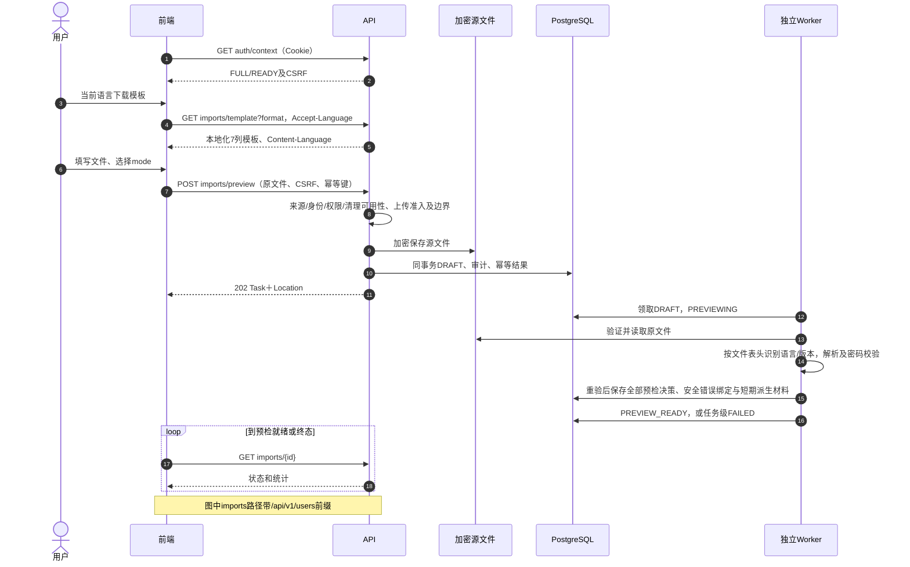
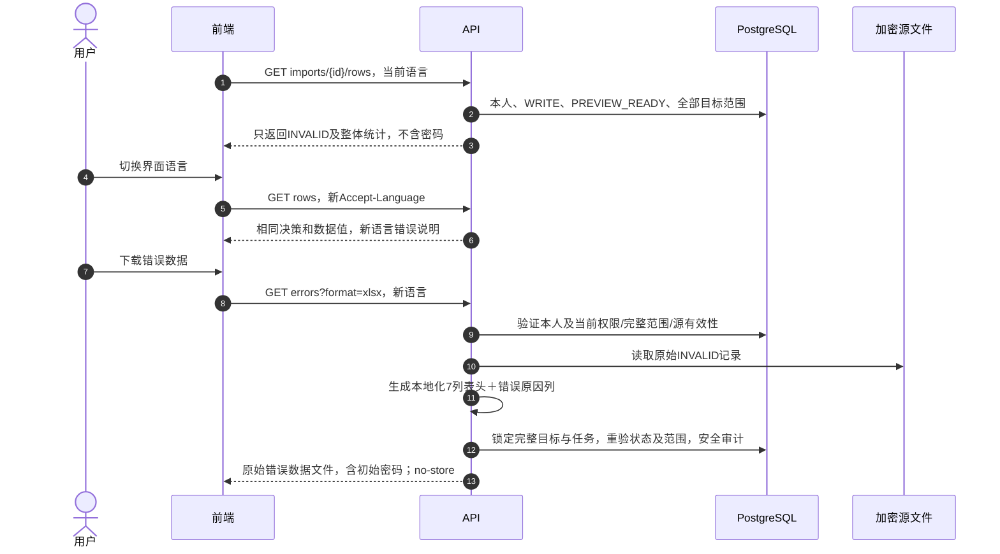
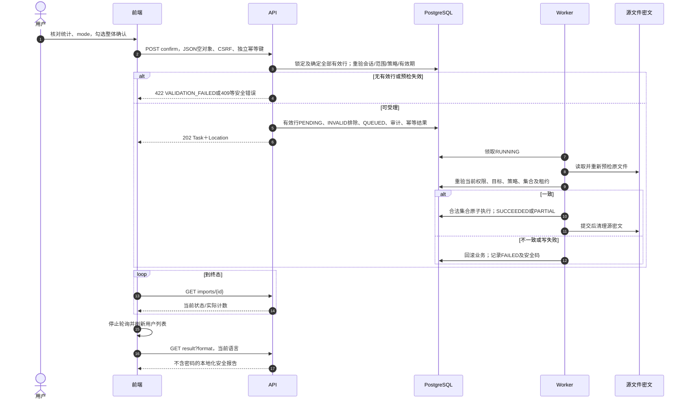
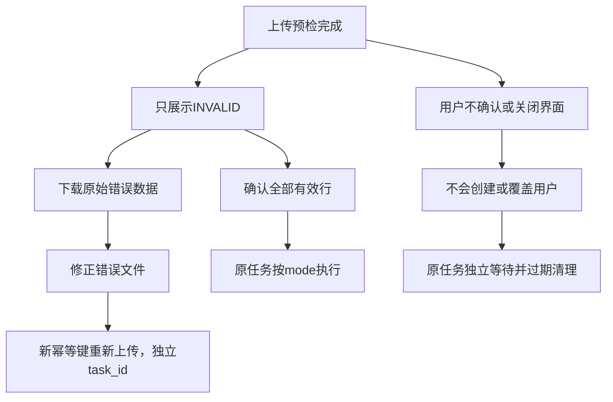

# 用户导入：完整时序图与前端接口调用说明

更新日期：2026-10-30。本说明对应本次导入改造源码，包含7个用户导入接口；不包含供应商模型导入。部署环境须使用同版后端和前端。

## 1. 调用流程

1. 登录，完成改密与条款流程，取得FULL/READY会话及`identity.users / WRITE`权限。
2. 按当前用户设置的语言下载CSV/XLSX模板，填写真实部门路径、角色原始名称和用户资料。
3. 上传原文件并确定重复用户名处理策略`mode`；接口返回202和任务ID。此时未创建或覆盖业务用户。
4. 轮询任务。到`PREVIEW_READY`后，展示整体统计和INVALID错误行；合法行保留在服务端，不返回给前端展示。
5. 如需修正，先下载错误数据。文件保留原始7列，包括初始密码，最后追加本地化错误原因。该下载仅在确认前、源文件有效时提供。
6. 用户核对统计和mode，勾选整体确认声明，提交空JSON对象；后端确定并处理全部有效行，不接受客户端行号。
7. 继续轮询至终态，刷新用户列表，并提供不含密码的安全执行报告。
8. 修正错误文件后可重新上传，形成独立任务；8列文件末尾的错误原因只作说明，不参与校验或导入。

## 2. 模板字段和多语言规则

用户提供的中文模板与原系统都是7个字段；差异为表头名称和列顺序。新模板各语言统一采用以下顺序：

| JSON字段         | 简体中文 | English          | Français              |
| ---------------- | -------- | ---------------- | --------------------- |
| username         | 用户名   | Username         | Nom d’utilisateur     |
| display_name     | 姓名     | Name             | Nom                   |
| email            | 邮箱     | Email            | E-mail                |
| phone            | 手机号   | Phone number     | Téléphone             |
| initial_password | 初始密码 | Initial password | Mot de passe initial  |
| department_path  | 部门路径 | Department path  | Chemin du département |
| role_name        | 角色名称 | Role name        | Nom du rôle           |
| 错误文件追加列   | 错误原因 | Error reason     | Motif de l’erreur     |

- 前端沿用`apiLocale(i18n.language)`及请求层`Accept-Language`，后端只选择当前ACTIVE且已交付导入资源的语言。按请求语言列表协商，其次用户偏好，最后系统默认语言；默认语言必须有完整资源，否则明确失败。
- 返回`Content-Language`表示实际采用的语言；本地化响应包含`Vary: Accept-Language`，并禁止缓存。`/rows`同时返回`response_locale`。
- 新模板输出中文、英文、法文；CSV为UTF-8 BOM。XLSX用文本单元格，保留手机号前导零。
- 上传根据文件完整表头和顺序识别语言，与当前界面语言独立；切换界面语言后，旧语言文件仍可上传。
- 保留旧英文技术表头兼容输入，原顺序为`username,display_name,department_path,role_name,email,phone,initial_password`。它不同于新英文展示表头。
- 表头不能混用语言、任意换序、重复或添加未知列。只允许标准7列，或者追加已识别语言的错误原因列共8列。
- 业务值不翻译：姓名、用户名、密码、部门路径和角色名称保持原始含义。部门仍按含根节点的名称全路径匹配，例如`公司/研发部`，不使用翻译名称或UUID。
- JSON字段名、mode、状态、错误码保持稳定英文标识。错误说明按本次请求语言生成；切换语言不会改变导入集合或mode，不要求重新预检。
- 任务在PREVIEW_READY时可返回`input_template_locale`、`input_template_version`，表示源文件实际识别结果；它们不等于当前下载/显示语言。

中文标准模板：

```csv
用户名,姓名,邮箱,手机号,初始密码,部门路径,角色名称
```

错误文件示例表头：

```csv
Username,Name,Email,Phone number,Initial password,Department path,Role name,Error reason
```

## 3. 通用请求与响应

使用浏览器管理的同源Cookie会话；不读写HttpOnly Cookie，不在localStorage/sessionStorage缓存秘密。通过`GET /api/v1/auth/context`取得CSRF token。写请求必须携带`X-CSRF-Token`和独立的`Idempotency-Key`；Origin由浏览器发送。

所有导入GET也要求WRITE权限。任务查询按本人UUID；预检、错误下载、确认及结果读取均保留相关完整目标范围检查，当前权限变化立即生效。

JSON统一包络：

```json
{ "code": "OK", "data": {}, "params": {}, "request_id": "b759ae0e-e8fd-43d1-b5a8-cbf793840121" }
```

失败使用非2xx HTTP状态与同样四字段包络。下载成功为原始文件流，不套JSON；下载失败仍为JSON，不能直接保存为.xlsx。复用`web-demo/src/features/imports/api.ts`，它与公共transport已处理这些差异。

## 4. 七个接口

| 操作           | 方法与完整路径                                 | 请求                             | 成功                           |
| -------------- | ---------------------------------------------- | -------------------------------- | ------------------------------ |
| 模板           | GET `/api/v1/users/imports/template`           | query `format=csv或xlsx`         | 200文件                        |
| 上传预检       | POST `/api/v1/users/imports/preview`           | multipart `file`,`format`,`mode` | 202 Task＋Location             |
| 任务查询       | GET `/api/v1/users/imports/{task_id}`          | task_id                          | 200 Task                       |
| 错误预检行     | GET `/api/v1/users/imports/{task_id}/rows`     | task_id                          | 200 INVALID行＋整体统计        |
| 错误修正文件   | GET `/api/v1/users/imports/{task_id}/errors`   | task_id；query `format`          | 200文件，含INVALID原始初始密码 |
| 确认全部有效行 | POST `/api/v1/users/imports/{task_id}/confirm` | task_id；JSON `{}`               | 202 Task＋Location             |
| 安全执行报告   | GET `/api/v1/users/imports/{task_id}/result`   | task_id；query `format`          | 200终态文件，不含密码          |

`task_id`使用服务端返回的标准小写UUID。下载请求仅允许一个format参数，不附加其他query字段。没有任务列表、取消、编辑行或重新执行接口。

### 4.1 上传

```typescript
const body = new FormData()
body.append('file', file) // 原始File，不是base64、URL或文件名字符串
body.append('format', 'csv')
body.append('mode', 'SKIP')
```

不要手写multipart Content-Type，由浏览器生成boundary。`format`为csv/xlsx；`mode`省略默认SKIP，可选OVERWRITE。只允许这三个字段，不重复。

资源边界：原始非空文件最大5MiB、整个请求最大6MiB、最多1000条数据记录；单字段最大4096字节，CSV逻辑记录64KiB。模板严格7列，或合法8列错误文件；列数不匹配现在作为文件结构错误拒绝，不静默截断额外数据。CSV要求UTF-8，XLSX仅支持安全单表纯值文件。上传/解析各有有界准入和10秒截止，这不是端到端成功时限。

成功返回202，`Location`指向Task URL。响应时Worker可能已推进任务，不硬编码state一定是DRAFT。预检错误可能在后续任务状态中出现，而不是上传HTTP立即失败。

### 4.2 Task

以下为PREVIEW_READY示例，省略统一包络：

```json
{
  "id": "eb52ac68-2d53-42e2-a2d4-ef6e6ccad2ee",
  "state": "PREVIEW_READY",
  "duplicate_mode": "SKIP",
  "total_rows": 3,
  "created_count": 0,
  "overwritten_count": 0,
  "skipped_count": 0,
  "failed_count": 0,
  "last_error_code": null,
  "expires_at": "2026-11-29T02:00:00Z",
  "completed_at": null,
  "preview_counts": { "create": 1, "overwrite": 0, "skip": 1, "invalid": 1 },
  "valid_rows": 2,
  "can_confirm": true,
  "can_download_errors": true,
  "confirm_before": "2026-10-31T01:59:00Z",
  "input_template_locale": "zh-CN",
  "input_template_version": 2
}
```

PREVIEW_READY以外不保证有预检统计、有效行数、输入模板标识或confirm_before；能力布尔字段默认为false。统计不是实时执行进度。`valid_rows=create+overwrite+skip`；真正计划写入数量为create+overwrite。`can_confirm`还检查原申请会话，不能把恢复查询等同于新登录后可确认原任务。所有能力提示在操作时重新校验。

### 4.3 仅查询INVALID行

仅PREVIEW_READY可用。全部最多1000行，不增加服务端分页；前端自行分页错误行。全部正确时rows为空数组，仍返回完整统计：

```json
{
  "task_id": "eb52ac68-2d53-42e2-a2d4-ef6e6ccad2ee",
  "state": "PREVIEW_READY",
  "duplicate_mode": "SKIP",
  "response_locale": "en",
  "preview_counts": { "create": 1, "overwrite": 0, "skip": 1, "invalid": 1 },
  "valid_rows": 2,
  "can_confirm": true,
  "can_download_errors": true,
  "rows": [
    {
      "row_number": 3,
      "username": "example_invalid",
      "fields": {
        "display_name": "Original name",
        "email": null,
        "phone": null,
        "department_path": "Missing department",
        "role_name": "Original role"
      },
      "disposition": "INVALID",
      "error_codes": ["IMPORT_TARGET_NOT_FOUND"],
      "errors": [
        {
          "code": "IMPORT_TARGET_NOT_FOUND",
          "field": "department_path",
          "message": "Department path: Target not found; use the original name or complete department path"
        }
      ]
    }
  ]
}
```

`row_number`是去除表头后的数据记录序号，从1开始；不是物理文本行或当前表格页index。错误行可能稀疏；不要要求rows[i].row_number=i+1。JSON没有initial_password、原始源引用、密码hash或内部目标UUID。

`errors`保存code/field对应的本地化message；程序按code/field判断，不按message文本判断。结构化信息保存的是安全码和字段，不固化某种语言，也不记录密码值。旧任务缺乏字段绑定时会返回安全通用原因，不能伪造未知具体字段。

### 4.4 错误文件下载

只在PREVIEW_READY、有INVALID且原文件仍有效时可用。前7列从加密源文件按INVALID记录序号读取，保留输入原值；不能从净化fields拼装，以免丢失原始错误值或初始密码。第8列合并该行所有安全错误原因，语言为当前请求语言。

XLSX写为文本；CSV会对危险公式前缀增加保护，不能承诺危险字符串CSV字节级原样往返。可优先选择XLSX，修正后再上传。

- 无INVALID、状态改变或超出下载窗口：409 IMPORT_PREVIEW_CHANGED。
- 非本人任务：404 NOT_FOUND；匿名401；无当前WRITE或范围不满足403。
- 文件流使用no-store、nosniff和附件头；JSON/执行报告/日志/审计/幂等结果仍不包含密码。
- 下载写入独立安全审计；最终返回文件前再次锁定申请人、完整目标、任务并重验状态/范围，下载与确认竞态不能绕过检查。
- 确认后源文件会在终态清理，错误修正文件接口即不再开放。请先下载待修正数据；终态安全执行报告仍可下载。

### 4.5 确认全部有效行

```http
POST /api/v1/users/imports/eb52ac68-2d53-42e2-a2d4-ef6e6ccad2ee/confirm
Content-Type: application/json
X-CSRF-Token: <当前token>
Idempotency-Key: <本次确认命令UUID>
Accept-Language: en

{}
```

必须提交严格空JSON对象，不可省略请求体，也不能传null、数组、mode或selected_rows。旧客户端传selected_rows返回400 MALFORMED_REQUEST，不能被静默解释为全量确认。

mode固定在上传预检时；确认页面明确展示该mode。用户要改变mode必须重新上传并预检，不能确认时直接覆盖。后端事务内读取全部有效集合，锁定旧/新目标，检查原申请会话、权限、策略、源材料、有效期及一致性，再入队。全部INVALID返回422 VALIDATION_FAILED；全合法SKIP允许确认但不修改任何用户。

最终Worker再次完整重验；合法集合内新建/覆盖/跳过及行结果、审计、代次同事务完成。执行失败回滚业务写入，不采用逐行任意成功。原始INVALID未执行但计失败，因此合法集合成功、原始存在INVALID时终态为PARTIAL。

### 4.6 安全执行报告

只在SUCCEEDED、PARTIAL、FAILED、CANCELLED或EXPIRED终态可用，仍要求本人、WRITE及完整相关范围。共12列，表头按当前用户语言生成，对应稳定含义：

```text
row_number,username,display_name,department_path,role_name,email,phone,decision,execution_state,error_reason,task_state,task_error_reason
```

这行表示列含义，不是固定英文文件表头。状态及决策值保持稳定码。报告没有初始密码，不能直接当作导入模板。文件级失败可能没有预检行，会用安全任务错误占位行说明失败。范围已改变时不能承诺始终可下载。

## 5. 字段与mode语义

- 用户名正则：`^[A-Za-z0-9][A-Za-z0-9_.@-]{0,127}$`。已有用户名匹配与文件内重复判断均按ASCII大小写不敏感。
- 显示名按原用户资料校验规范化；邮箱/手机号沿用现有长度及字符规则，本次不新增邮箱语法规则。
- 部门路径/角色名称按原始名称匹配，进行既有Unicode NFC规范化；缺失、歧义、越权均产生INVALID。
- 公式或危险单元格前缀、同文件重复用户名、初始密码策略违规均会产生错误。
- CREATE使用初始密码并初始化安全状态；SKIP和OVERWRITE不派生/替换已有密码。
- OVERWRITE只更新显示名、邮箱、手机号、部门和角色；空邮箱/手机号会清空已有值，不表示保持原值。
- 不通过导入修改用户名、已有凭据、登录/AI状态、条款事实、Key、组成员或模型授权。自我保护及最后超管等原保护保留。

## 6. 完整时序图

### 6.1 上传和异步预检



### 6.2 INVALID展示、语言切换与错误下载



### 6.3 全部有效行确认与执行



### 6.4 修正后重传与未确认任务



## 7. 状态、轮询、幂等及恢复

| 状态                                       | 前端动作                                                |
| ------------------------------------------ | ------------------------------------------------------- |
| DRAFT/PREVIEWING                           | 展示预检中，继续查询，不调用rows或confirm               |
| PREVIEW_READY                              | 停止自动轮询，查询INVALID、展示统计、下载错误文件或确认 |
| QUEUED/RUNNING                             | 禁止再次改选或改mode，继续查询                          |
| SUCCEEDED/PARTIAL/FAILED/CANCELLED/EXPIRED | 停止轮询，显示结果，刷新列表，按当前权限下载安全报告    |

现有UI每2秒轮询；任务查询503 AUTHENTICATION_BUSY可按原规则重试，其他查询错误停止自动轮询，允许手动刷新。权限/会话变化时清除可见旧数据；不同语言的预检缓存隔离。关闭界面或AbortSignal只取消客户端等待，不取消后台任务。

幂等规则：上传键绑定原文件内容、format和mode；确认键绑定task_id、mode及服务端完整有效集合。相同命令重试保持键及输入，语言切换不改变业务命令；实际文件内容变化必须新键。新键即独立新任务，即使文件相同也不会全局去重。旧任务不被新上传取消或合并。

没有保存task_id时没有当前用户任务列表接口可找回；有原上传幂等键及完全相同输入时可以尝试原命令重放，但不是通用任务检索。前端应提醒保存安全任务ID，不为恢复任务缓存原密码文件。

只预检未确认不创建/覆盖用户，但会有任务、预检行、源密文和短期密码派生材料。确认须创建未满24小时且源有效；清理程序从创建后23小时59分钟开始标记非终态任务EXPIRED并清理秘密材料，每30秒扫描一次。30天expires_at是任务/结果保留边界，不是可确认30天。到30天且expires_at已到后删除任务及行结果，审计证据保留；实际清理取决于进程正常运行，不保证到秒。

## 8. 前端调用示例

```typescript
import { transport, newCommandKey } from '../../api/transport/client'
import { importsApi, saveImportDownload } from './api'

await transport.context() // transport管理CSRF、同源Cookie和当前语言请求头
saveImportDownload(await importsApi.template('xlsx'), 'users-template.xlsx')

// 保存于组件ref；一次命令重试不能在请求函数内部重建键。
const uploadKey = newCommandKey()
const accepted = await importsApi.upload(file, 'xlsx', 'SKIP', uploadKey)
const taskId = accepted.id

// 由页面定时查询；PREVIEW_READY时获取错误行与统计。
const task = await importsApi.task(taskId, signal)
if (task.state === 'PREVIEW_READY') {
  const preview = await importsApi.rows(taskId, signal)
  // preview.rows全部为INVALID，不生成行选择集合。
  if (preview.can_download_errors) {
    // 仅在用户点击下载时调用；文件可能含原始初始密码。
    saveImportDownload(await importsApi.errors(taskId, 'xlsx'), 'users-errors.xlsx')
  }
  // 仅在用户核对mode和数量、明确确认后调用，不能自动执行。
  if (preview.can_confirm && userAcknowledged) {
    const confirmKey = newCommandKey() // 本次确认首次生成；重试保留
    await importsApi.confirm(taskId, confirmKey)
  }
}
```

示例中的file、signal、userAcknowledged由页面管理。实际导入向导已具备请求防双击、错误展示、确认前下载提示、终态列表刷新及Blob URL释放。

## 9. 错误处理速查

| HTTP/错误码                                                                     | 前端处理                                                              |
| ------------------------------------------------------------------------------- | --------------------------------------------------------------------- |
| 400 MALFORMED_REQUEST                                                           | 检查UUID、严格空对象、幂等键、重复/额外query；旧selected_rows必须移除 |
| 401 UNAUTHENTICATED                                                             | 停止轮询，重新登录后重新评估原任务                                    |
| 403 FORBIDDEN/OUT_OF_SCOPE/RESOURCE_DISABLED                                    | 刷新权限和入口，隐藏旧数据，不绕过完整目标范围                        |
| 403 ORIGIN_REJECTED/CSRF_INVALID                                                | 检查同源部署或刷新auth/context；结果未知的旧命令仍保留原键            |
| PASSWORD_CHANGE_REQUIRED/TERMS_ACCEPTANCE_REQUIRED                              | 完成对应门禁流程                                                      |
| 404 NOT_FOUND                                                                   | 不存在或非本人可见任务，不能推断他人数据                              |
| 409 IMPORT_PREVIEW_CHANGED                                                      | 状态/源/目标/会话已变，或无错误文件可下载；先查任务，再按需重新上传   |
| 409 PASSWORD_POLICY_CHANGED                                                     | 按最新密码规则重新预检                                                |
| 409 IDEMPOTENCY_CONFLICT/IDEMPOTENCY_IN_PROGRESS                                | 核对命令输入；相同命令原键有界重试，不盲换键                          |
| 413 IMPORT_FILE_TOO_LARGE                                                       | 文件/请求超限，缩减后重新提交                                         |
| 415 UNSUPPORTED_MEDIA_TYPE                                                      | 上传用FormData、确认用application/json                                |
| 422 VALIDATION_FAILED                                                           | 没有有效行等业务参数不满足，按统计和错误说明修正                      |
| 422 IMPORT_FORMAT_UNSUPPORTED/IMPORT_LIMIT_EXCEEDED                             | 编码/表头/结构/解析安全边界问题；有些在异步任务中体现                 |
| 429 IMPORT_BUSY                                                                 | 有界退避，原命令用原键                                                |
| 503 IMPORT_STORAGE_UNAVAILABLE/COMMAND_HMAC_KEY_UNAVAILABLE/AUTHENTICATION_BUSY | 服务暂不可用；保存request_id，按原重试策略处理                        |
| 500 INTERNAL_ERROR                                                              | 保存request_id，未知写结果按幂等恢复，不据HTTP失败推断业务未提交      |

行错误code包括重复用户名、危险公式、目标不存在/歧义、资料规则、密码策略、权限/范围及自我保护。message只包含安全字段规则和原因，不包含密码原值。HTTP200查询返回state=FAILED表示查询成功、任务失败。

## 10. Swagger、生成与兼容发布

Swagger调试导入接口时，显式填写的Accept-Language会原样保留；未填写时由服务端按当前用户保存的语言偏好协商，不被条款语言选择器覆盖。

后端Req/Res和同一实际Controller注册表导出Swagger。运行应用的`/openapi.json`、本地`/docs`和生成客户端应一致。

```sh
# 项目根目录，固定现有工具链；不读配置、不连接数据库
node scripts/generate-api.mjs
node scripts/generate-api.mjs --check
python3 scripts/generate-model-access-runtime-contract.py
node scripts/generate-model-access-client.mjs
```

`contracts/actual/openapi.json`及`web-demo/src/api/generated/schema.d.ts`由工具生成，不手改。启用M2时的实际规范同步包含同样导入变化；旧发布规范、原SQL/依赖不改写。

本次是破坏性导入契约升级：`/rows`仅INVALID、confirm取消行号、模板多语言和原始错误下载。必须联动发布新前后端；旧行选择请求明确拒绝。历史M1/M2比较只对精确七条导入路径采用本次受审快照，其他路由仍严格比较，不扩大全局豁免。

本文描述实现接口，不表示生产部署、容量或SLA已经验证。测试结果、失败原件、工作区隔离边界见同目录《用户导入-实施与验证记录》。
