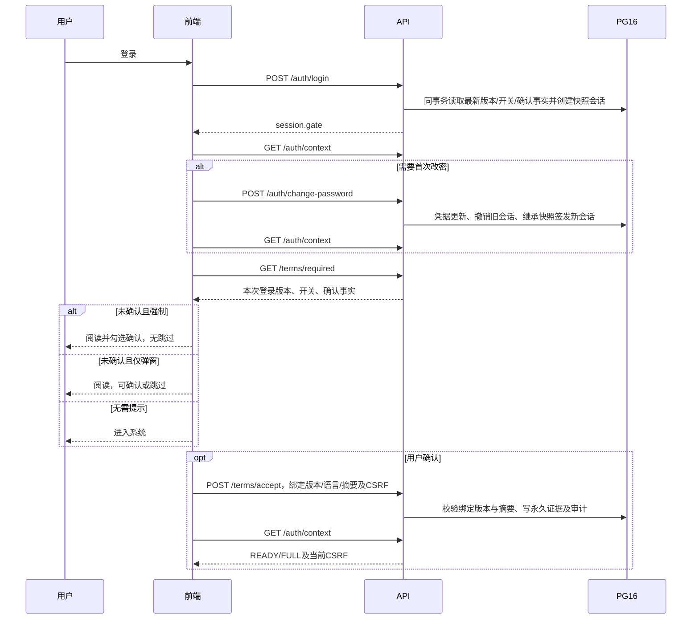

# 登录条款快照接口与调用流程

## 业务规则

登录成功时读取当时最新的已发布版本、登录弹窗开关、强制确认开关和该版本确认记录，并与会话绑定。配置修改或连续发布不追溯已有会话；下次重新登录只处理登录时最新生效版本，不要求补确认中间版本。首次改密、ONBOARDING→FULL换发及空闲续期继承本次登录快照。账号停用、认证版本、会话吊销/期限、角色/部门权限仍实时校验。

## 接口

| 接口                                        | 用途与变化                                                                                                                                                            |
| ------------------------------------------- | --------------------------------------------------------------------------------------------------------------------------------------------------------------------- |
| POST /api/v1/auth/login                     | 创建会话并保存条款快照；响应报文结构不变，gate按快照计算                                                                                                              |
| GET /api/v1/auth/context                    | session.gate按会话快照；兼容字段current_terms_id现在表示本次登录绑定的版本，terms_confirmation_required表示该次登录是否强制；旧会话为""/false；密码规则仍读取当前配置 |
| GET /api/v1/auth/me                         | 返回按会话快照计算的门禁                                                                                                                                              |
| **GET /api/v1/terms/required?locale=zh-CN** | 新增；登录引导使用，只能由当前Cookie会话确定版本，不接受用户指定terms_id；报文与/current同形                                                                          |
| GET /api/v1/terms/current?locale=zh-CN      | 保留读取全局当前版本，供系统内主动阅读；不能用于判断本次登录门禁                                                                                                      |
| POST /api/v1/terms/accept                   | 请求结构不变；允许确认全局当前版本或本次登录绑定版本，拒绝无关历史版本；校验真实译文摘要，首次确认事实与审计/outbox同事务；重复确认返回原记录                         |
| PATCH /api/v1/terms/config                  | 开关只影响后续登录；强制开启仍自动启用弹窗；不新建正文版本                                                                                                            |
| POST /api/v1/terms/versions                 | 发布不可变新版本，仅影响后续登录的版本选择                                                                                                                            |

required 返回的 mandatory_confirmation/login_popup_enabled 为登录快照；version_updated_at 为绑定版本的生成时间，config_updated_at 为登录时保存的配置时间。accepted按用户对该绑定版本的永久确认事实计算，确认任何有效译文即满足该版本要求。升级前NULL快照会话的required返回当前正文供主动阅读，但两个开关均false，不追加引导或门禁。

## 调用方式

所有认证读取携带同源HttpOnly Cookie；无会话返回401。GET required沿用/current的语言校验、回退和Origin策略，空locale/未知参数为400。locale可省略，服务端按显式语言→用户首选→Accept-Language→系统默认选择可用译文。

```http
GET /api/v1/terms/required?locale=zh-CN
Accept: application/json
```

响应保持code/data/params/request_id四字段。data包含terms_id、version、title、body、requested_locale、resolved_locale、content_digest、mandatory_confirmation、login_popup_enabled、accepted及两个时间字段。正文由发布时后端净化，不由前端拼接或重新计算摘要。

```http
POST /api/v1/terms/accept
Content-Type: application/json
X-CSRF-Token: <本会话/auth/context返回值>

{"terms_id":"<required返回值>","locale_code":"<resolved_locale>","content_digest":"<content_digest>"}
```

不要替换为最新/current的ID或自行摘要。200表示确认成功，重复提交保持原首次证据；错误摘要或无关旧版本返回409/TERMS_VERSION_CHANGED。缺少CSRF返回403；首次改密尚未完成时返回PASSWORD_CHANGE_REQUIRED。确认完成后重新获取/auth/context，允许服务端换发FULL会话和CSRF；使用新上下文，不保留旧CSRF重试业务请求。

## 前端时序



管理员在上述任一节点发布新版或调整开关，都不替换会话要求；已在系统的用户继续使用。刷新网页、刷新会话上下文和续期不是重新登录。退出后重新认证、过期重新认证才创建新快照。

## 范围边界

API Key管理的TERMS_REQUIRED继续表达“全局当前条款”的Key控制条件，不是本次管理会话的gate；未更改模型网关鉴权。原会话与新会话可具有不同的条款要求，这是本次产品规则的预期行为。
