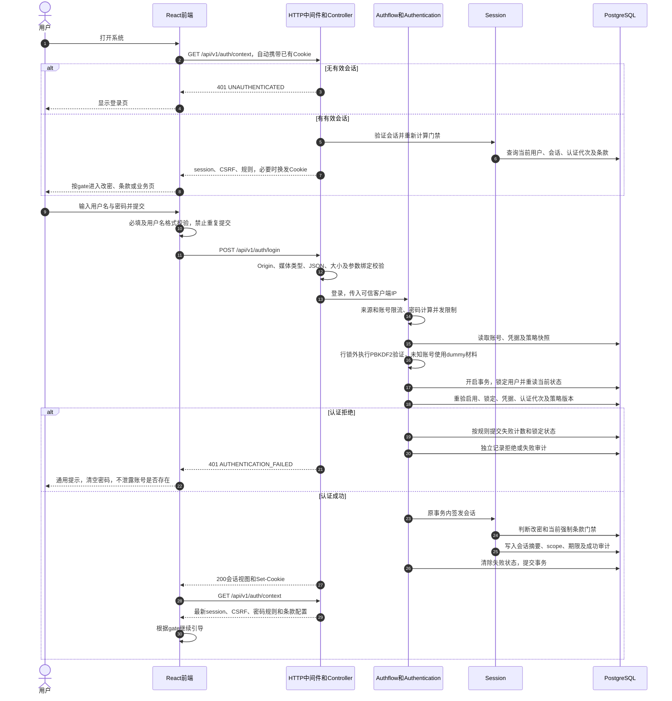
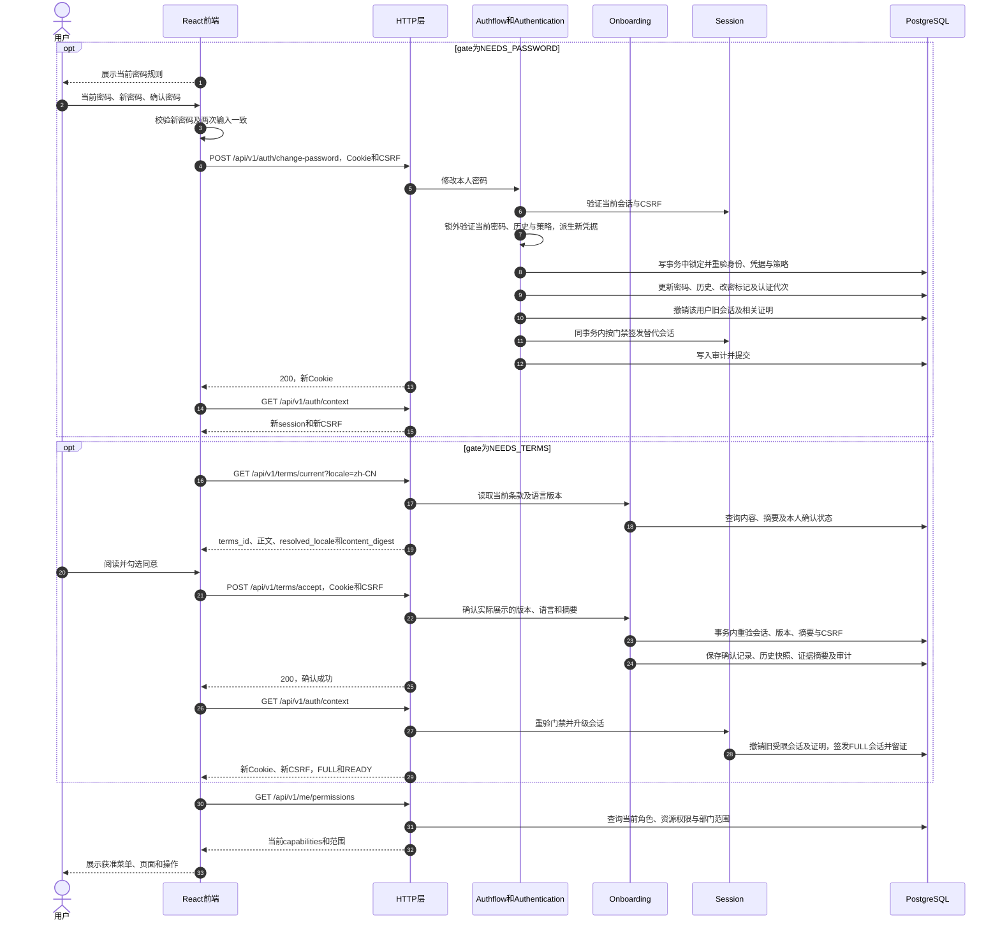

# 登录流程时序与前端对接指南

- 文档日期：2026-10-28（Asia/Shanghai）。
- 依据：当前工作区GoFrame Req/Res、实际OpenAPI、认证/会话/条款实现与React调用代码；Git基线`8823a94c`。
- 范围：本地账号密码登录、会话恢复、首次改密、当前条款确认、权限加载、退出及异常处理。不包含SSO、OAuth、API Key登录或网关认证。
- 本文为源码及契约核对，不代表今天重新进行了服务器或运行时验收；不修改工程、依赖、数据库、服务器或现有任务状态。
- 本文全部用户名、密码、UUID、CSRF与摘要均为公开合成示例，不是任何环境的可用凭据。必须使用运行接口返回的真实ID、CSRF及摘要，不能复制示例值作为固定参数。

## 1. 对接前先明确

1. 密码正确仅表示身份验证成功，可能获得`ONBOARDING`受限会话；必须依据`gate`继续改密或条款流程。
2. 业务页面的进入条件是`scope=FULL`且`gate=READY`。随后还要读取当前权限，不能把FULL理解成管理员或全权限。
3. 登录采用服务端会话和HttpOnly Cookie，不是前端保存JWT。请求JSON中没有可供前端保存的access_token。
4. 写请求（登录除外）携带当前CSRF；会话换发后重新获取上下文，不能沿用旧CSRF。
5. 当前API采用统一四字段报文：`code/data/params/request_id`；错误仍使用正确HTTP状态，不是全部HTTP 200。
6. 现有前端已有`AuthProvider`和`transport`，应优先复用，不新建第二套登录或Cookie管理机制。

## 2. 地址、Cookie与请求约定

同源路径统一以`/api/v1`开头。前端生产页面和API宜由同一个入口提供；开发期沿用Vite代理。本文使用相对路径，不要求访问某台服务器。

```http
Accept: application/json
Accept-Language: zh-CN
Content-Type: application/json
X-CSRF-Token: <从最新auth/context读取，仅适用于需CSRF的请求>
```

- 浏览器请求使用`credentials: 'same-origin'`，自动携带同源Cookie。不要手工设置Cookie或伪造Origin，也不要使用`mode: 'no-cors'`。
- POST的JSON按接口示例序列化；退出请求正文为`{}`。登录及本文引导接口不需要`Idempotency-Key`或`X-Reauth-Proof`，不要自行添加。
- HTTPS会话Cookie：`__Host-ais_session; Path=/; HttpOnly; Secure; SameSite=Lax`。
- 显式允许的开发HTTP Cookie：`ais_session_dev; Path=/; HttpOnly; SameSite=Lax`，不带Secure。
- Cookie名由服务端环境决定；前端不能通过`document.cookie`读取会话Cookie。
- 会话绝对期限8小时，空闲期限30分钟；有效访问按一分钟节流更新空闲期限，但不延长绝对期限。以服务端返回和校验为准。
- CSRF只保存在请求层内存，不保存到localStorage/sessionStorage。用户名密码、Cookie、CSRF和一次性证明均不进入日志或埋点。

## 3. 登录主流程时序



密码校验使用PBKDF2-HMAC-SHA256（当前规定最低600000次）；计算在行锁外，锁后重验避免凭据或策略变化。登录成功的会话与审计等同事务提交，提交后才发送Cookie。认证拒绝需要保留失败计数；不能因为返回401而把计数回滚。进程内来源60次/分钟、账号10次/分钟，密码验证计算最多2并发；这些不是跨多API实例共享的全局限流。账号锁定阈值和期限来自当前密码策略，不在前端写死。

## 4. 门禁与前端路由

| gate           | scope      | next_action       | 路由/处理              |
| -------------- | ---------- | ----------------- | ---------------------- |
| NEEDS_PASSWORD | ONBOARDING | CHANGE_PASSWORD   | `/onboarding/password` |
| NEEDS_TERMS    | ONBOARDING | ACCEPT_TERMS      | `/onboarding/terms`    |
| READY          | FULL       | ENTER_APPLICATION | 加载权限并进入业务页面 |

优先级为改密 → 强制条款 → 业务。两个门禁同时存在时必须先改密。`gate`会随当前策略重新计算；前端不可自行把状态改为READY。受限会话门禁刚解除但尚未换发时，可能暂时出现`scope=ONBOARDING, gate=READY`，应读取`auth/context`完成升级后再请求业务。

## 5. 首次改密及条款确认时序



改密会使该用户旧会话整体失效，并不是只改数据库密码哈希。条款确认接口本身返回的是接受证据；不能把它当作新会话，必须继续调用上下文接口。

## 6. 接口示例

下面成功响应都保留统一四字段。时间、密码规则、版本及可见能力均只是示例，以实际响应为准。`request_id`用于问题定位，前端不得用它当会话或幂等键。

### 6.1 POST /api/v1/auth/login

公开登录接口，不需要已有Cookie或CSRF。前端校验用户名格式`^[A-Za-z0-9][A-Za-z0-9_.@-]{0,127}$`；用户名上限128、密码输入上限1024字符，同时服务端还有字节边界。不要擅自trim密码，避免改变用户实际输入；登录不是新密码策略检查入口。

**请求正文：**

```json
{
  "username": "integration_user",
  "password": "ExampleLogin@2026"
}
```

以下为需要首次改密的成功响应。浏览器同时收到Set-Cookie，令牌不在JSON正文中。

**响应：HTTP 200**

```json
{
  "code": "OK",
  "data": {
    "user_id": "11111111-1111-4111-8111-111111111111",
    "username": "integration_user",
    "display_name": "前端联调用户",
    "scope": "ONBOARDING",
    "gate": "NEEDS_PASSWORD",
    "next_action": "CHANGE_PASSWORD",
    "expires_at": "2026-10-28T09:00:00Z",
    "idle_expires_at": "2026-10-28T01:30:00Z",
    "time_zone": "Asia/Shanghai",
    "preferred_locale": "zh-CN"
  },
  "params": {},
  "request_id": "44444444-4444-4444-8444-444444444444"
}
```

前端随后调用`GET /auth/context`，不要仅凭此次200跳转业务页。READY/FULL的普通登录响应结构相同，只替换scope/gate/next_action。

### 6.2 GET /api/v1/auth/context

页面启动、登录成功、改密成功、确认条款成功及CSRF失效后使用。不需要请求正文，由浏览器自动携带Cookie。默认恢复接口使用本接口，不用`auth/me`替代。

```http
GET /api/v1/auth/context
Accept: application/json
Accept-Language: zh-CN
```

**响应：HTTP 200**

```json
{
  "code": "OK",
  "data": {
    "session": {
      "user_id": "11111111-1111-4111-8111-111111111111",
      "username": "integration_user",
      "display_name": "前端联调用户",
      "scope": "ONBOARDING",
      "gate": "NEEDS_PASSWORD",
      "next_action": "CHANGE_PASSWORD",
      "expires_at": "2026-10-28T09:00:00Z",
      "idle_expires_at": "2026-10-28T01:30:00Z",
      "time_zone": "Asia/Shanghai",
      "preferred_locale": "zh-CN"
    },
    "csrf_token": "AAAAAAAAAAAAAAAAAAAAAAAAAAAAAAAAAAAAAAAAAAA",
    "csrf_header": "X-CSRF-Token",
    "password_rules": {
      "min_length": 8,
      "max_length": 64,
      "complexity_categories": 3,
      "history_count": 5
    },
    "current_terms_id": "33333333-3333-4333-8333-333333333333",
    "terms_confirmation_required": true
  },
  "params": {},
  "request_id": "44444444-4444-4444-8444-444444444444"
}
```

- 缓存`csrf_token`到内存；写请求使用`csrf_header`指定的请求头，当前固定为X-CSRF-Token。
- `terms_confirmation_required`是当前强制确认配置，不能替代`session.gate`判断本人是否仍需要确认。
- `current_terms_id`不是条款内容，不能据此构造content_digest。
- 可能换发Cookie：ONBOARDING门禁解除后，在本接口内撤销旧受限会话/证明并签发FULL会话；若没有换发，正常读取不要求每次更换Cookie。

### 6.3 GET /api/v1/auth/me

仅在需要会话视图时使用，无正文。不返回CSRF、密码规则或条款内容，因此正常登录链路不必在context之后再重复调用me。

**响应：HTTP 200**

```json
{
  "code": "OK",
  "data": {
    "user_id": "11111111-1111-4111-8111-111111111111",
    "username": "integration_user",
    "display_name": "前端联调用户",
    "scope": "FULL",
    "gate": "READY",
    "next_action": "ENTER_APPLICATION",
    "expires_at": "2026-10-28T09:00:00Z",
    "idle_expires_at": "2026-10-28T01:30:00Z",
    "time_zone": "Asia/Shanghai",
    "preferred_locale": "zh-CN"
  },
  "params": {},
  "request_id": "44444444-4444-4444-8444-444444444444"
}
```

### 6.4 POST /api/v1/auth/change-password

需要已认证会话（允许首次改密受限会话）以及当前CSRF。表单的`confirm_password`只在前端比较，不发送给后端。

```http
POST /api/v1/auth/change-password
Content-Type: application/json
X-CSRF-Token: <最新上下文中的csrf_token>
```

```json
{
  "current_password": "ExampleLogin@2026",
  "new_password": "ExampleNew@2026!"
}
```

以下示例为改密后仍需确认强制条款：

**响应：HTTP 200**

```json
{
  "code": "OK",
  "data": {
    "user_id": "11111111-1111-4111-8111-111111111111",
    "username": "integration_user",
    "display_name": "前端联调用户",
    "scope": "ONBOARDING",
    "gate": "NEEDS_TERMS",
    "next_action": "ACCEPT_TERMS",
    "expires_at": "2026-10-28T09:00:00Z",
    "idle_expires_at": "2026-10-28T01:30:00Z",
    "time_zone": "Asia/Shanghai",
    "preferred_locale": "zh-CN"
  },
  "params": {},
  "request_id": "44444444-4444-4444-8444-444444444444"
}
```

成功后服务端替换Cookie；前端清除旧CSRF，重新读取context并按新gate导航。若不需要确认条款，直接返回READY/FULL，不必强行显示条款页。

### 6.5 GET /api/v1/terms/current?locale=zh-CN

需要有效会话，允许引导阶段读取。`locale`可省略；存在时不得为空。服务端会做语言回退，提交确认时使用`resolved_locale`，不能盲目提交请求中的locale。

**响应：HTTP 200**

```json
{
  "code": "OK",
  "data": {
    "terms_id": "33333333-3333-4333-8333-333333333333",
    "version": "1",
    "title": "联调用户须知",
    "body": "<h2>联调说明</h2><p>仅用于测试。</p>",
    "requested_locale": "zh-CN",
    "resolved_locale": "zh-CN",
    "content_digest": "aaaaaaaaaaaaaaaaaaaaaaaaaaaaaaaaaaaaaaaaaaaaaaaaaaaaaaaaaaaaaaaa",
    "mandatory_confirmation": true,
    "login_popup_enabled": true,
    "accepted": false
  },
  "params": {},
  "request_id": "44444444-4444-4444-8444-444444444444"
}
```

`body`为后端发布时处理后的HTML，沿用现有条款组件展示；不要自行替换内容后仍回传原摘要。本文摘要是占位值，不表示示例HTML的真实哈希。必须保存本次实际展示的`terms_id/resolved_locale/content_digest`三元组。

### 6.6 POST /api/v1/terms/accept

需要有效会话、完成改密以及CSRF。用户明确勾选同意后才能提交；不能在页面加载或登录成功时自动代替用户接受条款。

```json
{
  "terms_id": "33333333-3333-4333-8333-333333333333",
  "locale_code": "zh-CN",
  "content_digest": "aaaaaaaaaaaaaaaaaaaaaaaaaaaaaaaaaaaaaaaaaaaaaaaaaaaaaaaaaaaaaaaa"
}
```

**响应：HTTP 200**

```json
{
  "code": "OK",
  "data": {
    "id": "55555555-5555-4555-8555-555555555555",
    "user_id": "11111111-1111-4111-8111-111111111111",
    "terms_id": "33333333-3333-4333-8333-333333333333",
    "locale_code": "zh-CN",
    "content_digest": "aaaaaaaaaaaaaaaaaaaaaaaaaaaaaaaaaaaaaaaaaaaaaaaaaaaaaaaaaaaaaaaa",
    "evidence_digest": "bbbbbbbbbbbbbbbbbbbbbbbbbbbbbbbbbbbbbbbbbbbbbbbbbbbbbbbbbbbbbbbb",
    "accepted_at": "2026-10-28T01:05:00Z",
    "username_snapshot": "integration_user",
    "display_name_snapshot": "前端联调用户",
    "department_snapshot": {
      "snapshot_version": 1,
      "department_id": "22222222-2222-4222-8222-222222222222",
      "name": "联调部门",
      "ancestor_ids": ["22222222-2222-4222-8222-222222222222"],
      "path": [
        {
          "id": "22222222-2222-4222-8222-222222222222",
          "name": "联调部门"
        }
      ]
    }
  },
  "params": {},
  "request_id": "44444444-4444-4444-8444-444444444444"
}
```

响应是历史确认快照，不是用户当前部门或新会话。相同用户/条款已存在确认记录时可返回已有证据，不新增前端幂等键。成功后立即读取context完成门禁重算及可能的会话升级，再进入业务。

语言、条款版本或内容变化后清空勾选状态；用户必须重新阅读当前内容并确认。摘要必须原样回传，前端不要自行重新计算HTML摘要。

### 6.7 GET /api/v1/me/permissions

只在FULL/READY后加载，自动携带Cookie，无正文。

**响应：HTTP 200**

```json
{
  "code": "OK",
  "data": {
    "permissions_version": "3",
    "configuration_version": "2",
    "department_scope_root_id": "22222222-2222-4222-8222-222222222222",
    "capabilities": [
      {
        "resource_code": "identity.users",
        "can_read": true,
        "can_write": false
      },
      {
        "resource_code": "personal.profile",
        "can_read": true,
        "can_write": true
      }
    ]
  },
  "params": {},
  "request_id": "44444444-4444-4444-8444-444444444444"
}
```

能力数组仅为示例，不预设一定包含这些资源。路由、菜单、按钮按实际capabilities判断；部门范围使用department_scope_root_id。版本是字符串，不能当成JWT或仅靠前端缓存跳过后端校验。

### 6.8 POST /api/v1/auth/logout

需要当前Cookie和CSRF，发送空JSON对象。

```json
{}
```

**响应：HTTP 200**

```json
{
  "code": "OK",
  "data": {
    "applied": true,
    "replayed": false
  },
  "params": {},
  "request_id": "44444444-4444-4444-8444-444444444444"
}
```

服务端撤销当前会话及相关证明并清Cookie；前端清除CSRF、用户上下文与业务查询缓存，回登录页。普通退出不等于撤销所有设备。replayed的具体值由服务端返回，不写死。

## 7. 前端调用顺序

| 场景                   | 必须顺序                                                                                                             |
| ---------------------- | -------------------------------------------------------------------------------------------------------------------- |
| 首次打开，无有效Cookie | context → 401 → 登录页；401是正常匿名状态，不展示系统故障                                                            |
| 已有Cookie恢复         | context → 判断gate；READY/FULL才请求permissions及业务                                                                |
| 普通登录且无需引导     | login → context → current terms的可选弹窗检查 → permissions → 业务                                                   |
| 需要改密和强制条款     | login → context → change-password → context → terms/current → 用户确认 → terms/accept → context → permissions → 业务 |
| 只需要改密             | login → context → change-password → context → READY/FULL → permissions → 业务                                        |
| 只需要强制条款         | login → context → terms/current → 用户确认 → terms/accept → context → permissions → 业务                             |
| 非强制登录弹窗         | READY/FULL → terms/current → popup开启且未确认则展示；可以暂不确认                                                   |
| 会话失效               | 停止依赖请求、清敏感缓存 → 登录页；保留已保存业务事实，不自动重放写请求                                              |
| 退出                   | logout → 清本地缓存 → 登录页                                                                                         |

表中业务调用由门禁控制；当前AuthProvider在READY/FULL后启用permissions查询，因此权限请求与非强制条款读取可能并行，不应依赖两者严格串行。`auth.refresh()`还会使语言选项、权限及identity相关缓存失效，这些附加刷新请求不是多次登录。

**当前实现细节：**可选条款弹窗检查位于LoginPage的READY分支；PasswordPage改密成功后按新gate导航，没有复用同样的可选弹窗预检。新写独立前端时若希望统一这两处体验，应作为明确产品决策，不要把可选弹窗实现成新的后端强制门禁。

### 7.1 复用项目现有调用层

以下为与现有组件一致的调用骨架，使用`src/api/transport/client.ts`中的transport/unwrap。`auth`来自useAuth；navigate来自React Router；locale按现有apiLocale解析。类型应从生成的schema.d.ts取得，不另写一份同义DTO。

```ts
// 登录提交：页面应禁用重复提交，并在finally恢复按钮。
unwrap(
  await transport.client.POST('/api/v1/auth/login', {
    body: { username, password },
  }),
)
// 浏览器已经接收Set-Cookie，refresh读取最新上下文并刷新CSRF。
const context = await auth.refresh()
if (context.session.gate === 'NEEDS_PASSWORD') {
  navigate('/onboarding/password', { replace: true })
} else if (context.session.gate === 'NEEDS_TERMS') {
  navigate('/onboarding/terms', { replace: true })
} else if (context.session.scope === 'FULL') {
  const terms = unwrap(
    await transport.client.GET('/api/v1/terms/current', {
      params: { query: { locale } },
    }),
  )
  navigate(terms.login_popup_enabled && !terms.accepted ? '/onboarding/terms' : '/', {
    replace: true,
  })
}
```

```ts
// 首次改密：confirm_password只用于前端比较，不放入body。
unwrap(
  await transport.client.POST('/api/v1/auth/change-password', {
    body: { current_password, new_password },
  }),
)
const context = await auth.refresh()
// 按context.session.gate继续改密/条款/业务，不使用旧context。
```

```ts
// 用户已经明确勾选了当前展示内容；换语言/版本后应清空勾选。
unwrap(
  await transport.client.POST('/api/v1/terms/accept', {
    body: {
      terms_id: displayed.terms_id,
      locale_code: displayed.resolved_locale,
      content_digest: displayed.content_digest,
    },
  }),
)
await auth.refresh() // 可能换发FULL会话及CSRF
navigate('/', { replace: true })

// 退出复用现有封装，包含清除查询缓存及CSRF。
await auth.logout()
```

现有transport会自动带Cookie、语言和CSRF。非GET且非login的调用如缺少CSRF，会先读取context；页面正常执行上述链路后通常无需额外请求。不要同时让页面与另一个拦截器分别维护CSRF。

## 8. 异常处理

### 8.1 HTTP状态与稳定错误码

| 场景                           | HTTP / code                   | 前端处理                                                |
| ------------------------------ | ----------------------------- | ------------------------------------------------------- |
| 字段、JSON、类型不合法         | 400 MALFORMED_REQUEST         | 表单/请求错误提示，保留可修正的非敏感输入               |
| JSON媒体类型错误               | 415 UNSUPPORTED_MEDIA_TYPE    | 检查Content-Type与JSON序列化                            |
| 来源不允许                     | 403 ORIGIN_REJECTED           | 核对同源、代理、publicOrigin；不靠伪造Origin绕过        |
| 账号、密码、启用或锁定验证拒绝 | 401 AUTHENTICATION_FAILED     | 统一提示，不说明账号是否存在；清空密码                  |
| 当前会话无效或过期             | 401 UNAUTHENTICATED           | 清CSRF及业务缓存，回登录；启动探测时视为匿名            |
| 来源/账号限流                  | 429 RATE_LIMITED              | 遵循Retry-After，默认实现可能返回60秒；不要自动连点重试 |
| 认证计算资源繁忙               | 503 AUTHENTICATION_BUSY       | 显示稍后重试；部分分支有Retry-After: 1，以实际头为准    |
| CSRF失效                       | 403 CSRF_INVALID              | 清旧CSRF，刷新context；不得自动重放敏感POST             |
| 未完成改密                     | 403 PASSWORD_CHANGE_REQUIRED  | context刷新后导航改密页                                 |
| 未确认强制条款                 | 403 TERMS_ACCEPTANCE_REQUIRED | context刷新后读取条款并展示                             |
| 新密码不符策略/当前密码错误    | 422 VALIDATION_FAILED         | 使用params.fields及password_policy展示具体原因          |
| 新密码命中历史                 | 422 PASSWORD_REUSED           | 提示换一个密码，按字段提示定位                          |
| 密码策略在操作期间变化         | 409 PASSWORD_POLICY_CHANGED   | 按refresh_required刷新规则并让用户重新确认提交          |
| 条款版本或内容变化             | 409 TERMS_VERSION_CHANGED     | 重取当前正文，清勾选；用户重新阅读确认                  |
| 无当前动作/资源权限            | 403 FORBIDDEN等               | 刷新权限，显示无权；不要循环登录或扩大菜单权限          |
| 服务异常                       | 500 INTERNAL_ERROR            | 通用提示和request_id，不展示服务端内部细节              |
| 网络失败/响应不符合契约        | 无可靠业务响应                | 与空列表区分；查询可显式重试，写请求先核实结果          |

所有调用均应处理HTTP状态和code，不仅判断HTTP 200。注意区分：login的401 AUTHENTICATION_FAILED是提交失败，不能一律触发“会话过期”；其他接口的401 UNAUTHENTICATED才走会话失效流程。

### 8.2 错误响应示例

认证失败：

**响应：HTTP 401**

```json
{
  "code": "AUTHENTICATION_FAILED",
  "data": null,
  "params": {},
  "request_id": "44444444-4444-4444-8444-444444444444"
}
```

新密码长度不符合当前策略：

**响应：HTTP 422**

```json
{
  "code": "VALIDATION_FAILED",
  "data": null,
  "params": {
    "fields": {
      "new_password": "PASSWORD_LENGTH"
    },
    "password_policy": {
      "min_length": 8,
      "max_length": 64,
      "complexity_categories": 3
    }
  },
  "request_id": "44444444-4444-4444-8444-444444444444"
}
```

条款在用户阅读期间发生变化：

**响应：HTTP 409**

```json
{
  "code": "TERMS_VERSION_CHANGED",
  "data": null,
  "params": {
    "refresh_required": true
  },
  "request_id": "44444444-4444-4444-8444-444444444444"
}
```

params.fields的值是稳定规则码，不是可直接展示的中文文案。沿用validation字段映射和i18n；未知code使用安全兜底文案并展示request_id。不要把服务端错误当成登录成功或空数据。

### 8.3 网络中断与重复提交

- 登录响应丢失：先读取context核实是否已建立会话，不盲目无限重试。
- 改密响应丢失：服务端可能已提交并撤销旧会话；先读取context。若旧Cookie已失效，提示用户用新密码重新登录，不能断言改密失败。
- 条款确认响应丢失：重取context/current terms确认accepted状态；确需再次提交时仍使用当前展示三元组，不自动接受新版本。
- 点击期间禁用提交按钮；已有写请求不因CSRF刷新、语言切换或组件重挂而自动重放。
- context不可达时不能简单降级成匿名并开放登录后的页面；区分未认证与网络/服务异常。

## 9. 前后端联调检查清单

- [ ] 匿名context返回401后正常展示登录页，已有Cookie可恢复状态。
- [ ] 密码错误、账号不存在、账号锁定使用同一通用提示；密码输入不留在日志和缓存。
- [ ] 三种gate均正确导航；直接输入业务URL不能绕过改密/条款。
- [ ] Cookie由浏览器接收并自动携带；HTTPS/开发HTTP不混用Cookie策略。
- [ ] 改密后旧CSRF不用，旧会话失效，新context得到正确下一步。
- [ ] 强制条款无跳过入口；非强制弹窗允许暂不确认，不伪装后端门禁。
- [ ] 接受条款提交resolved_locale和实际content_digest；版本变化清勾选。
- [ ] accept后再读取context，看到FULL/READY后才进入业务。
- [ ] permissions决定菜单、页面与写按钮，前端不写死管理员权限。
- [ ] 401、403、409、422、429、503、网络错误均有处理，刷新不会自动重放敏感请求。
- [ ] 退出清Cookie、CSRF、用户上下文及业务缓存；刷新页面不能复用已撤销会话。
- [ ] 没有用户名密码、Cookie、CSRF或条款证据原件进入共享日志、埋点或仓库。

本清单供后续联调使用，未勾选不代表本文编写时重新执行了测试。

## 10. 代码及契约索引

以下为当前工程中的权威来源，文档不能替代生成契约：

- [实际OpenAPI](</Users/zhangyun/Documents/ChatGPT.nosync/AIS Gateway/contracts/actual/openapi.json>)
- [认证Req/Res](</Users/zhangyun/Documents/ChatGPT.nosync/AIS Gateway/backend/api/auth/v1/auth.go>)
- [条款Req/Res](</Users/zhangyun/Documents/ChatGPT.nosync/AIS Gateway/backend/api/terms/v1/terms.go>)
- [密码验证与锁后重验](</Users/zhangyun/Documents/ChatGPT.nosync/AIS Gateway/backend/internal/logic/authentication/login.go>)
- [登录及改密编排](</Users/zhangyun/Documents/ChatGPT.nosync/AIS Gateway/backend/internal/logic/authflow/login.go>)
- [改密事务](</Users/zhangyun/Documents/ChatGPT.nosync/AIS Gateway/backend/internal/logic/authflow/change_password.go>)
- [会话签发与门禁](</Users/zhangyun/Documents/ChatGPT.nosync/AIS Gateway/backend/internal/logic/session/service.go>)
- [会话上下文及升级](</Users/zhangyun/Documents/ChatGPT.nosync/AIS Gateway/backend/internal/logic/session/manager.go>)
- [条款内容与确认](</Users/zhangyun/Documents/ChatGPT.nosync/AIS Gateway/backend/internal/logic/onboarding/core.go>)
- [前端登录/改密/条款页面](</Users/zhangyun/Documents/ChatGPT.nosync/AIS Gateway/web-demo/src/pages/AuthPages.tsx>)
- [前端上下文与权限](</Users/zhangyun/Documents/ChatGPT.nosync/AIS Gateway/web-demo/src/features/auth/AuthProvider.tsx>)
- [请求层与错误事件](</Users/zhangyun/Documents/ChatGPT.nosync/AIS Gateway/web-demo/src/api/transport/client.ts>)
- [路由门禁](</Users/zhangyun/Documents/ChatGPT.nosync/AIS Gateway/web-demo/src/app/App.tsx>)
- [生成的前端接口类型](</Users/zhangyun/Documents/ChatGPT.nosync/AIS Gateway/web-demo/src/api/generated/schema.d.ts>)

跨电脑共享时，可按上述仓库相对路径查找；绝对链接用于当前Codex工作区。服务器上的镜像版本可能与本地源码不同，服务器对接前应读取现场/openapi.json再次核对，不能只按本文假定已部署。

## 11. 本次文档检查

已核对15份JSON示例：14份依据实际OpenAPI schema，退出请求的空对象依据LogoutReq的`input:"empty-json"`约定；示例字段与文档中的JSON代码块逐项一致。14个源码/契约链接存在，Markdown代码围栏配对，保留2段Mermaid时序图源码。本次未渲染Mermaid图片，未重跑业务、浏览器或服务器验收。工程正由其他任务持有写入租约，因此本文位于当前对话独立交付目录，未改仓库源码、任务状态或Git索引。
